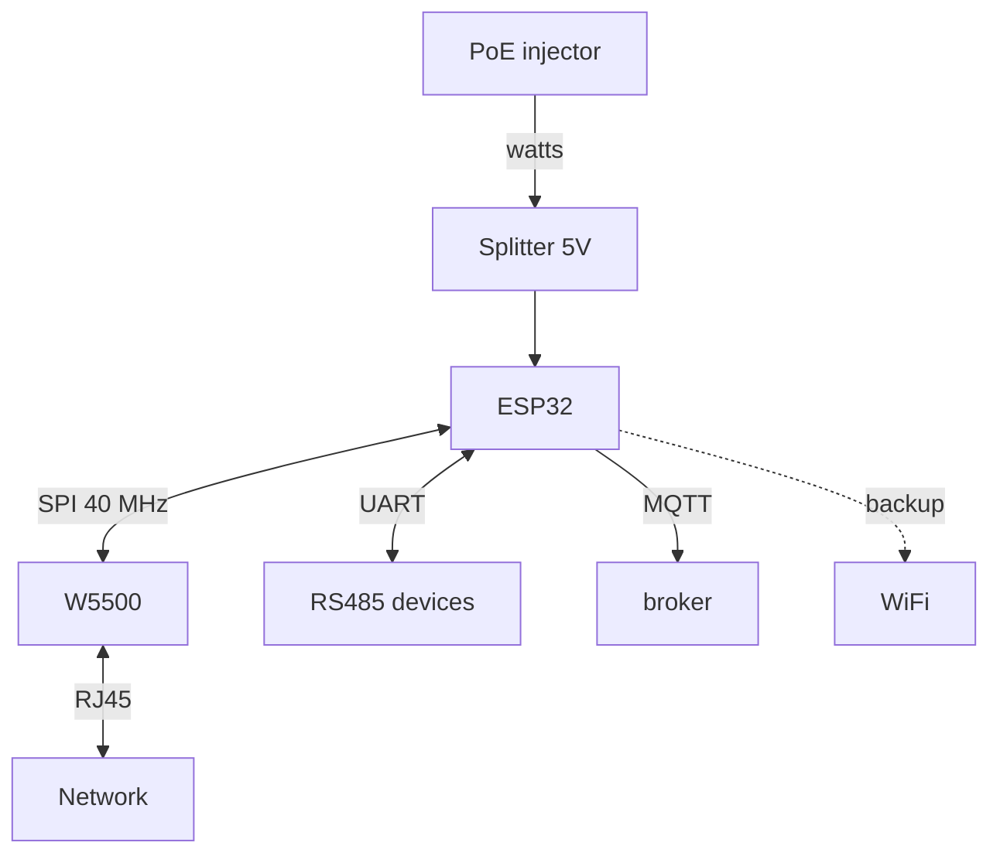

# ESP32 Ethernet deep - W5500, PoE and wired gateway

![[assets/img/esp32-ethernet-poe-deep-scheme.png|600]]
*Fig. Wired node: W5500 over SPI gives TCP/IP, PoE splitter - watts, WiFi stays as backup.*

> [!tip] What this note is about
> When radio is not an option: workshop, basement, server room. Hardware TCP/IP in the W5500 offloads the die, PoE removes the PSU. Base: [[EN/04-Interfaces/02-SPI.en|SPI bus]], [[EN/12-Comm-Modules/07-SIM7600-W5500-MCP2515.en|SIM/W5500 modules]].

## 1. Goal

Build a node that does not need the air:

- W5500 over SPI: sockets, speeds, limits;
- PoE: splitter vs PoE-HAT for ESP32;
- Ethernet+WiFi redundancy with auto-switching;
- RS485→Ethernet→MQTT gateway.

| Option | Speed | When |
| --- | --- | --- |
| W5500 module | 10/100, SPI 80 MHz | universal |
| Built-in MAC+PHY (rare boards) | 10/100 | if present on the board |
| PoE splitter 5V | + watts over cable | ceiling/cabinet |
| WiFi backup | - | channel reserve |

## 2. Architecture



W5500 holds 8 sockets in hardware: TCP/IP does not eat CPU. SPI at 40 MHz - the stability limit on long wires.

## 3. W5500 module pinout

| ESP32 pin | W5500 pin | Note |
| --- | --- | --- |
| GPIO18 | SCK | clock up to 80 MHz |
| GPIO23 | MOSI | data into the module |
| GPIO19 | MISO | data from the module |
| GPIO5 | CS | chip select |
| GPIO4 | INT | socket interrupts |
| GPIO2 | RST | hardware reset |
| 3V3/GND | VCC/GND | 200 mA margin |

SPI ribbon length up to 10 cm at 40 MHz. Longer - drop to 20 MHz or buffers.

## 4. PoE practice

- 5V 2A splitter: standard 802.3af input, USB-C/pin-header output;
- galvanic isolation inside - network ground does not go into the board;
- budget: board + sensors + 30% margin;
- surge protection on outdoor spans;
- PoE tester shows the device class before power-on.

## 5. Working code (C, Arduino)

```cpp
#include <SPI.h>
#include <Ethernet.h>

byte mac[] = {0xDE, 0xAD, 0xBE, 0xEF, 0xFE, 0x01};
EthernetClient client;

void setup() {
  Serial.begin(115200);
  SPI.begin(18, 19, 23, 5);
  Ethernet.init(5);
  if (Ethernet.begin(mac) == 0) {
    Ethernet.begin(mac, IPAddress(192, 168, 1, 177));
  }
  Serial.println(Ethernet.localIP());
}

void loop() {
  if (!client.connected()) {
    client.stop();
    client.connect("broker.local", 1883);
  }
  static unsigned long t0 = 0;
  if (millis() - t0 > 5000) {
    t0 = millis();
    client.println("PUB sensors/temp 23.5");
  }
  Ethernet.maintain();
}
```

`Ethernet.maintain()` - DHCP lease renewal. Static is more reliable for 24/7: fewer points of failure.

## 6. Working code (MicroPython)

```python
# MicroPython + W5500 (драйвер wiznet5k)
import network
import time
from machine import Pin, SPI

spi = SPI(1, baudrate=40000000, sck=Pin(18), mosi=Pin(23), miso=Pin(19))
nic = network.WIZNET5K(spi, Pin(5), Pin(4))
nic.active(True)
nic.ifconfig(('192.168.1.177', '255.255.255.0', '192.168.1.1', '8.8.8.8'))
print(nic.ifconfig())

import usocket
while True:
    try:
        s = usocket.socket()
        s.connect(('broker.local', 1883))
        s.send(b'PUB sensors/temp 23.5\n')
        s.close()
    except OSError as e:
        print('net error', e)
    time.sleep(5)
```

WIZNET5K driver is in firmware with network support. Missing - build your own with the `wiznet5k` module.

## 7. Channel redundancy

- primary Ethernet, WiFi - `reconnect` on link loss;
- check: ping the gateway every 30 s;
- two MQTT brokers (local + cloud) - the client iterates;
- static IPs for both interfaces - without DHCP dependency;
- switching log - for instability analysis.

## 8. typical errors

| Symptom | Cause | Fix |
| --- | --- | --- |
| DHCP 0.0.0.0 | no link/cable | verify Link/Act LEDs, another cable |
| Tears at 40 MHz SPI | long ribbon | 20 MHz or shorter than 10 cm |
| Works a minute and hangs | no `maintain()` | call in loop or static |
| PoE does not power | passive injector | only active 802.3af/at |
| Sockets exhausted | connections not closed | `stop()` + timeouts |
| Slow after WiFi | both stacks active | Ethernet priority, WiFi to sleep |

## 9. Ethernet quick cheat sheet

- SPI 40 MHz, ribbon up to 10 cm;
- static instead of DHCP for 24/7;
- PoE - only the active standard;
- close sockets with a timeout;
- WiFi - backup, not the base.

## 10. Adjacent notes

- [[EN/12-Comm-Modules/07-SIM7600-W5500-MCP2515.en|SIM/W5500 modules]] - module overview.
- [[EN/04-Interfaces/02-SPI.en|SPI bus]] - speeds and CS.
- [[EN/15-Protocols/01-MQTT.en|MQTT protocol]] - telemetry.
- [[EN/02-Power-Supply/02-LDO-DC-DC.en|power supply]] - stable 3.3V.
- [[Home.en|Home map]] - full navigation.

## Official sources

- [W5500 (WIZnet Docs)](https://docs.wiznet.io/Product/Chip/Ethernet/W5500) - registers, sockets, SPI.
- [Ethernet examples (Espressif, GitHub)](https://github.com/espressif/esp-idf/tree/master/examples/ethernet) - drivers and events.
- [MQTT Specification (OASIS)](https://mqtt.org/mqtt-specification/) - protocol over TCP.
