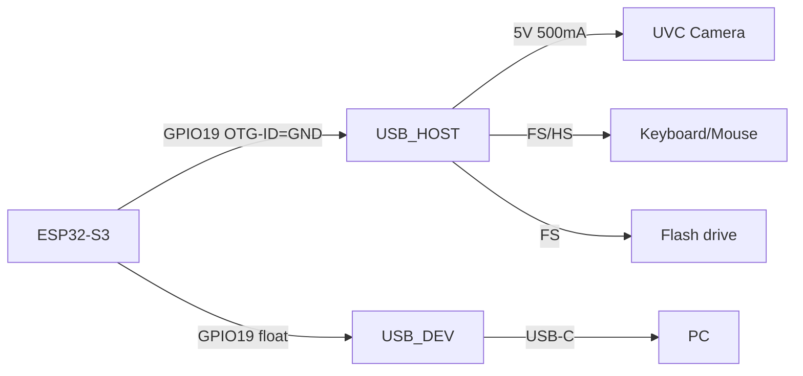

# ESP32 USB-OTG and UVC host - deep practice

![[assets/img/esp32-usb-host-deep-scheme.png|600]]
*Fig. ESP32 as USB host: OTG-ID pin defines the role, UVC cameras via the UVC stack, HID keyboards via the HID class.*

> [!tip] Purpose of the note
> Break down which ESP32 can be a USB host, at what speed (FS/HS), with which classes (UVC/UAC/HID/MSC/CDC) and why not all chips are equal.

## 1. Which chip can do what

| Chip | USB | Speed | Device | Host | Note |
| --- | --- | --- | --- | --- | --- |
| ESP32 | USB-OTG FS | Full-Speed (12 Mbps) | Yes | Yes | Interrupts + polling |
| ESP32-S2 | USB-OTG FS | Full-Speed | Yes | Yes | UVC removed with SDK 5.2 |
| ESP32-S3 | USB-OTG HS + FS | High-Speed (480 Mbps) | Yes | Yes | UVC/VCP/MSC/HID |
| ESP32-C3 | USB-OTG FS | Full-Speed | Yes | Yes | UVC stack impossible |
| ESP32-C6 | USB-OTG FS | Full-Speed | Yes | No (device) | Host limited |
| ESP32-P4 | USB-OTG HS + FS | High-Speed | Yes | Yes | Native USB host, Ethernet |

- **Full-Speed (12 Mbps)** - enough for HID, CDC, MSC (flash drives); for UVC cameras - a minimum, but works (720p @ 30 FPS via compression).
- **High-Speed (480 Mbps)** - for 1080p UVC, audio interfaces, fast MSC.



## 2. Role via OTG-ID

- `GPIO19` (on ESP32-S3) - `OTG_ID`; if tied to `GND` → Host; if `VCC/floating` → Device;
- `GPIO20` / `GPIO21` - `USB_D-` / `USB_D+` (HS via internal PHY);
- for Host mode: the USB power pin (`5V`) must give `500 mA` (external PSU or hub); the board does not power from the `3.3V` regulator.

## 3. UVC host practice (ESP32-S3 / P4)

```c
#include "esp_camera.h"
#include <usb/usb_host.h>

void app_main(void) {
    usb_host_config_t config = { .skip_phy_setup = false, .intr_flags = ESP_INTR_FLAG_LOWMED };
    ESP_ERROR_CHECK(usb_host_install(&config));
    // UVC-стек підключається через usb_host_client_handle_t
    // камера розпізнається по PID/VID
    ESP_LOGI("UVC", "Host ready: %d devices found", usb_host_device_addr_list(0));
}
```

- **Limits**: a UVC stream requires `USB-Host` + `USB-Stream` (stack with SDK, not Base); on S2 removed in 5.2 - check the SDK version.
- **Memory**: each UVC camera stream takes ~200-400 KB of buffer (720p @ MJPEG); on 512 KB SRAM - only 1 camera without anything else.
- **Power supply**: 5V 500 mA per port; if the camera has backlight - add an external PSU.

## 4. HID host (keyboard/mouse)

```python
from machine import USB
from usb_hid import HIDServer
# MicroPython / CircuitPython для HID-Host обмежено;
# C SDK через usb_host_client для HID-report
```

- HID host works on FS (ESP32, S2, S3, C3); does not require HS.
- Connection via the `USB-HID` class; report reading via callback.

## 5. MSC / CDC-Host

- MSC - reading flash drives via `FATFS` + `USB-Host` (ESP32-S3/P4);
- CDC - serial port over USB cable (PC ↔ ESP32) - this is Device, not Host.

## 6. typical errors

| Symptom | Cause | Fix |
| --- | --- | --- |
| `No device found` on Host | OTG-ID not connected / pin wrong | Check `GPIO19` to `GND`; check `USB_D+/D-` |
| UVC does not recognize the camera | SDK version or not a UVC class | Update to 5.2+; check PID/VID (log via `usb_host_printf`) |
| Reboot on USB | Insufficient PSU (`5V < 4.8V`) | Separate `5V 2A+` PSU; do not power from the board `VIN` |
| MSC does not see the flash drive | NTFS / exFAT format / larger partition | Format FAT32; size < 32 GB |
| `Task watchdog` after USB | Buffer overflow on the UVC stream | Lower resolution (480p) / lower FPS |

## 2.1 Frequencies and protocols

- Full-Speed USB 2.0 = 12 Mbps; enough for HID (keyboard 8 bytes/request, 125 Hz) and MSC (flash drive up to 32 GB FAT32).
- High-Speed USB 2.0 = 480 Mbps; required for UVC 720p MJPEG (~6 Mbps stream) and 48 kHz stereo audio.
- ESP32-S3 has a built-in HS PHY; ESP32 (Classic) - FS only.
- Device mode (CDC/MSC) works on all; Host - needs a 5V source > 500 mA.

## 2.2 USB host power supply

- A USB port on an ESP32 board does not output 5V - an external hub/PSU is mandatory.
- for a UVC camera with backlight: count 5V x 0.5 A (camera) + 0.2 A (PWM regulator) = 3.5 W + margin = 5A PSU.
- for HID (mouse) - 500 mA is enough; HID does not require HS.
- for MSC - flash drive up to 32 GB FAT32; NTFS/exFAT not supported without an extra stack.

## 2.3 UVC stream code (ESP-IDF 5.2+)

```cpp
#include "esp_camera.h"
#include <usb/usb_host.h>
void app_main() {
    usb_host_config_t cfg = { .skip_phy_setup = false, .intr_flags = ESP_INTR_FLAG_LOWMED };
    ESP_ERROR_CHECK(usb_host_install(&cfg));
    // UVC-class розпізнається автоматично за PID/VID
    ESP_LOGI("UVC", "Host active; FS/HS detected");
}
```

> [!warning] In SDK 5.2 the UVC stack was removed from the base bundle - check `component.mk` for the presence of `usb_stream`.

## See also

- [[EN/12-Comm-Modules/32-USB-UVC-Host-Deep.en|USB-UVC host deep]] - deeper UVC stream diagram;
- [[EN/04-Interfaces/06-USB-OTG-JTAG.en| USB-OTG-JTAG]] - OTG + JTAG on ESP32;
- [[EN/01-Hardware/09-ESP32-C2-P4.en| C2/P4]] - P4 with HS + Ethernet.

## Official sources

- [ESP-IDF USB host (Espressif)](https://docs.espressif.com/projects/esp-idf/en/latest/esp32/api-reference/usb/usb_host.html) - host stack, classes.
- [USB-OTG for ESP32-S3 (Espressif)](https://docs.espressif.com/projects/esp-idf/en/latest/esp32s3/api-reference/usb/otg.html) - HS + FS, OTG-ID.
- [UVC specs (USB-IF)](https://www.usb.org/document-library/video-class-v11-specification) - UVC class.
- [ESP32-S3 Datasheet (Espressif)](https://www.espressif.com/sites/default/files/esp32-s3_datasheet_en.pdf) - USB-OTG, DMA, UART.

## 7. USB host power supply

- Total current calculation: 500 mA (camera) + 100 mA (PWM cooler) + 50 mA (controller) = 650 mA minimum;
- PSU with PD protocol (5 V / 5 A = 27 W) gives margin for peaks at USB start;
- if the PSU gives only 3 A - limit yourself to one camera + HID, without MSC;
- diagnostics: `usb_host_printf(USB_HOST_LOG_LEVEL_DEBUG)` shows device enumeration.

> [!warning] USB host without an external PSU at 2 A - guaranteed 5V sag and ESP32 reset under load.

## 10. Conclusion

- USB host on ESP32-S3/P4: FS/HS, UVC/HID/MSC; OTG-ID controls the role; 5V 500 mA minimum; SDK 5.2+ check for UVC presence.
- BOOTSEL and firmware do not depend on the USB role: UF2 flashes in both modes.
- First host test: HID mouse (cheap, FS, visible in logs right away).
- UVC camera: start with 480p MJPEG, then raise the resolution.
