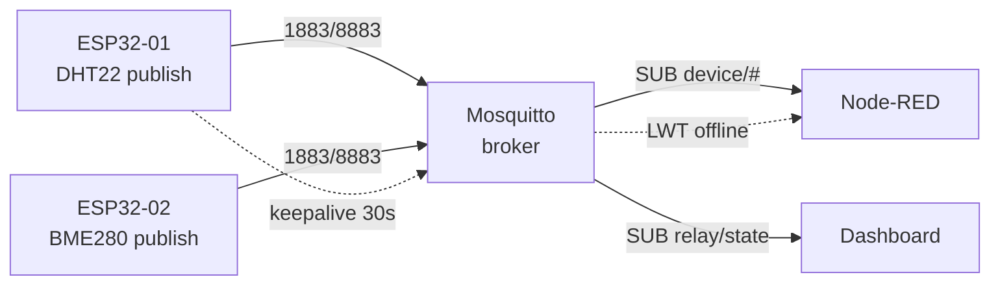

# MQTT on ESP32 - esp-mqtt, PubSubClient, umqtt

> [!warning] MQTT without TLS on open WiFi - passwords and telemetry fly as plain text!
> In a local network `mqtt://:1883` with a password is enough, in production - only `mqtts://:8883` with a CA certificate. See section 7.

Network overview: [[05-Radio/01-WiFi-STA-AP.en | WiFi STA and AP]], radio power [[02-Power-Supply/01-Power-Rails.en | Power rails]], sleep [[07-Timers/03-Sleep-ULP.en | Sleep and ULP]], OTA [[08-Memory/03-OTA.en | OTA]], start [[Home.en | Home]].

## Purpose

MQTT - lightweight publish/subscribe protocol for IoT: node does not hold direct connections with dozens of clients, but speaks with one broker. Broker distributes messages to subscribers by topics.

When to use MQTT:

- sensor telemetry every second/minute (temperature, humidity, current);
- commands to a node (`relay/set ON`) with state confirmation (`relay/state`);
- tens or hundreds of nodes on one Mosquitto broker on Raspberry Pi or VPS;
- unstable link: QoS 1 + LWT report that a node has dropped.

When NOT to use:

- file or OTA firmware transfer - use HTTP(S) for that, see [[EN/15-Protocols/03-HTTP-Client.en|HTTP and WebSocket]];
- local discovery without a server - use mDNS for that, see [[15-Protocols/03-mDNS-NTP-TLS.en | mDNS, NTP and TLS]];
- one-time entry of WiFi credentials - use provisioning for that, see [[15-Protocols/04-Provisioning.en | Provisioning]];
- full cloud pipeline with charts - see [[15-Protocols/05-Cloud-Pipeline.en | Cloud pipeline]].

## Parameters

| Parameter | Value for ESP32 | Note |
| --- | --- | --- |
| Libraries | esp-mqtt (IDF), PubSubClient (Arduino), umqtt.simple/robust (MP) | APIs differ, logic is the same |
| Broker | Mosquitto 2.x | ports 1883 (plain) / 8883 (TLS) |
| Protocol version | MQTT 3.1.1 (everywhere), MQTT 5 partly in esp-mqtt | PubSubClient 3.1.1 only |
| QoS | 0 / 1 / 2 (see the table below) | PubSubClient publishes only QoS 0 |
| Keepalive | 15-60 s | pings the broker, catches drops |
| LWT | topic `device/<id>/status` = `offline` | retained, fires on drop |
| Retain | for `state` and `config`, not for the telemetry stream | else a retain storm follows reconnect |
| Arduino buffer | 256 bytes by default | `setBufferSize()` for JSON |
| TLS memory | about 40 KB heap for an mbedTLS session | mind it on S2/C3 without PSRAM |
| Power supply | WiFi TX peak 500 mA | see [[02-Power-Supply/01-Power-Rails.en | Power rails]] |

![[assets/img/mqtt-broker-lwt-scheme.png | 600]]
*Fig. MQTT topology: nodes publish telemetry, broker fans out to subscribers, LWT reports dropouts.*

### ASCII diagram

```text
ESP32-вузол #1 (DHT22)          Mosquitto-broker (RPi 192.168.1.10)
─────────────────────          ──────────────────────────────────
 PUBLISH device/esp32-01/sensors ──► 1883/8883 ──► розсилка підписникам
 SUBSCRIBE device/esp32-01/relay/set ◄── команда від Node-RED/додатка
 LWT device/esp32-01/status="offline" (retained, QoS 1)
         │                                │
         │ PINGREQ keepalive 30с          │ SUB device/# (Node-RED)
         │                                │ SUB device/+/relay/state (дашборд)
ESP32-вузол #2 (BME280) ──► PUBLISH ──► той самий broker
Grafana/Node-RED ◄── SUB ── broker ──► InfluxDB (див. 05-Cloud-Pipeline)

Реконект: WiFi down → чекати WL_CONNECTED → mqtt.reconnect() з backoff 1/2/4/8с
```

### Mermaid



## Mosquitto broker on Ubuntu

Installation and first launch:

```bash
sudo apt update && sudo apt install -y mosquitto mosquitto-clients
sudo systemctl enable --now mosquitto
mosquitto -v                      # перевірка версії
mosquitto_sub -h localhost -t 'device/#' -v   # слухач усіх топіків
```

With Mosquitto 2.0 anonymous access from the network is denied by default. Minimal configuration `/etc/mosquitto/conf.d/esp32.conf`:

```conf
listener 1883
allow_anonymous false
password_file /etc/mosquitto/passwd
```

Passwords and ACL:

```bash
sudo mosquitto_passwd -c /etc/mosquitto/passwd esp      # створити користувача esp
sudo mosquitto_passwd /etc/mosquitto/passwd esp32-01    # додати вузол
sudo systemctl restart mosquitto
```

Example ACL file (`acl_file /etc/mosquitto/acl`):

```conf
user esp32-01
topic readwrite device/esp32-01/#
topic read device/+/config
user nodered
topic readwrite device/#
```

Check from the console:

```bash
mosquitto_pub -h localhost -u esp -P '***' -t 'device/esp32-01/sensors' -m '{"t":24.5}'
```

## QoS 0/1/2, retain, LWT, keepalive

| Level | Name | Guarantee | Cost | Use |
| --- | --- | --- | --- | --- |
| QoS 0 | At most once | may be lost | 1 packet | raw telemetry every 5 s |
| QoS 1 | At least once | arrives, duplicates possible | 2+ packets, idempotent handling | relay commands, statuses |
| QoS 2 | Exactly once | exactly once | 4 packets, slow | billing, critical counters |

Practical rules:

- Streaming telemetry - QoS 0, no retain. Losing one packet changes nothing.
- `state`, `status`, and `config` - QoS 1 + retain: a new subscriber sees the last state at once.
- Always pair LWT with retained `online` at start: the node publishes `online` (retained), while LWT is set to `offline` (retained). Live nodes are visible at once.
- Keepalive 30 s for mains power, 60 s for batteries. Under 15 s means extra traffic and radio wake-ups.
- PubSubClient: publish is QoS 0 only, subscribe is QoS 0/1 - design the architecture around this.

## Topic convention `device/<id>/...`

```text
device/esp32-01/sensors        → телеметрія JSON (QoS 0, без retain)
device/esp32-01/relay/state    → стан реле (QoS 1, retain)
device/esp32-01/relay/set      → команда реле (QoS 1, без retain)
device/esp32-01/status         → online/offline LWT (QoS 1, retain)
device/esp32-01/config         → конфіг з хмари (QoS 1, retain)
device/esp32-01/fw             → тригер OTA (QoS 1, без retain)
```

Prohibitions: spaces and Cyrillic in topics, `#` and `+` only in subscriptions, depth no more than 4-5 levels. Node ID - MAC or flash serial with NVS, see [[08-Memory/01-Partitions-NVS.en | Partitions and NVS]].

## TLS: mqtts on port 8883

on the broker add a listener:

```conf
listener 8883
cafile /etc/mosquitto/ca/ca.crt
certfile /etc/mosquitto/ca/server.crt
keyfile /etc/mosquitto/ca/server.key
require_certificate false
```

On ESP32 place the CA certificate in firmware (IDF: cert bundle component or PEM in flash; Arduino: `WiFiClientSecure::setCACert()`; MP: `ssl_params={'cert':...}`). Time must be synced via NTP, else the handshake fails - see [[15-Protocols/03-mDNS-NTP-TLS.en | mDNS, NTP and TLS]]. Memory: a TLS session eats about 40 KB of heap, on ESP32-C3 without PSRAM do not hold HTTPS and MQTT-TLS at once.

## ESP-IDF code (esp-mqtt, with reconnect)

```c
#include "mqtt_client.h"
static const char *TAG = "MQTT";
static esp_mqtt_client_handle_t s_client;
static bool s_connected = false;

static void mqtt_event(void *arg, esp_event_base_t base, int32_t id, void *data) {
    esp_mqtt_event_handle_t e = data;
    switch ((esp_mqtt_event_id_t)id) {
    case MQTT_EVENT_CONNECTED:
        s_connected = true;
        esp_mqtt_client_subscribe(s_client, "device/esp32-01/relay/set", 1);
        esp_mqtt_client_publish(s_client, "device/esp32-01/status",
                                "online", 0, 1, 1); // retained online
        break;
    case MQTT_EVENT_DISCONNECTED:
        s_connected = false; // esp-mqtt перепідключиться сам (auto_reconnect)
        break;
    case MQTT_EVENT_DATA:
        // e->topic / e->topic_len, e->data / e->data_len
        break;
    default: break;
    }
}

void mqtt_start(void) {
    esp_mqtt_client_config_t cfg = {
        .broker.address.uri = "mqtt://192.168.1.10:1883",
        .credentials.client_id = "esp32-01",
        .credentials.username = "esp32-01",
        .credentials.authentication.password = "SECRET",
        .session.keepalive = 30,
        .session.disable_auto_reconnect = false,
        .session.last_will.topic = "device/esp32-01/status",
        .session.last_will.msg = "offline",
        .session.last_will.qos = 1,
        .session.last_will.retain = 1,
    };
    s_client = esp_mqtt_client_init(&cfg);
    esp_mqtt_client_register_event(s_client, ESP_EVENT_ANY_ID, mqtt_event, NULL);
    esp_mqtt_client_start(s_client);
}

// Публікація телеметрії (викликати раз на 5 с):
// esp_mqtt_client_publish(s_client, "device/esp32-01/sensors", json, 0, 0, 0);
```

## Arduino code (PubSubClient, with reconnect)

```cpp
#include <WiFi.h>
#include <PubSubClient.h>

WiFiClient net;
PubSubClient mqtt(net);
const char* ID = "esp32-01";

void onMsg(char* topic, byte* p, unsigned int n) {
  String s; for (unsigned i = 0; i < n; i++) s += (char)p[i];
  if (String(topic) == "device/esp32-01/relay/set") {
    digitalWrite(27, s == "ON" ? HIGH : LOW);
    mqtt.publish("device/esp32-01/relay/state", s.c_str(), true); // retained
  }
}

bool mqttReconnect() {
  static uint8_t attempt = 0;
  if (mqtt.connected() || WiFi.status() != WL_CONNECTED) return mqtt.connected();
  if (mqtt.connect(ID, "esp32-01", "SECRET",
                   "device/esp32-01/status", 1, 1, "offline")) { // LWT
    mqtt.publish("device/esp32-01/status", "online", true);
    mqtt.subscribe("device/esp32-01/relay/set", 1);
    attempt = 0;
    return true;
  }
  delay(min(8000, (1 << min(attempt++, 3)) * 1000)); // backoff 1/2/4/8 с
  return false;
}

void setup() {
  WiFi.begin("SSID", "PASS");
  while (WiFi.status() != WL_CONNECTED) delay(300);
  mqtt.setServer("192.168.1.10", 1883);
  mqtt.setCallback(onMsg);
  mqtt.setBufferSize(1024);   // дефолт 256 замалий для JSON!
  mqtt.setKeepAlive(30);
}

void loop() {
  mqttReconnect();
  mqtt.loop(); // викликати ЧАСТО, інакше keepalive зірветься
}
```

## MicroPython code (umqtt.robust, with reconnect)

```python
import network, time, json
from umqtt.robust import MQTTClient

ID = "esp32-01"
sta = network.WLAN(network.STA_IF)
sta.active(True); sta.connect("SSID", "PASS")
while not sta.isconnected(): time.sleep(0.3)

def on_msg(topic, msg):
    if topic == b"device/esp32-01/relay/set":
        from machine import Pin
        Pin(27, Pin.OUT).value(1 if msg == b"ON" else 0)
        c.publish(b"device/esp32-01/relay/state", msg, retain=True, qos=1)

c = MQTTClient(ID, "192.168.1.10", user="esp32-01", password="SECRET",
               keepalive=30)
c.set_callback(on_msg)
c.set_last_will(b"device/esp32-01/status", b"offline", retain=True, qos=1)
c.connect()  # robust сам перепідключиться при обриві publish/wait
c.publish(b"device/esp32-01/status", b"online", retain=True, qos=1)
c.subscribe(b"device/esp32-01/relay/set", qos=1)

while True:
    c.publish(b"device/esp32-01/sensors", json.dumps({"t": 24.5}), qos=0)
    c.check_msg()   # disassemble вхідні
    time.sleep(5)
```

> [!tip] umqtt.simple supports only QoS 0/1 (no QoS 2 by design - RAM saving). For TLS: `MQTTClient(..., ssl=True, ssl_params={})`.

## Common issues

| Symptom | Cause | Fix |
| --- | --- | --- |
| `rc=-2` (conn lost) | WiFi fell before MQTT | reconnect only after `WL_CONNECTED`, backoff |
| `rc=-4` (connection refused) | wrong login or password, or `allow_anonymous false` without a user | `mosquitto_passwd`, check ACL |
| `rc=5` (not authorized) | topic denied to the user by the ACL file | `topic readwrite device/<id>/#` for the node |
| Drops every 15 s | `mqtt.loop()` / `check_msg()` called rarely | keepalive 30 s + loop call each iteration |
| JSON gets cut | PubSubClient 256-byte buffer | `setBufferSize(1024)` before `connect()` |
| Silence after deep-sleep | session died, LWT fired as offline | full `connect()` + repeated `subscribe()` after sleep |
| Retain storm after reconnect | retain on the telemetry stream | retain only on `state/status/config` |
| TLS `handshake failed` | time stuck at 1970 (no NTP) or wrong CA | SNTP first, see [[15-Protocols/03-mDNS-NTP-TLS.en | mDNS, NTP and TLS]] |
| Broker listens only on localhost | Mosquitto 2.x default | explicit `listener 1883` in conf.d |

## Official sources

- [ESP-MQTT - API reference (ESP-IDF)](https://docs.espressif.com/projects/esp-idf/en/stable/esp32/api-reference/protocols/mqtt.html) - esp-mqtt, events, LWT, TLS.
- [Eclipse Mosquitto - docs](https://mosquitto.org/documentation/) - broker, `mosquitto_pub/sub` tools.
- [mosquitto.conf - man page](https://mosquitto.org/man/mosquitto-conf-5.html) - listener, ACL, passwords, TLS listeners.
- [PubSubClient (knolleary) - GitHub](https://github.com/knolleary/pubsubclient) - 256-byte limit, QoS 0 on publish.
- [umqtt.simple - micropython-lib](https://github.com/micropython/micropython-lib/tree/master/micropython/umqtt.simple) - QoS 0/1, `set_last_will`, robust reconnect.

## See also

- [[Home.en|Home]]
- [[05-Radio/01-WiFi-STA-AP.en|WiFi STA and AP]] - MQTT cannot start without WiFi
- [[08-Memory/03-OTA.en|OTA]] - update trigger through the `fw` topic
- [[08-Memory/01-Partitions-NVS.en|NVS]] - storage for node ID and MQTT password
- [[EN/99-Additions/02-Troubleshooting-FAQ.en|FAQ]] - drop diagnostics
- [[EN/15-Protocols/03-HTTP-Client.en|HTTP and WebSocket]] - REST and dashboards
- [[15-Protocols/03-mDNS-NTP-TLS.en|mDNS, NTP and TLS]] - time for TLS, local names
- [[15-Protocols/04-Provisioning.en|Provisioning]] - WiFi entry without reflashing
- [[15-Protocols/05-Cloud-Pipeline.en|Cloud pipeline]] - MQTT to Node-RED to InfluxDB to Grafana
