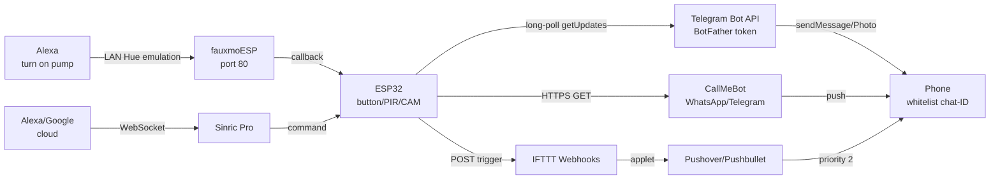

# Notifications and Voice Control ESP32 - Telegram, CallMeBot, Alexa

> [!warning] Bot token in code = password: whoever reads it writes in your name!
> Keep token in NVS/`secrets.h` (not in git!), enable whitelist chat-ID - otherwise anyone in Telegram will click your relay. Do not send camera photos to public groups.!

Network overview: [[05-Radio/01-WiFi-STA-AP.en | WiFi STA and AP]], event broker [[15-Protocols/01-MQTT.en | MQTT]], ready firmwares [[EN/15-Protocols/06-Firmwares.en|Firmwares]], start [[Home.en | Home]].

## Purpose

ESP32 can not only blink, but also shout: "leak!", "door open!", "watering finished!". Two directions: **notifications** (device to human: Telegram, WhatsApp, or push) and **voice** (human to device: Alexa, turn on).

When to take what:

- Button or sensor to a message on your phone: **Telegram bot** (own, free, with photos) or **CallMeBot** (WhatsApp or Telegram without own bot, 1 GET request).
- Critical alarm with read confirmation: **Pushover** (emergency priority with retry) instead of or with Telegram.
- Voice on LAN without cloud: **fauxmoESP** (Alexa, turn on, lamp emulation).
- Voice + app + remote over the internet: **Sinric Pro** (Alexa, Google Home, or SmartThings), in Tasmota - `Emulation`.
- Automations between services (if ESP then Google Sheet): **IFTTT Webhooks**.

When NOT to use:

- battery sensor with deep-sleep - long-poll Telegram holds WiFi and eats the battery in a day (see the sleep section);
- commercial product on someone else free gateway (CallMeBot or IFTTT free) - limits, queues, no SLA;
- private data (nanny video, alarms) through public bots without a whitelist - own server or webhook only.

## Parameters

| Parameter | Own Telegram bot | CallMeBot | IFTTT Webhooks + Pushover | fauxmoESP (Alexa LAN) | Sinric Pro |
| --- | --- | --- | --- | --- | --- |
| Registration | @BotFather to token | number in CallMeBot contacts, apikey | key at maker.ifttt.com + APP and USER keys | no registration | account + APP_KEY and SECRET |
| Protocol | HTTPS `api.telegram.org` | HTTPS GET in 1 request | HTTPS POST JSON | UDP discovery + HTTP (LAN) | WebSocket or MQTT TLS to the cloud |
| Command input | long-poll `getUpdates` | send only | through IFTTT applets | voice turn on, off, or set percent | voice + app |
| Photos and files | `sendPhoto` from the camera! | text (media is paid) | Pushover attachment 5 MB | none | camera (separate examples) |
| Cost | free | free personal / TextMeBot paid | IFTTT free limits, Pushover one-time payment | free | 3 devices free, then dollars per year |
| Delay | 1-3 s | 5-30 s (queue) | 2-15 s | under 1 s (LAN) | 1-3 s |
| Offline work | internet needed | internet needed | internet needed | works without internet! | internet needed |
| Security | token + whitelist chat-ID | apikey in URL (never expose!) | keys in NVS | LAN only, no auth | signed commands + local control |

![[assets/img/notify-voice-telegram-scheme.png | 600]]
*Fig. Event from ESP32 splits three ways: Telegram bot (long-poll + photo), CallMeBot, IFTTT, or Pushover (HTTPS hooks), voice back through Alexa (fauxmoESP locally or Sinric Pro cloud).*

### ASCII diagram

```text
ESP32 (кнопка GPIO0 / PIR / ESP32-CAM)
   │
   ├─ 1) Telegram-бот (свій, long-poll) ──HTTPS──► api.telegram.org
   │      getUpdates offset=N ──► нові msg ──► whitelist chat-ID?
   │      sendMessage / sendPhoto ──► твій чат (токен BotFather)
   │
   ├─ 2) CallMeBot (без свого бота) ──HTTPS GET──► api.callmebot.com
   │      /whatsapp.php?phone=..&text=..&apikey=..
   │      /telegram.php /telegram/call (дзвінок голосом!)
   │
   ├─ 3) IFTTT Webhooks ──POST──► maker.ifttt.com/trigger/{event}/with/key/KEY
   │      ──► аплет: Pushover / Pushbullet / Google Sheets / Mail
   │      Pushover: api.pushover.net/1/messages.json (priority 2 = будитиме!)
   │
   └─ 4) Голос назад:
        Alexa ──LAN──► fauxmoESP (порт 80, "Alexa, turn on pump")
        Alexa/Google ──хмара──► Sinric Pro ──WebSocket──► ESP32

 Deep-sleep несумісний з long-poll! (див. розділ Сон): будильник → швидкий POST → спати.
```

### Mermaid



## Telegram bot: BotFather, long-poll, photo, whitelist

Own bot is the most flexible path: free, with two-way link (accepts commands and sends photos from the camera), works with the UniversalTelegramBot library.

Step 1 - BotFather (in the Telegram app):

1. Find `@BotFather` to `/newbot` to a name (`My ESP32`) + username (`myesp32bot`).
2. Save the token `123456:ABC-DEF...` - it is a PASSWORD, never commit it in code!
3. `/setprivacy` to Disable (so the bot sees group commands), `/setcommands` for the list (`led_on`, `status`).
4. Write anything to the bot from a personal account, learn your chat-ID: `https://api.telegram.org/bot<TOKEN>/getUpdates` to the `message.chat.id` field.

Step 2 - long-poll on ESP32 (the [UniversalTelegramBot](https://github.com/witnessmenow/Universal-Arduino-Telegram-Bot) library):

```cpp
#include <WiFi.h>
#include <WiFiClientSecure.h>
#include <UniversalTelegramBot.h>

#define BOT_TOKEN "123456:ABC-DEF..."   // ← у secrets.h / NVS, НЕ в git!
#define CHAT_ID "123456789"             // свій ID (whitelist!)
#define ALLOWED_CHAT_ID "123456789"

WiFiClientSecure secured;
UniversalTelegramBot bot(BOT_TOKEN, secured);
uint32_t lastCheck = 0;

void handleMsg(const telegramMessage &m) {
  if (String(m.chat_id) != ALLOWED_CHAT_ID) {
    bot.sendMessage(m.chat_id, "⛔ No access", "");  // чужим — відмова
    return;
  }
  if (m.text == "/led_on")  { digitalWrite(27, HIGH); bot.sendMessage(CHAT_ID, "LED ON", ""); }
  if (m.text == "/led_off") { digitalWrite(27, LOW);  bot.sendMessage(CHAT_ID, "LED OFF", ""); }
  if (m.text == "/status")  { bot.sendMessage(CHAT_ID, "T=24.5 IP=" + WiFi.localIP().toString(), ""); }
}

void setup() {
  Serial.begin(115200);
  pinMode(27, OUTPUT);
  WiFi.begin("SSID", "PASS");
  while (WiFi.status() != WL_CONNECTED) delay(300);
  secured.setCACert(TELEGRAM_CERTIFICATE_ROOT);  // з прикладів бібліотеки!
  bot.longPoll = 10;  // довгі запити — менше трафіку
}

void loop() {
  if (millis() - lastCheck > 2000) {
    lastCheck = millis();
    int n = bot.getUpdates(bot.last_message_received + 1);
    for (int i = 0; i < n; i++) handleMsg(bot.messages[i]);
  }
}
```

sendMessage with a photo (ESP32-CAM to Telegram):

```cpp
// Варіант A: фото за URL (камера вже віддає JPEG по HTTP):
bot.sendPhoto(CHAT_ID, "http://192.168.1.60/capture", "Рух біля дверей!");
// Варіант B: прямий POST multipart (див. приклад SendPhoto/PhotoFromSD у бібліотеці):
// bot.sendPhotoByBinary(CHAT_ID, "image/jpeg", size, bufferReader, ...);
// Важливо: бот пише ПЕРШІМ тільки тому, хто вже написав йому (обмеження Bot API)!
```

Chat-ID whitelist is mandatory:

```cpp
const char* ALLOWED[] = {"123456789", "987654321"};  // сім'я
bool allowed(const String& id) {
  for (auto a : ALLOWED) if (id == a) return true;
  return false;
}
// У handleMsg: if (!allowed(m.chat_id)) return;  // мовчки ігнорувати чужих
```

Bot API limits: about 30 messages/s per chat, 20 MB per photo through the bot API (50 MB download), 4096 chars of text. Flooding means a minutes-long ban.

MicroPython option (no library, plain HTTPS):

```python
import urequests, json
TOKEN = "123456:ABC-DEF..."  # з файлу secrets, не з коду!
CHAT = "123456789"
def tg_send(text):
    url = "https://api.telegram.org/bot%s/sendMessage" % TOKEN
    urequests.post(url, json={"chat_id": CHAT, "text": text}).close()
tg_send("ESP32 прокинувся, T=24.5")
```

## CallMeBot - WhatsApp and Telegram without own bot

When an own bot feels like too much work, but 1 GET to a WhatsApp message is needed: [CallMeBot API](https://api.callmebot.com/) - free gateway (personal use). Registration: add the CallMeBot number to contacts, write it I allow callmebot to send me messages, get an apikey.

WhatsApp with ESP32 (example from the [ESP8266/ESP32 blog](https://www.callmebot.com/blog/whatsapp-messages-from-esp8266-esp32/)):

```cpp
#include <WiFi.h>
#include <HTTPClient.h>

String phone = "380501234567";   // БЕЗ + !
String apikey = "123456";        // від CallMeBot
String text = "Door OPEN! T=24.5";

void callmebot_whatsapp(const String& msg) {
  HTTPClient http;
  String url = "https://api.callmebot.com/whatsapp.php?phone=" + phone
             + "&text=" + msg + "&apikey=" + apikey;
  url.replace(" ", "%20");
  http.begin(url);
  int code = http.GET();
  Serial.println(code);  // 200 = прийнято (не = доставлено!)
  http.end();
}
```

Telegram text and call through CallMeBot:

```bash
# Telegram-текст (після активації за інструкцією callmebot-бота):
curl "https://api.callmebot.com/text.php?user=@myuser&text=Alarm!&apikey=KEY"
# Voice дзвінок у Telegram (читає текст уголос!):
curl "https://api.callmebot.com/telegram/call.php?user=@myuser&text=Water+leak!&lang=en-US-Standard-A&apikey=KEY"
```

Limits: 5-30 s queues, messages-per-day limit, Latin text is more reliable than Cyrillic (URL-encode!), no photos or files on free. For business - paid TextMeBot. Apikey in the URL shows in proxy logs - use a separate account, not the main one!

## IFTTT Webhooks + Pushover and Pushbullet

IFTTT is glue between ESP32 and hundreds of services: one POST from the board to an applet that distributes anywhere.

Webhook trigger:

```cpp
#include <HTTPClient.h>
void ifttt(const char* event, const char* v1) {
  HTTPClient http;
  String url = String("https://maker.ifttt.com/trigger/") + event
             + "/with/key/cdxxxxxxxxxxxxxxxxxxxxxxxxxx";
  http.begin(url);
  http.addHeader("Content-Type", "application/json");
  http.POST(String("{\"value1\":\"") + v1 + "\"}");
  http.end();
}
// Виклик: ifttt("door_open", "kitchen 21:30");
```

Applet at ifttt.com: `If Webhooks (door_open) to Then Pushover, Gmail, Sheets, or Philips Hue`. Event name in Latin, no spaces.

Pushover ([API](https://pushover.net/api)) - push with priorities, works with ESP32 directly without IFTTT:

```cpp
// POST https://api.pushover.net/1/messages.json
// token=APP_TOKEN&user=USER_KEY&message=Leak!&priority=2&retry=60&expire=1800
// priority: -2 silent, 0 normal, 1 bypass quiet, 2 EMERGENCY (будить поки не підтвердиш!)
```

```bash
curl -s -F "token=APP_TOKEN" -F "user=USER_KEY" \
  -F "priority=2" -F "retry=60" -F "expire=1800" \
  -F "message=Water leak, kitchen!" https://api.pushover.net/1/messages.json
# Вкладення: -F "attachment=@/capture.jpg" (до 5 МБ!)
```

Pushbullet is simpler (1 token, channels), but without emergency repeats. For fire or flood use Pushover priority 2, for watering done use Telegram or IFTTT.

## Alexa through fauxmoESP + Sinric Pro, Google Home

fauxmoESP is local lamp emulation for Alexa, no internet needed. It works like this: ESP32 pretends to be Philips Hue (v3+, earlier Belkin WeMo), the Echo speaker finds it on LAN and sends `turn on`, `off`, or `set percent`.

> [!note] History note: before v3.0 fauxmoESP emulated Belkin WeMo, from v3.0 it is Philips Hue (gives dimming like set to 50 percent). Old guides still write WeMo - the point is the same: local discovery without cloud.

```cpp
#include <WiFi.h>
#include <fauxmoESP.h>  // https://github.com/vintlabs/fauxmoESP

fauxmoESP fauxmo;

void setup() {
  Serial.begin(115200);
  WiFi.begin("SSID", "PASS");
  while (WiFi.status() != WL_CONNECTED) delay(300);
  fauxmo.createServer(true);
  fauxmo.setPort(80);  // gen3-колонки вимагають порт 80!
  fauxmo.enable(true);
  fauxmo.addDevice("pump");    // "Alexa, turn on pump"
  fauxmo.addDevice("kitchen light");
  fauxmo.onSetState([](unsigned char id, const char* name, bool state, unsigned char value) {
    Serial.printf("%s → %s (%d)\n", name, state ? "ON" : "OFF", value);
    digitalWrite(27, state ? HIGH : LOW);  // value 0..255 = яскравість!
  });
}

void loop() {
  fauxmo.handle();  // викликати ЧАСТО, без delay()!
}
```

Terms: Echo and ESP32 on ONE subnet (no guest isolation!), port 80 free, LwIP Higher Bandwidth on the ESP8266 core. Alexa, discover devices to turn on pump or set kitchen light to fifty percent. With split 2.4 and 5 GHz bands on the router discovery often breaks - put both on 2.4 GHz.

Sinric Pro ([SinricPro ESP SDK](https://github.com/sinricpro/esp8266-esp32-sdk)) - cloud bridge to Alexa, Google, SmartThings, and Homebridge when control over the INTERNET + app + OTA is needed:

1. Registration to Add Device (Switch, Dimmer, or Thermostat) to APP_KEY + APP_SECRET + DEVICE_ID.
2. Firmware with the SDK (`SinricPro` lib): WebSocket TLS to the cloud, `onPowerState` callbacks.
3. Free: 3 devices; then about $3 per device per year. Local control also works (signed LAN commands when the internet is down).
4. In Tasmota it is built in: `Emulation 1` (WeMo) or `2` (Hue) - Alexa finds the outlet with no code at all.

Google Home directly (no middlemen) is beyond ESP32 - only through a cloud: Sinric Pro (Google Action), Home Assistant (emulated_hue or Google Assistant integration), or Tasmota Hue emulation + HA bridge. No standalone Google Home library for ESP32 exists - all guides lead through one of these bridges.

## Example: button to notification + camera photo

Scenario: door button (GPIO0) to ESP32-CAM snapshot to Telegram bot sending photo + text to Pushover priority 1 in parallel.

```cpp
#include <WiFi.h>
#include <WiFiClientSecure.h>
#include <UniversalTelegramBot.h>
#include "esp_camera.h"  // ESP32-CAM конфіг опущено

#define BOT_TOKEN "123456:ABC-DEF..."
#define CHAT_ID "123456789"
#define BTN 0

WiFiClientSecure secured;
UniversalTelegramBot bot(BOT_TOKEN, secured);
volatile bool pressed = false;

void IRAM_ATTR onBtn() { pressed = true; }  // тільки прапорець!

void sendAlert() {
  camera_fb_t* fb = esp_camera_fb_get();
  if (!fb) { bot.sendMessage(CHAT_ID, "🚪 Двері! (камера недоступна)", ""); return; }
  // Шлях 1: фото через Telegram (див. SendPhoto-приклади бібліотеки)
  // bot.sendPhotoByBinary(CHAT_ID, "image/jpeg", fb->len, ...);
  esp_camera_fb_return(fb);
  bot.sendMessage(CHAT_ID, "🚪 Двері відчинено 21:30", "");
  // Шлях 2: паралельно Pushover (HTTPClient POST) — якщо Telegram ліг
}

void setup() {
  WiFi.begin("SSID", "PASS");
  while (WiFi.status() != WL_CONNECTED) delay(300);
  secured.setCACert(TELEGRAM_CERTIFICATE_ROOT);
  pinMode(BTN, INPUT_PULLUP);
  attachInterrupt(BTN, onBtn, FALLING);
}

void loop() {
  bot.getUpdates(bot.last_message_received + 1);  // + обробка команд /led_on...
  if (pressed) {
    pressed = false;
    delay(50);  // антибрязкіт
    if (digitalRead(BTN) == LOW) sendAlert();
  }
}
```

Camera power: flash + WiFi TX peak above 600 mA, separate 5 V and 2 A regulator, else brownout at the photo moment.

## Sleep: long-poll + deep-sleep do not mix

Issue: `getUpdates` needs CONSTANT WiFi (tens of mA), while deep-sleep turns the radio fully off (10 uA). They never live together: either sleep or listen for commands.

Fix 1 - polling by alarm (sensor sleeps, wakes, SENDS, sleeps again):

```cpp
// Прокинувся за таймером / EXT0 (PIR) → WiFi → tg_send("T=...") → спати
esp_sleep_enable_timer_wakeup(10 * 60 * 1000000ULL);  // кожні 10 хв
// ... WiFi + sendMessage ...
esp_deep_sleep_start();  // команд НЕ чекаємо — тільки відправка!
```

Fix 2 - webhook server instead of long-poll (for always-on nodes):

- Own server (VPS or RPi) holds `setWebhook https://...`, takes Telegram commands and queues them in MQTT (`device/esp32-01/cmd`).
- ESP32 wakes, takes the queue over MQTT (QoS 1, retained command), runs it, reports, sleeps.
- Bonus: the server hides the bot token - only the MQTT login stays on the device.

Rule: on battery use SEND-only per wake (Telegram, CallMeBot, or Pushover POST); command input in sleep goes through a retained-MQTT queue, not long-poll.

## Common issues

| Symptom | Cause | Fix |
| --- | --- | --- |
| `410 Gone` or silent bot | token revoked through BotFather | generate a new `/token`, update NVS, never commit to git |
| Bot silent in a group | privacy mode cuts foreign messages | @BotFather `/setprivacy` to Disable, add the bot as admin |
| Anyone runs commands | no whitelist chat-ID | compare `m.chat_id` with ALLOWED, ignore or refuse strangers |
| `sendPhoto` fails on ESP32-CAM | too little heap for JPEG + TLS (about 40 KB) | QVGA instead of UXGA, PSRAM on, photo apart from long-poll |
| CallMeBot answers 200 but nothing arrives | activation unfinished or limit | repeat I allow, 24 h pause, Latin in the text |
| Cyrillic in CallMeBot shows ??? | URL not encoded | `url.encode()` or `%20` for spaces, Latin is better |
| IFTTT fires after minutes | IFTTT free queue | critical alerts go directly to Pushover or Telegram, not through an applet |
| Alexa, turn on answers device not found | different subnets or port not 80 | one 2.4 GHz LAN, `fauxmo.setPort(80)`, rediscover |
| fauxmoESP does not compile with WebServer | port 80 conflict | `fauxmoESP_External_Server` example or another port + gen1 speaker |
| Long-poll eats the battery in a day | WiFi+TLS always on air | deep-sleep + send per alarm, see the Sleep section |
| Pushover emergency never silences | no `retry` or `expire`, user never confirmed | `retry` at least 30, `expire` up to 10800, confirm in the app |

## Official sources

- [Telegram Bot API](https://core.telegram.org/bots/api) - `getUpdates`, `sendMessage`, `sendPhoto`, limits.
- [UniversalTelegramBot - GitHub](https://github.com/witnessmenow/Universal-Arduino-Telegram-Bot) - long-poll, keyboards, ESP32 and CAM examples.
- [CallMeBot API](https://api.callmebot.com/) - WhatsApp, Telegram, and Signal API, activation, apikey.
- [Pushover API](https://pushover.net/api) - priorities, retry and expire, 5 MB attachments.
- [fauxmoESP - GitHub](https://github.com/vintlabs/fauxmoESP) - Hue emulation, port 80, `onSetState`.

## See also

- [[Home.en|Home]]
- [[15-Protocols/01-MQTT.en|MQTT]] - command queue for sleepy nodes, LWT
- [[EN/15-Protocols/06-Firmwares.en|Firmwares]] - Tasmota emulation, out-of-the-box Blynk alerts
- [[05-Radio/01-WiFi-STA-AP.en|WiFi STA and AP]] - STA connect before any HTTPS
- [[EN/11-Vivid/09-LED-Strip-Power-SK6812-APA102.en|LED strip power]] - ESP32-CAM power at the photo moment
- [[EN/99-Additions/02-Troubleshooting-FAQ.en|FAQ]] - TLS handshake, NTP time for HTTPS, brownout
