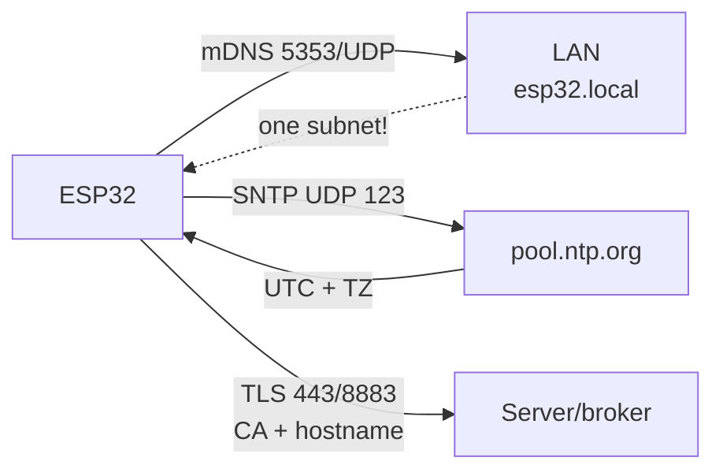

# mDNS, NTP and TLS on ESP32

> [!warning] Without NTP time sticks at 1970 - and ANY TLS fails (HTTPS, MQTTS)!
> Start order: WiFi to SNTP sync to TLS connections only after that.

Network overview: [[EN/05-Radio/01-WiFi-STA-AP.en|WiFi STA and AP]], MQTT [[EN/15-Protocols/01-MQTT.en|MQTT]], HTTP [[EN/15-Protocols/03-HTTP-Client.en|HTTP and WebSocket]], start [[Home.en|Home]].

## Purpose

Three base services without which applied comms limp:

- **mDNS** - reaching the board by the name `esp32.local` instead of IP. Handy for a local dashboard and firmware upload.
- **NTP/SNTP** - precise time: telemetry stamps, TLS certificate checks, deep-sleep schedule.
- **TLS** - server encryption and auth (HTTPS, MQTTS): CA certificate, name check, fingerprint as a temporary crutch.

## Parameters

| Parameter | Value | Note |
| --- | --- | --- |
| mDNS name | `esp32.local` (configurable) | single subnet / broadcast domain only |
| mDNS IDF | `espressif/mdns` component | `_http._tcp` and `_mqtt._tcp` services |
| mDNS Arduino | `ESPmDNS.h` | `MDNS.begin("esp32")` |
| mDNS MicroPython | no built-in support | client by IP only; `.local` resolving from a PC |
| NTP servers | `pool.ntp.org`, `time.google.com` | 2-3 servers for reliability |
| IDF SNTP mode | `esp_netif_sntp_init()` | smooth or immediate |
| Arduino time | `configTzTime()` + `getLocalTime()` | POSIX time + zone |
| MP time | `ntptime.settime()` + RTC | UTC only, zone by hand |
| Kyiv zone | `EET-2EEST,M3.5.0/3,M10.5.0/4` | summer and winter automatic |
| IDF/Arduino-ESP32 TLS stack | mbedTLS | full, about 40 KB heap |
| ESP8266-legacy TLS | BearSSL | lighter, but this is not ESP32 |
| CA storage | NVS / LittleFS / embedded PEM | Mozilla bundle for public URLs |
| Check | CA + hostname, fingerprint temporary | `setInsecure()` bench only |

![[assets/img/mdns-ntp-tls-scheme.png|600]]
*Fig. Trust chain: mDNS gives the name, NTP gives time, CA bundle gives TLS verification.*

### ASCII diagram

```text
ESP32                        Локальна мережа / Інтернет
─────                        ─────────────────────────
 mDNS-responder "esp32.local" ──► multicast 224.0.0.251:5353 ──► ПК/телефон
   сервіси: _http._tcp:80, _mqtt._tcp:1883
   МЕЖІ: тільки одна підмережа! через роутер/VLAN не проходить.

 SNTP-клієнт ──► UDP 123 ──► pool.ntp.org ──► час UTC
   TZ=EET-2EEST ──► локальний час Київ (літній/зимовий авто)
   ДО синхронізації: 1970-01-01 → TLS FAIL гарантовано.

 TLS-клієнт ──► 443/8883 ──► серверний сертифікат
   CA-bundle (NVS/LittleFS/вшитий) перевіряє ланцюжок
   hostname == CN/SAN, термін дії — за NTP-часом
```

### Mermaid



## mDNS: `esp32.local` and limits

What it can do: answer on `esp32.local`, announce services (`_http._tcp` with port 80 - the browser or IDE finds the board itself). What it cannot do:

- does not work through routers between subnets (multicast is not forwarded);
- Android without a special resolver cannot see `.local` (iOS, macOS, and Windows with Bonjour can);
- VPN and guest WiFi with client isolation cut multicast.

Practice: mDNS is for the home lab and demos, in production use a static IP or DHCP reservation + own DNS or config via provisioning, see [[EN/15-Protocols/04-Provisioning.en|Provisioning]].

## SNTP sync and time zones

Order: wait for `WL_CONNECTED` to start SNTP to wait for the first sync (about 10 s timeout) to MQTT-TLS/HTTPS only after that. Resync period is one hour (lwIP default).

Zone in one line (POSIX TZ):

```text
Київ:  EET-2EEST,M3.5.0/3,M10.5.0/4
```

After `setenv("TZ",...); tzset();` the `localtime()` function returns Kyiv time with automatic switch. On MicroPython there is no zone - keep UTC and add 2/3 hours by hand or on the server.

## TLS in practice

Where the CA lives:

- **Embedded PEM** in firmware - one own server, minimal code.
- **Mozilla CA bundle** (`esp_crt_bundle_attach`) - public HTTPS URLs, +about 200 KB flash.
- **LittleFS file** `/ca.pem` - certificate update without reflashing (download over HTTP once).
- **NVS** - small CA or fingerprint.

BearSSL vs mbedTLS: on ESP32 the standard is mbedTLS (full TLS 1.2/1.3, more RAM). BearSSL is ESP8266 legacy, on ESP32 it is taken only for specific constrained tasks. **WolfSSL** is a third player: smaller footprint than mbedTLS, auto and medical certifications, partly compatible API; chosen when the customer demands WolfSSL or RAM cannot fit mbedTLS. Memory: one TLS session is about 40 KB of heap; two parallel sessions on ESP32-C3 without PSRAM are borderline.

Fingerprint (SHA-256 of the server certificate): works without CA and without NTP time, but breaks on every certificate reissue (Let's Encrypt - every 90 days). Only as a temporary bridge, not production.

## ESP-IDF code (mDNS + SNTP + TLS bundle)

```c
#include "mdns.h"
#include "esp_netif_sntp.h"
#include "esp_tls.h"

// --- mDNS ---
void mdns_start(void) {
    mdns_init();
    mdns_hostname_set("esp32");           // → esp32.local
    mdns_instance_name_set("ESP32 lab");
    mdns_service_add(NULL, "_http", "_tcp", 80, NULL, 0);
    mdns_service_add(NULL, "_mqtt", "_tcp", 1883, NULL, 0);
}

// --- SNTP: чекати синк ДО першого TLS ---
void sntp_start(void) {
    esp_sntp_config_t cfg = ESP_NETIF_SNTP_DEFAULT_CONFIG("pool.ntp.org");
    esp_netif_sntp_init(&cfg);
    setenv("TZ", "EET-2EEST,M3.5.0/3,M10.5.0/4", 1); // Київ
    tzset();
    if (esp_netif_sntp_sync_wait(pdMS_TO_TICKS(10000)) != ESP_OK)
        ESP_LOGW("TIME", "NTP timeout — TLS відкласти!");
}

// --- TLS з bundle (для https_client / mqtts) ---
// esp_http_client_config_t cfg = {
//     .url = "https://api.example.com/",
//     .crt_bundle_attach = esp_crt_bundle_attach,
// };
```

## Arduino code (ESPmDNS + configTzTime + CA)

```cpp
#include <WiFi.h>
#include <ESPmDNS.h>

void setup() {
  WiFi.begin("SSID", "PASS");
  while (WiFi.status() != WL_CONNECTED) delay(300);

  // mDNS → http://esp32.local
  MDNS.begin("esp32");
  MDNS.addService("http", "tcp", 80);

  // NTP + Київ: чекати синк до TLS!
  configTzTime("EET-2EEST,M3.5.0/3,M10.5.0/4", "pool.ntp.org", "time.google.com");
  struct tm t; int i = 0;
  while (!getLocalTime(&t) && i++ < 20) delay(500);
}

// HTTPS з CA-сертифікатом (PEM у PROGMEM або LittleFS):
// WiFiClientSecure sec;
// sec.setCACert(ca_pem);          // продакшен
// sec.setFingerprint(fp);         // тимчасово (ламається при перевипуску!)
// sec.setInsecure();              // ТІЛЬКИ стенд
```

## MicroPython code (ntptime + TLS socket)

```python
import network, ntptime, time, socket, ssl

sta = network.WLAN(network.STA_IF)
sta.active(True); sta.connect("SSID", "PASS")
while not sta.isconnected(): time.sleep(0.3)

# mDNS-сервера в stock MicroPython НЕМАЄ — плату шукати за IP (див. sta.ifconfig())

# NTP: тільки UTC!
try:
    ntptime.host = "pool.ntp.org"
    ntptime.settime()   # RTC = UTC
    print("utc:", time.gmtime())
except OSError as e:
    print("ntp fail — TLS відкласти:", e)

# Київ вручну: +2 год зима / +3 літо (або тримати UTC і конвертувати на сервері)
KYIV_OFFSET = 2 * 3600
local = time.localtime(time.time() + KYIV_OFFSET)

# TLS до MQTTS/HTTPS з CA:
# with open("ca.pem") as f: ca = f.read()
# ctx = ssl.SSLContext(ssl.PROTOCOL_TLS_CLIENT)
# ctx.verify_mode = ssl.CERT_REQUIRED
# ctx.load_verify_locations(cadata=ca)
# s = ctx.wrap_socket(socket.socket(), server_hostname="broker.example.com")
# s.connect(("broker.example.com", 8883))
```

## Typical issues

| Symptom | Cause | Fix |
| --- | --- | --- |
| TLS FAIL, time 1970 | NTP not synced yet | wait for `sntp_sync_wait` or `getLocalTime` before the first TLS |
| `esp32.local` does not open | other subnet or Android without resolver | IP from DHCP, iOS or PC with Bonjour, static IP |
| WolfSSL fails to build under ESP-IDF | wrong wolfssl version or wolfSSL config | Take the wolfSSL example for your IDF version; without a customer demand stay on mbedTLS |
| mDNS visible, no service | `addService` not added | `_http._tcp:80`, `_mqtt._tcp:1883` |
| `verify failed` after server update | Let us Encrypt reissued the cert | CA bundle instead of fingerprint |
| Fingerprint stopped working | reissue every 90 days | move to CA, fingerprint is temporary |
| `setInsecure` in production | MITM reads MQTT passwords | bench only; production uses CA bundle |
| Two TLS at once to crash | about 40 KB x 2 on C3 without PSRAM | one session at a time, close with `cleanup/end` |
| Time drifts in deep-sleep | uncalibrated RTC RC oscillator | NTP resync after wake |
| NTP timeout behind firewall | UDP 123 closed | open 123/UDP or run own NTP on LAN |
| Wrong zone in winter or summer | hardcoded `+2` instead of a TZ rule | full TZ string with M3/M10 switches |

## Official sources

- [mDNS Service - ESP-IDF](https://docs.espressif.com/projects/esp-idf/en/stable/esp32/api-reference/protocols/mdns.html) - hostname, `_http._tcp` services.
- [System Time / SNTP - ESP-IDF](https://docs.espressif.com/projects/esp-idf/en/stable/esp32/api-reference/system/system_time.html) - `esp_netif_sntp`, zones, smooth and immediate modes.
- [ESP-TLS - ESP-IDF](https://docs.espressif.com/projects/esp-idf/en/stable/esp32/api-reference/protocols/esp_tls.html) - CA, SNI, sessions, BearSSL and mbedTLS.
- [ESP x509 Certificate Bundle - ESP-IDF](https://docs.espressif.com/projects/esp-idf/en/stable/esp32/api-reference/protocols/esp_crt_bundle.html) - Mozilla bundle, `esp_crt_bundle_attach`.

## See also

- [[Home.en|Home]]
- [[EN/05-Radio/01-WiFi-STA-AP.en|WiFi STA and AP]] - transport for mDNS, NTP and TLS
- [[EN/08-Memory/03-OTA.en|OTA]] - HTTPS firmware delivery needs time and CA
- [[EN/08-Memory/01-Partitions-NVS.en|NVS]] - storage for CA and TZ string
- [[EN/99-Additions/02-Troubleshooting-FAQ.en|FAQ]] - TLS FAIL, time 1970
- [[EN/15-Protocols/01-MQTT.en|MQTT]] - NTP+TLS consumer (mqtts 8883)
- [[EN/15-Protocols/03-HTTP-Client.en|HTTP and WebSocket]] - CA bundle consumer
- [[EN/15-Protocols/04-Provisioning.en|Provisioning]] - mDNS as portal discovery
- [[EN/15-Protocols/05-Cloud-Pipeline.en|Cloud pipeline]] - time stamps in InfluxDB

## Appendix: network checklist

| Symptom | Cause | Fix |
|---|---|---|
| Connection refused | Wrong broker/port or TLS cert missing | Verify URL, CA cert, firewall rules |
| Timeout / no response | Network unreachable / DNS failure | Check WiFi, mDNS/NTP server reachability |
| TLS handshake failed | Clock not set / wrong CA | Set time via NTP before TLS connect |

## Official sources

- [Espressif ESP-IDF Protocol Docs](https://docs.espressif.com/projects/esp-idf/en/latest/esp32/api-reference/protocols/index.html) - official protocol APIs.
- [Micropython umqtt / network docs](https://docs.micropython.org/en/latest/index.html) - MQTT and socket references.
