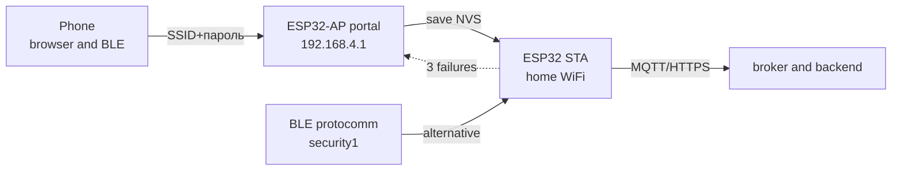

# Provisioning WiFi on ESP32 without reflashing

> [!warning] Open provisioning portal without password and timeout is a hole: anyone nearby can hijack the device!
> Password on SoftAP, portal timeout 3-5 min, after success - stop AP and wipe NVS if needed.

WiFi base: [[EN/05-Radio/01-WiFi-STA-AP.en|WiFi STA and AP]], credential storage [[EN/08-Memory/01-Partitions-NVS.en|NVS]], then MQTT [[EN/15-Protocols/01-MQTT.en|MQTT]], start [[Home.en|Home]].

## Purpose

Provisioning - entering SSID, password (and MQTT settings) into a finished device without reflashing. The user joins the temporary access point of the device, enters home WiFi - the device reboots as a client.

Options:

- **WiFiManager (Arduino)** - captive portal, simplest for hobby.
- **wifi_provisioning + protocomm (IDF)** - BLE or SoftAP transport, security1/2, production approach.
- **Manual AP portal (MicroPython)** - socket server on 192.168.4.1, minimal dependencies.
- **ESP RainMaker** - when cloud, mobile app and out-of-the-box claiming are needed.
- **SmartConfig / BluFi** - warning: fragile, legacy only.

## Parameters

| Parameter | Value | Note |
| --- | --- | --- |
| WiFiManager AP | SSID `ESP32-Setup`, IP 192.168.4.1 | captive portal + DNS hijack |
| IDF BLE provisioning | protocomm GATT service, security1 (PoP) / security2 | phone nearby, no open AP |
| IDF SoftAP provisioning | AP + protocomm HTTP endpoints | like WiFiManager, but with encryption |
| MP portal | own `socket` + HTML form | about 60 lines, full control |
| RainMaker | claiming + MQTT to Espressif cloud | ready iOS and Android apps |
| SmartConfig | ESP-Touch by packet lengths | breaks on 5 GHz and mesh, not advised |
| BluFi | closed-protocol BLE channel | Espressif app only, legacy |
| Security | AP password at least 8 chars, 180-300 s timeout | after provision - stop AP |
| Storage | NVS (SSID and password), erase on owner change | `nvs_flash_erase` / `WiFi.disconnect(true)` |
| Reset button | 10 s GPIO hold to erase + reboot to portal | mandatory for an enclosed product |

![[assets/img/provisioning-blufi-rainmaker-scheme.png|600]]
*Fig. Provisioning transports: BLE or SoftAP portal hands over credentials, the device becomes an STA client of home WiFi.*

### ASCII diagram

```text
ПЕРВИННИЙ СТАН (нема NVS-облікових / кнопка утримана)
────────────────────────────────────────────────────
 ESP32-AP "ESP32-Setup" (пароль! таймаут 180с)
   │
   ├─► Телефон підключається ──► captive-портал 192.168.4.1
   │     форма: SSID + пароль (+ MQTT-хост за потреби)
   │
   ├─► [IDF] BLE GATT protocomm security1 (PoP з наліпки) ──► ті самі поля
   │
   └─► Зберегти в NVS ──► стоп AP/BLE ──► reboot ──► STA до домашнього WiFi
                                                   │
ПІСЛЯ УСПІХУ: портал ЗАЧИНЕНО, пристрій ──► MQTT/HTTPS (див. 01/02)
НЕВДАЧА: лічильник 3 спроби ──► назад у портал (не висіти вічно!)
```

### Mermaid



## WiFiManager (Arduino): captive portal

Behavior: starts STA, no saved network or connect failed - raises AP + DNS + web server. The captive portal opens on the phone by itself.

Security minimum: `autoConnect("ESP32-Setup", "SetupPass123")` (password!), `setConfigPortalTimeout(180)`, after success - plain `loop()`. Custom fields (MQTT host and port) through `WiFiManagerParameter`, store in NVS or Preferences.

Pitfalls: a portal that never closed after provisioning (stuck in AP+STA) - call `stopConfigPortal()` or reboot explicitly; stale credentials in NVS after a router change - long button hold to `WiFi.disconnect(true)` + reboot.

## wifi_provisioning + protocomm (IDF): BLE and SoftAP

Production path: BLE transport (phone nearby, clean air) or SoftAP + HTTP, with a protocomm session on top:

- security0 - no encryption, development only;
- security1 - Curve25519 + PoP (proof of possession from the case sticker);
- security2 - SRP6a, advised for production.

Flow: `wifi_prov_mgr_init()` to `wifi_prov_mgr_start_provisioning(security, pop, service_name)` to app sending SSID to `WIFI_PROV_END` event to `wifi_prov_mgr_deinit()` (free BLE memory!) to STA connect. After success turn BLE off (`esp_bt_mem_release`) - else RAM leaks.

## Manual AP portal (MicroPython)

When no libraries exist: raise AP `esp32-setup`, socket on 80, serve a form, accept POST, write `wifi.json`, reboot. Plus - zero dependencies and full control; minus - validation, timeout and DNS hijack by hand (without it the user opens 192.168.4.1 manually).

## ESP RainMaker - overview

When to take it: remote control over the internet, ready mobile apps, device claiming, and cloud OTA are needed - and there is no backend team. RainMaker gives an on-device agent + cloud + apps; parameters (relay, temperature) follow a model and render in the UI by themselves.

When to skip it: local device without internet, own backend already exists (then MQTT or HTTP from sections 01-02), strict data privacy demands.

## SmartConfig / BluFi: warnings

- **SmartConfig (ESP-Touch):** encodes SSID in packet lengths. Breaks on 5 GHz, mesh roaming, and isolated APs. Legacy support for old batches only.
- **BluFi:** closed BLE protocol for the Espressif app. Works, but ties to someone else app.
- For new products - WiFiManager (hobby) or wifi_provisioning security1/2 (production).

## Arduino code (WiFiManager, secure)

```cpp
#include <WiFi.h>
#include <WiFiManager.h>

#define RESET_PIN 0  // BOOT: утримати 10 с → забути WiFi

WiFiManagerParameter p_mqtt("mqtt", "MQTT host", "192.168.1.10", 40);

void setup() {
  Serial.begin(115200);
  pinMode(RESET_PIN, INPUT_PULLUP);
  WiFiManager wm;
  wm.addParameter(&p_mqtt);
  wm.setConfigPortalTimeout(180);          // не висіти вічно!
  wm.setConnectTimeout(20);
  // Скидання за кнопкою:
  if (digitalRead(RESET_PIN) == LOW) {
    delay(10000);
    if (digitalRead(RESET_PIN) == LOW) { wm.resetSettings(); ESP.restart(); }
  }
  // Пароль на AP — ОБОВ'ЯЗКОВО:
  if (!wm.autoConnect("ESP32-Setup", "SetupPass123")) {
    Serial.println("provision fail → reboot");
    ESP.restart();
  }
  Serial.println(WiFi.localIP());
  Serial.println(p_mqtt.getValue()); // → зберегти в Preferences/NVS
}

void loop() { /* робочий код: MQTT/HTTP */ }
```

## ESP-IDF code (wifi_provisioning over BLE)

```c
#include "wifi_provisioning/manager.h"

void prov_start(const char *pop) {
    wifi_prov_mgr_config_t cfg = {
        .scheme = wifi_prov_scheme_ble,
        .scheme_event_handler = WIFI_PROV_SCHEME_BLE_EVENT_HANDLER_FREE_BTDM,
    };
    wifi_prov_mgr_init(cfg);
    // service_name видно в ефірі; PoP — з наліпки на корпусі
    wifi_prov_mgr_start_provisioning(WIFI_PROV_SECURITY_1, pop,
                                     "ESP32_ABC123", NULL);
    // Чекати подію WIFI_PROV_END, далі:
    // wifi_prov_mgr_deinit(); → esp_bt_mem_release(ESP_BT_MODE_BTDM);
}

// Події: WIFI_PROV_CRED_RECV (облікові отримано),
// WIFI_PROV_CRED_SUCCESS / FAIL (3 FAIL → лишити портал, не reboot-цикл),
// WIFI_PROV_END → deinit + робочий режим STA.
```

## MicroPython code (manual AP portal)

```python
import network, socket, json, time, machine

CONF = "wifi.json"

def start_portal():
    ap = network.WLAN(network.AP_IF)
    ap.active(True)
    ap.config(essid="ESP32-Setup", password="SetupPass123")  # пароль!
    ap.ifconfig(("192.168.4.1", "255.255.255.0", "192.168.4.1", "8.8.8.8"))
    s = socket.socket(); s.bind(("0.0.0.0", 80)); s.listen(1)
    s.settimeout(1.0)
    t0 = time.time()
    while time.time() - t0 < 180:  # таймаут порталу!
        try: cl, _ = s.accept()
        except OSError: continue
        req = cl.recv(1024).decode()
        if "POST /save" in req:
            body = req.split("\r\n\r\n")[-1]  # ssid=..&pass=..&mqtt=..
            kv = dict(p.split("=") for p in body.split("&") if "=" in p)
            open(CONF, "w").write(json.dumps(kv))
            cl.send("HTTP/1.0 200 OK\r\n\r\nSaved. Rebooting...")
            cl.close(); time.sleep(1); machine.reset()
        else:
            html = ("<form method=POST action=/save>SSID:<input name=ssid><br>"
                    "PASS:<input name=pass type=password><br>"
                    "MQTT:<input name=mqtt value=192.168.1.10><br>"
                    "<input type=submit value=Save></form>")
            cl.send("HTTP/1.0 200 OK\r\nContent-Type: text/html\r\n\r\n" + html)
        cl.close()
    machine.reset()  # таймаут вийшов — reboot у робочий режим

try:
    kv = json.load(open(CONF))
    sta = network.WLAN(network.STA_IF); sta.active(True)
    sta.connect(kv["ssid"], kv["pass"])
    for _ in range(40):
        if sta.isconnected(): break
        time.sleep(0.5)
    if not sta.isconnected(): start_portal()
except OSError:
    start_portal()  # конфіга нема → портал
```

## Typical issues

| Symptom | Cause | Fix |
| --- | --- | --- |
| Portal hangs after provision | no `deinit` or reboot, AP+STA at once | `wifi_prov_mgr_deinit()` or `ESP.restart()` after success |
| Device ignores the new network | stale credentials in NVS | 10 s button to `resetSettings()` or `nvs_flash_erase` |
| Captive portal never pops | no DNS hijack (manual portal) | open 192.168.4.1 by hand; enabled in WiFiManager |
| Reboot to portal loop | FAIL without a counter | 3 tries to stay in portal, no reboot loop |
| BLE provisioning ate RAM | BTDM not freed after deinit | `esp_bt_mem_release(ESP_BT_MODE_BTDM)` |
| Strangers join the Setup AP | open AP without timeout | password of 8+ chars + 180 s timeout |
| SmartConfig never catches | 5 GHz, mesh, or AP isolation | 2.4 GHz only or move to BLE or SoftAP |
| Same PoP sticker for a batch | cloned access | unique PoP per device (MAC-based) |

## Official sources

- [Protocomm - ESP-IDF](https://docs.espressif.com/projects/esp-idf/en/stable/esp32/api-reference/provisioning/protocomm.html) - security0/1/2, BLE and SoftAP transport.
- [WiFiManager - GitHub](https://github.com/tzapu/WiFiManager) - captive portal, timeouts, custom parameters.
- [ESP RainMaker - Programming Guide](https://docs.espressif.com/projects/esp-rainmaker/en/latest/) - claiming, device model, OTA.
- [esp-rainmaker - GitHub](https://github.com/espressif/esp-rainmaker) - agent, examples, apps.

## See also

- [[Home.en|Home]]
- [[EN/05-Radio/01-WiFi-STA-AP.en|WiFi STA and AP]] - modes that provisioning switches
- [[EN/08-Memory/03-OTA.en|OTA]] - updates for provisioned devices
- [[EN/08-Memory/01-Partitions-NVS.en|NVS]] - where credentials live, erasing
- [[EN/99-Additions/02-Troubleshooting-FAQ.en|FAQ]] - portal never starts, loops
- [[EN/15-Protocols/01-MQTT.en|MQTT]] - next step after WiFi
- [[EN/15-Protocols/03-HTTP-Client.en|HTTP and WebSocket]] - next step after WiFi
- [[EN/15-Protocols/03-mDNS-NTP-TLS.en|mDNS, NTP and TLS]] - finding the device after provision
- [[EN/15-Protocols/05-Cloud-Pipeline.en|Cloud pipeline]] - where data flows

## Appendix: checklist

| Symptom | Cause | Fix |
|---|---|---|
| Connection refused | Wrong broker/port or TLS cert missing | Verify URL, CA cert, firewall rules |
| Timeout / no response | Network unreachable / DNS failure | Check WiFi, mDNS/NTP server reachability |
| TLS handshake failed | Clock not set / wrong CA | Set time via NTP before TLS connect |

## Official sources

- [Espressif ESP-IDF Protocol Docs](https://docs.espressif.com/projects/esp-idf/en/latest/esp32/api-reference/protocols/index.html) - official protocol APIs.
- [Micropython umqtt / network docs](https://docs.micropython.org/en/latest/index.html) - MQTT and socket references.
