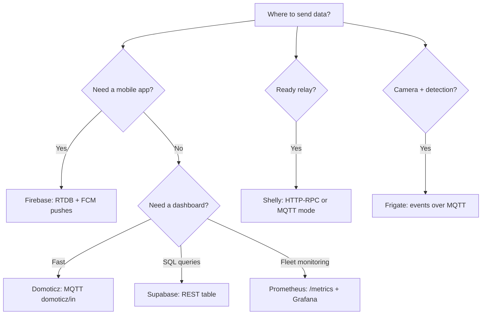

# Cloud platforms with ESP32: Firebase, Shelly, Frigate, Supabase, Domoticz, Prometheus

## Purpose

Own Mosquitto - not always the answer: sometimes ready dashboards (Domoticz), mobile pushes out of the box (Firebase), bridge to ready relays (Shelly), video analytics (Frigate), SQL storage (Supabase) or metric collection (Prometheus) are needed. Note - a map of what each can do + how to connect ESP32 + cost.

Base: start - [[Home.en | Home]], MQTT - [[15-Protocols/01-MQTT.en|MQTT]], pipeline - [[15-Protocols/05-Cloud-Pipeline.en | Cloud pipeline]], AWS - [[15-Protocols/12-AWS-IoT.en | AWS IoT]], Azure - [[15-Protocols/13-Azure-IoT.en | Azure IoT]], TLS - [[15-Protocols/03-mDNS-NTP-TLS.en | TLS and NTP]].

![[assets/img/cloud-platforms-firebase-shelly-scheme.png | 600]]
*Fig. ESP32 in the center: arrows to Firebase/Supabase (HTTPS), Shelly (RPC/MQTT), Frigate (MQTT frame), Domoticz (MQTT), Prometheus (scrape /metrics).*

## Comparison table

| Platform | Protocol with ESP32 | Auth | Free | When to use |
| --- | --- | --- | --- | --- |
| Firebase RTDB + FCM | HTTPS REST / SSE | OAuth2 / database secret | Spark plan (limits!) | Mobile app + pushes |
| Shelly (devices) | HTTP-RPC / MQTT | Digest / MQTT login | You buy a relay | Ready actuators without soldering |
| Frigate (NVR) | MQTT event frame | none / MQTT login | Open-source | Camera + someone in the yard |
| Supabase | HTTPS REST (PostgREST) | anon/service key (JWT) | 500 MB database | Need SQL, not topics |
| Domoticz | MQTT `domoticz/in` | none / password | Open-source | Dashboard in 15 min |
| Prometheus | HTTP GET `/metrics` (scrape!) | none / bearer | Open-source | Fleet monitoring, alerts |

### Mermaid: platform choice



## 1. Firebase: RTDB + FCM pushes

```text
RTDB REST: PUT https://<proj>.firebaseio.com/device/<id>/sensors.json?auth=<DB_SECRET>
  тіло {"t":23.5} → відповідь 200. ПРАВИЛА RTDB: за замовчуванням ЗАКРИТО —
  відкрити читання/запис для шляху пристрою (не root!).
FCM-пуш з ESP32 безпосередньо НЕ шлють (потрібен server key!) — схема:
  ESP32 → RTDB → Cloud Function → FCM на телефон.
ESP32-сторона: HTTPS POST (див. 15-02), CA-сертифікат + NTP-час обов'язково!
```

## 2. Shelly: HTTP-RPC and MQTT mode

```text
HTTP-RPC (без хмари взагалі!): GET http://shelly-84/status → JSON;
  GET http://shelly-84/rpc/Switch.Set?id=0&on=true → клац!
MQTT-режим: shelly вмикається в Settings → MQTT prefix shelly-kitchen-1 →
  топіки shellies/.../relay/0/command (accept) і .../announce.
ESP32 керує Shelly реле безпосередньо по LAN: затримка мс, інтернет не потрібен.
```

## 3. Frigate: camera events over MQTT

```text
Frigate (на сервері/міні-ПК) дивиться RTSP з камери → детекція (person/car/dog) →
  MQTT: frigate/events → {"before":{...},"after":{"label":"person","camera":"yard"}}.
ESP32 підписаний на frigate/events → сирена/світло/LINE-сповіщення.
Зворотний бік: ESP32-CAM як джерело для Frigate — RTSP-прошивка камери + стабільний WiFi!
```

## 4. Supabase: SQL instead of topics

```cpp
// Arduino: POST рядка в таблицю telemetry через PostgREST
// POST https://<proj>.supabase.co/rest/v1/telemetry
// Headers: apikey: <ANON_KEY>, Authorization: Bearer <ANON_KEY>, Content-Type: application/json
// Body: {"device_id":"esp32-01","t":23.5}
// Відповідь 201. RLS-політики: дозволити INSERT тільки в свою таблицю!
```

## 5. Domoticz: MQTT input in 15 min

```text
Domoticz → Налаштування → MQTT (mosquitto той самий!) → топік domoticz/in.
ESP32 шле: {"idx":12,"nvalue":0,"svalue":"23.5"} → пристрій-сенсор з'являється сам!
idx дізнатись: вкладка Пристрої (невикористані) → додати.
```

## 6. Prometheus: scraping `/metrics` from ESP32

```text
ESP32 віддає текст на :80/metrics:
  # HELP esp32_temp_c Температура
  # TYPE esp32_temp_c gauge
  esp32_temp_c{device="esp32-01"} 23.5
  esp32_heap_free 180000
Prometheus scrape_interval 60s → Grafana → алерти (t>30 5 хв).
Плюс: нуль коду на пристрої крім формату; мінус: pull-модель (пристрій має бути доступний!).
```

## Code (ESP-IDF/Arduino - universal snippets)

```cpp
// Arduino: Domoticz-публікація через PubSubClient (розділ 5)
mqtt.publish("domoticz/in", "{\"idx\":12,\"nvalue\":0,\"svalue\":\"23.5\"}");
// Arduino: Prometheus-метрики через WebServer (розділ 6)
server.on("/metrics", []() {
  char b[160];
  snprintf(b, sizeof(b),
    "# TYPE esp32_temp_c gauge\nesp32_temp_c{device=\"esp32-01\"} %.1f\n", readTemp());
  server.send(200, "text/plain", b);
});
```

## Common issues

| # | Issue | Why it is bad | Correct way |
| --- | --- | --- | --- |
| 1 | RTDB rules open on root | Anyone can read and write | Rules on the device path |
| 2 | FCM from ESP32 directly | Needs server key (secret on device!) | Through Cloud Function |
| 3 | Shelly in the cloud, but LAN is needed | Delays + internet dependency | HTTP-RPC over LAN |
| 4 | Supabase without RLS | Anyone writes to the table | RLS: INSERT only own rows |
| 5 | Prometheus scrape 5s | DDoS of own node | 30-60s is enough |
| 6 | Domoticz without idx | Message to nowhere | idx from the Devices tab |
| 7 | HTTPS without NTP | TLS fails | SNTP before requests (see 15-03) |
| 8 | One key for the fleet | One compromised key exposes all | One key or token per device |

## Official sources

- [Firebase RTDB REST](https://firebase.google.com/docs/database/rest/start) - auth, rules.
- [Shelly API Docs](https://shelly-api-docs.shelly.cloud/gen2/) - RPC, MQTT.
- [Frigate MQTT](https://docs.frigate.video/integrations/mqtt) - event topics.
- [Supabase PostgREST](https://supabase.com/docs/guides/api) - tables, RLS.
- [Prometheus exposition format](https://prometheus.io/docs/instrumenting/exposition_formats/) - metric format.

## See also

- [[Home.en | Home]]
- [[15-Protocols/01-MQTT.en|MQTT]]
- [[EN/15-Protocols/03-HTTP-Client.en| HTTP/WebSocket]]
- [[15-Protocols/03-mDNS-NTP-TLS.en|TLS and NTP]]
- [[15-Protocols/05-Cloud-Pipeline.en|Cloud pipeline]]
- [[15-Protocols/12-AWS-IoT.en|AWS IoT]]
- [[15-Protocols/13-Azure-IoT.en|Azure IoT]]
- [[EN/12-Comm-Modules/13-Camera-Streaming.en|Camera streaming]]
