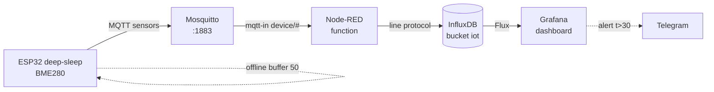

# Cloud pipeline: ESP32 to MQTT to Node-RED to InfluxDB to Grafana

> [!warning] Without NTP time on the node InfluxDB stores points stamped 1970 - charts look empty!
> NTP sync before the first publish is mandatory, see [[EN/15-Protocols/03-mDNS-NTP-TLS.en|mDNS, NTP and TLS]].

Base: MQTT [[EN/15-Protocols/01-MQTT.en|MQTT]], time [[EN/15-Protocols/03-mDNS-NTP-TLS.en|mDNS, NTP and TLS]], sleep [[EN/07-Timers/03-Sleep-ULP.en|Sleep and ULP]], WiFi [[EN/05-Radio/01-WiFi-STA-AP.en|WiFi STA and AP]], start [[Home.en|Home]].

## Purpose

End-to-end applied IoT example: an ESP32 node with DHT22 or BME280 sends telemetry over MQTT, Mosquitto receives it, Node-RED normalizes, InfluxDB stores time series, Grafana draws the dashboard. Each link can be replaced, the contract between them is JSON and MQTT topics from [[EN/15-Protocols/01-MQTT.en|MQTT]].

When to take this stack:

- own server (RPi 4 or VPS), data never leaves home;
- dozens of nodes, charts, alerts, and a year of history needed;
- rules (if t is above 30 turn on the fan) written by a non-engineer in Node-RED.

Alternatives (overview below): ThingsBoard instead of Node-RED+InfluxDB+Grafana together; AWS IoT Core instead of own Mosquitto - when one broker is too small for thousands of devices.

## Parameters

| Parameter | Value | Note |
| --- | --- | --- |
| Node | ESP32 + DHT22/BME280, 60 s period | deep-sleep between measurements |
| Transport | MQTT QoS 0, topic `device/<id>/sensors` | no retain on the stream! |
| Broker | Mosquitto 2.x on RPi or VPS | 1883 locally, see [[EN/15-Protocols/01-MQTT.en|MQTT]] |
| Flow | Node-RED: mqtt-in to function to influxdb-out | stream JSON below |
| Storage | InfluxDB 2.x bucket `iot`, measurement `climate` | 365-day retention |
| Dashboard | Grafana: Flux or SQL query, Time series panel | alert to Telegram |
| Batch | 1 point = 1 write; offline buffer in packs of up to 50 | more must be split |
| Time | NTP on the node + server timestamp as fallback | without time - garbage in the database |
| Alternative 1 | ThingsBoard (MQTT + own UI) | fast start, less flexible |
| Alternative 2 | AWS IoT Core (MQTT + rules to Timestream) | money per message |

![[assets/img/cloud-pipeline-nodered-scheme.png|600]]
*Fig. Pipeline: sleepy node wakes, sends MQTT, Node-RED writes to InfluxDB, Grafana draws.*

### ASCII diagram

```text
ESP32-вузол (deep-sleep 60с)        Сервер RPi (192.168.1.10)
────────────────────────────        ────────────────────────
 wake → BME280 read → connect WiFi
   │ NTP sync (раз на добу/wake)     Mosquitto :1883
   └─► PUBLISH device/esp32-01/sensors {"t":24.5,"h":55,"vbat":4.0} ──►│
                                                                      ▼
                                                              Node-RED :1880
                                                               mqtt-in (device/#)
                                                                 │
                                                              function: нормалізація
                                                               + timestamp fallback
                                                                 │
                                                              influxdb-out ──► InfluxDB :8086
                                                                                bucket iot
                                                                                  │
                                                                               Grafana :3000
                                                                                 дашборд + алерти
Офлайн: нема WiFi → кільцевий буфер у RTC/NVS (до 50 точок) → злив пачкою.
```

### Mermaid



## Link 1: node (short, details in 01-MQTT)

The node does the minimum: woke up to measured to connected to published to slept. Full MQTT code with reconnect is in [[EN/15-Protocols/01-MQTT.en|MQTT]], only three stack frames here (below). The payload format is fixed:

```json
{"id": "esp32-01", "t": 24.5, "h": 55.1, "vbat": 4.02, "rssi": -67}
```

The node never sets the `ts` field (its clock may lie) - Node-RED or InfluxDB stamps time at write, but NTP on the node is still needed for TLS and point order.

## Link 2: Mosquitto

Broker from [[EN/15-Protocols/01-MQTT.en|MQTT]]: one user per node, ACL `device/<id>/#`, user `nodered` with `device/#` for reading. No logic in the broker - it is only a bus.

## Link 3: Node-RED flow (flow JSON)

Install: `sudo apt install -y nodejs npm`, then Node-RED with the official script, `node-red-contrib-influxdb` palette. Import the flow (Menu to Import):

```json
[
  {
    "id": "mqtt-in-climate",
    "type": "mqtt in",
    "topic": "device/+/sensors",
    "qos": "0",
    "broker": "mosquitto-local",
    "nl": false
  },
  {
    "id": "fn-normalize",
    "type": "function",
    "func": "const m = JSON.parse(msg.payload);\nmsg.measurement = 'climate';\nmsg.payload = [{\n  t: Number(m.t), h: Number(m.h),\n  vbat: Number(m.vbat), rssi: Number(m.rssi)\n}, {id: m.id}];\nreturn msg;"
  },
  {
    "id": "influx-out",
    "type": "influxdb out",
    "influxdb": "influx-local",
    "measurement": "climate",
    "precision": "s"
  },
  {
    "id": "fn-alert",
    "type": "function",
    "func": "const m = JSON.parse(msg.payload);\nif (m.t > 30) { msg.payload = 'ALERT ' + m.id + ' t=' + m.t; return msg; }\nreturn null;"
  }
]
```

Links: `mqtt-in-climate` to `fn-normalize` to `influx-out`; `mqtt-in-climate` to `fn-alert` to (telegram-sender). The normalize function drops garbage (`NaN` from DHT22 never goes to the database, rejected BME280 samples go to a separate metric).

## Link 4: InfluxDB (bucket, retention, query)

```bash
influx setup -b iot -o home -u admin -p '***' -r 365d --force
influx bucket list
```

Line protocol that Node-RED writes:

```text
climate,id=esp32-01 t=24.5,h=55.1,vbat=4.02,rssi=-67 1727486400
```

Data check (Flux):

```flux
from(bucket: "iot")
  |> range(start: -24h)
  |> filter(fn: (r) => r._measurement == "climate" and r.id == "esp32-01")
```

Batch rule: a pack from the offline buffer holds up to 50 points per write; more cuts Node-RED memory and InfluxDB timeouts.

## Link 5: Grafana dashboard

Source: InfluxDB (Flux, URL `http://localhost:8086`, token with read rights on `iot`). Panels: Time series `t` and `h` for 24 h, Stat `vbat` (red under 3.3 V), Bar gauge `rssi`. Alert: `t` above 30 for 5 min to a Telegram contact. Export the dashboard JSON to git - restore in a minute.

## Deep-sleep node + offline buffering

Cycle: `wake to sensors to WiFi to NTP (rarely) to MQTT to sleep(60 s)`. If WiFi or MQTT is down - store the point in a ring buffer (RTC memory until reboot, NVS survives reboot, up to 50 records). On the next success - flush the buffer as one QoS 1 pack and clear it. Never spin reconnect longer than 20 s on battery - better to sleep and try next cycle.

## Node code: ESP-IDF (frame, details in 01-MQTT)

```c
// wake → read BME280 → publish → sleep. MQTT-клієнт як у 01-MQTT.
void app_main(void) {
    wifi_connect(); sntp_start(); mqtt_start();
    float t, h; bme280_read(&t, &h);
    char j[128];
    snprintf(j, sizeof j, "{\"id\":\"esp32-01\",\"t\":%.1f,\"h\":%.1f}", t, h);
    mqtt_await_connected(5000);
    esp_mqtt_client_publish(s_client, "device/esp32-01/sensors", j, 0, 0, 0);
    vTaskDelay(pdMS_TO_TICKS(500)); // дати TCP стекти
    esp_sleep_enable_timer_wakeup(60 * 1000000ULL);
    esp_deep_sleep_start();
}
```

## Node code: Arduino (frame)

```cpp
#include <WiFi.h>
#include <PubSubClient.h>
WiFiClient net; PubSubClient mqtt(net);
void setup() {
  WiFi.begin("SSID", "PASS");
  for (int i = 0; i < 60 && WiFi.status() != WL_CONNECTED; i++) delay(500);
  mqtt.setServer("192.168.1.10", 1883);
  if (mqtt.connect("esp32-01", "esp32-01", "SECRET")) {
    float t = 24.5, h = 55.0; // dht.readTemperature/Humidity()
    if (!isnan(t)) mqtt.publish("device/esp32-01/sensors",
      ("{\"id\":\"esp32-01\",\"t\":" + String(t) + "}").c_str());
    delay(500);
  }
  esp_sleep_enable_timer_wakeup(60 * 1000000ULL);
  esp_deep_sleep_start(); // реконект — у 01-MQTT, тут сон важливіший
}
void loop() {}
```

## Node code: MicroPython (frame)

```python
import network, time, json, machine
from umqtt.simple import MQTTClient
import dht
from machine import Pin

sta = network.WLAN(network.STA_IF); sta.active(True)
sta.connect("SSID", "PASS")
for _ in range(40):
    if sta.isconnected(): break
    time.sleep(0.5)
if sta.isconnected():
    s = dht.DHT22(Pin(4)); s.measure()
    c = MQTTClient("esp32-01", "192.168.1.10", user="esp32-01", password="SECRET")
    c.connect()
    c.publish(b"device/esp32-01/sensors",
              json.dumps({"id": "esp32-01", "t": s.temperature(), "h": s.humidity()}))
    time.sleep(0.5)
# else: записати точку в буфер (файл) і спати
machine.deepsleep(60_000)
```

## Alternatives: ThingsBoard, AWS IoT Core (overview)

- **ThingsBoard:** node sends MQTT to `v1/devices/me/telemetry` with the device token - and at once gets dashboards, rule engine, and alerts without Node-RED, InfluxDB, or Grafana. Fast start, price is less query flexibility and one-platform lock-in.
- **AWS IoT Core:** broker + rules (SQL) to Timestream, DynamoDB, or S3, device shadow, fleet provisioning for thousands of nodes. Price is money per million messages and harder IAM and TLS with client certificates. Worth it from hundreds of devices or when the customer is already in AWS.

## Typical issues

| Symptom | Cause | Fix |
| --- | --- | --- |
| Empty charts, points stamped 1970 | no NTP on the node | SNTP before the first publish; fallback is the server timestamp |
| Duplicate points after reconnect | retained `sensors` + resubscribe | retain ONLY state and status, never the stream (see 01-MQTT) |
| `NaN` in the database, broken charts | DHT22 too slow or CRC fail | drop `isnan` in the Node-RED function |
| 500-point pack hangs the write | batch without a limit | split per 50, InfluxDB client timeout |
| Retain storm: 1000 stale points | node publishes retain each time | QoS 0 without retain on `sensors` |
| Time jumps after deep-sleep | RTC drift, daily NTP is too rare | sync every Nth wake or on drift above 2 s |
| Grafana `401` to InfluxDB | token expired or wrong bucket | read token on `iot`, check Organization |

## Official sources

- [Node-RED - docs](https://nodered.org/docs/) - flows, mqtt-in, function nodes.
- [InfluxDB OSS v2 - docs](https://docs.influxdata.com/influxdb/v2/) - buckets, line protocol, Flux.
- [Grafana - docs](https://grafana.com/docs/grafana/latest/) - sources, panels, alerts.
- [ThingsBoard - docs](https://thingsboard.io/docs/) - MQTT telemetry API, rule engine.
- [AWS IoT - What is AWS IoT](https://docs.aws.amazon.com/iot/latest/developerguide/what-is-aws-iot.html) - Core, rules, protocols.

## See also

- [[Home.en|Home]]
- [[EN/05-Radio/01-WiFi-STA-AP.en|WiFi STA and AP]] - node transport
- [[EN/08-Memory/03-OTA.en|OTA]] - pipeline node updates
- [[EN/08-Memory/01-Partitions-NVS.en|NVS]] - offline buffer, node ID
- [[EN/99-Additions/02-Troubleshooting-FAQ.en|FAQ]] - link diagnostics
- [[EN/15-Protocols/01-MQTT.en|MQTT]] - full node code with reconnect
- [[EN/15-Protocols/03-HTTP-Client.en|HTTP and WebSocket]] - REST alternative for the node
- [[EN/15-Protocols/03-mDNS-NTP-TLS.en|mDNS, NTP and TLS]] - time for InfluxDB
- [[EN/15-Protocols/04-Provisioning.en|Provisioning]] - WiFi entry on nodes

## Appendix: checklist

| Symptom | Cause | Fix |
|---|---|---|
| Connection refused | Wrong broker/port or TLS cert missing | Verify URL, CA cert, firewall rules |
| Timeout / no response | Network unreachable / DNS failure | Check WiFi, mDNS/NTP server reachability |
| TLS handshake failed | Clock not set / wrong CA | Set time via NTP before TLS connect |

## Official sources

- [Espressif ESP-IDF Protocol Docs](https://docs.espressif.com/projects/esp-idf/en/latest/esp32/api-reference/protocols/index.html) - official protocol APIs.
- [Micropython umqtt / network docs](https://docs.micropython.org/en/latest/index.html) - MQTT and socket references.
