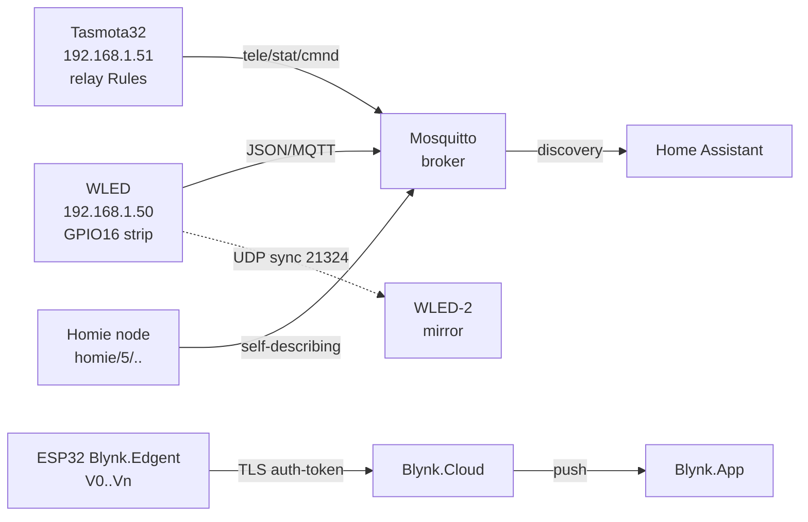

# Ready firmwares ESP32 - WLED, Tasmota, Blynk, Homie

> [!warning] Ready firmware never means no risk: a foreign binary sees your WiFi password and MQTT login!
> Flash only from official releases (WLED and Tasmota GitHub), change default passwords at once, close the open AP. Count LED strip current SEPARATELY - firmware never saves thin wires!

Network overview: [[EN/05-Radio/01-WiFi-STA-AP.en|WiFi STA and AP]], telemetry [[EN/15-Protocols/01-MQTT.en|MQTT]], strip power [[EN/11-Vivid/09-LED-Strip-Power-SK6812-APA102.en|LED strip power]], start [[Home.en|Home]].

## Purpose

Own firmware (ESP-IDF, Arduino, or MicroPython) gives full control but eats weeks on WiFi reconnect, web UI, OTA, and dashboards. Ready firmwares cover 80 percent of typical tasks in an evening: LED strip glow means WLED, relay clicks over MQTT and buttons mean Tasmota, mobile app without backend means Blynk, self-documented MQTT topics mean the Homie convention on top of own firmware.

When to take ready firmware:

- LED setup, garland, backlight: WLED out of the box gives 200+ effects, segments, presets, UDP sync.
- Smart outlet, switch, or sensor with WebUI and MQTT: Tasmota with a Template config and zero lines of code.
- Pilot IoT product with a mobile app: Blynk (Console + Apps + Edgent provisioning).
- Own firmware but standard topics for Home Assistant or openHAB: Homie convention.

When to skip it:

- battery node with microamp deep-sleep - ready firmwares hold WiFi and eat tens of mA (see sleep [[EN/07-Timers/03-Sleep-ULP.en|Sleep and ULP]]);
- certified commercial product with own app brand - Blynk Enterprise costs money, WLED and Tasmota carry GPL and EUPL duties;
- exotic peripherals without a ready driver - faster to write your own than to carve a usermod from zero.

## Parameters

| Parameter | WLED | Tasmota (tasmota32) | Blynk (Edgent) | Homie (convention) |
| --- | --- | --- | --- | --- |
| Purpose | addressable LEDs: WS2812B, SK6812, APA102 | relays, sensors, dimmers, bridges | cloud + mobile UI | MQTT topic standard |
| Binary | `WLED_*.bin` / install.wled.me | `tasmota32.bin` (+ sensors and display variants) | own sketch + Blynk library | own code + homie-lib |
| First launch | AP `WLED-AP`, portal 4.3.2.1 | AP `tasmota-XXXX`, portal 192.168.4.1 | BlynkEdgent provisioning (AP + claiming) | depends on firmware |
| Control | WebUI, JSON/HTTP API, MQTT | WebUI, MQTT, HTTP `cm?`, Console | Blynk.Console and Apps, virtual pins | any Homie controller |
| Discovery | mDNS `wled.local`, HA discovery | MQTT discovery for HA | cloud claiming | `$state` + self-description |
| OTA | HTTP OTA from WebUI | OTA URL (`OtaUrl`, `Upgrade 1`) | Blynk.Air OTA | own OTA mechanism |
| LED current | ABL limit in UI, but count wires yourself! | PWM and DALI bridges, no ABL | no LED driver | no LED driver |
| ESP power | 5 V / 500 mA WiFi peak | 5 V / 500 mA WiFi peak | 5 V / 500 mA WiFi peak | depends on the node |
| License | EUPL-1.2 | GPL-3.0 | commercial (free limits) | MIT-like convention |

![[assets/img/firmwares-wled-tasmota-scheme.png|600]]
*Fig. Ready firmwares: WLED drives the strip and listens to JSON/MQTT, Tasmota clicks relays by Rules, Blynk carries data to the cloud on V pins, Homie describes itself with `$state` topics.*

### ASCII diagram

```text
                    WiFi-роутер 192.168.1.1
                            │
        ┌───────────────────┼────────────────────┐
        │                   │                    │
  WLED-вузол           Tasmota-вузол        Телефон Blynk.App
  192.168.1.50         192.168.1.51         (хмара blynk.cloud)
  GPIO16 → 300×WS2812B  GPIO23 → реле
        │                   │
        │ JSON http://.50   │ cmnd/tasmota_01/POWER
        │ /json/state       │ stat/tasmota_01/RESULT
        │                   │ tele/tasmota_01/SENSOR
        │                   │
        ├─ UDP-sync ────────┤ (WLED→WLED порт 21324)
        │                   │
        └─► MQTT-broker 192.168.1.10 ──► Home Assistant
              │  wled/+/g  (WLED)
              │  homie/5/device123/$state (Homie-вузол)
              └─► Blynk-хмара (TLS, auth-token) ──► дашборд

First launch: WLED-AP / tasmota-XXXX / BlynkEdgent-AP → портал → STA
```

### Mermaid



## WLED - addressable strips with no code

WLED is the king firmware for WS2812B, WS2811, SK6812, APA102, and WS2801. Flash a ready binary through the [web installer](https://kno.wled.ge/basics/install-binary/) or `esptool.py`, then everything is done with the mouse in WebUI.

Flashing the binary:

```bash
# Варіант 1: браузерний інсталер (рекомендовано) — https://install.wled.me/
# Варіант 2: вручну
pip install esptool
esptool.py --chip esp32 --port /dev/ttyUSB0 erase_flash
esptool.py --chip esp32 --port /dev/ttyUSB0 write_flash 0x0 WLED_0.15.0_ESP32.bin
```

First launch:

1. ESP raises the open AP `WLED-AP` (password `wled1234` in new versions).
2. Connect to the portal or open `4.3.2.1` to enter home SSID and password.
3. After connect the node is reachable as `wled.local` (mDNS) and by DHCP IP; AP stays as failsafe.
4. `Config to LED Preferences`: strip type (WS281x, SK6812, or APA102), GPIO, LED count, color order (GRB!), voltage.

Segments, effects, presets:

- **Segments:** cut one physical strip into virtual zones (0-99, 100-199), each with its own effect, color, or palette. Up to 10 outputs on ESP32 (parallel I2S + RMT).
- **Effects:** 200+ built in (running fire, meteors, audio-reactive with INMP441 mic). Speed and Intensity are separate sliders.
- **Presets:** up to 250 slots - a snapshot of colors, effects, and segments. Preset 1 can go on the download button. Playlists cycle presets by timer.
- **Nightlight:** smooth fade over N minutes. **ABL current limit (Auto Brightness Limiter):** you set the PSU milliamps - WLED caps brightness, but this never replaces thick wires!

UDP sync between WLED nodes:

- `Settings to Sync Interfaces to WLED Broadcast`: all nodes on one WiFi network send UDP packets to port 21324 (effect, color, brightness).
- Modes: Send + Receive (mirror), Send only (leader), Receive only (follower).
- For stage or theater use DDP, E1.31, or Art-Net input from Jinx or Resolume instead of UDP sync.

Home Assistant integration:

- Native `WLED` integration (Settings to Devices to Add to WLED to IP): each segment becomes a separate `light.*`, plus current, memory, and RSSI sensors, preset and playlist selects, restart buttons.
- WLED 0.14.0 minimum. WebSocket gives push updates; custom builds without JSON API are not supported.
- YAML automation - turn on the My Preset preset:

```yaml
action: light.turn_on
target:
  entity_id: light.wled
data:
  effect: "Fire 2012"
```

```yaml
action: select.select_option
target:
  entity_id: select.wled_preset
data:
  option: "My Preset"
```

Strip current - MUST read [[EN/11-Vivid/09-LED-Strip-Power-SK6812-APA102.en|LED strip power]]:

- 300x WS2812B on full white 100 percent draws about 18 A at 5 V. One 2 A USB brick burns or sags - the strip end turns red.
- Feed the strip from BOTH ends (and every 2-3 m), common ground with ESP, data through a 33-100 Ohm resistor, 1000 uF capacitor on power.
- ABL in WLED is a software fuse, never a copper replacement: set 80 percent of the brick rating.

JSON API example (HTTP):

```bash
# Статус
curl http://192.168.1.50/json/state
# Увімкнути червоний + ефект
curl -X POST http://192.168.1.50/json/state \
  -d '{"on":true,"bri":128,"seg":[{"col": [ [255,0,0] ],"fx":5,"sx":200}]}'
# MQTT ті самі поля: топік wled/wled-01/api → той самий JSON
```

## Tasmota - relays, sensors, automation with no code

Tasmota (`tasmota32.bin` branch for ESP32) turns a bare module into a WebUI, MQTT, and HTTP device: relays, buttons, DS18B20, BME280, simple WS2812 strips, dimmers, IR and RF bridges.

Flashing:

```bash
esptool.py --chip esp32 --port /dev/ttyUSB0 erase_flash
# Взяти tasmota32.bin з https://github.com/arendst/Tasmota/releases
esptool.py --chip esp32 --port /dev/ttyUSB0 write_flash 0x0 tasmota32.bin
# Після старту: AP tasmota-XXXX → 192.168.4.1 → домашній WiFi → WebUI
```

Template and GPIO config (`Configure to Configure Template`):

- Each GPIO takes a role: `Relay1`, `Button1`, `Led1`, `DS18x20`, `I2C SDA/SCL`, `PWM1`, or `WS2812`.
- Ready templates for hundreds of devices live at [templates.blakadder.com](https://tasmota.github.io/docs/Templates/), paste JSON into the Template field and press Activate.
- Example: Sonoff Basic - GPIO12 Relay1, GPIO0 Button1. Own board: relay on GPIO23, button on GPIO0 (with pull-up).

```text
{"NAME":"MyBoard","GPIO":[0,0,0,0,0,0,0,0,0,2304,0,320,0,0,0,0,0,0,0,0,0,0,224,0,0,0,0,0,0,0,0,0,0,0,0,0],"FLAG":0,"BASE":1}
; 224 = Relay1, 320 = Button1, 2304 = Led1 (індекси компонентів Tasmota)
```

MQTT topics `tele`, `stat`, and `cmnd` (base [[EN/15-Protocols/01-MQTT.en|MQTT]]):

```text
cmnd/tasmota_01/POWER1 ON        → команда (QoS 1, без retain)
stat/tasmota_01/RESULT {"POWER1":"ON"}   ← відповідь на команду
stat/tasmota_01/POWER1 ON        ← стан реле
tele/tasmota_01/SENSOR {"DS18B20":{"Temperature":23.4}}  ← телеметрія кожні TelePeriod
tele/tasmota_01/LWT Online       ← LWT online/offline
```

Setup through Console or Backlog in one pack:

```text
Backlog MqttHost 192.168.1.10; MqttUser esp; MqttPassword SECRET;
Topic tasmota_01; TelePeriod 60; PowerRetain on; SetOption53 1
; SetOption53=1 → CBC... (див. довідник SetOption нижче)
```

Key SetOptions (full list in `Commands`):

- `SetOption26 1` - force `POWER1` indexes even with one relay.
- `SetOption53 1` - show hostname+MAC in MQTT.
- `PowerRetain on` - retain on the relay state (HA sees the state after restart).
- `TelePeriod 60` - telemetry period, seconds (10-300).
- `BlinkCount` and `BlinkTime` - relay blinking for bells and sirens.
- `Emulation 1` - Belkin WeMo for Alexa (see note 07), `2` - Hue Bridge.

Rules (automation without cloud):

```text
Rule1 ON DS18B20#Temperature>28 DO Power1 ON ENDON ON DS18B20#Temperature<25 DO Power1 OFF ENDON
Rule1 1
; Вентилятор за температурою: гістерезис 25/28 °C, всередині пристрою
Rule2 ON Switch1#State=2 DO Backlog Power1 TOGGLE; Publish stat/tasmota_01/EVT {"btn":"double"} ENDON
Rule2 1
```

Timers (`Timers` in WebUI) - 16 sunrise and sunset schedules with offsets, no code.

## Blynk - cloud and app in an evening

Blynk is a platform: Blynk.Cloud (broker+database) + Blynk.Console (web) + Blynk.Apps (iOS and Android) + Blynk Library or Edgent firmware. You pay or live with free limits (device and message counts), but the mobile UI builds with drag-and-drop.

Auth token and virtual pins:

- In Console: Template to Datastreams to create `V0` (temperature, double, degrees C), `V1` (relay, integer 0/1). Each device gets a `BLYNK_AUTH_TOKEN`.
- Firmware never uses GPIO numbers in the cloud directly - write with `Blynk.virtualWrite(V0, t)`, read with `BLYNK_WRITE(V1)`.

```cpp
#define BLYNK_TEMPLATE_ID "TMPLxxxx"
#define BLYNK_TEMPLATE_NAME "ESP32 Climate"
#define BLYNK_AUTH_TOKEN "AbCdEfGhIjKlMnOpQrStUvWx"
#include <WiFi.h>
#include <BlynkSimpleEsp32.h>

char ssid[] = "SSID", pass[] = "PASS";

BLYNK_WRITE(V1) {  // віджет кнопки у застосунку
  digitalWrite(27, param.asInt());
}

void setup() {
  pinMode(27, OUTPUT);
  Blynk.begin(BLYNK_AUTH_TOKEN, ssid, pass);
}

void loop() {
  Blynk.run();           // тримати зв'язок з хмарою!
  static uint32_t t0 = 0;
  if (millis() - t0 > 5000) {
    t0 = millis();
    Blynk.virtualWrite(V0, 24.5);  // температура → дашборд
  }
}
```

BlynkEdgent provisioning:

- `Edgent_ESP32` example from the library: first start means AP `Blynk Device-XXXX` to portal to home WiFi to claiming into your account (button + LED status).
- OTA from the cloud (Blynk.Air): upload a new binary in Console to update devices in batches.
- Reconnect timeout and `Blynk.config()` instead of blocking `begin()` - if the cloud is down the device must work locally!

Prices (guide, check at blynk.io/pricing):

- Free: 2 devices, basic data history, Blynk branding.
- Plus and Pro: more devices, white-label app, organizations, sub-tenants.
- Hobby weather sensor fits in Free; a 500-case run means counting dollars per device per year and reading Terms!

## Homie convention - order in MQTT topics

Homie is not firmware but an MQTT topic naming convention: the device describes itself with retained messages, the controller (openHAB, Home Assistant, or Node-RED) picks it up with no manual mapping. Current version is Homie 5.0 (`homie/5/...`).

Topic frame:

```text
homie/5/device123/$state       → ready | sleeping | lost | alert
homie/5/device123/$description → JSON: ім'я, вузли, властивості, одиниці, формат
homie/5/device123/mythermostat/temperature → 22
homie/5/device123/mythermostat/temperature/set → 23  (команда: .../set)
homie/5/device123/$extensions/...  (OTA, статистика, firmware)
```

Minimal `$state` lifecycle: `init to ready to sleeping to ready to lost` (LWT = `lost`).

Description example (retained):

```json
{
  "id": "device123",
  "homie": "5.0",
  "version": "12",
  "name": "My device",
  "nodes": {
    "mythermostat": {
      "name": "My thermostat",
      "type": "thermostat",
      "properties": {
        "temperature": {
          "name": "Temperature",
          "unit": "°C",
          "datatype": "integer",
          "settable": true
        }
      }
    }
  }
}
```

OTA extension: `firmware/checksum` property + `.../firmware/update/set` topic with the binary URL; the device downloads, checks SHA, and reboots.

Own Homie node on MicroPython (sketch):

```python
import json
from umqtt.robust import MQTTClient
BASE = b"homie/5/esp32-01"
c = MQTTClient("esp32-01", "192.168.1.10")
c.set_last_will(BASE + b"/$state", b"lost", retain=True)
c.connect()
c.publish(BASE + b"/$state", b"init", retain=True)
desc = {"id": "esp32-01", "homie": "5.0", "version": "1",
        "name": "ESP32 climate",
        "nodes": {"env": {"name": "Env", "type": "sensor",
        "properties": {"t": {"name": "T", "unit": "°C",
        "datatype": "float", "settable": False}}}}}
c.publish(BASE + b"/$description", json.dumps(desc), retain=True)
c.publish(BASE + b"/env/t", b"24.5", retain=True)
c.publish(BASE + b"/$state", b"ready", retain=True)
```

## When own firmware, when ready

| Criterion | Own firmware (IDF/Arduino/MP) | WLED | Tasmota | Blynk | Homie on top of own |
| --- | --- | --- | --- | --- | --- |
| Time to demo | days to weeks | 1 evening | 1 evening | 1 evening + UI | days (but standard topics) |
| 100+ LED strip | write engine and RMT yourself | take it at once | simple ones only | no | write yourself |
| Relays+buttons+sensors | GPIO+MQTT by hand | no | take it at once | maybe | maybe |
| Mobile app | own backend or Flutter | WLED app | WebUI, not an app | take it at once | own |
| Offline work | full | full (LAN) | full (LAN) | cloud needed | full |
| Microamp deep-sleep | yes | no | no | no | yes |
| 100+ node scale | own fleet management | MQTT+HA | MQTT+HA | Blynk Orgs and Air | own + discovery |

Rule: prototype on ready firmware to a product that took off and hits the ceiling (sleep, branding, exotics) to rewriting as own firmware while keeping topics (Homie or `device/<id>/...` from [[EN/15-Protocols/01-MQTT.en|MQTT]]).

## Typical issues

| Symptom | Cause | Fix |
| --- | --- | --- |
| LED strip end turns yellow or red | 5 V sag on thin or long wires | feed from both ends, wire at least 1.5 sq mm, common ground; see [[EN/11-Vivid/09-LED-Strip-Power-SK6812-APA102.en|LED strip power]] |
| WLED-AP never goes away after setup | failsafe AP left on | `WiFi Setup to Disable AP`, set a password |
| R and B colors mixed | wrong channel order | `LED Preferences to Color Order`: GRB for WS2812B, RGB for SK6812 |
| UDP sync jerks | different WLED versions or WiFi lags | one version everywhere, 1 leader, multicast reachable |
| Tasmota misses the sensor | wrong GPIO or role in Template | `Configure Template`, compare with the blakadder board template |
| `cmnd/...` with no answer | wrong `Topic` or `FullTopic` | `Topic tasmota_01`, subscribe `stat/#` for diagnostics |
| Rules never fire | rule not enabled | `Rule1 1`, bare `Rule1` shows the text |
| Blynk `Invalid auth token` | token from another Template | copy `BLYNK_AUTH_TOKEN` from Device Info of this exact device |
| Blynk data never refreshes | `Blynk.run()` called rarely or `delay()` | no blocking `delay`, `run()` at least every 50 ms |
| Homie controller misses the node | `$description` without retain | publish description and `$state` with `retain=True` |

## Official sources

- [WLED - docs (kno.wled.ge)](https://kno.wled.ge/basics/install-binary/) - flashing, segments, presets, UDP sync, JSON and MQTT API.
- [WLED - GitHub (wled/WLED)](https://github.com/wled/WLED) - binary releases, install.wled.me, usermods.
- [Tasmota - docs](https://tasmota.github.io/docs/) - Template, components, MQTT, Rules, Timers.
- [Tasmota Commands](https://tasmota.github.io/docs/Commands/) - Backlog, Power, SetOption, TelePeriod, Rules syntax.
- [Homie convention - overview](https://homieiot.github.io/homie-esp8266/) - topics, `$state`, self-description, OTA extension.

- WS2801 Datasheet (WorldSemi, PDF search): [WS2801 search](https://www.alldatasheet.com/view.jsp?Searchword=WS2801) - LED driver.
- WS2811 Datasheet (WorldSemi, PDF search): [WS2811 search](https://www.alldatasheet.com/view.jsp?Searchword=WS2811) - LED driver for 12V strips.

## See also

- [[Home.en|Home]]
- [[EN/15-Protocols/01-MQTT.en|MQTT]] - broker, QoS, LWT for Tasmota and Homie
- [[EN/15-Protocols/02-Notify-Voice.en|Notify and Voice]] - alerts and voice control with ready firmwares
- [[EN/05-Radio/01-WiFi-STA-AP.en|WiFi STA and AP]] - radio modes, first-launch AP portals
- [[EN/11-Vivid/09-LED-Strip-Power-SK6812-APA102.en|LED strip power]] - current, wires, ABL for WLED - read BEFORE the strip!
- [[EN/99-Additions/02-Troubleshooting-FAQ.en|FAQ]] - drop and power diagnostics
- [[EN/15-Protocols/04-Provisioning.en|Provisioning]] - BlynkEdgent vs WiFiManager vs wifi_provisioning


## Appendix: checklist

| Symptom | Cause | Fix |
|---|---|---|
| Connection/timeout | Network / broker settings | Verify URL, firewall, credentials |

## Official sources

- [Espressif Protocol Docs](https://docs.espressif.com/projects/esp-idf/en/latest/esp32/api-reference/protocols/index.html)
