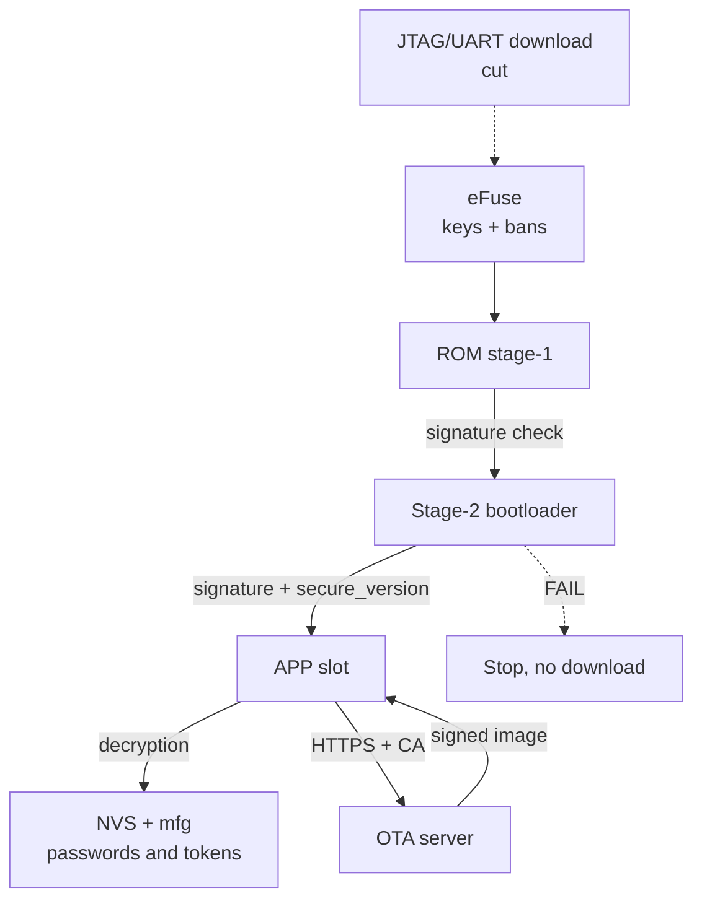

# Security Hardening ESP32 before production

> [!warning] Prototype ≠ product!
> Board with open UART log, firmware without signature and WiFi password in plaintext-NVS - this desk demo, but not product for client. Pass this checklist BEFORE first batches: half items irreversible (eFuse).

Base: flash and signature [[EN/08-Memory/04-Secure-Boot-Encrypt.en|Secure boot and encryption]], update delivery [[08-Memory/03-OTA.en | OTA]], debug [[EN/09-Firmware/05-JTAG-Debug.en|JTAG debug]], time and TLS [[15-Protocols/03-mDNS-NTP-TLS.en | mDNS, NTP and TLS]], start [[Home.en | Home]].

## Purpose

Hardening - this shifting device with "easy to develop" mode in "hard to break" mode. Document gives one checklist: what to enable, what to disable, where it impacts and what you will pay (money, time, brick risk). Covers Secure Boot, Flash encryption, OTA protection, JTAG lock and unique per-device passwords.

## 1. Threat model: who we defend against

Physical access is the main difference of embedded from servers. The device sits in an entryway, on a roof, in a field: an attacker can take it apart.

| Threat | What attacker can do | What saves |
| --- | --- | --- |
| Flash reading programmer / `esptool read_flash` | copy firmwares, extract passwords and keys | Flash Encryption + NVS encryption |
| Firmware substitution (own build with a backdoor) | reflashing over UART or OTA file swap | Secure Boot V2 + signed OTA |
| Rollback to old vulnerable version | flash signed but old binary | Anti-rollback, secure version in eFuse |
| Air sniffing (WiFi, BLE, MQTT) | reads passwords, swaps commands | WPA2/WPA3 + PMF, MQTTS/TLS, BLE bonding with encryption |
| Provisioning interception | connects to open Setup-AP | Password on portal, timeout, PoP (see [[15-Protocols/04-Provisioning.en | Provisioning]]) |
| Cloning device batches | copies one firmware to 100 boards | Unique passwords and keys per device (mfg partition) |
| Secret extraction from logs | UART console spills tokens | Log level without secrets, console off in release |
| Remote exploit of an old version | botnet of unpatched nodes | OTA only over HTTPS with signature + rollback |

> [!caution] Physical access = full access without crypto!
> Without Flash Encryption + Secure Boot anyone with a screwdriver and USB cable is your admin. Case and seals only delay, they never protect.

## 2. Main checklist: what to disable and enable

| No | Measure | Where enabled | Cost and risk |
| --- | --- | --- | --- |
| 1 | Threat model written (table above) | this doc + signed ADR | 1 hour; risk is building the wrong protection |
| 2 | Flash Encryption, Release mode | `menuconfig` to Security features to Enable flash encryption; summary in [[EN/08-Memory/04-Secure-Boot-Encrypt.en|Secure boot and encryption]] | Irreversible; `read_flash` returns ciphertext; back up before enabling |
| 3 | Secure Boot V2, ECDSA/RSA signature | `menuconfig` to Secure Boot V2 + key on an offline machine; details in [[EN/08-Memory/04-Secure-Boot-Encrypt.en|Secure boot and encryption]] | Irreversible; lost `signing.pem` means a frozen fleet |
| 4 | Anti-rollback, secure version +1 per release | `CONFIG_BOOTLOADER_APP_ANTI_ROLLBACK`, `CONFIG_BOOTLOADER_APP_SECURE_VERSION` | Counter for 32 steps; never set on factory or test slots |
| 5 | JTAG locked (`DIS_USB_JTAG` / JTAG-disable) | eFuse or `menuconfig` (Secure Boot burns it automatically at first start) | Debug never possible again; debug BEFORE burning bits |
| 6 | UART download off (`DIS_DOWNLOAD_MODE`) | eFuse `DISABLE_DL_ENCRYPT/DECRYPT`, UART ROM download mode option | Brick on dead OTA - only a module swap saves it |
| 7 | NVS encryption, no plaintext passwords | `nvs_keys` partition + `CONFIG_NVS_ENCRYPTION`, WiFi and MQTT passwords only there | +4 KB partition, keys depend on Flash Encryption |
| 8 | WiFi: WPA2/WPA3 + PMF required | `pmf_cfg.required`, `WIFI_AUTH_WPA2_PSK` and above | Old routers without PMF will not join - test it |
| 9 | BLE: privacy (RPA) + bonding + characteristic encryption | `esp_ble_gap_config_local_privacy`, `ESP_LE_AUTH_REQ_SC_MITM_BOND` | Harder pairing UX; without it tracking by MAC |
| 10 | OTA only over HTTPS + image signature | `esp_https_ota` with CA bundle, Secure Boot checks the signature | PKI and server needed; HTTP OTA banned in production |
| 11 | Unique passwords and PoP per device (mfg partition) | factory rig writes `mfg` (serial, PoP, token) | Personalization infrastructure; one password per batch is banned |
| 12 | TLS certificate and API token rotation | server issues a new token over the old session; CA bundle updates with OTA | Expired CA means a fleet drop; keep a spare root |
| 13 | UART console off or without write commands | `CONFIG_ESP_CONSOLE_NONE` or `Error` log level, remove `console_repl` | Lost field diagnostics - compensate with coredump and cloud |
| 14 | Debug logs without secrets | review `ESP_LOGI` for `password`, `token`, `key`, or `ssid-pass`, mask with `***` | 30 min of grep review; one token in logs means compromise |
| 15 | Password on `/update` and provisioning portal | `AsyncElegantOTA.begin(&server, "admin", per-device-pass)`, 180 s timeout | See [[15-Protocols/04-Provisioning.en|Provisioning]]; open portal means foreign firmware |
| 16 | Final run: `espefuse summary` + signed OTA test | QA bench, 3+ sacrificial modules before Release | QA time; but the batch will not brick |

![[assets/img/security-hardening-scheme.png | 600]]
*Fig. Trust chain: eFuse to Secure Boot to Flash Encryption to signed OTA; NVS and mfg under the encryption umbrella.*

### ASCII diagram of the trust chain (boot to app to OTA)

```text
eFuse (корінь довіри, ONE-TIME)
  ├─ дайджест публічного ключа Secure Boot (перевірка підпису)
  ├─ key Flash Encryption (розшифровка на льоту)
  ├─ FLASH_CRYPT_CNT (що зашифровано)
  └─ DIS_DOWNLOAD_MODE / DIS_USB_JTAG (що відрізано назавжди)
        │
        ▼
ROM stage-1 (незмінний)
  ── перевіряє підпис stage-2 bootloader ── FAIL → стоп, без fallback
        │
        ▼
Stage-2 bootloader
  ── перевіряє підпис app-слота (Secure Boot V2)
  ── перевіряє secure_version ≥ eFuse (anti-rollback)
  ── розшифровує flash (AES-XTS)
        │
        ▼
APP (робоча прошивка)
  ── NVS читається розшифрованим (WiFi/MQTT-пасс НЕ в plaintext)
  ── TLS: NTP-час + CA-bundle (див. [[15-Protocols/03-mDNS-NTP-TLS]])
  ── OTA: тільки HTTPS → підпис → запис у неактивний слот
        │
        ▼
OTA-сервер ──TLS──► пристрій ──► self-test ──► mark_valid / rollback
  старий підписаний образ з secure_version < eFuse ──► ВІДХИЛЕНО
```

### Mermaid



## 3. Flash Encryption + Secure Boot: short summary

Full mechanics - [[EN/08-Memory/04-Secure-Boot-Encrypt.en|Secure boot and encryption]]. Only the production summary here:

- the device generates the encryption key itself at first start (or it is flashed at the factory, but unique per board).
- Development mode is for sacrificial modules: reflashing is still possible.
- Release mode is for batches: only encrypted images and signed OTA.
- Secure Boot V2 checks the bootloader and app signature on every start and every OTA.
- Production order: key backup to 2 storages to 3+ tests in Development to Release on batches only after that.

## 4. Anti-rollback: secure version

Even a signed image can be old and vulnerable. Anti-rollback never allows rolling back below the security version in eFuse.

```c
// menuconfig:
//   CONFIG_BOOTLOADER_APP_ANTI_ROLLBACK=y
//   CONFIG_BOOTLOADER_APP_SECURE_VERSION=3   // +1 на кожен security-реліз
//   CONFIG_BOOTLOADER_APP_ROLLBACK_ENABLE=y  // разом з anti-rollback
#include "esp_ota_ops.h"

// Після self-test нової версії — підтвердити, інакше відкат:
esp_ota_mark_app_valid_cancel_rollback();
// Провал self-test — примусовий відкат:
// esp_ota_mark_app_invalid_rollback_and_reboot();
```

Rules: the image version must be at least the eFuse version, else the bootloader rejects the slot. Bits last for about 32 raises - never spend them on every bugfix, only on security releases. Factory and test slots are not supported in this scheme.

## 5. JTAG lock + UART download disable: BRICK WARNING

> [!caution] This is the point of no return!
> `DIS_USB_JTAG` and `DIS_DOWNLOAD_MODE` (plus `DISABLE_DL_ENCRYPT/DECRYPT`) burn FOREVER. A device with dead firmware and cut UART download is fixed only with a soldering iron (module swap).

What gets cut and when:

| Bit or action | What it closes | When to burn |
| --- | --- | --- |
| JTAG-disable (automatic with Secure Boot or Flash Encryption) | hardware debug, RAM dump through an adapter | after the last debug session |
| `DIS_DOWNLOAD_MODE` and `DISABLE_DL_*` | `esptool write_flash`, flash read over UART | only when signed OTA is tested on 3+ boards |
| `RD_DIS` on keys | even the owner never reads eFuse | with the release, after writing backups |

Minimal safe order: debug and QA to key backup to Development encryption to signed OTA to Release and only then JTAG and UART lock.

## 6. NVS key encryption: no plaintext passwords

WiFi password, MQTT login and password, and API tokens lie in NVS as plain text by default. With Flash Encryption on, turn NVS encryption on too:

```text
# partitions.csv — партиція ключів NVS (мінімум 4 КБ, прапор encrypted):
nvs,      data, nvs,      0x9000, 0x6000,
nvs_keys, data, nvs_keys, 0xF000, 0x1000, encrypted
```

```c
// menuconfig: CONFIG_NVS_ENCRYPTION=y
// Дефолтна NVS шифрується автоматично через nvs_flash_init(),
// ключі генеруються в nvs_keys при першому старті.
```

Bans: never put secrets in `phy_init`, in unencrypted `data` partitions, in LittleFS files without encryption, or in code (`const char *PASS = ...` is readable from the binary!). Unique secrets go to the factory `mfg` partition (next section).

## 7. WiFi PMF + WPA3 and BLE privacy and bonding

Everyone listens to the air. Minimum for WiFi is WPA2-PSK with PMF on (protection from deauth attacks and session drops):

```c
wifi_config_t cfg = { /* ... .sta.threshold.authmode = WIFI_AUTH_WPA2_PSK ... */ };
// PMF: optional — для сумісності, required — для продакшену з новими AP:
cfg.sta.pmf_cfg.capable = true;
cfg.sta.pmf_cfg.required = true; // відхиляє AP без PMF — протестувати з цільовими роутерами!
```

WPA3-SAE - if the target routers support it; else WPA2/WPA3 transition. Mode details are in the official Wi-Fi Security guide (see sources).

BLE minimum for wearable and room devices:

- Privacy: resolvable private address (RPA) - else tracking by static MAC across the office.
- Pairing with bonding + MITM protection (passkey or JustWorks per threat model), encryption of characteristics with secrets.
- After provisioning turn BLE off (`esp_bt_mem_release`), so no open GATT hangs around (see [[15-Protocols/04-Provisioning.en|Provisioning]]).

## 8. TLS certificate and API token rotation

Certificates die (Let us Encrypt - 90 days), tokens leak. Plan rotation into the architecture, not into a fire drill:

- Update the CA bundle with OTA; keep 2 roots (old + new) for the transition.
- Device token: issued at the factory in `mfg`, refreshed over an authenticated session (`POST /rotate` with the old token to a new token in NVS).
- Time for expiry checks only after NTP sync, else a valid certificate gets rejected (see [[15-Protocols/03-mDNS-NTP-TLS.en|mDNS, NTP and TLS]]).
- Certificate fingerprint is a temporary bench crutch, in production it breaks on every reissue.

## 9. OTA only over HTTPS with signature

Production rules (slot mechanics - [[08-Memory/03-OTA.en|OTA]]):

1. Transport - HTTPS only with CA and hostname verification. Plain HTTP is for the test bench.
2. Image signed with the same key as in eFuse; the bootloader rejects unsigned images.
3. `secure_version` grows monotonically on security releases.
4. After start - self-test (WiFi, sensors, reached OTA server) and only then `mark_valid`, otherwise rollback.
5. `/update` endpoint under a per-device password.

```c
#include "esp_https_ota.h"
esp_http_client_config_t config = {
    .url = "https://ota.example.com/firmware.bin",
    .crt_bundle_attach = esp_crt_bundle_attach, // CA-bundle, НЕ setInsecure!
    .timeout_ms = 10000,
};
if (esp_https_ota(&config) == ESP_OK) esp_restart();
```

## 10. Unique passwords per device (mfg partition)

One `admin/admin` password for the whole batch means one leak and a dead fleet. The factory rig writes each board its own `mfg` partition: serial, PoP for provisioning, `/update` password, cloud token.

```text
# partitions.csv:
mfg, data, undefined, 0x3A0000, 0x10000, encrypted
```

A sticker with serial + PoP goes on the package. PoP is issued on owner request, never lies in a public CSV. Factory reset erases WiFi credentials but never wipes `mfg`.

## 11. Debug logs without secrets

Logs are the first thing posted to forums together with tokens.

```c
// ПОГАНО:
ESP_LOGI("NET", "mqtt pass=%s token=%s", pass, token);
// ДОБРЕ:
ESP_LOGI("NET", "mqtt connected as %s", client_id);
ESP_LOGI("OTA", "token ...%s", token + strlen(token) - 4); // тільки хвіст
```

Pre-release check: `grep -rn "pass\|token\|key\|secret" main/ --include=*.c` and scrub every `LOG` with a secret. Release log level is `Error`, console without write commands.

## 12. espefuse and idf commands: reading only

> [!caution] Never run write commands (`burn_key`, `burn_efuse`, `efuse-burn`) without a written checklist and backup!
> Below are safe read commands. Write commands are deliberately not given in full in this doc.

```bash
# Безпечно: подивитись стан бітів (що вже запаяно):
espefuse.py --port /dev/ttyUSB0 summary
idf.py efuse-summary

# Безпечно: перевірити підпис образу ОФЛАЙН-ключем (key не на пристрої!):
espsecure.py verify_signature --version 2 --keyfile signing.pem app-signed.bin

# Безпечно: перевірити, що flash уже шифрується (на живому пристрої):
esptool.py --port /dev/ttyUSB0 read_flash 0x10000 256 dump.bin
# Після Release там має бути шифротекст, а не читабельний код.
```

Write only on a sacrificial module, only by the procedure in [[EN/08-Memory/04-Secure-Boot-Encrypt.en|Secure boot and encryption]] section 4, with two key backups.

## Common issues

| Symptom | Cause | Fix |
| --- | --- | --- |
| JTAG never attaches after protection | Secure Boot or Flash Encryption cut JTAG | this is normal; next are logs, coredump, `esp-coredump.py`, and software trace |
| JTAG locked, but debug still needed | bits burned on a working sample | Debug on an unprotected twin; the protected one is for regression runs only |
| UART download off, firmware dead | `DIS_DOWNLOAD_MODE` + broken app, OTA never comes up | No rescue over wire - module swap; lesson: cut download only after 3+ good OTAs |
| `flash read err, 1000` in a loop | plaintext flashed over encrypted flash | check `FLASH_CRYPT_CNT`, flash an encrypted image or use OTA; details in [[EN/08-Memory/04-Secure-Boot-Encrypt.en|Secure boot and encryption]] |
| Device never starts after signing | wrong key or secure_version below eFuse | offline `verify_signature`, compare `CONFIG_BOOTLOADER_APP_SECURE_VERSION` |
| OTA fails with a TLS error | time 1970 (no NTP) or expired CA | SNTP sync first, then TLS; rotate the CA bundle (see [[15-Protocols/03-mDNS-NTP-TLS.en|mDNS, NTP and TLS]]) |
| MQTT password pulled from a dump | NVS was plaintext | Turn NVS encryption on, rewrite secrets, revoke the old ones |
| One password per batch leaked | no mfg personalization | Revoke shared secret, introduce mfg + token rotation |
| Token shines in forum logs | `LOGI` with a secret | Mask it, lower the level, revoke the exposed token |
| PMF-required never joins anything | old APs without PMF | Fallback: capable without required + WPA2, or renew the AP fleet |
| After enabling protection `esptool` is silent | download cut or wrong port | check the port and bits with `summary`; if bits are intact it is a brick |

## Official sources

- [Security Overview - ESP-IDF](https://docs.espressif.com/projects/esp-idf/en/stable/esp32/security/security.html) - goals, threat model, Secure Boot, Flash Encryption, Secure OTA, and Secure Storage overview.
- [Flash Encryption - ESP-IDF](https://docs.espressif.com/projects/esp-idf/en/stable/esp32/security/flash-encryption.html) - Development vs Release, eFuse, effects.
- [Secure Boot v2 - ESP-IDF](https://docs.espressif.com/projects/esp-idf/en/stable/esp32/security/secure-boot-v2.html) - RSA and ECDSA signatures, keys, best practices.
- [NVS Encryption - ESP-IDF](https://docs.espressif.com/projects/esp-idf/en/stable/esp32/api-reference/storage/nvs_encryption.html) - `nvs_keys` partition, credential encryption.
- [OTA / Anti-rollback - ESP-IDF](https://docs.espressif.com/projects/esp-idf/en/stable/esp32/api-reference/system/ota.html) - rollback, secure version, slot states.
- [Wi-Fi Security - ESP-IDF](https://docs.espressif.com/projects/esp-idf/en/stable/esp32/api-guides/wifi-security.html) - PMF, WPA3, Enterprise.
- [ESP-TLS - ESP-IDF](https://docs.espressif.com/projects/esp-idf/en/stable/esp32/api-reference/protocols/esp_tls.html) - CA, SNI, server check.
- [ESP x509 Certificate Bundle - ESP-IDF](https://docs.espressif.com/projects/esp-idf/en/stable/esp32/api-reference/protocols/esp_crt_bundle.html) - Mozilla bundle for OTA and MQTTS.

## See also

- [[Home.en|Home]]
- [[EN/08-Memory/04-Secure-Boot-Encrypt.en|Secure boot and flash encryption]] - full key and eFuse mechanics
- [[08-Memory/03-OTA.en|OTA]] - slots, rollback, HTTPS delivery
- [[EN/09-Firmware/05-JTAG-Debug.en|JTAG debug]] - debug before burning bits
- [[15-Protocols/03-mDNS-NTP-TLS.en|mDNS, NTP and TLS]] - time for TLS and CA bundle
- [[08-Memory/01-Partitions-NVS.en|NVS]] - `nvs`, `nvs_keys`, and `mfg` partitions
- [[15-Protocols/01-MQTT.en|MQTT]] - store broker passwords encrypted
- [[15-Protocols/04-Provisioning.en|Provisioning]] - PoP, portal password, timeout
- [[EN/99-Additions/02-Troubleshooting-FAQ.en|FAQ]] - failure analysis
