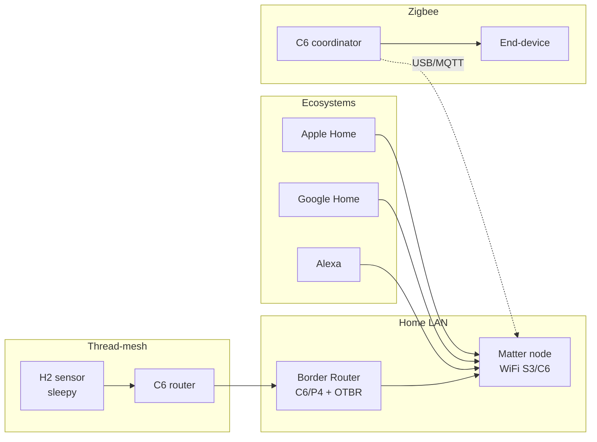

# Matter, Thread and Zigbee on ESP32 - esp-matter, OpenThread, esp-zigbee-SDK

> [!warning] Matter, Thread, and Zigbee need an 802.15.4 radio - that is C6 or H2, not C3!
> ESP32-C3 has no 802.15.4 and supports neither Thread nor Zigbee. For Matter-over-WiFi any ESP32 with WiFi fits, but for Matter-over-Thread or Zigbee take C6 or H2. See [[EN/01-Hardware/04-ESP32-C3-C6-H2.en|C3/C6/H2]].

Radio overview: [[EN/05-Radio/02-BLE-Bluetooth.en|BLE]], power [[EN/02-Power-Supply/01-Power-Rails.en|Power rails]], start [[Home.en|Home]].

## Purpose

Three different answers to how a smart home talks without cloud:

- **Matter** is a top-level applied IP protocol (application). Runs over WiFi, Thread, or Ethernet. One language for Apple Home, Google Home, Alexa, and SmartThings: one device is visible in several ecosystems at once (multi-admin). Commissioning goes over BLE + QR code or numeric code.
- **Thread** is a network transport (IPv6 over 802.15.4, mesh). These are the roads for Matter packets when WiFi is down or wasteful (battery sensors). Thread alone gives no application - Matter (or plain UDP/CoAP) runs on top.
- **Zigbee** is a mature non-IP stack (802.15.4 + own network and app layers). Own ecosystem: coordinator + routers + end devices, Home Assistant integration through ZHA or Zigbee2MQTT. Not directly compatible with Matter - bridge through a border router or hub.

When to take what:

- lamp or outlet in Apple or Google Home without own cloud - Matter-over-WiFi on any ESP32;
- battery sensor with years of life and mesh - Matter-over-Thread on C6 or H2;
- large existing Zigbee network (dozens of Aqara or IKEA devices) - Zigbee coordinator or end device on C6 or H2;
- one sensor to a nearby phone - plain BLE, see [[EN/05-Radio/02-BLE-Bluetooth.en|BLE]].

## What to choose - Matter vs Zigbee vs BLE vs WiFi

| Criterion | Matter-over-WiFi | Matter-over-Thread | Zigbee 3.0 | BLE (GATT) | Plain WiFi (MQTT/HTTP) |
| --- | --- | --- | --- | --- | --- |
| ESP chips | any with WiFi | C6/H2 (+ border router) | C6/H2 | all | any with WiFi |
| Transport | IP/WiFi | 802.15.4 mesh + IP | 802.15.4 mesh, not IP | BLE connection | IP/WiFi |
| Ecosystems | Apple, Google, and Alexa at once | same | ZHA/Zigbee2MQTT, hubs | phone or app | own cloud, Node-RED |
| Commissioning | BLE + QR or code | BLE + QR or code | pairing (permit join) | connect | provisioning, see [[EN/15-Protocols/04-Provisioning.en|Provisioning]] |
| Battery life | poor (WiFi) | excellent (SEDs sleep for years) | excellent | good | poor without deep-sleep |
| Range and topology | star to the router | mesh, self-healing | mesh, self-healing | point-to-point about 10-50 m | star to the router |
| Certification | needed for the logo | needed for the logo | needed for the logo | not needed | not needed |
| Code complexity | high (esp-matter) | highest (matter+thread) | medium (esp-zigbee-SDK) | low | low |
| When | outlet in HomeKit | battery sensor in HomeKit | existing Zigbee home | nearby remote or beacon | own dashboard or MQTT |

Rule: **no Apple or Google ecosystems means never pay the Matter price**. For your own home Zigbee or MQTT is enough, see [[EN/15-Protocols/01-MQTT.en|MQTT]].

## Chip and memory requirements

| Chip | WiFi | 802.15.4 | Matter-over-WiFi | Matter-over-Thread / Zigbee | Role in Thread/Zigbee |
| --- | --- | --- | --- | --- | --- |
| ESP32 Classic | yes | no | yes | no | - |
| ESP32-S3 | yes | no | yes | no | - |
| ESP32-C3 | yes | no | yes | no | - |
| ESP32-C6 | WiFi 6 | yes | yes | yes | node, RCP radio, border router |
| ESP32-H2 | no | yes | no (no WiFi) | yes | node, RCP radio |
| ESP32-C2 | yes | no | limited (little RAM) | no | - |
| ESP32-P4 | no (needs external radio) | no | as host over Ethernet | as host + C6/H2 radio over UART/SPI | border router host |

Memory: esp-matter pulls about 1 MB of flash (DAC certificates, clusters, BLE commissioning) - plan flash from 4 MB and partitions for factory + OTA, see [[EN/08-Memory/01-Partitions-NVS.en|Partitions]]. A Thread node on H2 lives in about 320 KB of flash. Hardware details: [[EN/01-Hardware/04-ESP32-C3-C6-H2.en|C3/C6/H2]], [[EN/01-Hardware/09-ESP32-C2-P4.en|C2/P4]].

![[assets/img/matter-thread-zigbee-scheme.png|600]]
*Fig. Matter over WiFi and Thread: BLE+QR commissioning, multi-ecosystem fabric, border router between Thread mesh and home LAN.*

### ASCII diagram

```text
ЕКOSИСТЕМИ (multi-admin, одна fabric або кілька):
  Apple Home ─┐
  Google Home ─┼──► WiFi/Ethernet ──► Matter-вузол (ESP32-S3, on-off light)
  Alexa ──────┘                              │
                                             │ Thread-радіо (802.15.4)
                                             ▼
  Thread-mesh: H2-датчик (SED, спить) ──► C6-роутер ──► Border Router (C6+RCP / RPi+OTBR)
                                                    ──► LAN ──► ті самі екосистеми

Zigbee-гілка (окрема мережа, не IP):
  Zigbee-координатор (C6, esp-zigbee-SDK) ──► роутер (лампа) ──► end-device (кнопка, спить)
        │ USB/UART
        ▼
  Home Assistant (ZHA / Zigbee2MQTT) ──► MQTT ──► Node-RED (див. 05-Cloud-Pipeline)

Комісіонування Matter: BLE-advertise + QR (passcode/discriminator) ──► fabric-credentials ──► operational
```

### Mermaid



## esp-matter SDK: commissioning, clusters, fabric, OTA

**Commissioning (BLE + QR).** A new device advertises over BLE. The commissioner (phone with Home) scans the QR: passcode, discriminator, and PASE session data. Operational credentials (NOC - node operational certificate) follow over BLE, the device joins a **fabric** and moves to the work transport (WiFi or Thread). Practice: print the QR on the case + keep a copy; without a factory QR recommission through manual code entry from the console.

**Data model: endpoints to clusters to attributes and commands.**

| Level | Example (smart lamp) | Note |
| --- | --- | --- |
| Endpoint 0 | Root Node (Descriptor, Basic Information, OTA) | service, always present |
| Endpoint 1 | On/Off Light (0x0100): OnOff server, LevelControl server | your device |
| Cluster server | OnOff (0x0006): `OnOff` attribute, `On/Off/Toggle` commands | state + control |
| Cluster client | OnOff client on a switch - sends commands to the lamp | binding |
| Attribute | `OnOff = true`, reporting on change | ecosystem subscriptions |

**Fabric and multi-admin.** Fabric is a security domain (one home = one fabric; a device can join several - multi-admin: Apple + Google at once). Each fabric has its own NOC and admins. Removing a fabric means remove from home without resetting others.

**Matter OTA.** Firmware is pulled through BDX from the OTA provider (hub or phone), the image is checked by VID, PID, and version. Plan two OTA slots, see [[EN/08-Memory/03-OTA.en|OTA]].

esp-matter examples: `examples/light` (on-off + level), `examples/light_switch` (client), `examples/thermostat`. Build is ESP-IDF only (esp-matter as a component, CMake).

## Thread, OpenThread, and border router

**Thread node roles:**

| Role | Power | What it does | Example |
| --- | --- | --- | --- |
| Leader | mains | drives the mesh, one per network | C6 router |
| Router | mains | relays, up to 32 per network | C6 lamp |
| Child (FTD/MTD) | mains or battery | talks through its parent | H2 switch |
| SED (Sleepy End Device) | battery, years | sleeps, polls its parent | H2 door sensor |

**OpenThread on ESP:** OpenThread stack in ESP-IDF (`CONFIG_OPENTHREAD_*`), 802.15.4 transport on C6/H2. Two designs: SoC (all on one C6) or **RCP** (C6/H2 is radio only over Spinel/UART, while the stack and app run on the host: P4 or Linux).

**Border Router (OTBR):** Thread mesh to WiFi/Ethernet bridge. Options: ready OTBR on Raspberry Pi + C6/H2 RCP, or ESP32 border router (C6 radio + WiFi uplink). Without a border router Thread devices are isolated from LAN and ecosystems - newcomer fault No.1.

> [!tip] C6 as radio + P4 as host
> Pair from the spec: P4 (strong host without radio) + C6/H2 as RCP over UART/SPI. Use the official `esp-border-router` image and Spinel transport - never invent your own host-to-radio protocol.

## esp-zigbee-SDK: roles, pairing, touchlink

**Roles:**

| Role | Power | Example | Note |
| --- | --- | --- | --- |
| Coordinator | mains, 1 per network | C6 stick on Home Assistant | forms the network, stores tables |
| Router | mains | lamp or outlet | relays, children attach to it |
| End Device | battery | button or sensor | sleeps, polls its parent |

**Pairing with ZHA/Zigbee2MQTT:** `permit join` turns on in the coordinator or hub (60-120 s), the device is put into pairing (button or reset), then interview (clusters) and appearance in HA. Channels 11-26 (2.4 GHz); channels 25-26 overlap with WiFi 11 - on deaf air change the coordinator channel. SDK examples: `examples/esp_zigbee_HA_sample` (HA on-off light/switch), `HA_on_off_light`, `HA_on_off_switch`.

**Touchlink (overview).** Direct lamp-to-remote pairing at close range (a few meters, reduced power), no coordinator: the remote steals the lamp into its mini network. Good for demos, careful in production: touchlink can unbind a foreign lamp through a wall, so keep it off by default.

> [!warning] Zigbee and Matter are different networks
> A Zigbee device never appears in Apple Home directly. Bridge through Home Assistant (ZHA/Z2M to HomeKit bridge) or a Matter bridge device. Plan this into the architecture at once.

## Code - commissioning and on-off cluster

**ESP-IDF, esp-matter: on-off light (short, `examples/light` example):**

```c
// idf.py menuconfig: ESP_MATTER_ENABLE_DATA_MODEL_SERVER, WiFi/Thread транспорт,
// BLE-комісіонування увімкнено. QR-код друкується в лог при старті.
// Ключові кроки light-прикладу:
#include <esp_matter.h>
#include <esp_matter_console.h>

static void *s_onoff_handle; // дескриптор кластера OnOff (endpoint 1)

static esp_err_t onoff_cb(esp_matter::attribute::callback_type_t type, uint16_t ep,
                          uint32_t cluster, uint32_t attr, esp_matter_attr_val_t *val,
                          void *priv)
{
    if (type == esp_matter::attribute::callback_type_t::PRE_UPDATE) {
        bool on = val->val.b;                 // новий стан OnOff
        gpio_set_level(GPIO_NUM_2, on);       // фізична лампа/світлодіод
    }
    return ESP_OK;
}

void app_main(void)
{
    nvs_flash_init();                         // fabric-дані і QR живуть у NVS!
    esp_matter::node_t *node = esp_matter::node::create_raw();
    esp_matter::endpoint_t *ep =
        esp_matter::endpoint::on_off_light::create(node, NULL, NULL, NULL);
    s_onoff_handle = esp_matter::cluster::get_first(ep); // OnOff-кластер
    esp_matter::attribute::set_callback(onoff_cb);       // колбек PRE_UPDATE
    esp_matter::start();                        // старт + BLE-advertise для комісіонування
    // QR/passcode шукайте в логу: "QR Code URL: ...", "Manual pairing code: ..."
}
```

**ESP-IDF, esp-zigbee-SDK: HA on-off light (short, `HA_on_off_light` example):**

```c
// menuconfig: Zigbee channel/mode (Coordinator/Router/End Device), install code.
// Кнопка BOOT — toggle локально + report; pairing — довге утримання.
#include "esp_zigbee_core.h"

static void bdb_start_top_level_commissioning_cb(uint8_t mode_mask)
{
    ESP_ERROR_CHECK(esp_zb_bdb_start_top_level_commissioning(mode_mask));
}

void esp_zb_app_signal_handler(esp_zb_app_signal_t *sig)
{
    if (sig->p_app_signal == ESP_ZB_BDB_SIGNAL_STEERING) {
        // пристрій у мережі (coordinator відкрив permit join)
    }
}

static esp_err_t zb_onoff_handler(const esp_zb_zcl_set_attr_value_message_t *m)
{
    if (m->info.cluster == ESP_ZB_ZCL_CLUSTER_ID_ON_OFF &&
        m->attribute.id == ESP_ZB_ZCL_ATTR_ON_OFF_ON_OFF_ID) {
        gpio_set_level(GPIO_NUM_2, m->attribute.data.value.__u8);
    }
    return ESP_OK;
}

void app_main(void)
{
    esp_zb_cfg_t cfg = { .esp_zb_role = ESP_ZB_DEVICE_TYPE_ED, // або ROUTER/COORDINATOR
                         .install_code_policy = false };
    esp_zb_init(&cfg);
    esp_zb_on_off_light_cfg_t light = ESP_ZB_DEFAULT_ON_OFF_LIGHT_CONFIG();
    esp_zb_ep_list_t *ep = esp_zb_on_off_light_ep_create(10, &light);
    esp_zb_device_register(ep);
    esp_zb_core_action_handler_register(zb_onoff_handler);
    ESP_ERROR_CHECK(esp_zb_start(false)); // false = не factory-reset при старті
    esp_zb_main_loop_iteration();         // головний цикл стеку
}
```

**Arduino:** there is no official Arduino wrapper for esp-matter or esp-zigbee-SDK - these stacks build only under ESP-IDF (CMake, partitions, NVS factory data). Practice: write the Matter or Zigbee node on ESP-IDF, keep Arduino logic on a second controller or talk over a UART or MQTT bridge. Never try to flash Matter as a sketch - it is a dead end.

**MicroPython:** no Matter, Thread, or Zigbee support in MicroPython (no 802.15.4 driver and no room for certificates). Practice: a MicroPython node talks to a gateway over MQTT or UART (see [[EN/15-Protocols/01-MQTT.en|MQTT]]), while a separate C6 or H2 on ESP-IDF holds the Matter or Zigbee part.

## Typical issues

| Symptom | Cause | Fix |
| --- | --- | --- |
| Thread or Zigbee never builds on C3 | no 802.15.4 radio on C3 | move to C6 or H2, see [[EN/01-Hardware/04-ESP32-C3-C6-H2.en|C3/C6/H2]] |
| Phone misses QR or commissioning hangs | BLE busy with another stack; factory data erased | clean `light` example, check the QR log; never erase NVS after commissioning |
| Device in fabric but not responding | no route: Thread without border router; WiFi in another VLAN | bring up OTBR; keep IoT and phone in one L2 |
| Device is a ghost in Home after `erase_flash` | fabric data stayed in the hub | remove the node from all fabrics (all ecosystems) before reflashing |
| Zigbee interview fails in ZHA or Z2M | dead end-device battery; noisy channel | fresh battery; change the coordinator channel; router closer |
| Touchlink stole a foreign lamp | touchlink on everywhere | turn touchlink off by default, on for a minute |
| Matter OTA never starts | VID, PID, or version mismatch; small OTA slot | align versions in the descriptor; partitions for two slots |
| NVS full after dozens of commissionings | old fabrics never cleaned | factory reset with a long button + `nvs_flash_erase()` |

## Official sources

- [ESP-Matter - Programming Guide](https://docs.espressif.com/projects/esp-matter/en/latest/) - commissioning, data model, Matter OTA, light and switch examples.
- [ESP Zigbee SDK - Programming Guide](https://docs.espressif.com/projects/esp-zigbee-sdk/en/latest/) - roles, HA examples, API reference.
- [OpenThread](https://openthread.io/guides/border-router) - border router, commissioner, RCP design.
- [Matter - Connectivity Standards Alliance](https://csa-iot.org/all-solutions/matter/) - spec, certification, multi-admin.

## See also

- [[Home.en|Home]]
- [[EN/05-Radio/02-BLE-Bluetooth.en|BLE and Bluetooth]] - Matter BLE commissioning, GATT base
- [[EN/05-Radio/05-BLE-Mesh-A2DP-HID.en|BLE Mesh, A2DP, HID]] - another Espressif BLE stack, A2DP on Classic only
- [[EN/01-Hardware/04-ESP32-C3-C6-H2.en|ESP32-C3, C6, H2]] - which radio lives where
- [[EN/01-Hardware/09-ESP32-C2-P4.en|ESP32-C2 and P4]] - P4 as border router host
- [[EN/11-Vivid/13-Audio-Codecs.en|Audio codecs]] - I2S sound for Matter voice devices
- [[EN/15-Protocols/01-MQTT.en|MQTT]] - Zigbee2MQTT to cloud bridge
- [[EN/15-Protocols/04-Provisioning.en|Provisioning]] - WiFi entry without reflashing
- [[EN/08-Memory/03-OTA.en|OTA]] - slots for Matter OTA
- [[EN/08-Memory/01-Partitions-NVS.en|NVS]] - fabric data lives in NVS


## Appendix: checklist

| Symptom | Cause | Fix |
|---|---|---|
| Connection/timeout | Network / broker settings | Verify URL, firewall, credentials |

## Official sources

- [Espressif Protocol Docs](https://docs.espressif.com/projects/esp-idf/en/latest/esp32/api-reference/protocols/index.html)
