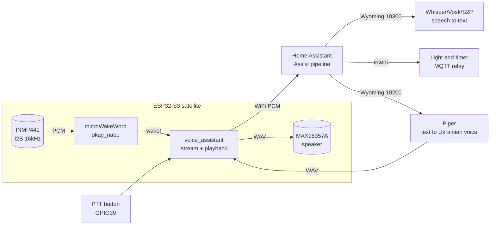

# Voice assistant on ESP32 - microWakeWord → Assist → Wyoming → Piper TTS

> [!info] Purpose
> Note on the full voice pipeline: **microWakeWord** hears the wake word right on ESP32 to audio flying to **Home Assistant Assist** to the **Wyoming protocol** handing tasks to services to **Piper TTS** speaking the answer back on the speaker to **STT** (faster-whisper or Vosk) on the server recognizing the phrase. Plus: wake engine comparison (Porcupine, Rhino, Cobra, OpenWakeWord), ready **ESPHome voice + Atom Echo** firmware, **VoIP and SIP intercom** and **ESP32 to ESP32 intercom** overview, honest talk on **privacy** (all local vs cloud). Offline commands without a server - [[EN/12-Comm-Modules/16-Offline-Voice.en|Offline voice]], neural nets on chip - [[EN/12-Comm-Modules/11-TinyML-Voice.en|TinyML voice]].

Network overview: [[EN/05-Radio/01-WiFi-STA-AP.en|WiFi STA and AP]], sound [[EN/04-Interfaces/04-I2S.en|I2S]], commands to the house [[EN/15-Protocols/01-MQTT.en|MQTT]], start [[Home.en|Home]].

## Purpose

Short version: turn ESP32 with mic and speaker into a smart-home voice remote - turn on the living room light, set a timer, what is the temperature. ESP32 here is only ears and mouth (satellite): hears the wake word, streams audio, plays the answer. Home Assistant with services does the thinking.

| Parameter | Value |
| --- | --- |
| Transport | WiFi (satellite to HA), Wyoming TCP (HA to STT, TTS, and wake services) |
| Audio format | 16 kHz, 16 bit, mono (same everywhere - from mic to Whisper) |
| Satellite hardware | ESP32-S3 (advised, PSRAM) or ESP32 + I2S mic and speaker; ready Atom Echo |
| Server | Home Assistant OS (RPi 4 minimum for Piper; x86 or NUC for Whisper) |
| Cloud | Not needed at all (fully local option) or HA Cloud (simplest start) |
| Languages | Ukrainian - Whisper + Piper `uk_*` voices; wake word trains separately |

When to take this pipeline:

- free speech needed, not 15 fixed commands;
- house already on Home Assistant and talking to entities sounds good;
- privacy: nothing flies to the cloud (hospital, office, kids room).

When to skip it:

- no 24/7 server - take offline modules [[EN/12-Comm-Modules/16-Offline-Voice.en|Offline voice]];
- sub-300 ms reaction to one button command needed - GPIO or BLE remote is faster;
- only fixed Ukrainian commands and zero WiFi - SU-61T or SYN7318 are cheaper.

## Specifications

| Pipeline link | Where it runs | What it does | Typical delay | Memory and demands |
| --- | --- | --- | --- | --- |
| microWakeWord | ESP32-S3 (on device!) | Listens for okay nabu or hey jarvis, silent the rest of the time | 200-500 ms to stream start | Arena about 23 KB + PSRAM for audio; `.tflite` model + JSON |
| ESPHome `voice_assistant` | ESP32 (satellite) | Streams 16 kHz audio to HA, plays the answer on the speaker | Depends on WiFi (50-200 ms) | About 100 KB heap for buffers; never turn BLE on at once! |
| Wyoming protocol | TCP between HA and services | JSON header + audio bytes; ports 10300, 10400, 10500 | Under 10 ms locally | One container per service |
| STT faster-whisper | Server (CPU/GPU) | Speech to text (open-ended, any phrase) | 0.5-8 s (see VRAM/CPU table!) | base and small on CPU; medium+ wants GPU |
| STT Vosk / Speech-to-Phrase | Server (even RPi!) | Speech to text from the HA dictionary (close-ended, fast) | Under 1 s on RPi 4 | 50 MB model, about 200 MB RAM |
| Piper TTS | Server (even RPi!) | Text to `uk_` voice back on the speaker | About 0.6 s of render per 1 s of speech (medium) | RAM about 200-300 MB |
| Assist intent | Home Assistant | Text to action (light, timer, script) | Under 100 ms | - |

![[assets/img/voice-assistant-pipeline-scheme.png|600]]
*Fig. Pipeline: mic to microWakeWord (ESP32) to WiFi to Assist to Wyoming (STT/TTS) to Piper voice to speaker.*

## 1. microWakeWord - wake word on the ESP32 itself

microWakeWord is a TinyML model (streaming CNN, about 23 KB arena) that always hears the mic and wakes only on its word. Everything else - silence, TV, talk - is ignored. Runs on ESP32-S3 with no server at all.

How it is built:

1. I2S mic gives a 16 kHz stream to a spectrogram in 10 ms steps (`feature_step_size`);
2. model scores the wake word in a sliding window (`sliding_window_size: 5`);
3. if the mean is above `probability_cutoff` (typically 0.97) - `on_wake_word_detected` event;
4. ESPHome stops the detector (`stop_after_detection: true`) and starts the stream to HA - so it never hears itself.

Ready models (`esphome/micro-wake-word-models` repo, v2): `okay_nabu`, `hey_jarvis`, `alexa`, `hey_mycroft`. Own word (like hello house) trains in the microWakeWord Colab notebook: 100+ target sayings + hours of negatives (noise, TV, similar words!), output is `model.tflite` + JSON manifest.

> [!tip] VAD against the TV
> Add a VAD model (`vad:` in config) - it cuts non-speech sounds and false fires from music and TV by 3-5 times. Hold the VAD threshold at 0.6-0.7, else quiet speech from afar gets lost.

## 2. Home Assistant Assist - pipeline brain

Assist is the built-in HA voice assistant. Pipeline logic (set in **Settings to Voice assistants to Add assistant**):

```text
[Сателіт ESP32] ──WiFi 16кГц──► [Assist pipeline]
                                        │
              ┌─────────────────────────┼─────────────────────────┐
              ▼                         ▼                         ▼
        Wake word                Speech-to-Text              Conversation agent
   (microWakeWord на             (Whisper / Vosk /            (Home Assistant:
    пристрої або                  Speech-to-Phrase)            інтенти світло/таймер/
    openWakeWord на                                        або LLM-персонаж)
    сервері)                         │                         │
              │                      ▼                         ▼
              │               Text-to-Speech ──► сателіт грає відповідь
              │               (Piper uk_UA, medium)
              ▼
        expose devices! (інакше «не знайдено»)
```

Critical settings without which it never works:

1. **Entity expose:** each light, outlet, or script goes to Settings to Voice assistants to Expose; else Assist answers sorry, not found.
2. **Zones (Areas):** device bound to a room - turn on the light means the light of *this* room (per satellite!).
3. **Aliases:** chandelier, sconce, telly - entity aliases in Ukrainian, else Whisper hears but intent never gets it.
4. `assist_pipeline:` in `configuration.yaml` - if no assistants show in the UI (no default config).

## 3. Wyoming protocol - glue between HA and services

Wyoming is a simple TCP protocol: JSON header with event type + optional bytes. Each service (Whisper, Piper, openWakeWord) is a separate Wyoming server on its own port, HA joins with the **Wyoming Protocol** integration (autodiscovery on LAN!).

| Service | Default port | Events (simplified) | Where installed |
| --- | --- | --- | --- |
| faster-whisper | 10300 | `transcribe` to audio chunks to `transcript` (text + language + score) | Add-on or Docker on the server |
| Piper | 10200 | `synthesize` (text + `uk_UA` medium voice) to 22050 Hz WAV chunks | Add-on or Docker (even RPi!) |
| openWakeWord | 10400 | `detect` to audio to `detection` (word + timestamp) | Add-on or Docker |
| Speech-to-Phrase | 10300 (instead of Whisper) | same `transcribe` and `transcript`, but the dictionary is your HA entities | Add-on + HA WebSocket token |

Frame format (concept, full spec in `rhasspy3/docs/wyoming.md`):

```text
TCP-пакет:  {"type": "audio-start", "data": {"rate": 16000, "width": 2, "channels": 1}}\n
            <сирі PCM-байті 16кГц/16біт/моно чанками ~1024 семпли>
            {"type": "audio-stop"}\n
            ◄── {"type": "transcript", "data": {"text": "увімкни світло"}}\n
```

Why it is handy: STT can live on a strong PC in the closet (`Wyoming Protocol to host: 192.168.1.50:10300`), while HA runs on Green. One Whisper serves 5 satellites in turn.

## 4. Piper TTS - voice back on the speaker

Piper is local neural speech (VITS), tuned for RPi 4: a medium model renders 1.6 s of voice per 1 s. Ukrainian voices are `uk_UA-ukrainian-medium` (female and male, listen to samples at `rhasspy.github.io/piper-samples/`).

Answer path:

```text
[Assist: "Світло у вітальні увімкнено"]
   ──Wyoming synthesize──► [Piper: текст → WAV 22050 Гц]
   ──WAV по WiFi──► [ESP32: I2S → MAX98357A → динамік 4 Ом]
```

Practice:

- `medium` quality is the optimum (low sounds robotic, high is twice slower);
- cut long answers (over 30 s) by sentences - the ESP32 stream buffer is small;
- Piper in automations: `tts.speak` service to the satellite `media_player` (gate open announcements with no wake word!);
- volume: `volume_multiplier` in ESPHome (a 3W speaker in a case screams at max).

## 5. Server STT: faster-whisper vs Vosk (VRAM and CPU demands!)

| Model or engine | Where it runs | VRAM (GPU) / RAM (CPU) | Speed | Ukrainian | When to take |
| --- | --- | --- | --- | --- | --- |
| faster-whisper `tiny` | CPU RPi 4 | about 300 MB RAM | about 8 s per phrase (RPi 4) | Weak | Tests only |
| faster-whisper `base` | CPU RPi 4 or NUC | about 500 MB RAM | about 4 s or under 1 s (NUC) | Fair | Minimum for house control |
| faster-whisper `small` | CPU NUC or 2 GB GPU | about 1 GB | under 1 s | Good | Price and quality optimum |
| faster-whisper `medium` | 4-5 GB GPU (int8: about 3 GB) | about 5 GB fp16 or 3 GB int8 | about 1 s batched | Very good | LLM talks, dictation |
| faster-whisper `large-v3` | 6-8 GB GPU (int8: about 4.5 GB) | about 10 GB fp16 | 1-2 s | Best | Max accuracy |
| faster-whisper `distil-large-v3` | 6 GB GPU | about 6 GB fp16 | About 40 percent faster than large | like large (EN optimized!) | EN house, speed |
| Vosk `vosk-model-small-uk` | CPU RPi (even Zero 2!) | about 50 MB RAM | Real time | Good (dictionary) | Weak hardware, fixed dictionary |
| Vosk server `uk` big | 4+ core NUC CPU | about 1.5 GB RAM | near real time | Very good | Server without GPU |
| Speech-to-Phrase | CPU Green or RPi 4 | about 200 MB RAM | under 1 s | through HA templates | House control only, max speed |

Rules:

- house control on RPi means Speech-to-Phrase (instant) or whisper `base`;
- free phrases and Ukrainian dictation mean NUC + `small`, GPU preferred;
- int8 quantization (`compute_type="int8"`) cuts VRAM almost in half with about 1 percent accuracy loss - always on for weak GPUs;
- default `beam_size=5`; for speed use `beam_size=1` (greedy), minus 30 percent time, minus 2 percent accuracy.

## 6. Wake engines: Porcupine, Rhino, Cobra, OpenWakeWord compared

| Engine | Where it runs | What it detects | Ukrainian and custom | License and price | ESP32? |
| --- | --- | --- | --- | --- | --- |
| microWakeWord | ESP32-S3 (device!) | 1 wake word | Custom through Colab (any language, 100+ samples needed) | Apache-2.0, free | **Yes, main pick** |
| OpenWakeWord | HA server (Wyoming 10400) | Several wake words | Community custom models, mostly EN | Apache-2.0, free | No (audio always streams!) |
| Porcupine (Picovoice) | RPi, phone, or MCU (Cortex-M!) | 1-3 wake words, built in + console | 9 languages, no Ukrainian; custom through the Picovoice console | Free for personal use; AccessKey mandatory | Yes (C library, but not through ESPHome voice!) |
| Rhino (Picovoice) | Same | Speech-to-Intent (command to intent, no STT!) | EN, DE, FR, ES, no Ukrainian | like Porcupine | MCU yes, ESP32 by hand |
| Cobra (Picovoice) | Same | VAD (voice or not) | Language independent | like Porcupine | Yes (light) |
| ESP-SR WakeNet | ESP32/S3 (device!) | Hi ESP + MultiNet commands | EN and CN out of the box | Espressif, free | **Yes, microWakeWord alternative** |

Bottom line for ESP32+HA: wake word means **microWakeWord** (free, built into ESPHome, Ukrainian words trainable). OpenWakeWord fits if the satellite is weak (ESP32 without S3) and ready to stream audio to the server all the time. Porcupine and Rhino fit a custom C project with no HA at all.

## 7. ESPHome voice + Atom Echo - ready firmware

M5Stack Atom Echo (about $13): ESP32-PICO + mic + button + Grove jack, no speaker out of the box (solder a 2W one through Grove or take Atom Echo + external speaker). Official ready YAML is `esphome/voice-kit` or the HA firmware wizard ($13 voice remote): flashes from the browser through ESPHome Web, then only WiFi data.

Minimal satellite YAML (S3 + INMP441 + MAX98357A):

```yaml
esphome:
  name: kitchen-satellite
esp32:
  board: esp32-s3-devkitc-1
  framework:
    type: esp-idf
psram:
  mode: octal
  speed: 80MHz

wifi:
  ssid: !secret wifi_ssid
  password: !secret wifi_password
api:
  encryption:
    key: !secret api_key

i2s_audio:
  - id: i2s_in
    i2s_lrclk_pin: GPIO5    # WS мікрофона
    i2s_bck_pin: GPIO6     # BCK
  - id: i2s_out
    i2s_lrclk_pin: GPIO15  # WS динаміка
    i2s_bck_pin: GPIO14

microphone:
  - platform: i2s_audio
    id: mic
    i2s_audio_id: i2s_in
    adc_type: external
    i2s_din_pin: GPIO4
    channel: left

speaker:
  - platform: i2s_audio
    id: spk
    i2s_audio_id: i2s_out
    dac_type: external
    i2s_dout_pin: GPIO22
    mode: mono

micro_wake_word:
  microphone:
    microphone: mic
    channels: 0
    gain_factor: 4
  vad:
  models:
    - model: okay_nabu
      id: okay_nabu_model

voice_assistant:
  microphone:
    microphone: mic
    channels: 0
    gain_factor: 4
  speaker: spk
  use_wake_word: true
  micro_wake_word: okay_nabu_model
  noise_suppression_level: 2
  auto_gain: 31dBFS
  volume_multiplier: 2.0
  on_tts_end:
    - homeassistant.service:
        service: persistent_notification.create
        data:
          message: !lambda 'return "Сателіт сказав: " + x;'

binary_sensor:
  - platform: gpio  # Push-to-talk кнопка (Atom Echo: GPIO39!)
    pin:
      number: GPIO39
      inverted: true
    on_press:
      - voice_assistant.start:
          silence_detection: false
    on_release:
      - voice_assistant.stop:
```

> [!warning] Audio + BLE means crash!
> Voice components eat RAM and CPU: a Bluetooth proxy on the same ESP32 almost surely drops the firmware. Satellite is voice only; BLE tracker is a separate chip. See ESPHome troubleshooting (backtrace through `esp-idf`).

## 8. VoIP and SIP intercom - overview (UDP stream, latency!)

Intercom is the same voice, but human-to-human talk through a SIP server (Asterisk or FreePBX) or directly. ESP32 acts as a SIP client (`esp-sip` libraries, `esphone` and `SIP-Doorbell` projects).

```text
[Кнопка біля хвіртки] → ESP32: INVITE → [Asterisk 192.168.1.5]
   → UDP/RTP-потік G.711 (8 кГц, 64 кбіт/с!) ↔ телефон у кишені
   → DTMF «5» → ESP32 відкриває замок (GPIO)
```

Numbers to know:

| Parameter | Value | Note |
| --- | --- | --- |
| ESP32 codec | G.711 mu-law and A-law (8 kHz) | No Opus on ESP32 (see section 9!) |
| Traffic | About 80 kbit/s with headers (20 ms packets) | WiFi pulls it easily; 100-200 ms jitter buffer |
| Latency | 200-600 ms (codec + buffer + WiFi) | Talk in turn, never interrupt! |
| Registration | SIP REGISTER every 60-300 s | without re-registration incoming calls vanish |
| Power | A call wakes ESP32 from light-sleep by button | Constant RTP stream eats the battery in hours |

This is an overview: a full SIP stack (SDP, NAT, STUN) is a separate note and server topic. For call from gate to phone a ready Grandstream + ESP32 lock-only is simpler.

## 9. ESP32 to ESP32 intercom - I2S to UDP (Opus? Opus on ESP32 is hard, honestly!)

Idea: two ESP32 boards with mic and speaker, PTT button - voice flies over UDP on LAN with no server at all. It really works on raw PCM or ADPCM; Opus is a trap.

| Codec option | Bitrate | ESP32 CPU | RAM | Verdict |
| --- | --- | --- | --- | --- |
| PCM 16 kHz/16 bit | 256 kbit/s | about 0% (direct DMA to UDP) | 2x4 KB buffers | **Works.** LAN pulls 2-3 pairs at once |
| ADPCM (IMA, 4 bit) | 64 kbit/s | about 5% (table coder) | +1 KB | Works, walkie-talkie quality - fine for an intercom |
| G.711 | 64 kbit/s | about 3% | +1 KB | Works, SIP compatible! |
| Opus | 16-32 kbit/s | **Never fits stably**: encoder needs about 40-60 MHz + about 100 KB RAM + float, fights the WiFi stack on one core | - | **Honestly: skip it.** Tests exist on S3 (16 kHz, mono, complexity 0), but jitter and drops remain. For Opus run a server (Janus or Mumble) and stream PCM to it |

PTT intercom scheme (PCM and UDP broadcast):

```text
[ESP32-A: INMP441 → I2S 16кГц] ──UDP:5004 broadcast──► [ESP32-B: UDP → MAX98357A]
[ESP32-B: INMP441 → I2S 16кГц] ──UDP:5005 broadcast──► [ESP32-A: UDP → MAX98357A]
Кнопка PTT: поки затиснута — TX; відпустив — RX (half-duplex, без AEC!)
```

Full duplex (talk at once) needs AEC (see ESP-SR AFE, [[EN/12-Comm-Modules/11-TinyML-Voice.en|TinyML voice]]) - on two ESP32 boards over WiFi with jitter it never flies. Half-duplex + PTT is the working scheme for a garage or cottage.

## 10. Privacy: all local vs cloud

| Mode | What goes where | Delay | Price | When |
| --- | --- | --- | --- | --- |
| All local (microWakeWord + Whisper/S2P + Piper) | Nothing leaves LAN | 1-3 s | 24/7 server (RPi/NUC) | Home, office, GDPR or hospital demands |
| HA Cloud (Nabu Casa, about $6/month) | Audio to Nabu Casa cloud to text back | 1-2 s | Subscription, zero admin | 10-minute start, HA development support |
| Local LLM character (Ollama) | Text to local LLM (Llama 3 8B) | 5-30 s | 8+ GB VRAM GPU | Jokes and talks with no cloud |
| Cloud LLM character (OpenAI/Gemini) | Text to API | 2-5 s | Dollars per tokens + data in cloud | Talk like Mario, hard questions |
| Alexa or Google speaker | All to the vendor | about 1 s | $0 + your data | not this note at all |

Privacy minimum even locally: separate IoT VLAN for satellites, ESPHome API password never in git (`!secret`), HA logs with no audio (only transcript texts stored), mic MUTE switch (physical `micro_wake_word.stop` button + recording LED!).

## Satellite module pin legend

### M5Stack Atom Echo (ready, nothing to solder for start)

| Atom Echo pin or part | Purpose | ESPHome note |
| --- | --- | --- |
| ESP32-PICO-D4 | Brain (4 MB flash, no PSRAM!) | Only `voice_assistant`, microWakeWord never fits there - wake on the server (openWakeWord) or button! |
| Mic (I2S, built in) | Input | `i2s_audio` ready preset `m5stack-atom-echo.yaml` |
| Button (GPIO39) | Push-to-talk | `on_press to voice_assistant.start` (see YAML above) |
| RGB LED (SK6812, GPIO27) | Status (hears, thinks, speaks) | `on_listening`, `on_stt_end`, `on_tts_start` in different colors |
| Grove (GPIO32/26: SDA/SCL + 5V/GND) | External speaker or sensors | Speaker through an I2S DAC, never directly! |
| USB-C | Power + flashing | 5V 500 mA is enough |

### DIY satellite S3 + INMP441 + MAX98357A (full cycle with microWakeWord)

| Module or pin | Where on ESP32-S3 | Note |
| --- | --- | --- |
| INMP441 VDD/GND | 3V3 / GND (+100 nF) | 3.3V only |
| INMP441 SD / WS / SCK | GPIO4 / GPIO5 / GPIO6 | I2S RX 16 kHz, under 10 cm |
| INMP441 L/R | GND (Left) | - |
| MAX98357A VIN/GND | separate 5V! / common GND | 1A+ peaks - never from ESP32 3V3! |
| MAX98357A BCLK / LRCK / DIN | GPIO14 / GPIO15 / GPIO22 | I2S TX; BCLK and LRCK may share with the mic by frequency |
| MAX98357A GAIN | GND (12 dB) / NC (9 dB) | 12 dB screams in a room - set 9 dB |
| 4 Ohm 3W speaker | MAX98357A output | in a ported case, 10+ cm away from the mic (feedback!) |
| PTT/MUTE button | GPIO39/0 + GND | MUTE: `micro_wake_word.stop` + red LED |

## Wiring diagram

| ESP32-S3 DevKit | INMP441 | MAX98357A | Button/LED | Note |
| --- | --- | --- | --- | --- |
| 3V3 | VDD (+100 nF) | - (SD_MODE to GND!) | LED anode through 220 Ohm | - |
| 5V (VIN, separate 2A PSU) | - | VIN | - | 1A+ speaker peaks |
| GND | GND | GND | GND | Star, thick wire to the amp |
| GPIO4 | SD | - | - | I2S DIN |
| GPIO5 | WS | - | - | I2S WS (may be shared) |
| GPIO6 | SCK | - | - | I2S BCK |
| GPIO22 | - | DIN | - | I2S DOUT |
| GPIO15/14 | - | LRCK/BCLK | - | I2S TX clock |
| GPIO39 | - | - | PTT button to GND | Internal pull-up |
| GPIO27 | - | - | Status LED | Hears means green, thinks means blue, fault means red |

> [!warning] Mic to speaker feedback
> Speaker answer leaks back to the mic to Assist hearing itself to a loop. Cure: speaker and mic on opposite case walls 10+ cm apart, `noise_suppression_level: 2`, AEC (ESP-SR AFE) for advanced users, volume at most 70 percent.

### ASCII diagram

```text
ESP32-S3 DevKit                  INMP441 (I2S-мікрофон)
─────────────                    ──────────────────────
3V3 ───[100нФ]─────────────────► VDD
GND ───────────────────────────  GND (коротко!)
GPIO4 ◄────────────────────────  SD (16кГц/16біт)
GPIO5 ─────────────────────────► WS
GPIO6 ─────────────────────────► SCK
GND ───────────────────────────  L/R (=Left)

ESP32-S3                         MAX98357A (I2S-підсилювач)
────────                         ─────────────────────────
5V (БЖ 2A!) ───────────────────► VIN (піки 1A+!)
GND (товстий!) ─────────────────  GND
GPIO22 ────────────────────────► DIN
GPIO15 ────────────────────────► LRCK
GPIO14 ────────────────────────► BCLK
GND ───────────────────────────  GAIN (=9dB, не верещить)
                                 SPK+ / SPK− ──► Динамік 4Ом 3W
                                 (10см+ від мікрофона!)

GPIO39 ──[кнопка]──► GND (PTT/MUTE)      GPIO27 ──[220]──► LED статус
         │ WiFi 16кГц PCM                │
         ▼                               ▼
   Home Assistant (Assist → Wyoming 10300/10200 → Whisper/Piper)
```

### Mermaid



## ESP-IDF code (satellite: I2S mic to TCP stream to I2S speaker, concept)

```c
// Концепт: повний Wyoming-клієнт — це ~500 рядків (сокети, перепідключення,
// чанки). Тут каркас I2S duplex + TCP-стрим; протокол див. розділ 3.
#include "driver/i2s.h"
#include "esp_log.h"
#include "lwip/sockets.h"
#define MIC_BCK 6
#define MIC_WS 5
#define MIC_DIN 4
#define SPK_BCK 14
#define SPK_WS 15
#define SPK_DOUT 22
#define SERVER_IP "192.168.1.10"
#define WYOMING_STT_PORT 10300

static void i2s_init(void) {
    // RX: мікрофон 16 кГц/16 біт/моно.
    i2s_config_t rx = { .mode = (i2s_mode_t)(I2S_MODE_MASTER | I2S_MODE_RX),
        .sample_rate = 16000, .bits_per_sample = I2S_BITS_PER_SAMPLE_16BIT,
        .channel_format = I2S_CHANNEL_FMT_ONLY_LEFT,
        .communication_format = I2S_COMM_FORMAT_STAND_I2S,
        .dma_buf_count = 4, .dma_buf_len = 512, .use_apll = false,
        .tx_desc_auto_clear = false, .fixed_mclk = 0 };
    i2s_pin_config_t rxp = { .bck_io_num = MIC_BCK, .ws_io_num = MIC_WS,
        .data_out_num = -1, .data_in_num = MIC_DIN };
    i2s_driver_install(I2S_NUM_0, &rx, 0, NULL);
    i2s_set_pin(I2S_NUM_0, &rxp);
    // TX: динамік 22050 Гц (Piper!) / 16 біт/моно.
    i2s_config_t tx = rx;
    tx.mode = (i2s_mode_t)(I2S_MODE_MASTER | I2S_MODE_TX);
    tx.sample_rate = 22050;
    i2s_pin_config_t txp = { .bck_io_num = SPK_BCK, .ws_io_num = SPK_WS,
        .data_out_num = SPK_DOUT, .data_in_num = -1 };
    i2s_driver_install(I2S_NUM_1, &tx, 0, NULL);
    i2s_set_pin(I2S_NUM_1, &txp);
}

static void stream_task(void *a) {
    int s = socket(AF_INET, SOCK_STREAM, 0);
    struct sockaddr_in d = { .sin_family = AF_INET,
        .sin_port = htons(WYOMING_STT_PORT) };
    inet_pton(AF_INET, SERVER_IP, &d.sin_addr);
    if (connect(s, (void *)&d, sizeof(d)) != 0) {
        ESP_LOGE("SAT", "нема Wyoming/STT"); vTaskDelete(NULL);
    }
    const char *start = "{\"type\":\"audio-start\","
        "\"data\":{\"rate\":16000,\"width\":2,\"channels\":1}}\n";
    send(s, start, strlen(start), 0);
    int16_t buf[1024]; size_t n;
    for (int i = 0; i < 500; i++) { // ~10 с фрази
        i2s_read(I2S_NUM_0, buf, sizeof(buf), &n, portMAX_DELAY);
        send(s, buf, n, 0); // тут мають бути Wyoming-чанки з довжиною!
    }
    const char *stop = "{\"type\":\"audio-stop\"}\n";
    send(s, stop, strlen(stop), 0);
    // TODO: прочитати {"type":"transcript"...} і показати/озвучити.
    close(s); vTaskDelete(NULL);
}

void app_main(void) {
    i2s_init();
    // TODO: WiFi STA connect → xTaskCreate(stream_task) по кнопці/GPIO.
    // Продакшн: беріть ESPHome voice_assistant — там це все готове!
}
```

## Arduino code (satellite: I2S read + UDP stream to server, concept)

```cpp
#include <WiFi.h>
#include <WiFiUdp.h>
#include <driver/i2s.h>
#define MIC_BCK 6
#define MIC_WS 5
#define MIC_DIN 4
#define SPK_DOUT 22
#define PTT 39
const char *SSID = "IoT";
const char *PASS = "SECRET";
const char *SRV = "192.168.1.10";
const int PORT = 5004; // UDP-порт приймача на сервері
WiFiUDP udp;

void setup() {
  Serial.begin(115200);
  pinMode(PTT, INPUT_PULLUP);
  WiFi.begin(SSID, PASS);
  while (WiFi.status() != WL_CONNECTED) delay(300);
  Serial.println(WiFi.localIP());
  i2s_config_t c = {.mode = (i2s_mode_t)(I2S_MODE_MASTER | I2S_MODE_RX),
    .sample_rate = 16000, .bits_per_sample = I2S_BITS_PER_SAMPLE_16BIT,
    .channel_format = I2S_CHANNEL_FMT_ONLY_LEFT,
    .communication_format = I2S_COMM_FORMAT_I2S,
    .intr_alloc_flags = 0, .dma_buf_count = 4, .dma_buf_len = 512,
    .use_apll = false};
  i2s_pin_config_t p = {.bck_io_num = MIC_BCK, .ws_io_num = MIC_WS,
    .data_out_num = -1, .data_in_num = MIC_DIN};
  i2s_driver_install(I2S_NUM_0, &c, 0, NULL);
  i2s_set_pin(I2S_NUM_0, &p);
}

void loop() {
  // PTT: затиснув — стримлю PCM по UDP; відпустив — мовчу.
  static int16_t buf[512];
  size_t n;
  if (digitalRead(PTT) == LOW) {
    i2s_read(I2S_NUM_0, buf, sizeof(buf), &n, 100 / portTICK_PERIOD_MS);
    if (n > 0) {
      udp.beginPacket(SRV, PORT);
      udp.write((uint8_t *)buf, n);
      udp.endPacket();
    }
  } else {
    delay(20); // відпочинок: без PTT ефір мовчить (приватність!)
  }
}
// Серверна сторона: python приймає UDP → faster-whisper → Piper →
// відповідь назад (див. MicroPython-приклад нижче і розділ 5).
```

## MicroPython code (PTT intercom ESP32 to ESP32 over UDP + server pipeline)

```python
# Частина A: PTT-інтерком (однаковий код на обох ESP32, різні порти!).
import network, socket
from machine import I2S, Pin
import time

MY_TX_PORT = 5004    # куди шлю (порт партнера)
MY_RX_PORT = 5005    # де слухаю (у партнера навпаки!)
PEER = "192.168.1.42"

sta = network.WLAN(network.STA_IF)
sta.active(True); sta.connect("IoT", "SECRET")
while not sta.isconnected(): time.sleep(0.3)
print("IP:", sta.ifconfig()[0])

mic = I2S(0, sck=Pin(6), ws=Pin(5), sd=Pin(4),
          mode=I2S.RX, bits=16, format=I2S.MONO, rate=16000, ibuf=4096)
spk = I2S(1, sck=Pin(14), ws=Pin(15), sd=Pin(22),
          mode=I2S.TX, bits=16, format=I2S.MONO, rate=16000, ibuf=4096)
ptt = Pin(39, Pin.IN, Pin.PULL_UP)
led = Pin(27, Pin.OUT)

tx = socket.socket(socket.AF_INET, socket.SOCK_DGRAM)
rx = socket.socket(socket.AF_INET, socket.SOCK_DGRAM)
rx.bind(("0.0.0.0", MY_RX_PORT))
rx.settimeout(0.02)
buf = bytearray(2048)

while True:
    if ptt.value() == 0:  # PTT затиснуто: TX (half-duplex!)
        led.on()
        n = mic.readinto(buf)
        if n:
            tx.sendto(buf[:n], (PEER, MY_TX_PORT))
    else:                 # PTT відпущено: RX
        led.off()
        try:
            data, _ = rx.recvfrom(2048)
            spk.write(data)  # сирий PCM 16кГц — той самий формат!
        except OSError:
            pass  # таймаут — тиша в ефірі, це нормально
```

```python
# Частина B: серверний пайплайн (запускається на ПК/NUC, не на ESP32!).
# UDP-прийом → faster-whisper tiny/base → Piper → WAV назад.
# pip install faster-whisper piper-tts
import socket
from faster_whisper import WhisperModel

stt = WhisperModel("base", device="cpu", compute_type="int8")
print("STT готова (base/int8/CPU)")

s = socket.socket(socket.AF_INET, socket.SOCK_DGRAM)
s.bind(("0.0.0.0", 5004))
frames = []
while True:
    data, addr = s.recvfrom(4096)
    frames.append(data)
    # 2 с аудіо (16кГц*2байт*2с = 64000 байт) → транскрипція.
    if sum(len(f) for f in frames) >= 64000:
        raw = b"".join(frames); frames = []
        with open("/tmp/phrase.raw", "wb") as f:
            f.write(raw)
        segs, _ = stt.transcribe("/tmp/phrase.raw", beam_size=1,
                                 language="uk")
        text = " ".join(s.text for s in segs).strip()
        print("Почуто:", text)
        # Далі: Home Assistant webhook / Piper:
        # echo "<text>" | piper --model uk_UA-medium.onnx --output_file out.wav
```

More on environments: [[EN/00-Start/05-Environment-Choice.en|Environment choice]].

## Typical issues

| # | Symptom | Cause | Fix |
| --- | --- | --- | --- |
| 1 | Satellite visible in ESPHome, but Assist never hears it | `voice_assistant` without `microphone:` or `use_wake_word: false` without a button | Add the mic and `use_wake_word: true` + bound `micro_wake_word`; or a PTT button |
| 2 | Crash or reboot at voice start | No PSRAM on the board (plain ESP32-WROOM or Atom Echo!) | microWakeWord is S3 with PSRAM only; on boards without PSRAM use wake on the server (openWakeWord) or a button |
| 3 | Crash on simultaneous BLE + voice | Audio eats the heap, BLE stack never fits | Remove `bluetooth_proxy` from the satellite; BLE is a separate chip |
| 4 | Whisper 8+ s on RPi 4 | `small` or `medium` model on a weak CPU | `tiny` or `base`, or Speech-to-Phrase for commands; heavy models go to NUC or GPU |
| 5 | Sorry, not found on every command | Entities never exposed, no zones or aliases | Expose + Area + Ukrainian aliases; check built-in Assist sentences |
| 6 | No assistants in the UI at all | No default config | Add `assist_pipeline:` to `configuration.yaml`, restart HA |
| 7 | Wyoming service never found | Service in another subnet, port closed, or container never started | One LAN or VLAN; `telnet host 10300`; add-on logs; manual IP:port entry |
| 8 | Piper speaks English instead of Ukrainian | `en_*` voice picked in the pipeline | Pick `uk_UA` medium TTS in the pipeline; check `language: uk` |
| 9 | Satellite hears itself (answer loop) | Speaker next to the mic, volume 100 percent | 10+ cm between them; `noise_suppression_level: 2`; volume at most 70 percent; AEC for advanced users |
| 10 | False fires on the TV | No VAD, low wake threshold | Add `vad:`; `probability_cutoff` 0.97+; satellite away from TV |
| 11 | UDP intercom crackles or drops | WiFi jitter, small buffers, 256 kbit/s PCM borderline | `ibuf=8192`; half-duplex PTT; ADPCM or G.711 instead of PCM; access points closer |
| 12 | Opus on ESP32 crackles and drops | Encoder never fits CPU and RAM next to WiFi | Never use Opus on ESP32 (see section 9); PCM/ADPCM or server transcode |
| 13 | SIP call rings, but silence | NAT or RTP ports closed, wrong codec (Opus requested!) | G.711 mandatory; STUN and RTP range forwarding; compare SDP with Asterisk logs |
| 14 | MicroPython records with clicks | Small `ibuf`, GC pauses during `write` | `ibuf=4096+`; `mic.readinto` in 2048 blocks; heavy work to a separate thread or `_thread` |

## Official sources

- [Home Assistant Assist - house voice control](https://www.home-assistant.io/voice_control/) - Assist concept, satellites, languages (including Ukrainian).
- [Local Assist pipeline: Whisper + Piper with no cloud](https://www.home-assistant.io/voice_control/voice_remote_local_assistant/) - step-by-step STT and TTS add-on install, Speech-to-Phrase vs Whisper.
- [Wyoming Protocol - integration](https://www.home-assistant.io/integrations/wyoming/) - how HA joins external STT, TTS, and wake services, ports, autodiscovery.
- [ESPHome micro_wake_word - on-device wake word](https://esphome.io/components/micro_wake_word.html) - `okay_nabu` models, VAD, `probability_cutoff`, JSON manifest.
- [ESPHome voice_assistant - satellite](https://esphome.io/components/voice_assistant.html) - mic and speaker, `noise_suppression_level`, PTT, timers, `on_stt_end` and `on_tts_end` events.
- [ESP-SR - WakeNet, MultiNet, and AFE from Espressif](https://github.com/espressif/esp-sr) - microWakeWord alternative + AEC for full duplex.
- [ESP-Skainet - Espressif voice assistant examples](https://github.com/espressif/esp-skainet) - `wake_word_detection`, MultiNet7 commands.
- [faster-whisper - fast STT (CTranslate2, int8, VRAM benches)](https://github.com/SYSTRAN/faster-whisper) - tiny to large-v3 models, CPU and GPU demands.
- [Piper - local neural TTS](https://github.com/rhasspy/piper) - voices, samples, RPi 4 tuning.
- [Speech-to-Phrase - fast local STT for HA entities](https://github.com/OHF-Voice/speech-to-phrase) - close-ended recognition under 1 s on RPi.
- [Porcupine - Picovoice wake word engine](https://github.com/Picovoice/porcupine) - MCU, RPi, and phone, sensitivity, custom words through the console.
- [Vosk - offline STT (Ukrainian model included)](https://alphacephei.com/vosk/) - light 50 MB models for weak hardware.

## See also

- [[Home.en|Home]]
- [[EN/15-Protocols/01-MQTT.en|MQTT]] - Assist commands to relays and sensors through topics
- [[EN/05-Radio/01-WiFi-STA-AP.en|WiFi STA and AP]] - without stable WiFi the 16 kHz stream breaks
- [[EN/04-Interfaces/04-I2S.en|I2S]] - INMP441 + MAX98357A, 16 kHz and 16 bit formats
- [[EN/12-Comm-Modules/11-TinyML-Voice.en|TinyML voice]] - ESP-SR, WakeNet, neural nets on S3
- [[EN/12-Comm-Modules/16-Offline-Voice.en|Offline voice]] - LD3320, SU-61T, SYN7318: commands with no server at all
- [[EN/01-Hardware/03-ESP32-S3.en|ESP32-S3]] - PSRAM for wake word and buffers
- [[EN/15-Protocols/03-mDNS-NTP-TLS.en|mDNS, NTP and TLS]] - Wyoming service discovery on LAN, time for TLS


## Appendix: checklist

| Symptom | Cause | Fix |
|---|---|---|
| Connection/timeout | Network / broker settings | Verify URL, firewall, credentials |

## Official sources

- [Espressif Protocol Docs](https://docs.espressif.com/projects/esp-idf/en/latest/esp32/api-reference/protocols/index.html)
