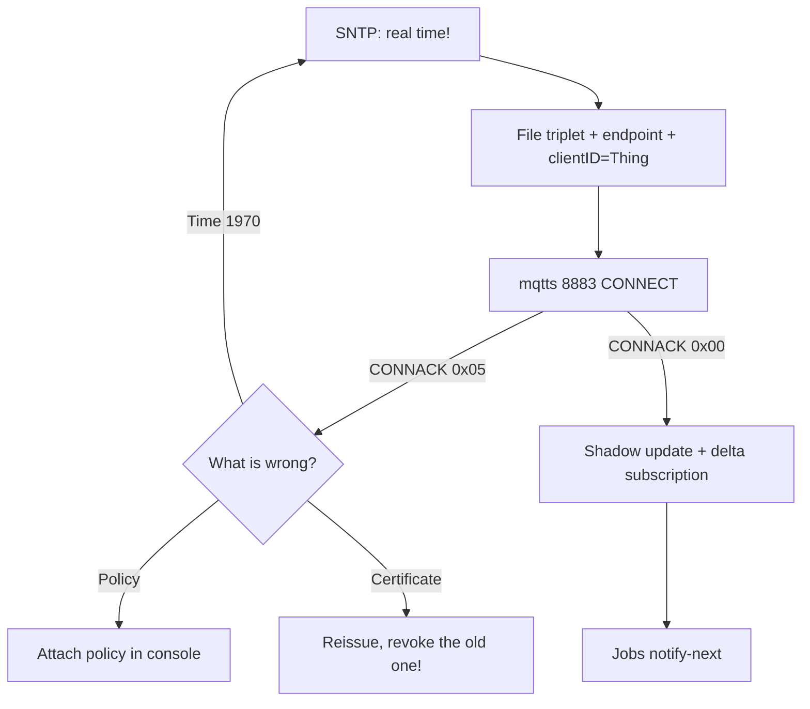

# AWS IoT Core with ESP32: certificates, Shadow, Jobs

## Purpose

AWS IoT Core - managed MQTT broker with auth ONLY by X.509 certificates (login and password are not accepted!). Plus Thing Shadow (digital twin) and Jobs (fleet commands and OTA). ESP32 connects through esp-mqtt with a client certificate.

Base: start - [[Home.en|Home]], MQTT base - [[EN/15-Protocols/01-MQTT.en|MQTT]], TLS and NTP - [[EN/15-Protocols/03-mDNS-NTP-TLS.en|TLS and NTP]], pipeline - [[EN/15-Protocols/05-Cloud-Pipeline.en|Cloud pipeline]], OTA - [[EN/08-Memory/03-OTA.en|OTA]], time - [[EN/10-Sensors/27-Time-Mem-IO-DAC.en|Time and memory]].

> [!danger] Three things without which AWS will not connect
>
> 1. Real time (NTP/GPS) - the certificate is checked by date. 2. File triplet: device certificate + private key + AmazonRootCA1 - all three on the device. 3. Cloud policy allows `iot:Connect/Publish/Subscribe` for this exact Thing. A fault in any of them gives a silent `CONNACK 0x05`.

![[assets/img/cloud-aws-iot-scheme.png|600]]
*Fig. ESP32 with the file triplet to TLS 8883 to IoT Core endpoint to Rules to Shadow/DynamoDB + Jobs for the fleet.*

## Connection specs

| Parameter | Value |
| --- | --- |
| Endpoint | `<account>-ats.iot.<region>.amazonaws.com:8883` (ATS - new root!) |
| Auth | X.509 client certificate + private key (P256/RSA2048) |
| CA | AmazonRootCA1.pem (ECC) - download from AWS docs, not from random places |
| Protocol | MQTT 3.1.1 (no 5), keepalive 60-300 s |
| RAM | TLS session about 40-60 KB - mind it on C3 without PSRAM! |
| Limits | 100 messages/s per connection (throttling!), 128 KB payload |

## 1. Creating a Thing and the file triplet (AWS console)

```text
IoT Core → Manage → Things → Create:
  1. Thing name = серійник пристрою (напр. esp32-tracker-0142).
  2. Auto-generate certificate → ЗАВАНТАЖИТИ ОДРАЗУ 3 файли:
     xxxx-certificate.pem.crt + xxxx-private.pem.key + AmazonRootCA1.pem
     (приватний key показують ОДИН раз — провтикав = перевипуск!)
  3. Attach policy (приклад нижче) → Attach thing.
Policy (мінімум, не "*"):
  { "iot:Connect": "arn:...:client/esp32-tracker-0142",
    "iot:Publish": "arn:...:topic/device/esp32-tracker-0142/*",
    "iot:Subscribe": "arn:...:topicfilter/device/esp32-tracker-0142/cmd" }
```

## 2. Firmware: esp-mqtt with certificates (ESP-IDF)

```c
// ESP-IDF: сертифікати вшиті (certs.h) або з LittleFS; час — SNTP ДО connect!
extern const char ca_pem_start[] asm("_binary_AmazonRootCA1_pem_start");
extern const char cert_pem_start[] asm("_binary_device_pem_start");
extern const char key_pem_start[] asm("_binary_private_pem_start");
esp_mqtt_client_config_t cfg = {
  .broker.address.uri = "mqtts://xxxx-ats.iot.eu-central-1.amazonaws.com:8883",
  .credentials.authentication.certificate = cert_pem_start,
  .credentials.authentication.key = key_pem_start,
  .credentials.authentication.certificate_len = 0,  // NUL-terminated
  .credentials.client_id = "esp32-tracker-0142",    // = Thing name!
};
// Arduino (PubSubClient + WiFiClientSecure): setCACert(ca) + setCertificate(cert) + setPrivateKey(key).
// MicroPython: umqtt + ssl_params={'cert':..., 'key':..., 'cadata':...} — важко на малих чипах!
```

## 3. Thing Shadow: digital twin

```text
Топіки Shadow (резервовані, з $):
  $aws/things/esp32-tracker-0142/shadow/update         ← PUBLISH desired+reported
  $aws/things/esp32-tracker-0142/shadow/update/accepted ← відповідь
  $aws/things/esp32-tracker-0142/shadow/update/delta   ← хмара хоче змін!
Документ: {"state":{"reported":{"t":23.5,"vbat":3.95},"desired":{"period":300}}}
Логіка: пристрій слухає delta → застосовує period=300 → звітує reported.
Навіщо: команда дійде навіть якщо пристрій спав (desired чекає!), конфлікти видно.
```

## 4. Jobs: commands and OTA for the fleet

```text
Job = документ для списку Things: {"operation":"ota","url":"https://.../fw.bin","ver":"1.5.0"}.
Пристрій підписаний на $aws/things/<id>/jobs/notify-next → отримав → виконує →
звітує {status: IN_PROGRESS → SUCCEEDED/FAILED}.
OTA через Jobs = єдина пристойна масова OTA на AWS (див. 08-Memory/03).
```

## 5. Fleet Provisioning: mass production (JITP/JITR)

```text
Проблема: 1000 пристроїв — не будеш руками клікати 1000 сертифікатів!
Рішення: один CLAIM-сертифікат у прошивці заводу → перше підключення →
  хмара видає УНІКАЛЬНИЙ operational-сертифікат (JITP) → пристрій зберігає в NVS →
  далі працює на своєму. Claim після цього відкликати!
Зв'язок з базою: mfg-NVS партиція (див. 17-Lab/03) + серійник = CN сертифіката.
```

### Mermaid: first connection



## Typical issues

| # | Issue | Why it is bad | Correct way |
| --- | --- | --- | --- |
| 1 | Time stuck at 1970 at connect | Certificate looks invalid | SNTP BEFORE MQTT (blocking wait!) |
| 2 | clientID differs from Thing name | Policy blocks it | clientID = Thing name literally |
| 3 | Policy `*` on everything | Hole in fleet security | Minimal resource ARNs |
| 4 | Private key lost | Reissue + revoke the old one | Store at creation time (three files!) |
| 5 | ATS vs old endpoint | Old VeriSign root is deprecated | Only `-ats` endpoint + AmazonRootCA1 |
| 6 | MQTT 5 features | Core speaks 3.1.1 | No user properties |
| 7 | Throttling at 100 msg/s | Bursts get cut | Aggregate, QoS 0 for telemetry |
| 8 | One certificate for the fleet | One compromised key exposes all | Fleet Provisioning, section 5 |
| 9 | umqtt + X.509 on C3 | Too little RAM for 3 PEM files | ESP-IDF or a chip with PSRAM |
| 10 | Desired ignored by firmware | Commands get lost | Always subscribe to delta |

## Official sources

- [AWS IoT Core - Device SDK + ESP32 examples](https://docs.aws.amazon.com/iot/latest/developerguide/iot-embedded-c-sdk.html) - embedded C SDK.
- [AWS Fleet Provisioning (JITP)](https://docs.aws.amazon.com/iot/latest/developerguide/provision-wo-cert.html) - claim to operational.
- [Thing Shadow + Jobs docs](https://docs.aws.amazon.com/iot/latest/developerguide/iot-device-shadows.html) - topics, documents.

### Arduino: PubSubClient + WiFiClientSecure (short)

```cpp
#include <WiFiClientSecure.h>
#include <PubSubClient.h>
WiFiClientSecure net;
PubSubClient mqtt(net);
void setup() {
  net.setCACert(AWS_ROOT_CA);       // AmazonRootCA1
  net.setCertificate(DEVICE_CERT);  // свій сертифікат
  net.setPrivateKey(DEVICE_KEY);    // свій key
  mqtt.setServer(AWS_ENDPOINT, 8883);
  mqtt.connect("esp32-tracker-0142");  // clientID = Thing name!
  mqtt.publish("device/esp32-tracker-0142/sensors", "{}");
}
// RAM-ліміт C3 без PSRAM: 3 PEM (~4 КБ) + TLS-сесія 40+ КБ — рахувати heap!
```

## See also

- [[Home.en|Home]]
- [[EN/15-Protocols/01-MQTT.en|MQTT]]
- [[EN/15-Protocols/03-mDNS-NTP-TLS.en|TLS and NTP]]
- [[EN/15-Protocols/05-Cloud-Pipeline.en|Cloud pipeline]]
- [[EN/15-Protocols/13-Azure-IoT.en]]
- [[EN/08-Memory/03-OTA.en|OTA]]
- [[EN/08-Memory/04-Secure-Boot-Encrypt.en|Secure boot]]
- [[EN/17-Lab/03-Enclosure-Cert-Factory.en|Factory NVS]]


## Appendix: connection checklist

| Symptom | Cause | Fix |
|---|---|---|
| Connection / auth failure | Credentials / cert / region | Verify keys, cert, region config |

## Official sources

- [AWS IoT Docs](https://docs.aws.amazon.com/iot/latest/developerguide/iot-connect-devices.html)
- [Azure IoT Docs](https://learn.microsoft.com/en-us/azure/iot/develop/reference-iot-device-mqtt/)
