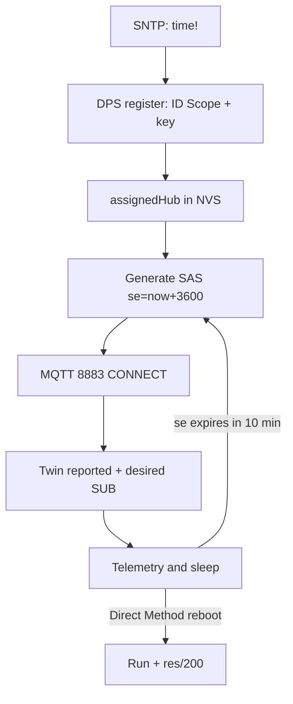

# Azure IoT Hub with ESP32: SAS, DPS, Twins, Direct Methods

## Purpose

Azure IoT Hub - Microsoft MQTT broker with auth by SAS tokens (HMAC from the device key, lifetime in hours!) or X.509. Plus DPS (device auto-provisioning), Device Twins (twins) and Direct Methods (cloud-to-device function calls). ESP32 works through the Azure SDK for Embedded C.

Base: start - [[Home.en|Home]], MQTT - [[EN/15-Protocols/01-MQTT.en|MQTT]], TLS - [[EN/15-Protocols/03-mDNS-NTP-TLS.en|TLS and NTP]], AWS sibling - [[EN/15-Protocols/12-AWS-IoT.en|AWS IoT]], OTA - [[EN/08-Memory/03-OTA.en|OTA]].

> [!warning] SAS tokens expire!
> Unlike an AWS certificate (no expiry), a SAS token lives hours to a day (the `se=` field is the expiry epoch). Firmware MUST regenerate the token and reconnect BEFORE expiry, else the fleet silently drops at midnight. Time (NTP!) is critical twice: for TLS and for `se`.

![[assets/img/cloud-azure-iot-scheme.png|600]]
*Fig. ESP32 with device key to SAS token to IoT Hub 8883 to Twins and Direct Methods + DPS for the fleet.*

## Connection specs

| Parameter | Value |
| --- | --- |
| Endpoint | `<hub>.azure-devices.net:8883` |
| Auth | SAS token (`SharedAccessSignature sr=...&sig=...&se=...`) or X.509 |
| Username | `<hub>.azure-devices.net/<device-id>/?api-version=2020-09-30` (yes, the username is a full URL!) |
| Client ID | `<device-id>` |
| Protocol | MQTT 3.1.1, keepalive 120-300 s |
| Free limit | 8000 messages/day (F1) - enough for about 5 nodes at 1/min |

## 1. SAS token: formula and generation on ESP32

```text
Токен = "SharedAccessSignature sr={URL-encoded resourceURI}&sig={URL-encoded HMAC-SHA256}&se={expiry}"
  resourceURI = <hub>.azure-devices.net/devices/<device-id> (lowercase!)
  HMAC-SHA256 ключем = base64-декодований device primary key
  se = epoch + 3600 (година життя — мінімум для сну!)
Генерація — на пристрої (mbedTLS HMAC є в IDF) або сервером-посередником.
Пароль MQTT = весь токен цілком (довгий рядок 200+ символів — буфер PubSubClient збільшити!).
```

```c
// ESP-IDF: HMAC-SHA256 з mbedTLS (скорочено, повний код — в Azure SDK samples)
mbedtls_md_hmac(mbedtls_md_info_from_type(MBEDTLS_MD_SHA256),
  key, key_len, (uint8_t*)toSign, toSign_len, hmac);
// далі base64 + URL-encode + збірка токена; se = time(NULL) + 3600.
```

## 2. Hub topics (encoded in MQTT!)

```text
Телеметрія:  devices/<id>/messages/events/              ← PUBLISH сюди
  + властивості: devices/<id>/messages/events/tempAlert=true
C2D (хмара→пристрій): devices/<id>/messages/devicebound/# ← SUB
Direct Method виклик (з хмари): $iothub/methods/POST/reboot/?$rid=1
  ← відповідь пристрою: $iothub/methods/res/200/?$rid=1 {"result":"ok"}
Twin desired: $iothub/twin/PATCH/properties/desired/#   ← SUB (команди!)
Twin reported: $iothub/twin/PATCH/properties/reported/  ← PUBLISH стан
```

## 3. Device Twins vs Direct Methods - when to use what

| Mechanism | Semantics | Example | Limit |
| --- | --- | --- | --- |
| Twin desired | State that WAITS (for sleepy nodes!) | `{"period":300}` | Delivered at the next connect |
| Twin reported | Device state to the cloud | `{"t":23.5,"vbat":3.95}` | Last known |
| Direct Method | Synchronous call, 30 s timeout | `reboot`, `relayOn` | Device MUST be online! |
| C2D | Queued message (48 h) | Config file | Queue, not a call |

> Sleepy sensor: Twins only. Live actuator: Direct Methods. Mixing them up means a reboot command never arrives because the device was asleep.

## 4. DPS: fleet auto-provisioning

```text
Device Provisioning Service: один глобальний endpoint (global.azure-devices-provisioning.net),
пристрій приїжджає з ID Scope + реєстраційним ID → DPS віддає СВІЙ hub + hostname.
Типи: Symmetric Key (групові/індивідуальні), X.509 (сертифікати), TPM (рідко на ESP32).
Прошивка: DPS-реєстрація ОДИН раз → зберегти assigned hub в NVS → далі безпосередньо в Hub.
```

### Mermaid: device lifecycle



## Typical issues

| # | Issue | Why it is bad | Correct way |
| --- | --- | --- | --- |
| 1 | SAS expired - fleet silent | `se` in the past | Regenerate 10 min before expiry |
| 2 | Time stuck at 1970 | both TLS and `se` break | Blocking SNTP before connect |
| 3 | Short username | Hub demands the full URL | Format from the table above |
| 4 | PubSubClient default buffer | 200+ char token does not fit | `setBufferSize(512)` |
| 5 | Direct Method to a sleepy node | 30 s timeout | Twins only for sleepy nodes |
| 6 | One key for the fleet | One compromised key exposes all | DPS group + separate derived keys |
| 7 | F1 limit exceeded | Hub cuts messages | Math: nodes x rate under 8000/day |
| 8 | `sr` not lowercase | signature mismatch | resourceURI in lowercase! |
| 9 | Loose `se=+86400x30` | Month-long token is a hole | One day max, one hour is better |
| 10 | DPS every time | Extra seconds and traffic | Cache assignedHub in NVS |

## Official sources

- [Azure IoT SDK for Embedded C (GitHub)](https://github.com/Azure/azure-sdk-for-c) - ESP32 examples (provisioning + telemetry + twin).
- [IoT Hub MQTT protocol](https://learn.microsoft.com/azure/iot-hub/iot-hub-mqtt-support) - topics, SAS, limits.
- [DPS concepts](https://learn.microsoft.com/azure/iot-dps/concepts-service) - enrollment, ID Scope.

### Twin desired handler (concept, ESP-IDF)

```c
// Підписка: $iothub/twin/PATCH/properties/desired/#
// Вхід: {"period":300} → зберегти в NVS → застосувати до таймера deep-sleep.
// Відповідь: PUBLISH reported {"period":300,"status":"applied"}.
// Direct Method reboot: $iothub/methods/POST/reboot → виконати esp_restart()
// ТІЛЬКИ якщо пристрій онлайн (таймаут хмари 30 с!); сплячим — ігнорувати,
// хмара повторить через twin при наступному пробудженні.
```

### Prices and limits: what fits in the free tier

| Parameter | F1 (free) | S1 (paid) |
| --- | --- | --- |
| Messages per day | 8000 | millions |
| Devices | 500 | unlimited |
| C2D + Direct Methods | Yes | Yes |
| SLA | None | 99.9% |

```text
Бюджет повідомлень (приклад): 5 вузлів × 1/хв × 1440 = 7200/добу — влазить у F1!
Правило: телеметрія раз на 1–5 хв + reported twin раз на годину = запас 20%+.
```

## See also

- [[Home.en|Home]]
- [[EN/15-Protocols/01-MQTT.en|MQTT]]
- [[EN/15-Protocols/03-mDNS-NTP-TLS.en|TLS and NTP]]
- [[EN/15-Protocols/12-AWS-IoT.en]]
- [[EN/15-Protocols/05-Cloud-Pipeline.en|Cloud pipeline]]
- [[EN/08-Memory/03-OTA.en|OTA]]
- [[EN/08-Memory/01-Partitions-NVS.en|NVS]]


## Appendix: checklist

| Symptom | Cause | Fix |
|---|---|---|
| Connection / auth failure | Credentials / cert / region | Verify keys, cert, region config |

## Official sources

- [AWS IoT Docs](https://docs.aws.amazon.com/iot/latest/developerguide/iot-connect-devices.html)
- [Azure IoT Docs](https://learn.microsoft.com/en-us/azure/iot/develop/reference-iot-device-mqtt/)
