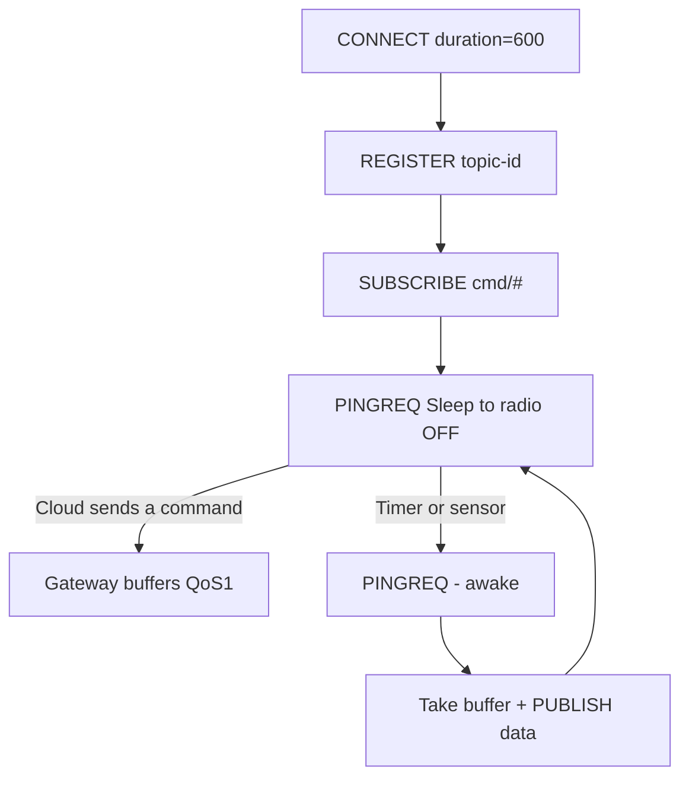

# MQTT-SN: MQTT for sensor networks

## Purpose

Classic MQTT means TCP + long topic names: too heavy for LoRa and Zigbee (small MTUs, sleepy nodes, no TCP). MQTT-SN (Sensor Networks) is the same pub/sub but over UDP, with short topic IDs and a sleep procedure. ESP32 acts as a gateway: LoRa/Zigbee nodes on one side, a plain broker on the other.

Base: start - [[Home.en|Home]], MQTT - [[EN/15-Protocols/01-MQTT.en|MQTT]], LoRa - [[EN/12-Comm-Modules/02-NRF24-LoRa.en|LoRa]], Zigbee - [[EN/15-Protocols/09-Matter-Thread-Zigbee.en|Matter and Zigbee]], offline buffer - [[EN/12-Comm-Modules/18-Cellular-LoRa-2.en|Cat-1]].

> MQTT-SN is not MQTT: different wire format! It cannot connect to Mosquitto directly - an SN gateway is needed (transparent or aggregating). The gateway is the ESP32 job here.

![[assets/img/mqtt-sn-gateway-scheme.png|600]]
*Fig. LoRa/Zigbee nodes speak MQTT-SN/UDP with the ESP32 gateway, the gateway speaks classic MQTT/TCP with the broker.*

## Specifications

| Parameter | MQTT-SN | Classic MQTT |
| --- | --- | --- |
| Transport | UDP (TCP optional) | TCP |
| Topics | 2-byte topic IDs / predefined / short-name (2 chars!) | Long strings |
| CONNECT | Short, with sleep procedure | Long + will |
| QoS | -1 (fire-and-forget!), 0, 1, 2 |
| Sleepy nodes | PINGREQ with sleep + gateway buffer | LWT only |
| MTU fit | Packets about 10-30 bytes | CONNECT about 100+ bytes |
| Gateway | Mandatory (transparent/aggregating) | Not needed |

## 1. Topics: IDs instead of strings

```text
Реєстрація: PUBLISH з довгим ім'ям → шлюз повертає REGISTER + topic-id (2 байти).
Далі: PUBLISH тільки з topic-id — економія кожного байта ефіру!
Predefined topic-id: зашиті в прошивку обох сторін (0x0001 = temp) — реєстрація не потрібна.
Short topic name: рівно 2 ASCII-символи ("t1") — для найбідніших.
```

## 2. Sleepy node: SLEEP procedure

```text
Вузол: CONNECT (clean, duration=600) → REGISTER/SUB → ... → PINGREQ з полем Sleep!
Шлюз: бачить Sleep → БУФЕРИЗУЄ вхідні QoS1/2 для вузла.
Вузол спить (радіо вимкнене!) → прокидається → PINGREQ (будить) → забирає буфер → знову Sleep.
DISCONNECT з duration: «спатиму N с, тримай буфер» — офіційний механізм, не хак!
```

### Mermaid: sleep with gateway buffer



## 3. Gateway on ESP32: transparent vs aggregating

| Type | How it works | Plus | Minus |
| --- | --- | --- | --- |
| Transparent | 1 SN connection = 1 MQTT connection with the broker | Simple, end-to-end LWT | 100 nodes = 100 TCP sessions (RAM!) |
| Aggregating | ONE MQTT connection for all, topic prefixes | Scale: hundreds of nodes | More complex code, emulate LWT |

```text
Архітектура шлюзу (ESP32-S3 з PSRAM!):
  LoRa (SX1262/SPI) або Zigbee (C6 UART) ──► SN-парсер ──► буфер ──► esp-mqtt ──► broker
  Мапінг: SN topic-id 0x0001 вузла A → MQTT device/node-A/sensors/temp
  Реалізації: Eclipse Paho MQTT-SN Gateway (Java/C), RSMB (старий, але робочий),
  або свій міні-шлюз під 10–20 вузлів (простіше, ніж здається!).
```

## 4. QoS -1: publish without a connection (for beacons!)

```text
QoS −1 = вузол шле PUBLISH з predefined topic-id БЕЗ CONNECT взагалі.
Шлюз налаштований приймати — ідеально для односторонніх датчиків (температура раз на 10 хв).
Ціна: без підтверджень і без шифрування на цьому рівні — для критичного додати лічильник + HMAC у payload!
```

## Typical issues

| # | Issue | Why it is bad | Correct way |
| --- | --- | --- | --- |
| 1 | MQTT-SN directly to Mosquitto | Different protocols! | Only through an SN gateway |
| 2 | Long topics on air | Eats LoRa MTU | topic-id / predefined |
| 3 | TCP instead of UDP on LoRa | Handshake will not pass | UDP by default |
| 4 | No duration in CONNECT | Gateway drops the buffer | Duration = sleep period + margin |
| 5 | 100 TCP sessions on ESP32 | No RAM | Aggregating gateway |
| 6 | QoS -1 for commands | Commands silently lost | -1 for telemetry only |
| 7 | No counter in payload | Replay attacks | seq + HMAC |
| 8 | One topic-id for all | Collisions | Registration per node |

## Official sources

- [MQTT-SN specification (OASIS)](https://www.oasis-open.org/committees/mqtt-sn/) - packets, procedures, gateways.
- [Eclipse Paho MQTT-SN Gateway](https://github.com/eclipse-paho/paho.mqtt-sn.embedded-c) - embedded-C client + gateway.
- [RSMB (Really Small Message Broker)](https://github.com/eclipse-mosquitto/mosquitto.rsmb) - broker with SN support.

### Minimal SN client (node pseudocode)

```text
LOOP (прокинувся раз на 10 хв):
  CONNECT(clean, duration=700) → чекати CONNACK
  REGISTER "sensors/temp" → запам'ятати topic-id (або predefined 0x0001!)
  PUBLISH topic-id, QoS1, "23.5" → чекати PUBACK (3 ретраї)
  PINGREQ зі Sleep → радіо OFF, спати 600 с
Перший цикл: duration з запасом +20% (дрейф годинника вузла!).
```

### SN + LoRa: airtime estimate

```text
Пакет PUBLISH QoS1: ~15–25 байт (замість 60+ у класичного MQTT!).
SF7/125 кГц: ефір ~50–100 мс → 1% duty-cycle = ~14 пакетів/годину МАКСИМУМ.
Висновок: період 10 хв — комфортно; раз на хвилину — тільки SF7 + короткий payload.
Sleep duration: період + 20% запас (дрейф RC-генератора вузла!).
Шлюз на ESP32-S3: SN-UDP-сокет + esp-mqtt + LittleFS-буфер (див. 18-Cellular-LoRa-2).
```

### RSMB gateway on a server (when the ESP32 gateway is too small)

```text
Eclipse RSMB (Really Small Message Broker): приймає MQTT-SN/UDP :1883
і класичний MQTT/TCP одночасно — шлюз не потрібен взагалі!
  - Вузли LoRa → свій UDP-міст (LoRa-приймач + forwarder) → RSMB :1883/UDP
  - Дашборди → класичний MQTT :1883/TCP до того самого RSMB
  - Retained/LWT працюють наскрізно (transparent-режим)
Мінус: RSMB застарілий (останні коміти давні) — для продакшену брати
Paho Gateway або ChirpStack + MQTT-інтеграцію.
```

## See also

- [[Home.en|Home]]
- [[EN/15-Protocols/01-MQTT.en|MQTT]]
- [[EN/15-Protocols/05-Cloud-2.en|MQTT client]]
- [[EN/15-Protocols/09-Matter-Thread-Zigbee.en|Matter, Thread and Zigbee]]
- [[EN/12-Comm-Modules/02-NRF24-LoRa.en|LoRa]]
- [[EN/12-Comm-Modules/18-Cellular-LoRa-2.en|Cat-1 (buffer)]]
- [[EN/10-Sensors/39-Wireless-Sensors.en|Wireless sensors]]


## Appendix: checklist

| Symptom | Cause | Fix |
|---|---|---|
| Connection / auth failure | Credentials / cert / region | Verify keys, cert, region config |

## Official sources

- [AWS IoT Docs](https://docs.aws.amazon.com/iot/latest/developerguide/iot-connect-devices.html)
- [Azure IoT Docs](https://learn.microsoft.com/en-us/azure/iot/develop/reference-iot-device-mqtt/)
