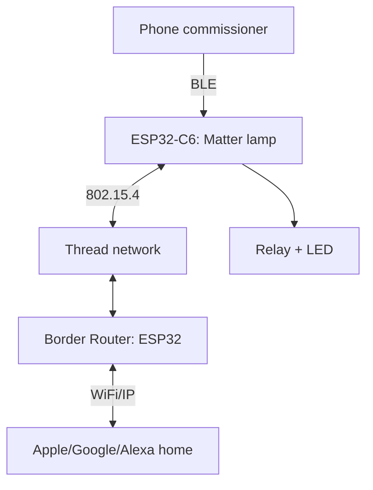

# ESP32 Matter-over-Thread - Fabric, clusters and commissioning deep dive

![[assets/img/esp32-matter-thread-deep-scheme.png|600]]
*Fig. Matter node: C6/H2 802.15.4 radio, Thread network, border router to IP, commissioning over BLE.*

> [!tip] What this note is for
> Depth on top of the Matter overview note: Fabric, clusters and code here, no marketing. C6 or H2 are needed (they have 802.15.4). Base: [[EN/01-Hardware/04-ESP32-C3-C6-H2.en|C3/C6/H2 chips]], [[EN/15-Protocols/09-Matter-Thread-Zigbee.en|Matter overview]].

## 1. Goal

To build a cert-compatible Matter node:

- Fabric: what it is and why one device can join several homes;
- OnOff/LevelControl/Color clusters: endpoint switch and lamp;
- commissioning over BLE: QR, passcode, discriminator;
- border router: Thread to WiFi on a second ESP32;
- memory: how much Matter eats on C6.

| Element | Role | Where it lives |
| --- | --- | --- |
| Node | device (lamp) | ESP32-C6/H2 |
| Fabric | trust domain + keys | commissioner and node |
| Cluster | function (OnOff) | node endpoint |
| Commissioner | joins to Fabric | phone or hub |
| Border Router | Thread to IP bridge | ESP32 + WiFi |

## 2. Architecture



Commissioning goes over BLE (temporarily), work goes over Thread. No WiFi is needed on the node at all.

## 3. Node pinout (DevKitC-H2/C6)

| Board pin | Purpose | Note |
| --- | --- | --- |
| GPIO8 | Relay/LED (OnOff cluster) | through a transistor, not directly! |
| GPIO9 | Commissioning button | to ground, pull-up |
| GPIO20/21 | UART log | 115200 for monitoring |
| 3V3/GND | power | 500 mA margin |
| EN/BOOT | flashing | board buttons |

Relay - only as a module with optocouplers. The mains part is for an electrician, not for this note.

## 4. Commissioning step by step

- flash the `light` example with esp-matter;
- QR in the monitor log: `MT:XXXX-XXX-XXXX`;
- phone (Apple Home or Google Home) to add device to scan QR;
- BLE session exchanges Fabric keys (CASE/PASE);
- after commissioning BLE can be off - Thread next;
- second home - same node, new Fabric (multi-admin!).

## 5. Working code (C, ESP-IDF)

```c
#include "esp_matter.h"

static esp_err_t on_off_cb(esp_matter_cluster_t *cluster, uint32_t cmd) {
  bool on = (cmd == 1);
  gpio_set_level(GPIO_NUM_8, on);
  esp_matter_attr_val_t val = {.b = on};
  esp_matter_cluster_update(cluster, 0, &val);
  return ESP_OK;
}

void app_main(void) {
  esp_matter_node_t *node = esp_matter_node_create(NULL, 0, 0, 0);
  esp_matter_endpoint_t *ep = esp_matter_endpoint_create(node, 0);
  esp_matter_cluster_t *cl = esp_matter_cluster_create_on_off(ep, on_off_cb);
  (void)cl;
  esp_matter_start();
}
```

OnOff cluster: 0/1 command, state attribute, controller subscription. Keep callbacks short, heavy work goes to a queue.

## 6. Working code (MicroPython)

```python
# MicroPython: Matter-клієнт-емуляція через BLE-GATT (навчальний міст)
# Повний Matter-стек на MicroPython нема — керуємо вузлом HTTP-мостом
import network
import urequests
import time
from machine import Pin

relay = Pin(8, Pin.OUT)
btn = Pin(9, Pin.IN, Pin.PULL_UP)
wlan = network.WLAN(network.STA_IF)
wlan.active(True)
wlan.connect('ssid', 'pass')
while not wlan.isconnected():
    time.sleep(0.5)

BRIDGE = 'http://border-router.local:8080'

def set_lamp(on):
    urequests.post(BRIDGE + '/lamp', json={'on': on})
    relay.value(on)

while True:
    if not btn.value():
        set_lamp(not relay.value())
        time.sleep(0.5)
    time.sleep(0.05)
```

Honestly: Matter commissioning cannot be reasonably done on MicroPython - a bridge through the border router gives the same result (lamp control) with little effort.

## 7. Border router

- second ESP32 (S3/C6) with OpenThread RCP firmware + WiFi;
- `otbr-agent` or the ESP Thread Border Router example;
- Thread network gets an IPv6 prefix from LAN;
- mDNS/DNS-SD - node discovery by controllers;
- 24/7 power, wired uplink preferred.

## 8. Memory and C6 limits

| Resource | Matter cost | Left |
| --- | --- | --- |
| Flash | about 1.5 MB (stack+clusters) | spare for OTA |
| RAM | about 150 KB runtime | careful with buffers |
| NVS | Fabric keys + counters | do not erase without decommission! |

Factory reset - by button procedure (10 s hold), else keys stay and commissioning hangs.

## 9. Typical issues

| Symptom | Cause | Fix |
| --- | --- | --- |
| Commissioning fails at 90% | BLE drop or distance | phone nearby, no metal in between |
| Node not in Thread | no leader or border router | bring up BR first |
| Works, dead after reboot | NVS with keys erased | never erase the whole flash, only the app |
| Two lamps get mixed | same discriminator | unique discriminator per node |
| Apple sees it, Google does not | only one Fabric | multi-admin: add a second home |
| Out of memory | heavy clusters + logging | Error log level, optimize partitions |

## 10. Matter quick cheat sheet

- node: C6/H2, light example;
- commissioning: QR + BLE nearby;
- work: Thread, BR 24/7;
- NVS with keys is sacred;
- multi-admin is a feature, not a bug.

## 11. Related notes

- [[EN/15-Protocols/09-Matter-Thread-Zigbee.en|Matter overview]] - starting picture.
- [[EN/01-Hardware/04-ESP32-C3-C6-H2.en|C3/C6/H2 chips]] - 802.15.4 radio.
- [[EN/15-Protocols/01-MQTT.en|MQTT protocol]] - alternative transport.
- [[EN/14-Devboards/13-ESP32C6-Boards.en|C6 boards]] - node hardware.
- [[Home.en|home map]] - full navigation.

## Official sources

- [esp-matter (Espressif, GitHub)](https://github.com/espressif/esp-matter) - SDK, examples, commissioning.
- [ESP-Matter Docs (Espressif)](https://docs.espressif.com/projects/esp-matter/en/latest/) - Fabric, clusters, memory.
- [esp-thread-br (Espressif, GitHub)](https://github.com/espressif/esp-thread-br) - border router, RCP, IPv6.


## Appendix: checklist

| Symptom | Cause | Fix |
|---|---|---|
| Connection / auth failure | Credentials / cert / region | Verify keys, cert, region config |

## Official sources

- [AWS IoT Docs](https://docs.aws.amazon.com/iot/latest/developerguide/iot-connect-devices.html)
- [Azure IoT Docs](https://learn.microsoft.com/en-us/azure/iot/develop/reference-iot-device-mqtt/)
