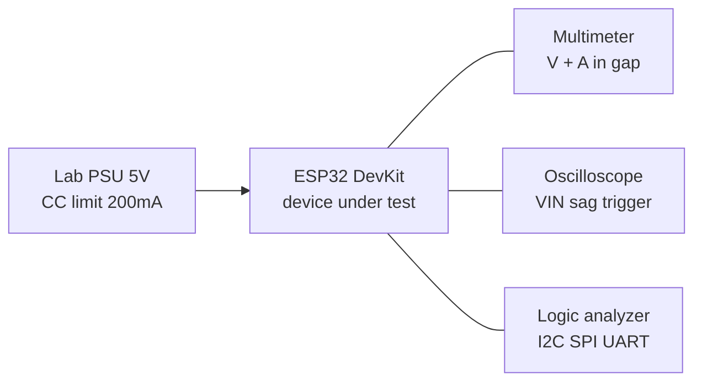

# Lab 1 - Measurement Instruments: Multimeter, Oscilloscope, Analyzer, PSU, Load, USB Tester

![[assets/img/lab-instruments-scheme.png|600]]
*Fig. ESP32 lab stand: lab PSU -> USB tester -> DevKit, multimeter in power gap, oscilloscope on VIN, logic analyzer on buses.*

> [!warning] Safety first
> Lab PSU always starts with current limit (CC). First power-on of new board - through CC 100-200 mA. Short on ESP32 board smells hot AMS1117 - turn off in time.
>
> [!tip] Purpose
> This note is a map of lab instruments for ESP32 development and debugging: what to measure with what, how not to burn board with probe, and how to catch power sag during WiFi transmission.

## 1. Purpose

Without instruments ESP32 development is guesswork from logs. Instruments answer:

- how much the board really consumes in deep-sleep (microamps or milliamps?);
- why board reboots at WiFi start (VIN sag below brownout?);
- what really flows over I2C/SPI/UART (address, ACK, baud rate?);
- can LDO/buck handle peak 500 mA WiFi TX;
- does USB cable have data wires or only charge.

## 2. Multimeter Basics

| Measurement | Range / Mode | What it answers |
| --- | --- | --- |
| DC Voltage | 3.3V / 5V | LDO output, VIN sag |
| DC Current | 10 mA - 10 A | Sleep, active, peak |
| Resistance | Continuity | Short, open, pull-up |
| Diode | 0.3-0.7V | Protection diode direction |

```text
Safety rules:
  - Always turn off power before moving probes to resistance/continuity;
  - Use 10A fuse for current; never measure voltage in current mode;
  - Use thin sharp probes to reach module pins.
```

## 3. Oscilloscope: Catching Peaks

| Channel | What to measure | Trigger | Note |
| --- | --- | --- | --- |
| CH1 | VIN / 3.3V | Falling edge at 3.0V | Brownout detection |
| CH2 | USB-UART TX | Rising edge | Start bit, baud rate |
| CH3 | I2C SDA / SCL | I2C trigger | Address, ACK, clock |

- Use 10x probe to reduce loading.
- Set time base 1 ms/div for WiFi peaks.
- Capture mode to see peak current at TX.

## 4. Logic Analyzer

| Protocol | Rate | What to check | Software |
| --- | --- | --- | --- |
| I2C | 100-400 kHz | Address ACK, data | PulseView / Saleae |
| SPI | 1-10 MHz | CS toggle, MISO, clock | PulseView |
| UART | 115200 | Start/stop, data | PulseView / Arduino IDE |

- Always use 3.3V logic levels; 5V can damage ESP32.

## 5. Power Supply (PSU)

| Type | Volts / Amps | Use | Safety |
| --- | --- | --- | --- |
| Lab PSU | 5V / 2A CC | Main power | Always CC first |
| Buck module (LM2596) | 5V -> 3.3V | Remote load | Heat check |
| Battery (18650 / LiPo) | 3.7V / 2000 mAh | Portable | Protection circuit |

```text
First power-on procedure:
  1. Set PSU to 3.3V, CC 100 mA;
  2. Connect board, check current (should be <50 mA at idle);
  3. If >200 mA - disconnect, check shorts;
  4. Only then increase current limit to 1-2 A.
```

## 6. USB Tester and Current Measurement

- USB tester shows voltage, current, power in real time.
- Use multimeter in series to measure sleep current (cut USB-UART power for real sleep).
- INA219 module can log current over time.

### Lab measurement chain



## Measurement cheat-sheet

| Question | Instrument | How | Pass bar |
| --- | --- | --- | --- |
| Deep-sleep current | Multimeter uA range in series | Cut USB-UART power, wake by timer | 10-150 uA for ESP32 |
| WiFi TX sag | Oscilloscope on VIN, falling trigger 3.0 V | Capture 1 ms/div at connect | No dip below 3.0 V |
| I2C NACK | Logic analyzer + PulseView | Decode address byte, check ACK bit | Every address ACKed |
| UART baud | Oscilloscope on TX, measure start bit | 1/115200 = 8.7 us per bit | Within 2 percent |
| LDO heat | Finger + multimeter temp probe | Full WiFi TX for 5 min | Below 70 C on package |
| Cable data or charge-only | USB tester + try flash | Flash 1 MB firmware | Flash succeeds, no retries |

## First deep-sleep current measurement

1. Power DevKit from lab PSU at 5.0 V with CC limit 200 mA, multimeter in series on mA range.
2. Flash minimal firmware: wake from timer every 10 s, no WiFi, no UART logs.
3. Switch multimeter to uA range after boot (burden voltage matters, keep leads short).
4. Read sleep current between wake pulses; expect 10-150 uA depending on board (USB-UART chip adds mA).
5. For true chip current, cut USB-UART power jumper or measure on bare module.

## Common issues

| Symptom | Cause | Fix |
| --- | --- | --- |
| Board reboots at WiFi start | VIN sags below brownout on TX peak 300-500 mA | Shorter USB cable or 5V 2A PSU, 470 uF bulk cap on VIN |
| Sleep current in milliamps | USB-UART bridge and LEDs stay powered | Cut bridge power jumper, desolder power LED or use bare module |
| I2C NACK on scanner | Missing 4.7k pull-ups or 5V device on bus | Add pull-ups to 3V3, level-shift 5V devices, shorten wires |
| Garbage on UART at 115200 | Wrong baud or charge-only cable dropping bytes | Fix baud on both sides, use data cable under 1 m |
| Oscilloscope shows SPI noise | Probe ground too far from chip | Clip probe ground to board GND next to chip, use 10x probe |
| LDO hot to touch | AMS1117 drops 5V to 3.3V at 500 mA TX peaks | External buck for load, copper pour heatsink, duty-cycle WiFi |

## Official sources

- [ESP32 Datasheet (Espressif)](https://www.espressif.com/sites/default/files/esp32-datasheet-en.pdf) - absolute maximums and current figures for reference.
- [ESP32 Hardware Design Guidelines (Espressif)](https://docs.espressif.com/projects/esp-hardware-design-guidelines/en/latest/esp32/index.html) - power, decoupling and grounding rules.
- [Oscilloscope Basics (SparkFun)](https://learn.sparkfun.com/tutorials/oscilloscope-basics) - probes, triggering and capture basics.
## See Also

- [[EN/Home.en]]
- [[EN/17-Lab/02-Soldering-Connectors.en]]
- [[EN/02-Power-Supply/01-Power-Rails.en]]
- [[EN/99-Additions/01-Pinout-tablici.en]]

> UA original twin: [[EN/17-Lab/01-Instruments.en| UA]]
