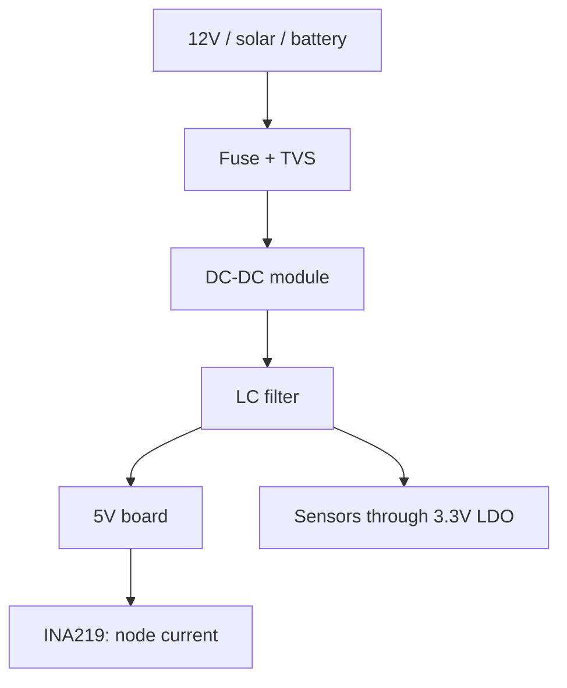

# DC-DC Modules for Raspberry Pi - Buck, Boost and Node Power

![[assets/img/rpi-buck-boost-dc-dc-scheme.png|600]]
*Fig. Any input (12V/solar/battery) to DC-DC to clean 5V: a filter on input and output is mandatory.*

> [!tip] What this note is
> Field and car: 12V vehicle networks, solar panels, batteries - we convert everything into stable 5V. Topology choice, currents, noise. Stock power: [[EN/02-Power-Supply/01-USB-C-PD.en|USB-C power supply]], backup: [[EN/02-Power-Supply/03-UPS-18650.en|UPS backup]].

## 1. Goal

Power the Pi away from the wall outlet:

- buck (step-down): 12/24V to 5V, the main workhorse;
- boost (step-up): 3.7V battery to 5V;
- buck-boost/SEPIC: solar with floating voltage;
- converter noise: filtering for ADC and radio.

| Topology | Input to output | Efficiency | When |
| --- | --- | --- | --- |
| Buck (LM2596) | 7-30V to 5V | 85-92% | car, 12V systems |
| Boost (MT3608) | 2-5V to 5V | 80-90% | one cell, self-built USB power bank |
| SEPIC | 3-12V to 5V | 80-85% | solar panel |
| LDO (final) | 5V to clean 3.3V | 66% | sensor power |

## 2. Node power architecture



A fuse and a TVS diode on the input protect against reverse polarity and spikes. Saving on them burns the node.

## 3. LM2596 buck in detail

- ready module with a trimmer: turn to 5.1V WITHOUT load? - no, under 1A load;
- current up to 3A with a heatsink, without - up to 1.5A;
- ripple about 50 mV - fine for digital, add LC for ADC;
- efficiency grows with input/output difference? - opposite: the closer, the better;
- a fixed 5V version is more reliable in the field than an adjustable one.

## 4. Boost and solar

- MT3608: from 3.7V to 5V 2A, efficiency about 85%;
- one 18650 cell + boost - a pocket UPS;
- 6/12V solar panel + MPPT controller (not directly!);
- survive the night on battery, charge by day;
- Schottky diode against reverse current into the panel at night.

## 5. Working code: node power watchdog

```python
import time
import board
import busio
from adafruit_ina219 import Adafruit_INA219

i2c = busio.I2C(board.SCL, board.SDA)
ina = Adafruit_INA219(i2c)

V_MIN = 4.75
I_MAX = 2.5

while True:
    v = ina.bus_voltage + ina.shunt_voltage
    i = ina.current / 1000.0
    status = 'OK'
    if v < V_MIN:
        status = 'LOW VOLTAGE'
    if i > I_MAX:
        status = 'OVERLOAD'
    print(f"{v:.2f}V {i:.2f}A {status}")
    time.sleep(10)
```

An INA219 at the node input (after the DC-DC) shows sags and overloads before the board hangs.

## 6. Noise filtering

- LC filter on the output: 10 uH + 470 uF;
- ferrite beads on sensor power wires;
- analog ground with a separate wire;
- converter frequency away from sensitive bands (150 kHz vs ADC);
- look at ripple with an oscilloscope, do not trust the "low ripple" label.

## 7. Heat and efficiency in practice

| Current | Buck losses (12 to 5V) | Module heating |
| --- | --- | --- |
| 0.5A | about 0.4W | warm |
| 1.5A | about 1.2W | hot, needs airflow |
| 3A | about 2.5W | heatsink mandatory |

## 8. Common issues

| Symptom | Cause | Fix |
| --- | --- | --- |
| 4.6V on the board | thin wires after the module | thick short wires |
| Whistle in speakers | converter noise | LC filter, different frequency |
| Module gets hot | current at the limit without heatsink | 50% margin, heatsink |
| Does not start from battery | sag at startup | 1000+ uF capacitor on the output |
| Burned by the sun | panel directly without controller | MPPT controller between panel and battery |
| Reverse polarity equals smoke | no protection | fuse + diode/TVS on the input |

## 9. DC-DC quick cheat sheet

- adjust under load, not idle;
- current margin 50% minimum;
- filter on the output always;
- input protection: fuse + TVS;
- measure efficiency, do not read it from the description.

## 10. Related notes

- [[EN/02-Power-Supply/01-USB-C-PD.en|USB-C power supply]] - stock power.
- [[EN/02-Power-Supply/03-UPS-18650.en|UPS backup]] - node batteries.
- [[EN/10-Sensors/04-INA219-Current.en|INA219 current]] - consumption monitoring.
- [[EN/13-Power-Modules/02-Level-Shift-3V3.en|clean levels]] - clean 3.3V.
- [[Home.en|main map]] - full navigation.

## 9.1 Topology choice at a glance

- battery/car: buck from 12V;
- one cell: boost to 5V;
- solar: SEPIC or MPPT controller;
- sensors: 3.3V LDO after 5V;
- in doubt - buck + current margin.
- an input filter saves nerve cells.
- an output capacitor near the load.
- an inductor out of saturation at peaks.
- polarity marking on the input.

## Official sources

- [LM2596 (Texas Instruments)](https://www.ti.com/product/LM2596) - buck controller, inductor calculation.
- [UPS HAT C (Waveshare Wiki)](https://www.waveshare.com/wiki/UPS_HAT_(C)) - battery node example.
- [Getting Started (Raspberry Pi docs)](https://www.raspberrypi.com/documentation/computers/getting-started.html) - power requirements.
