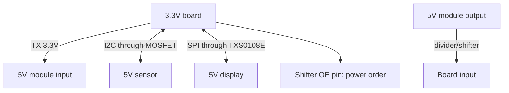

# 3.3V Level Matching - Level Shifters, Dividers and Tolerance

![[assets/img/rpi-level-shift-3v3-scheme.png|600]]
*Fig. Bridge between worlds: 5V signals down through a level shifter/divider, 3.3V up - often directly.*

> [!tip] What this note is
> The main GPIO survival rule: the board is 3.3V, the sensor world is often 5V. When a level shifter is needed, when resistors are enough, and when nothing is needed at all. Base: [[EN/03-GPIO/01-Header-Gpiozero.en|pin header and gpiozero]], power supply: [[EN/02-Power-Supply/01-USB-C-PD.en|USB-C power supply]].

## 1. Goal

Connect without smoke:

- directions: 5V to 3.3V (dangerous) and 3.3V to 5V (usually fine);
- tools: TXS0108E, MOSFET shift, divider, diode;
- speeds: what each method pulls (I2C/SPI/UART);
- typical modules: which are already tolerant and which are not.

| Direction | Method | Speed limit |
| --- | --- | --- |
| 5V to 3.3V | 1k/2k divider | kilohertz, UART fine |
| 5V to 3.3V | TXS0108E (auto) | MHz, I2C/SPI |
| 5V to 3.3V | MOSFET BSS138 in pairs | MHz, ideal I2C |
| 3.3V to 5V | directly (TTL threshold) | see receiver datasheet |
| 1-Wire | MOSFET or divider | works |

## 2. Bridge architecture



Power-up order: first power both sides, then signals. The level shifter OE goes after supplies stabilize.

## 3. TXS0108E in detail

- 8 channels, automatic direction;
- two supplies: VCCA (3.3V) and VCCB (5V);
- OE to ground through a resistor - enable on command;
- pull-ups on lines are weak (tens of kOhm), I2C pulls;
- not for large capacitance and long lines - MOSFET there.

## 4. MOSFET shift for I2C

- classic: BSS138 + 2x10 kOhm per channel (SDA, SCL separately);
- works both ways automatically;
- speed up to 400 kHz stable;
- ready 4-channel boards cost pennies;
- build yourself - 10 minutes of soldering.

## 5. Working code: level check

```python
import time
from gpiozero import DigitalInputDevice, DigitalOutputDevice

tx = DigitalOutputDevice(17)
rx = DigitalInputDevice(27, pull_up=True)

errors = 0
for i in range(1000):
    bit = i & 1
    tx.value = bit
    time.sleep(0.001)
    if rx.value != bit:
        errors += 1

print(f"errors: {errors}/1000")
if errors == 0:
    print("link OK: levels compatible")
else:
    print("add level shifter!")
```

A TX to RX loop through the level shifter/module: 1000 bits reveal the issue before connecting an expensive sensor.

## 6. Divider: calculation in a minute

- 5V to 3.3V: R1=1 kOhm (top), R2=2 kOhm (bottom) gives 3.33V;
- divider current 1.6 mA - fine for inputs, not for power;
- speed: input capacitance times resistance - a hundreds-of-kHz limit;
- 1% resistor accuracy - voltage in tolerance;
- a divider is for input only, never power and output!

## 7. What is tolerant out of the box

| Module | 5V input | Output to the board |
| --- | --- | --- |
| HC-SR04 (echo) | trigger fine | echo through a divider! |
| DHT22 data | 3.3V supply - directly | directly |
| WS2812 DIN | needs a 5V level | level shifter or first diode nearby |
| Relay modules | optocoupler, 3.3V is enough | - |
| SD cards | only 3.3V | directly |

## 8. Common issues

| Symptom | Cause | Fix |
| --- | --- | --- |
| Burned pin | 5V directly on GPIO | level shifter/divider, the pin is lost |
| I2C glitches through TXS | weak pull-ups + long line | MOSFET shift instead of TXS |
| Divider gets hot | powering a module from it | a divider is for signal only! |
| OE floats in the air | level shifter in undefined state | OE to ground/supply explicitly |
| Works, then stops | 5V side sag | stable power on both sides |
| First WS2812 blinks | 3.3V on the threshold edge | level shifter or diode closer than 10 cm |

## 9. Level quick cheat sheet

- board input: never above 3.6V;
- 5V to 3.3V: divider (slow) or level shifter;
- I2C: MOSFET shift is king;
- loop check before the sensor;
- OE and power - in order.

## 10. Related notes

- [[EN/03-GPIO/01-Header-Gpiozero.en|pin header and gpiozero]] - pins and rules.
- [[EN/04-Interfaces/01-I2C-SPI-UART.en|I2C/SPI/UART buses]] - buses through level shifters.
- [[EN/13-Power-Modules/01-Buck-Boost-DC-DC.en|DC-DC modules]] - clean power.
- [[EN/02-Power-Supply/01-USB-C-PD.en|USB-C power supply]] - side stability.
- [[Home.en|main map]] - full navigation.

## 9.1 Direction compatibility table

- GPIO to 5V sensor input: always a level shifter;
- 5V sensor to GPIO: divider or level shifter;
- I2C both ways: MOSFET shift;
- fast SPI: TXS0108E;
- in doubt - a level shifter, not hope.
- spare shifter boards in the box.
- direction markings on ribbons.
- oscilloscope on fast lines after assembly.
- power on both sides before applying signals.

## Official sources

- [TXS0108E (Texas Instruments)](https://www.ti.com/product/TXS0108E) - auto-direction, OE.
- [UPS HAT C (Waveshare Wiki)](https://www.waveshare.com/wiki/UPS_HAT_(C)) - 5V/3.3V board example.
- [gpiozero docs (Read the Docs)](https://gpiozero.readthedocs.io/en/stable/) - pins and levels.
