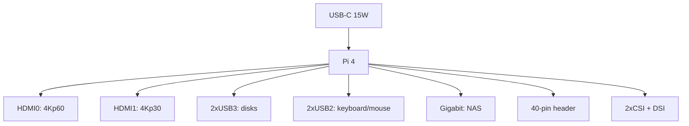

# Raspberry Pi 4 as a Workhorse - Revisions, USB-C and Board Limits

![[assets/img/rpi-pi4-board-scheme.png|600]]
*Fig. Pi 4: USB-C 3A, 2xmicro-HDMI, 2xUSB3, Gigabit Ethernet - everything a server and media center needs.*

> [!tip] What this note is
> Millions of boards in the field: what it can do, where the limits are, which revisions to take. The older brother is described here: [[EN/14-Devboards/01-Pi5-Flagship.en|Pi 5 flagship]], choice: [[EN/00-Start/03-Board-Comparison.en|model comparison]].

## 1. Goal

Squeeze the maximum from the mass board:

- revisions 1.1 to 1.5: what was fixed and how to recognize;
- USB3 and Ethernet at full: NAS and server;
- 4Kp60 from one HDMI only - media nuances;
- when Pi 4 is enough and when Pi 5 is already needed.

| Parameter | Value |
| --- | --- |
| SoC | BCM2711, 4xA72 1.5 GHz |
| RAM | 1/2/4/8 GB LPDDR4 (1 GB retired) |
| USB | 2xUSB3 + 2xUSB2 (VLI controller) |
| Network | Gigabit Ethernet, WiFi ac, BT 5.0 |
| Video | 2xmicro-HDMI, 1x4Kp60 or 2x4Kp30 |
| Power supply | USB-C 5V 3A (no PD) |

## 2. Board architecture



Order: case to SD to cables to power last. First boot is 30-60 seconds for expansion.

## 3. Revisions: what was fixed

- 1.1: USB-C bug (not all e-marker cables worked);
- 1.2: fixed USB-C resistor;
- 1.4: new PMIC, runs cooler;
- 1.5: cosmetics and component replacement;
- take 1.4+: look at the label near the header.

## 4. USB3 and disks

- two USB3 ports - SSD enclosures without a hub (one per port);
- UAS mode enabled by the kernel, TRIM per enclosure support;
- USB boot: the EEPROM since 2020 can do it, update the bootloader;
- system on SSD: faster and longer-lived than any SD.

## 5. Working code: server monitor

```python
from gpiozero import CPUTemperature, DiskUsage
import time
import shutil

cpu = CPUTemperature()

while True:
    t = cpu.temperature
    du = DiskUsage()
    total, used, free = shutil.disk_usage('/')
    print(f"CPU {t:.1f}C disk {used*100//total}% free {free//2**30}G")
    if t > 75.0:
        print("WARN: cooling needed")
    if used * 100 // total > 90:
        print("WARN: disk almost full")
    time.sleep(60)
```

Once a minute into a cron log is enough for a home server. Alerts go to a Telegram bot next.

## 6. Media center nuances

- Kodi (LibreELEC/OSMC): 4Kp60 H.265 from HDMI0;
- sound - HDMI or USB DAC, no 3.5 jack? - there is! a combined AV jack;
- CEC: control from the TV remote works;
- case with an IR receiver - remote without a USB dongle.

## 7. Network and server

- honest Gigabit (about 940 Mbit/s), not through USB as on Pi 3;
- Pi-hole + Unbound: ads cut, DNS your own;
- WireGuard: the CPU handles 100+ Mbit/s;
- static IP or DHCP reservation on the router.

## 7.1 Pi 4 cluster: when it makes sense

- learning Kubernetes: 3-4 boards + PoE HAT boards + rack;
- network boot: one image for all through PXE;
- distributed tasks: a queue (Celery/RQ) instead of complex sync;
- monitoring: Prometheus + Grafana on a separate board;
- rack power: one strong 5V 20A PSU with wiring;
- network: a gigabit switch, static IPs by MAC.

Combat sense is only for learning and redundancy. Not faster than one Pi 5 for compute, but availability is higher.

Honest cluster limits:

- USB disks on each node - local data;
- shared filesystem - NFS from the head node;
- clock - NTP from one source;
- updates - one node at a time, not all together.

## 8. Common issues

| Symptom | Cause | Fix |
| --- | --- | --- |
| USB3 disk drops | power/cable | 3A PSU, short quality cable |
| 4K stutters | second monitor eats bandwidth | one HDMI for 4Kp60 |
| Heats to 80 °C | passive in a sealed case | heatsink minimum, cooler better |
| Does not boot from USB | old EEPROM | update bootloader |
| Slow WiFi | Proant antenna, metal nearby | move out of a metal case |
| Revision 1.1 + e-marker cable | USB-C bug | marker-free cable or 1.2+ board |

## 9. Related notes

- [[EN/14-Devboards/01-Pi5-Flagship.en|Pi 5 flagship]] - the next step.
- [[EN/02-Power-Supply/01-USB-C-PD.en|USB-C power supply]] - PSU in detail.
- [[EN/08-Memory/01-SD-eMMC-NVMe.en|storage media]] - SSD over USB.
- [[EN/09-Firmware/02-EEPROM-Boot.en|EEPROM boot]] - USB boot.
- [[EN/15-Protocols/01-MQTT.en|MQTT protocol]] - server tasks.

## 9.1 Pi 4 quick cheat sheet

- revision 1.4+ (USB-C fixed);
- SSD over USB3 + USB boot;
- 4Kp60 from HDMI0 only;
- heatsink minimum, cooler better;
- honest Gigabit - NAS with no questions.

## Official sources

- [Raspberry Pi 4 Model B (Raspberry Pi)](https://www.raspberrypi.com/products/raspberry-pi-4-model-b/) - features and revisions.
- [Getting Started (Raspberry Pi docs)](https://www.raspberrypi.com/documentation/computers/getting-started.html) - first run.
- [gpiozero docs (Read the Docs)](https://gpiozero.readthedocs.io/en/stable/) - resource monitoring.
