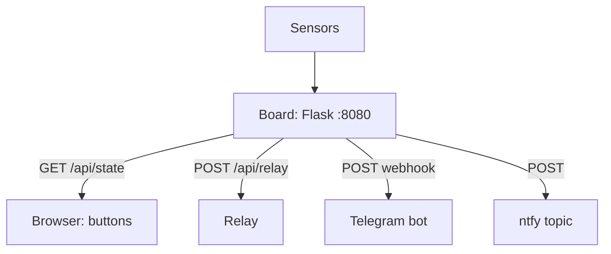

# HTTP and Webhooks on Raspberry Pi - Flask, Telegram and Notifications

![[assets/img/rpi-http-webhook-scheme.png|600]]
*Fig. Node HTTP layer: Flask serves the API and a page, webhooks knock on Telegram, the dashboard draws charts.*

> [!tip] What this note is
> When MQTT is too much: plain HTTP for rare data, browser control and phone pushes. A Flask server on the board + outbound webhooks. Twin brother: [[EN/15-Protocols/01-MQTT.en|MQTT protocol]], network: [[EN/09-Firmware/03-OS-Setup.en|OS setup]].

## 1. Goal

Cover node HTTP scenarios:

- REST API: serve state and take commands;
- a control web page without heavyweight frameworks;
- webhooks: Telegram, ntfy, IFTTT;
- security: do not expose a bare node to the world.

| Scenario | Tool | Period |
| --- | --- | --- |
| Sensor state | Flask JSON | on request |
| Relay control | POST forms | on event |
| Notifications | Telegram Bot API | on alarm |
| Pushes without a server | ntfy | on alarm |
| Charts | built-in page + JS | on request |

## 2. Layer architecture



Flask listens on LAN only (not `0.0.0.0` to the world!). Outside access goes through VPN/Tailscale, not port forwarding.

## 3. Flask minimum

- routes: `/` page, `/api/state` JSON, `/api/relay/<on|off>`;
- Jinja templates in `templates/` - HTML with no build;
- static (CSS/JS) from `static/` - one style file is enough;
- Basic Auth on the API: login/password from secrets;
- gunicorn instead of the dev server for 24/7 (3 workers are enough).

## 4. Outbound webhooks

- Telegram: `sendMessage` with a bot token, your own chat_id;
- ntfy: POST to your own topic - push without a server;
- alarm format: what, where, when, value;
- throttling: no more than once per 5 minutes per event;
- queue: first to a file, send in the background.

## 5. Working code

```python
from flask import Flask, jsonify, request, render_template_string
import subprocess

app = Flask(__name__)
PAGE = """
<h1>Вузол-01</h1>
<p>Температура: {{t}} C</p>
<form method=post action=/api/relay>
<button name=state value=on>УВІМКНУТИ</button>
<button name=state value=off>ВИМКНУТИ</button>
</form>
"""

def read_temp():
    out = subprocess.check_output(['cat', '/sys/class/thermal/thermal_zone0/temp'])
    return int(out) / 1000.0

@app.route('/')
def index():
    return render_template_string(PAGE, t=f"{read_temp():.1f}")

@app.route('/api/state')
def state():
    return jsonify(temp=read_temp())

@app.route('/api/relay', methods=['POST'])
def relay():
    # RPi.GPIO застарів на Bookworm/Pi 5 - використовуємо gpiozero:
    from gpiozero import DigitalOutputDevice
    relay_pin = DigitalOutputDevice(23)
    relay_pin.value = request.form['state'] == 'on'
    return 'OK', 200

if __name__ == '__main__':
    app.run(host='127.0.0.1', port=8080)
```

We listen on localhost + a reverse proxy (nginx/Caddy) with TLS - never expose Flask to the world directly.

## 6. Telegram notifications

```python
import requests

TOKEN = open('/home/pi/.tg-token').read().strip()
CHAT = open('/home/pi/.tg-chat').read().strip()

def tg_send(text):
    try:
        requests.post(
            f'https://api.telegram.org/bot{TOKEN}/sendMessage',
            json={'chat_id': CHAT, 'text': text},
            timeout=10)
    except Exception as e:
        with open('/home/pi/tg-fail.log', 'a') as f:
            f.write(text + '\n')
```

Token and chat_id live in separate files with 600 permissions. Unsent messages go to a queue file, cron finishes them.

## 7. Web layer security

- no ports outside without VPN;
- passwords not in code and not in git;
- Flask/requests updates with a security changelog;
- request limit: fail2ban on 404 scanners;
- backup access is SSH, not web.

## 8. Common issues

| Symptom | Cause | Fix |
| --- | --- | --- |
| Page does not open | listens on localhost without proxy | nginx/Caddy reverse or LAN address |
| Relay does not click from web | GPIO access rights | gpio group, service from a user in the group |
| Telegram silent | wrong chat_id/token | check getMe, then manual sendMessage |
| Spam every minute | no throttling | no more than once per 5 min per event |
| Dev server falls | one thread, exception | gunicorn + Restart=always |
| Port shines to the world | forwarding with no need | remove, VPN only |

## 9. HTTP quick cheat sheet

- Flask listens on LAN, world through VPN;
- JSON for machines, page for people;
- webhooks with a queue and throttling;
- secrets in separate 600 files;
- gunicorn for 24/7.

## 10. Related notes

- [[EN/15-Protocols/01-MQTT.en|MQTT protocol]] - transport for frequent data.
- [[EN/09-Firmware/03-OS-Setup.en|OS setup]] - systemd for the server.
- [[EN/11-Vivid/01-DSI-HDMI-Displays.en|DSI/HDMI displays]] - local face.
- [[EN/10-Sensors/01-BME280-Climate.en|BME280 climate]] - what to serve.
- [[Home.en|main map]] - full navigation.

## Official sources

- [MQTT Specification (OASIS)](https://mqtt.org/mqtt-specification/) - when HTTP is not enough.
- [Getting Started (Raspberry Pi docs)](https://www.raspberrypi.com/documentation/computers/getting-started.html) - network and services.
- [Raspberry Pi OS (Raspberry Pi)](https://www.raspberrypi.com/software/) - Python and packages.
