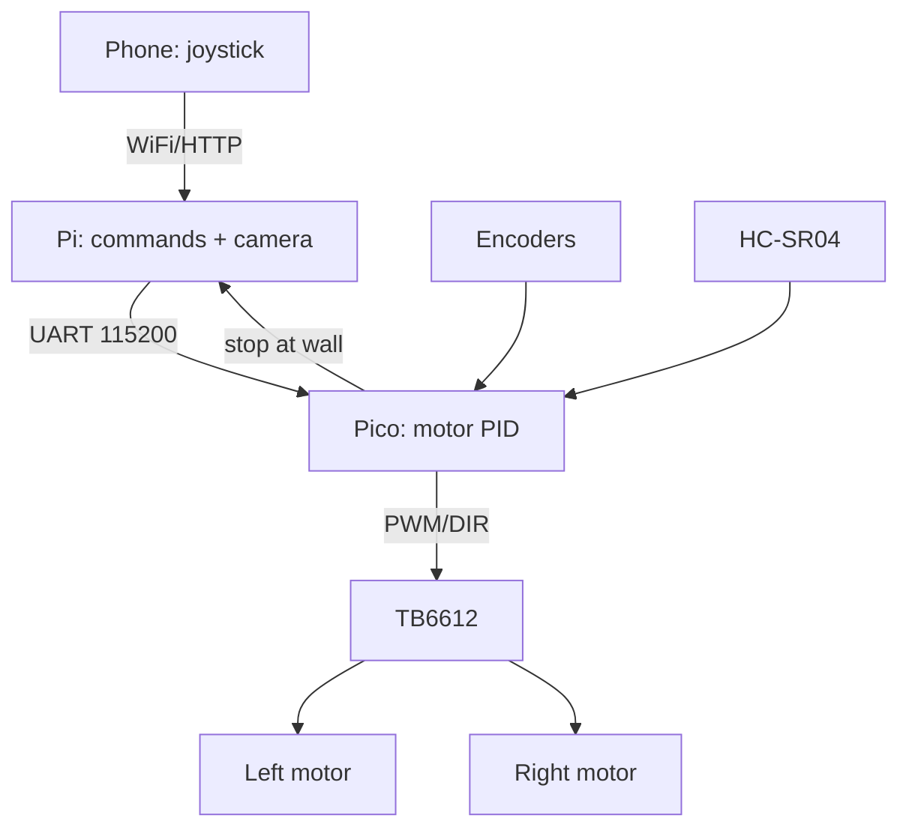

# Robot Cart on Raspberry Pi - Chassis, Drivers and Control

![[assets/img/rpi-robot-vizok-scheme.png|600]]
*Fig. Two cart brains: Pi for camera and decisions, Pico for motors and encoders; a UART bridge between.*

> [!tip] What this note is
> A first robot without pain: ready chassis, two motors with encoders, phone control, then autonomy. The "brain + spinal cord" architecture scales to serious machines. Motors: [[EN/11-Vivid/02-NeoPixel-Servo-Relay.en|power and relay]], camera: [[EN/10-Sensors/06-CSI-Camera.en|CSI camera]].

## 1. Goal

Drive in a weekend:

- 2WD chassis + encoder motors as the base;
- TB6612 driver (better) or L298N (cheaper);
- phone teleoperation over WiFi;
- second step: line, ultrasound, camera;
- power: 2S Li-ion + buck.

| Node | Option | Current |
| --- | --- | --- |
| 2WD chassis + TT motors | encoders optional | 0.5A idle |
| TB6612 | 1.2A per channel, high efficiency | 3A peak |
| L298N | 2A, gets hot, cheap | 4A peak |
| Pi Zero 2 W / Pi 4 | brain, camera | 1-3A |
| Pico | motor real time | milliamperes |

## 2. Control architecture



Split: the Pi thinks (camera, network, plan), the Pico spins (20 kHz PWM, encoders, emergency stop). If the Pi hangs, the Pico stops the cart itself.

## 3. Chassis and mechanics

- 2WD + caster wheel: simple, forgives mistakes;
- 4WD: clearance, but turns tear tires;
- shaft encoders - odometry and straight lines;
- clearance and board mounting on standoffs;
- front bumper switch - the last line of defense.

## 4. Drivers in detail

- TB6612: MOSFET bridge, 1.2A continuous, almost no heat;
- L298N: bipolar, 2V losses, heatsink mandatory;
- TB6612 STBY pin - driver sleep with one pin;
- 20+ kHz PWM - no motor whine heard;
- separate logic and motor power is sacred.

## 5. Working code: Pi-Pico bridge (MicroPython)

```python
from machine import UART, Pin, PWM
import time

uart = UART(0, baudrate=115200, tx=Pin(0), rx=Pin(1))
AIN1 = Pin(2, Pin.OUT); AIN2 = Pin(3, Pin.OUT)
PWMA = PWM(Pin(4), freq=20000)
BIN1 = Pin(5, Pin.OUT); BIN2 = Pin(6, Pin.OUT)
PWMB = PWM(Pin(7), freq=20000)
trig = Pin(14, Pin.OUT); echo = Pin(15, Pin.IN)
last_cmd = time.ticks_ms()

def drive(l, r):
    for pin_a, pin_b, pwm, v in ((AIN1, AIN2, PWMA, l), (BIN1, BIN2, PWMB, r)):
        if v >= 0:
            pin_a.on(); pin_b.off()
        else:
            pin_a.off(); pin_b.on()
        pwm.duty_u16(int(min(abs(v), 100) * 655))
    global last_cmd
    last_cmd = time.ticks_ms()

def dist_cm():
    trig.low(); time.sleep_us(2)
    trig.high(); time.sleep_us(10); trig.low()
    while echo.value() == 0:
        pass
    t0 = time.ticks_us()
    while echo.value() == 1:
        pass
    return (time.ticks_us() - t0) / 58.0

while True:
    if uart.any():
        line = uart.readline().decode().strip()
        try:
            l, r = map(int, line.split(','))
            drive(l, r)
        except ValueError:
            pass
    if dist_cm() < 20:
        drive(0, 0)
    if time.ticks_diff(time.ticks_ms(), last_cmd) > 1000:
        drive(0, 0)
```

Three safety loops: a wall closer than 20 cm, command silence over a second, everything stops. The Pi sends `l,r` dozens of times per second.

## 6. Phone teleoperation

- Flask on the Pi: a joystick page (touch zones);
- WebSocket instead of HTTP polling - fewer lags;
- MJPEG video next to the joystick;
- 10% joystick dead zone - no jerks;
- a STOP button half a screen large.

## 7. Autonomy step by step

- level 1: line following (IR sensors on the Pico);
- level 2: obstacle avoidance (ultrasound + turns);
- level 3: SLAM camera and a room map;
- each level is a separate mode, a switch on the page;
- trip logs - flight review in the evening.

## 8. Common issues

| Symptom | Cause | Fix |
| --- | --- | --- |
| Drives straight only | one motor not spinning | check the driver channel, wires |
| Reboots at start | motor inrush current | separate power, 1000 uF capacitor |
| Crooked straight line | different motors | PID on encoders on the Pico |
| WiFi control lag | HTTP polling | WebSocket + local network |
| Does not stop | no command watchdog | 1 s timeout + stop |
| Camera lags | bitrate + WiFi | lower resolution, 5 GHz |

## 9. Cart quick cheat sheet

- brain and motors are different boards;
- logic and power supplies are separate;
- three safety loops minimum;
- encoders mean straight lines without surprises;
- start with teleop, then autonomy.

## 10. Related notes

- [[EN/11-Vivid/02-NeoPixel-Servo-Relay.en|power and relay]] - drivers and power.
- [[EN/10-Sensors/06-CSI-Camera.en|CSI camera]] - robot eyes.
- [[EN/14-Devboards/03-Pico-W-Family.en|Pico family]] - spinal cord.
- [[EN/02-Power-Supply/03-UPS-18650.en|UPS backup]] - vehicle power.
- [[Home.en|main map]] - full navigation.

## Official sources

- [TB6612FNG (Adafruit)](https://www.adafruit.com/product/2448) - driver, currents, STBY.
- [gpiozero docs (Read the Docs)](https://gpiozero.readthedocs.io/en/stable/) - motors and remote.
- [Getting Started (Raspberry Pi docs)](https://www.raspberrypi.com/documentation/computers/getting-started.html) - pins and power.
