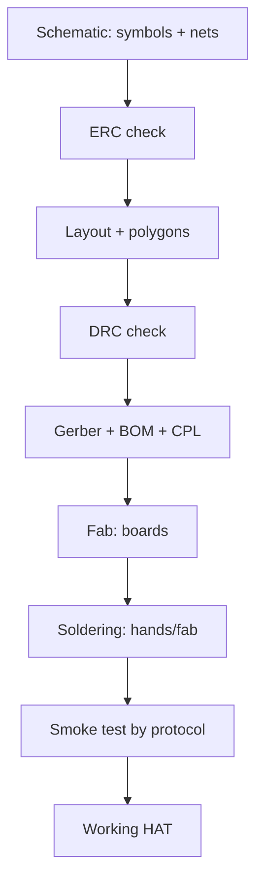

# Custom HAT Board - KiCad, Manufacturing and First Power-Up

![[assets/img/rpi-plata-pcb-hat-scheme.png|600]]
*Fig. Board path: schematic to layout to Gerber to fab to soldering to smoke test to working HAT.*

> [!tip] What this note is
> From breadboard to your own board: a first HAT in a month of evenings. KiCad is free, the fab is cheap, first power-up follows a protocol. Standard: [[EN/03-GPIO/03-HAT-EEPROM.en|HAT and EEPROM]], tools: [[EN/17-Lab/01-Instruments.en|lab instruments]].

## 1. Goal

Ship a working board on the first try:

- schematic: from breadboard to netlist;
- layout: rules for a two-layer board;
- manufacturing: what to send the fab;
- first power-up: a protocol without smoke.

| Stage | Tool | Result |
| --- | --- | --- |
| Schematic | KiCad Eeschema | netlist + BOM |
| Layout | KiCad Pcbnew | Gerber + drill |
| Manufacturing | JLCPCB/equivalents | 5 boards in a week |
| Soldering | iron/hot air/oven | assembled board |
| Debug | multimeter + analyzer | working HAT |

## 2. Process architecture



ERC/DRC to zero before sending: the fab prints mistakes too. A check is cheaper than a rework.

## 3. Schematic: rules

- hierarchy by block: power, digital, analog, connectors;
- every symbol gets a footprint at once;
- power: PWR flags on every bus;
- BOM comes from the schematic - manufacturer fields and numbers;
- revision on silkscreen: name + date + version.

## 4. Two-layer layout: rules

- bottom is a solid ground (do not cut it with traces!);
- top is signals, power is wide (0.5+ mm);
- 100 nF decoupling near every chip supply;
- I2C/SPI short, parallel, no sharp corners;
- 2.75 mm mounting holes as in HAT + keepout;
- silkscreen: pin marks, polarity, name.

## 5. Working code: BOM check generator

```python
import csv
import sys

total = 0
missing = []
with open('bom.csv') as f:
    for row in csv.DictReader(f):
        qty = int(row.get('Qty', 1))
        total += qty
        if not row.get('Mfr_PN'):
            missing.append(row.get('Reference', '?'))
        if row.get('DNP', '').strip():
            total -= qty

print(f"parts total: {total}")
if missing:
    print("NO Mfr_PN:", ', '.join(missing))
    sys.exit(1)
print("BOM OK: all parts have manufacturer numbers")
```

Without Mfr_PN the fab fits an "equivalent" at its own discretion. Exclude DNP items from the count but keep them in the schematic.

## 6. Fab ordering

- files: Gerber RS-274X + Excellon + BOM + CPL (for assembly);
- parameters: 2 layers, 1.6 mm, HASL/ENIG, silkscreen both sides;
- mask color is free, black hides traces worse;
- 5 pieces minimum - 2 to kill, 2 to work, 1 spare;
- lead time: a week of fab + a week of delivery.

## 7. Smoke test: first power-up

| Step | Action | Criterion |
| --- | --- | --- |
| 1 | Visual under a loupe | no bridges and cold joints |
| 2 | Supply continuity | no short between buses |
| 3 | Power through a 100 mA limit | microampere current |
| 4 | Voltages on all buses | 5V/3V3 in tolerance |
| 5 | Connection to Pi without load | boot fine, HAT visible |
| 6 | Functional test | all blocks per checklist |

A lamp dim-bulb tester in series with power is a classic: a short lights the lamp, not the board.

## 8. Common issues

| Symptom | Cause | Fix |
| --- | --- | --- |
| Short between buses | solder bridge | flux + wick, loupe check |
| Mirrored footprint | symbol without binding | 1:1 print check |
| No ground under the chip | cut polygon | solid bottom, via stitching |
| Fab "improved" the board | files without revision | version in the archive name and on silk |
| Connector does not fit | wrong pitch/row | connector datasheet before layout |
| Works but noisy | long analog traces | shorter, shield, RC on the input |

## 9. Board quick cheat sheet

- ERC/DRC to zero before sending;
- solid ground, wide power;
- BOM with Mfr_PN on every item;
- smoke test by protocol, not "into the outlet";
- 5 pieces: 2 to kill, 2 to work, 1 spare.

## 10. Related notes

- [[EN/03-GPIO/03-HAT-EEPROM.en|HAT and EEPROM]] - board standard.
- [[EN/17-Lab/01-Instruments.en|lab instruments]] - what to measure with.
- [[EN/04-Interfaces/02-Logic-Analyzer.en|logic analyzer]] - board bus debug.
- [[EN/02-Power-Supply/01-USB-C-PD.en|USB-C power supply]] - node power.
- [[Home.en|main map]] - full navigation.

## 9.1 Hardware versioning

- a git repository per board project;
- v1.0, v1.1 version tags - as in software;
- a Gerber archive of every fab order;
- a change log: what was reworked and why;
- the old revision stays in the archive forever.

## Official sources

- [HAT+ Specification (Raspberry Pi)](https://datasheets.raspberrypi.com/hat/hat-plus-specification.pdf) - mechanics, EEPROM, power.
- [Getting Started (Raspberry Pi docs)](https://www.raspberrypi.com/documentation/computers/getting-started.html) - HAT and extensions.
- [Raspberry Pi OS (Raspberry Pi)](https://www.raspberrypi.com/software/) - eepmake/eepdump utilities.
