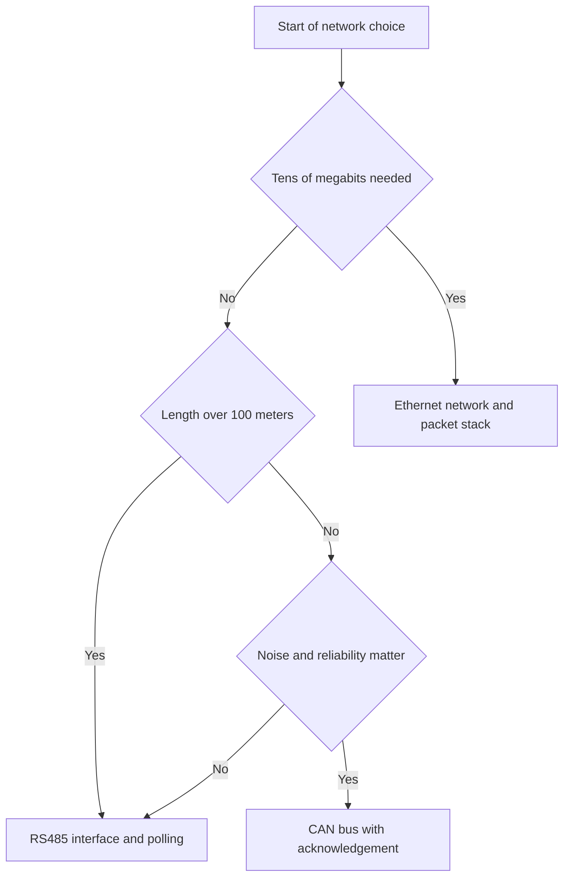

# RS485, CAN and Ethernet - Wired Networks

![[assets/img/stm32-rs485-eth-scheme.png|600]]
*Fig. Controller wired networks over twisted pair with matching, protection and power supply.*

> [!tip] Purpose of this note
> Give a working minimum of three wired networks from simple sensor polling to a full packet stack.

## 1. Purpose

Twisted pair gives range and noise immunity. The RS485 interface gives hundreds of meters on one cable. The CAN bus gives reliability in transport and industry. The Ethernet network gives speed and a link to computers. The controller has built-in ports for all options. External transceivers match levels to the cable. Protection saves from static and surges. The software stack turns bytes into packets and files. The choice depends on range, speed and complexity.

## 2. RS485 physics and DE control

The interface is differential with two wires A and B. Voltage difference sets zero and one. Common ground is needed for stability. The transceiver has an enable input and an enable output. The DE line turns transmission on. A low level turns reception on. Switching happens after the last stop bit. Switching delay is microseconds. Speeds range from 9600 to hundreds of kilobits. Length reaches 1200 meters at low speeds.

| Signal | Purpose | Explanation |
| --- | --- | --- |
| Line A | Non-inverted wire | Plus of the differential pair |
| Line B | Inverted wire | Minus of the differential pair |
| Ground | Reference potential | Mandatory on long lines |
| DE | Transmit enable | High level means transmit |
| RE | Receive enable | Low level means receive |
| Power | 3.3 V or 5 V | Per transceiver manual |

```text
Вузол RS485 на витій парі:
  Контролер TX ............ до входу DI приймача
  Контролер RX ............ до виходу RO приймача
  Вивід DE і RE разом ..... до виводу PA1 через резистор
  Лінія А ................. до витої пари, підтяжка до живлення
  Лінія В ................. до витої пари, підтяжка до землі
  Земля ................... спільна по всьому кабелю
  Термінатор 120 Ом ....... на обох кінцях лінії
  Захист .................. супресори до землі на кожному вузлі
```

## 3. Matching and line biasing

Waves reflect from cable ends. A 120 Ohm resistor at the ends kills reflections. Middle nodes stay with no resistors. Line biasing keeps the idle in a known state. Pull-up of A to power. Pull-down of B to ground. Values from 560 Ohm to 4.7 kOhm. Too many nodes overload the line. The standard holds 32 nodes. Modern transceivers hold 256 nodes. Branches stay short, under a meter. Star topology is forbidden.

| Element | Value | Where to place |
| --- | --- | --- |
| Terminator | 120 Ohm | Two line ends |
| Pull-up A | 680 Ohm to power | One master node |
| Pull-down B | 680 Ohm to ground | One master node |
| Protection | Bidirectional suppressor | Every node to ground |
| Fuse | Self-healing | In the node power supply circuit |
| Cable | Shielded twisted pair | Shield grounded at one point |

## 4. Modbus RTU protocol

The master polls slaves by addresses. Addresses range from 1 to 247. Zero is a broadcast with no answer. Read function 3 is for registers. Write function 6 is for one register. Function 16 is for a register group. A frame holds address, function, data and checksum. The CRC16 checksum uses a reflected polynomial. A 3.5 character pause splits frames. The answer timeout is hundreds of milliseconds. Retries run 2 times on silence.

| Frame field | Length | Explanation |
| --- | --- | --- |
| Address | 1 byte | Slave node number |
| Function | 1 byte | Read or write |
| Data | Variable | Register addresses and values |
| CRC low | 1 byte | Low part of the sum |
| CRC high | 1 byte | High part of the sum |
| Pause | 3.5 characters | Boundary between frames |

## 5. CAN bus and transceiver

The CAN bus is also differential with two wires. Levels are set by an external transceiver. The controller has a built-in CAN block. Speeds reach 1 Mbit on short lines. At 500 meters take 125 kbit. A frame holds an identifier, length and data. Filters select wanted identifiers. Acknowledgement is built into the protocol. Retries are automatic with no program. 120 Ohm terminators at the ends are mandatory. Galvanic isolation is desired in transport.

| Parameter | Value | Explanation |
| --- | --- | --- |
| Wires | High and low | 120 Ohm twisted pair |
| Speed | Up to 1 Mbit | Depends on length |
| Frame | Up to 8 bytes classic | Up to 64 bytes in FD |
| Identifier | 11 or 29 bits | Lower priority wins |
| Filters | Masks and lists | Filter out foreign frames |
| Termination | 120 Ohm, two ends | Frame issues without them |

## 6. Ethernet RMII PHY and LWIP stack

Controllers of the F407 and H7 series have a media access block. An external physical layer chip gives a connector. The RMII interface needs 9 lines and a 50 MHz clock. A 25 MHz quartz feeds the physical layer chip. The reference frequency returns to the controller. Transformer isolation is built into the connector. LEDs show link and activity. The LWIP stack gives addresses, sockets and a server. Packet buffer memory is tens of kilobytes. 100 Mbit speed is enough for telemetry.

| RMII signal | Purpose | Explanation |
| --- | --- | --- |
| Reference clock | 50 MHz input | From the physical layer chip |
| Transmit data | Two bits | Synchronous to reference clock |
| Transmit enable | Strobe | Active during packet |
| Receive data | Two bits | Synchronous to reference clock |
| Validity | Flag | Shows packet reception |
| Control | Two wires | Register setup |

## 7. Isolation and line protection

Long cables pick up noise and potential differences. Isolation breaks ground loops. For RS485 take an isolated transceiver. For CAN take an isolated transceiver with power. For Ethernet isolation is already in the connector. Suppressors cut overvoltage pulses. Gas dischargers fit street lines. Ground the cable shield at one point. A second point gives a loop and noise. Feed nodes over fuses.

## 8. HAL code for Modbus and CAN

```c
#include "main.h"
#include "usart.h"
#include "fdcan.h"

extern UART_HandleTypeDef huart2;
extern FDCAN_HandleTypeDef hfdcan1;

#define RS_DE_GPIO GPIOA
#define RS_DE_PIN  GPIO_PIN_1

static uint16_t modbus_crc(uint8_t *p, uint16_t n)
{
  uint16_t crc = 0xFFFF;
  for (uint16_t i = 0; i < n; i++)
  {
    crc ^= p[i];
    for (uint8_t k = 0; k < 8; k++)
    {
      if (crc & 1) crc = (uint16_t)((crc >> 1) ^ 0xA001);
      else crc >>= 1;
    }
  }
  return crc;
}

void rs_send(uint8_t *p, uint16_t n)
{
  HAL_GPIO_WritePin(RS_DE_GPIO, RS_DE_PIN, GPIO_PIN_SET);
  HAL_UART_Transmit(&huart2, p, n, 200);
  while (__HAL_UART_GET_FLAG(&huart2, UART_FLAG_TC) == RESET) {}
  HAL_GPIO_WritePin(RS_DE_GPIO, RS_DE_PIN, GPIO_PIN_RESET);
}

uint8_t modbus_read(uint8_t addr, uint16_t reg, uint16_t cnt)
{
  uint8_t f[8];
  f[0] = addr; f[1] = 0x03;
  f[2] = (uint8_t)(reg >> 8); f[3] = (uint8_t)reg;
  f[4] = (uint8_t)(cnt >> 8); f[5] = (uint8_t)cnt;
  uint16_t c = modbus_crc(f, 6);
  f[6] = (uint8_t)c; f[7] = (uint8_t)(c >> 8);
  rs_send(f, 8);
  return 1;
}

void can_send(uint32_t id, uint8_t *d, uint8_t n)
{
  FDCAN_TxHeaderTypeDef h;
  h.Identifier = id;
  h.IdType = FDCAN_STANDARD_ID;
  h.TxFrameType = FDCAN_DATA_FRAME;
  h.DataLength = FDCAN_DLC_BYTES_8;
  h.ErrorStateIndicator = FDCAN_ESI_ACTIVE;
  h.BitRateSwitch = FDCAN_BRS_OFF;
  h.FDFormat = FDCAN_CLASSIC_CAN;
  h.TxEventFifoControl = FDCAN_NO_TX_EVENTS;
  h.MessageMarker = 0;
  uint8_t buf[8] = {0};
  for (uint8_t i = 0; i < n && i < 8; i++) buf[i] = d[i];
  HAL_FDCAN_AddMessageToTxFifoQ(&hfdcan1, &h, buf);
}
```

## 9. Network choice for the task



## Common issues

| # | Issue | Why it hurts | Fix |
| --- | --- | --- | --- |
| 1 | No terminators at ends | Reflections break frames and checksums | Two 120 Ohm resistors at ends |
| 2 | Early DE drop after transmit | Byte tail lost in cable | Wait for transmit complete flag |
| 3 | No pause between frames | Receiver glues frames together | 3.5 character pause and timeout |
| 4 | CAN speed with no margin | Frame issues on long cable | Lower speed and line measurement |
| 5 | RMII with no 50 MHz clock | Block never starts, no link | 25 MHz quartz and reference return |
| 6 | Shield grounded at both sides | Loop gives noise and issues | Shield ground at one point |

## Official sources

- [Modbus RTU specification (Modbus Org)](https://www.modbus.org/specs.php) - frames, functions, addresses and checksum.
- [STM32 Ethernet LWIP manual (ST)](https://www.st.com/en/embedded-software/stm32cubef4.html) - RMII, physical layer, stack and buffers.

## See also

- [[Home.en]]
- [[EN/04-Interfaces/01-UART.en|serial UART port]]
- [[EN/04-Interfaces/04-FDCAN.en|FDCAN bus]]
- [[EN/04-Interfaces/02-SPI.en|SPI bus]]
- [[EN/12-Comm-Modules/01-NRF24-LoRa.en|radio over SPI]]
