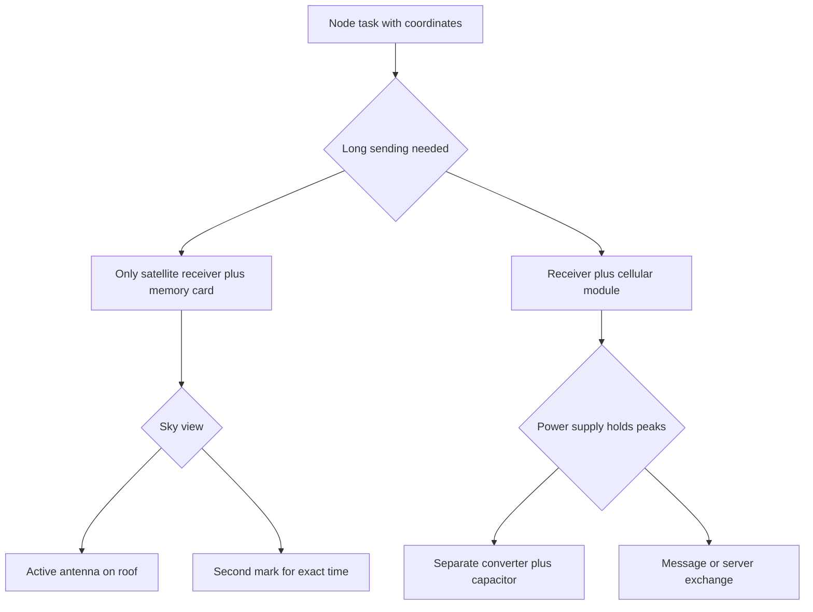

# GPS and GSM - Coordinates and Cellular Link

![[assets/img/stm32-gps-gsm-scheme.png|600]]
*Fig. GPS and GSM scheme: antenna with sky view, serial port, PPS time mark and power supply backup.*

> [!tip] Purpose of this note
> Close coordinates and link together: how to read satellite receiver sentences and how to drive a cellular module with commands over the same serial port.

## 1. Purpose

A satellite receiver gives coordinates, altitude, speed and exact time with no network. A cellular module gives calls, messages, data transfer and network access through control commands. Together they cover a tracker, a weather station with sending and a guard node.

Both modules talk over a serial port with 3.3 V logic. The satellite receiver speed is usually 9600, the cellular module 115200 with auto-detection. Reception runs over direct memory access with a line-idle interrupt so no bytes are lost.

Exact time comes from the second-mark pulse. Cellular module power supply needs a current margin because of short transmit peaks. The satellite receiver antenna needs an open sky.

## 2. Satellite receiver sentences

| Sentence | Full name | What it holds | Why to look |
| --- | --- | --- | --- |
| GGA | Fix data | Time, latitude, longitude, quality, satellites, altitude | Main sentence for coordinates |
| RMC | Navigation minimum | Time, date, status, coordinates, speed, course | Time plus motion in one line |
| GSA | Constellation set | Mode, satellite numbers, accuracy | Why accuracy is bad |
| GSV | Satellites in view | Count, elevation, azimuth, level | Where to point the antenna |
| VTG | Course and speed | True course, speed in knots | For a motion tracker |
| GLL | Simple coordinates | Latitude, longitude, time | Short option with no altitude |
| TXT | Text | Receiver messages | Start-up diagnostics |

Line example:

```text
Приклад потоку з приймача на 9600:
  $GPGGA,123519,4807.038,N,01131.000,E,1,08,0.9,545.4,M,46.9,M,,*47
  $GPRMC,123519,A,4807.038,N,01131.000,E,022.4,084.4,230394,003.1,W*6A
  Розбір полів GGA:
    Час ............ 12:35:19 всесвітній час
    Широта ......... 48 градусів 07.038 хвилин північ
    Довгота ........ 11 градусів 31.000 хвилин схід
    Якість ......... 1 означає автономна фіксація
    Супутники ...... 08 штук у розрахунку
    Висота ......... 545 метрів над рівнем моря
```

## 3. Reception over direct access and line idle

| Step | Action | Explanation |
| --- | --- | --- |
| 1 | Set port to 9600 | Standard of most receivers out of the box |
| 2 | Enable ring buffer | 256 or 512 bytes for lines |
| 3 | Enable idle interrupt | Packet end with no timers |
| 4 | Copy line to newline char | One line, one parse |
| 5 | Check checksum | Star char and two digits |
| 6 | Parse only GGA and RMC | Ignore the rest to save power |

```text
Зв'язки плати і модулів:
  STM32                GPS-модуль (9600)
  ----------------     -----------------
  PA9  -------------> RX
  PA10 <------------- TX
  PB1  <------------- PPS (секундна мітка)
  3V3  -------------- VCC
  GND  -------------- GND

  STM32                GSM-модуль (115200)
  ----------------     -----------------
  PC10 -------------> RXD
  PC11 <------------- TXD
  PC12 -------------> PWRKEY (імпульс 1 с)
  PA0  <------------- STATUS
  4V   -------------- VBAT (окремий перетворювач!)
  GND  -------------- GND (спільна земля товстим дротом)
```

## 4. PPS signal and exact time

The second mark is a short pulse at the start of every second. The edge ties to satellite time with tens of nanoseconds accuracy. The controller catches the edge with an external interrupt and corrects the internal clock.

| Signal | Parameter | Value |
| --- | --- | --- |
| Polarity | Rising | Edge interrupt |
| Duration | 100 ms | Enough for timer capture |
| Edge accuracy | Tens of nanoseconds | Better than network time |
| Use | Clock correction | Once a second |
| Backup | Receiver cell | Keeps the almanac |

## 5. Antenna and cold start

| Start mode | What it remembers | Fix time | When it happens |
| --- | --- | --- | --- |
| Cold | Nothing | Up to 12 minutes | First power-up or far move |
| Warm | Almanac and time | Up to 2 minutes | A day with no power, cell kept |
| Hot | All fresh | Up to 30 seconds | Short power break |
| Repeat | Ephemerides alive | Seconds | Leaving tree shade |

The antenna must see the sky. A window gives a weak signal through coated glass. A metal roof kills it fully. An active antenna with gain helps in the city but needs power over coax.

## 6. Cellular module and control commands

| Command | Purpose | Answer |
| --- | --- | --- |
| AT | Link check | OK |
| ATI | Module name | Firmware version |
| AT+CSQ | Signal level | Two quality numbers |
| AT+CREG? | Network registration | Status and cell |
| ATD+380971234567; | Voice call | OK and tones |
| ATH | Hang up | OK |
| AT+CMGF=1 | Message text mode | OK |
| AT+CMGS="+380971234567" | Message sending | Text prompt and OK |
| AT+CGATT=1 | Packet data attach | OK |
| AT+HTTPINIT | Exchange service start | OK |
| AT+HTTPPARA="URL","<http://srv/data>" | Server address | OK |

```text
Типова сесія обміну з мережею:
  1. AT .................... перевірка, чекаємо OK
  2. AT+CSQ ................ рівень більше 10 для стабільності
  3. AT+CREG? .............. статус 0,1 означає в мережі
  4. AT+CGATT=1 ............ приєднання до пакетних даних
  5. AT+HTTPINIT ........... старт служби
  6. AT+HTTPPARA ........... адреса і тіло запиту
  7. AT+HTTPACTION=1 ....... відправка, чекаємо код 200
  8. AT+HTTPTERM ........... завершення служби
```

## 7. Cellular module power supply

| Parameter | Value | Explanation |
| --- | --- | --- |
| Nominal voltage | 3.8 V | Range 3.4-4.4 V |
| Current peak | Up to 2 A | Short transmit pulses |
| Average current | 200-400 mA | Depends on signal |
| Capacitor | 1000 uF nearby | Holds dips |
| Power wires | Thick and short | Thin ones give dips |
| Source | Separate converter | Weak board regulator cannot pull it |

A weak regulator gives a restart at the transmit moment. The symptom is a cyclic status blink and lost registration. Fix it with a separate 2 A converter and a large capacitor near the power pins.

## 8. Code: sentence parsing over the port

```c
#include <string.h>
#include <stdlib.h>

#define NMEA_BUF 256

typedef struct {
  double lat;
  double lon;
  int fix;
  int sats;
  char time[12];
} gps_data_t;

static uint8_t nmea_hex(char c)
{
  if (c >= '0' && c <= '9') return (uint8_t)(c - '0');
  if (c >= 'A' && c <= 'F') return (uint8_t)(c - 'A' + 10);
  if (c >= 'a' && c <= 'f') return (uint8_t)(c - 'a' + 10);
  return 0;
}

int nmea_crc_ok(const char *line)
{
  const char *star = strchr(line, '*');
  uint8_t crc = 0;
  const char *p;
  uint8_t got;
  if (line[0] != '$' || star == NULL) return 0;
  for (p = line + 1; p < star; p++) crc ^= (uint8_t)(*p);
  got = (uint8_t)((nmea_hex(star[1]) << 4) | nmea_hex(star[2]));
  return crc == got;
}

static double nmea_deg(const char *f)
{
  double v = atof(f);
  int d = (int)(v / 100.0);
  double m = v - d * 100.0;
  return d + m / 60.0;
}

int nmea_gga(const char *line, gps_data_t *out)
{
  char copy[NMEA_BUF];
  char *t;
  strncpy(copy, line, sizeof(copy) - 1);
  copy[sizeof(copy) - 1] = 0;
  if (strstr(copy, "GGA") == NULL) return 0;
  if (!nmea_crc_ok(line)) return 0;
  t = strtok(copy, ",");
  t = strtok(NULL, ",");
  if (t) strncpy(out->time, t, sizeof(out->time) - 1);
  t = strtok(NULL, ",");
  out->lat = t ? nmea_deg(t) : 0;
  t = strtok(NULL, ",");
  if (t && t[0] == 'S') out->lat = -out->lat;
  t = strtok(NULL, ",");
  out->lon = t ? nmea_deg(t) : 0;
  t = strtok(NULL, ",");
  if (t && t[0] == 'W') out->lon = -out->lon;
  t = strtok(NULL, ",");
  out->fix = t ? atoi(t) : 0;
  t = strtok(NULL, ",");
  out->sats = t ? atoi(t) : 0;
  return out->fix > 0;
}
```

## 9. Code: control command wrapper

```c
#include <string.h>
#include <stdio.h>

extern UART_HandleTypeDef huart3;

static int at_send(const char *cmd, char *ans, uint32_t timeout)
{
  uint16_t len = 0;
  memset(ans, 0, 512);
  HAL_UART_Transmit(&huart3, (uint8_t *)cmd, strlen(cmd), 1000);
  HAL_UART_Transmit(&huart3, (uint8_t *)"\r\n", 2, 100);
  HAL_UART_Receive(&huart3, (uint8_t *)ans, 511, timeout);
  return strstr(ans, "OK") != NULL;
}

int gsm_call(const char *number)
{
  char cmd[48];
  char ans[512];
  snprintf(cmd, sizeof(cmd), "ATD%s;", number);
  return at_send(cmd, ans, 5000);
}

int gsm_sms(const char *number, const char *text)
{
  char cmd[48];
  char ans[512];
  snprintf(cmd, sizeof(cmd), "AT+CMGS=\"%s\"", number);
  HAL_UART_Transmit(&huart3, (uint8_t *)cmd, strlen(cmd), 1000);
  HAL_UART_Transmit(&huart3, (uint8_t *)"\r", 1, 100);
  HAL_Delay(300);
  HAL_UART_Transmit(&huart3, (uint8_t *)text, strlen(text), 1000);
  HAL_UART_Transmit(&huart3, (uint8_t *)"\x1A", 1, 100);
  HAL_UART_Receive(&huart3, (uint8_t *)ans, 511, 8000);
  return strstr(ans, "+CMGS") != NULL;
}

int gsm_signal(void)
{
  char ans[512];
  int rssi = 99;
  if (!at_send("AT+CSQ", ans, 2000)) return -1;
  sscanf(ans, "%*[^:]: %d", &rssi);
  return rssi;
}
```

## 10. Mermaid: data path choice



## 11. Field debugging

| Step | Check | Expectation |
| --- | --- | --- |
| 1 | Receiver port at 9600 | Dollar lines every second |
| 2 | Checksum | Most lines valid |
| 3 | Satellite count | 4 minimum for fix |
| 4 | Module check command | OK answer |
| 5 | Signal level | Value 10 and above |
| 6 | Voltage under transmit | No dips below 3.4 V |

## Common issues

| # | Issue | Why it hurts | Fix |
| --- | --- | --- | --- |
| 1 | Parsing with no sum check | Broken line jumps coordinates | Star check first, then parse |
| 2 | Byte reads in a loop with no buffer | Lost chars at high speed | Direct access with idle interrupt |
| 3 | Receiver test indoors | Signal never passes concrete | Window or roof with sky view |
| 4 | Module powered from board | 2 A peaks drop the rail, restart | Separate converter and 1000 uF capacitor |
| 5 | Message send with no registration | Module silent or errors | Registration status and signal level first |
| 6 | Common ground on a thin wire | Floating potential and exchange faults | Thick short ground and nearby capacitor |

## Official sources

- [u-blox receiver message description (u-blox)](https://www.u-blox.com/en/docs/UBX-13003221) - GGA and RMC formats with examples.
- [SIM800 command set (SIMCom)](https://www.simcom.com/product/sim800c.html) - calls, messages and data transfer.
- [Quectel M95 and MC60 modules (Quectel)](https://www.quectel.com/product/m95) - power supply, current peaks and control.

## See also

- [[Home.en]]
- [[EN/04-Interfaces/01-UART.en|serial UART port]]
- [[EN/02-Power-Supply/02-Battery-Power.en|battery power of nodes]]
- [[EN/14-Devboards/03-Nucleo.en|Nucleo boards]]
- [[EN/14-Devboards/01-Blue-Pill.en|Blue Pill board]]
