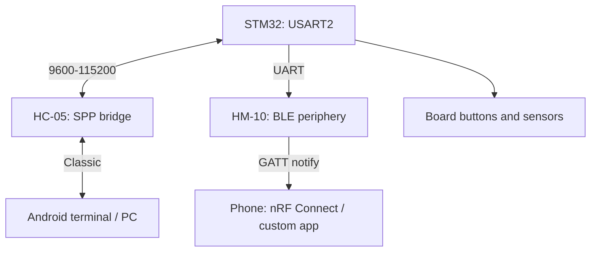

# STM32 + Bluetooth HC-05/HM-10 - SPP Classic and BLE Modems over UART

![[assets/img/stm32-ble-hc05-hm10-scheme.png|600]]
*Fig. HC-05 is a clear SPP bridge, HM-10 is BLE periphery with services; both over UART.*

> [!tip] What this note is
> Two different worlds for the same price: HC-05 (Bluetooth Classic, CSR BC417) is a "wireless COM port", HM-10 (BLE on CC2541) is GATT services for the phone. Never confuse them: a phone with no BLE never sees HM-10, and iPhone never friends SPP. Base: [[EN/04-Interfaces/01-UART.en|STM32 UART bus]].

## 1. Goal

Close all STM32 Bluetooth tasks with two penny modules:

- HC-05: terminal, debugging, control from Android/PC as a COM port;
- HM-10: sensors for the phone (temperature, buttons) over BLE;
- both use 3.3V logic, both set up with AT;
- clear choice: SPP or BLE - table below.

| Criterion | HC-05 (Classic) | HM-10 (BLE 4.0) |
| --- | --- | --- |
| Profile | SPP, clear bridge | GATT, services/characteristics |
| Phone | Android/PC, iPhone - no | Android + iPhone |
| Speed | up to ~30 KB/s real | 1-5 KB/s, 20-byte packets |
| Consumption | ~30 mA in link | ~8 mA, sleep in microamps |
| Price/complexity | cheap, zero phone code | cheap, needs a BLE app |

## 2. Architecture



HC-05 simply forwards bytes after pairing: what enters UART flies to the air. HM-10 needs service understanding: one FFE0 service, two FFE1 characteristics.

## 3. Hardware part

| STM32 pin | HC-05 | HM-10 | Note |
| --- | --- | --- | --- |
| TX (PA2) | RXD | RXD | over divider if module has 5V power with 3.3V logic - input tolerant, but check revision |
| RX (PA3) | TXD | TXD | direct, 3.3V |
| 3V3/5V | VCC | VCC | HC-05 takes 5V versions too; HM-10 strictly 3.3V |
| GND | GND | GND | common |
| PB12 | KEY/EN | - | HIGH before power means AT mode at 38400 |
| PB13 | STATE | STATE | HIGH means linked, route to LED |

> [!warning] Two HC-05 UART modes
> Normal mode is 9600 (or set value), AT mode over KEY is always 38400. Half of "broken" HC-05 units are AT attempts at 9600 with no KEY. HM-10 has no such trap: AT always runs at work speed.

## 4. HC-05 setup

```text
AT                 → OK
AT+VERSION?        → версія прошивки
AT+NAME=STM32-Node → ім'я в ефірі
AT+PSWD=1234       → PIN спарювання
AT+UART=115200,0,0 → швидкість, стоп-біти, парність
AT+ROLE=0          → slave (плата чекає підключення)
AT+CMODE=1         → приймати всіх
```

ROLE=1 (master) is needed only when STM32 searches devices itself - a rare case, keep slave.

## 5. HM-10 setup

```text
AT                 → OK
AT+NAMESTM32BLE    → ім'я (без знака рівності!)
AT+PIN123456       → PIN
AT+MODE0           → режим даних (MODE1 = AT по ефіру)
AT+NOTI1           → повідомлення про конект
AT+PWRM0           → без автосну (PWRM1 = сон)
```

The syntax difference is a trap: HM-10 writes `AT+NAME` together with the value, with no `=`. After `AT+RESET` the module starts advertising.

## 6. Working HAL code

One driver for both modules - only init differs:

```c
void bt_send(const char *s) {
  HAL_UART_Transmit(&huart2, (uint8_t*)s, strlen(s), 100);
}

void bt_send_line(const char *s) {
  bt_send(s);
  HAL_UART_Transmit(&huart2, (uint8_t*)"\r\n", 2, 100);
}

void hc05_init(void) {
  HAL_GPIO_WritePin(GPIOB, GPIO_PIN_12, GPIO_PIN_RESET);
  bt_send_line("AT+UART=115200,0,0");
  at_wait("OK", 1000);
  bt_send_line("AT+NAME=STM32-Node");
  at_wait("OK", 1000);
}

void hm10_notify(const char *payload) {
  char buf[48];
  snprintf(buf, sizeof(buf), "%s", payload);
  bt_send(buf);
}
```

For HM-10 cut packets at 20 bytes: the phone glues longer lines but with delay. Format sensor data short: `T23.5,H61`.

## 7. Phone side

- HC-05: any SPP terminal (Serial Bluetooth Terminal), pairing over PIN;
- HM-10: nRF Connect - find `STM32BLE`, FFE0 service, subscribe to notify FFE1;
- custom app only when buttons and plots are needed, protocol stays text;
- iPhone + HC-05 never work by design (Apple closed SPP) - HM-10 only.

## 8. Common issues

| Symptom | Cause | Fix |
| --- | --- | --- |
| HC-05 silent on AT | no KEY at power-up or speed not 38400 | KEY HIGH before power, port 38400 |
| HM-10 silent | command with `=` (AT+NAME=...) | write `AT+NAMESTM32BLE` with no equals |
| Phone never sees HM-10 | phone with no BLE or module in MODE1 | check BLE 4.0+, return MODE0 |
| Bytes lost at 115200 | long wires with no ground nearby | twisted TX/GND pair, or drop to 57600 |
| iPhone never connects | trying SPP on iOS | HM-10 only, BLE only |
| Different name after RESET | parameters never saved | HC-05 saves itself, HM-10 needs `AT+SAVE` on clones |

## 9. Neighbour notes

- [[EN/04-Interfaces/01-UART.en|STM32 UART bus]] - USART, DMA reception.
- [[EN/12-Comm-Modules/06-WiFi-ESP-AT.en|WiFi over ESP-AT]] - senior UART-modem brother.
- [[EN/12-Comm-Modules/01-NRF24-LoRa.en|NRF24 and LoRa]] - radio with no phone.
- [[EN/05-Radio/01-BLE-WB.en|BLE on STM32WB]] - when BLE is needed on chip.
- [[EN/07-Timers/02-LPTIM-RTC-WDT.en|timers and WDT]] - periodic sending.

## Official sources

- [HC-05 Bluetooth Module (Components101)](https://components101.com/wireless/hc-05-bluetooth-module) - pins, AT commands, modes.
- [HM-10 Bluetooth Module (Components101)](https://components101.com/wireless/hm-10-bluetooth-module) - syntax with no `=`, MODE/PWRM modes.
- [STM32CubeWB (STMicroelectronics, GitHub)](https://github.com/STMicroelectronics/STM32CubeWB) - BLE stack for WB, GATT examples.
- [Bluetooth Low Energy (Wikipedia)](https://en.wikipedia.org/wiki/Bluetooth_Low_Energy) - roles, services, 20-byte MTU.
- [Bluetooth Core Specification (Bluetooth SIG)](https://www.bluetooth.com/specifications/specs/core-specification/) - GATT, services, characteristics.
