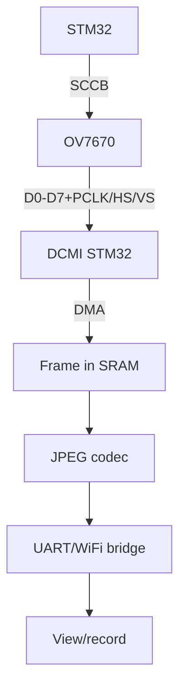

# STM32 DCMI Camera - OV7670, Frame Capture and JPEG

![[assets/img/stm32-dcmi-camera-scheme.png|600]]
*Fig. DCMI path: OV7670 sends pixels over 8 bits, DMA builds the frame in SRAM, code compresses and streams.*

> [!tip] What this note is
> Vision for STM32: a camera where ESP32 is usual and STM32 is not. DCMI exists on F4/F7/H7. Base: [[EN/04-Interfaces/07-DMA-DeepDive.en|deep DMA]], [[EN/07-Timers/01-GPTIM-ADTIM.en|STM32 timers]].

## 1. Goal

Get a picture from STM32:

- OV7670 over DCMI: signals, power supply, clocking;
- SCCB init (Omnivision I2C-like protocol);
- DMA frame capture with no CPU involvement;
- JPEG encoding in software or hardware (H7);
- frame streaming over a UART/WiFi bridge.

| Parameter | OV7670 | Note |
| --- | --- | --- |
| Matrix | VGA 640x480 | enough for detection |
| Interface | DCMI 8 bit + PCLK/HSYNC/VSYNC | parallel |
| Power | 3.3V digital + 1.8V core | two LDOs! |
| Clock | XCLK 24 MHz from MCO | given by STM32 |
| Formats | YUV/RGB565/JPEG | JPEG for streaming |

## 2. Architecture



A VGA RGB565 frame is 600 KB - never fits F4 SRAM whole. QVGA (320x240) or external SRAM/SDRAM.

## 3. DCMI pinout (F4/F7)

| OV7670 signal | STM32 pin | Note |
| --- | --- | --- |
| D0-D7 | PC6-PC9, PE4-PE6... | per chip DCMI table! |
| PCLK | PA6 | pixel clock |
| HSYNC/VSYNC | per chip DCMI table | frame/line sync |
| XCLK | MCO (PA8) 24 MHz | clocks the sensor |
| SDA/SCL (SCCB) | PB7/PB6 | 100 kHz |
| 3V3/1V8/GND | LDO x2 | order: core first |

DCMI pin mapping differs between F4/F7/H7 - check against the datasheet of the EXACT chip, not memory.

## 4. SCCB init

- looks like I2C but with no repeated start (Omnivision dialect);
- base registers: format, resolution, clocking, balance;
- ready tables for QVGA/YUV come from Cube examples;
- chip ID check (0x76) means the sensor is alive;
- after init wait 2 frames for stabilisation.

## 5. Working code (C, HAL)

```c
#define CAM_W 320
#define CAM_H 240
static uint16_t frame[CAM_W * CAM_H];

void camera_start(void) {
  sccb_init();
  sccb_write_table(qvga_yuv_table);
  HAL_DCMI_Start_DMA(&hdcmi, DCMI_MODE_SNAPSHOT,
                     (uint32_t)frame, CAM_W * CAM_H / 2);
}

void HAL_DCMI_FrameEventCallback(DCMI_HandleTypeDef *hdcmi) {
  frame_ready = 1;
}

void app_main(void) {
  camera_start();
  while (1) {
    if (frame_ready) {
      frame_ready = 0;
      jpeg_encode_send(frame, CAM_W, CAM_H);
      HAL_DCMI_Resume(&hdcmi);
    }
  }
}
```

SNAPSHOT mode: frame → stop → process → restart. Continuous is for video with a double buffer.

## 6. Working code (MicroPython)

```python
# MicroPython: керування камерою-вузлом (захват — на C-ядрі)
import time
import machine
import network
import urequests

pwr = machine.Pin('PC13', machine.Pin.OUT, value=1)
wlan = network.WLAN(network.STA_IF)
wlan.active(True)
wlan.connect('ssid', 'pass')
while not wlan.isconnected():
    time.sleep(0.5)

SNAP_URL = 'http://192.168.1.60/snap'

while True:
    try:
        r = urequests.get(SNAP_URL)
        open('/sd/frame.jpg', 'wb').write(r.content)
        r.close()
        print('snap saved')
    except OSError as e:
        print('snap error', e)
    time.sleep(60)
```

Split: the C core captures and serves HTTP, the MicroPython client takes frames and writes to SD. DCMI timings never stretch to MicroPython by design.

## 7. JPEG and streaming

- software JPEG (TinyJPEG) - slow but with no hardware;
- H7: hardware JPEG codec - frames on the fly;
- MJPEG stream: frames in a row over HTTP;
- stream resolution below capture (QVGA is enough);
- night: OV7670 IR module plus backlight.

## 8. Common issues

| Symptom | Cause | Fix |
| --- | --- | --- |
| Black frame | no XCLK/core power | MCO 24 MHz, both LDOs |
| Stripes/tearing | PCLK phasing | PCLK polarity, shorter wires |
| SCCB NACK | address/power | ID read, 100 kHz |
| Frame never fits | VGA in small SRAM | QVGA or external memory |
| DMA stopped | overrun with no handling | double buffer, faster handling |
| Colours odd | wrong format | YUV vs RGB565 matched both ends |

## 9. DCMI quick cheat sheet

- core power 1.8V first;
- XCLK 24 MHz from MCO;
- ID read means sensor alive;
- QVGA to start, VGA with memory;
- pin mapping from chip datasheet.

## 10. Neighbour notes

- [[EN/04-Interfaces/07-DMA-DeepDive.en|deep DMA]] - frame transport.
- [[EN/12-Comm-Modules/03-GPS-GSM.en|GPS/GSM modules]] - UART bridge for streaming.
- [[EN/02-Power-Supply/03-Power-Design.en|power supply design]] - two camera LDOs.
- [[EN/01-Hardware/02-F3-F4.en|F3/F4 family]] - DCMI chips.
- [[Home.en|main map]] - full navigation.

## Official sources

- [OV7670 Camera Board (Waveshare)](https://www.waveshare.com/wiki/OV7670_Camera_Board) - wiring, SCCB, formats.
- [STM32CubeF7 (STMicroelectronics, GitHub)](https://github.com/STMicroelectronics/STM32CubeF7) - DCMI examples.
- [STM32F4 (ST)](https://www.st.com/en/mcus-mpus/stm32f4.html) - DCMI pin mapping.
