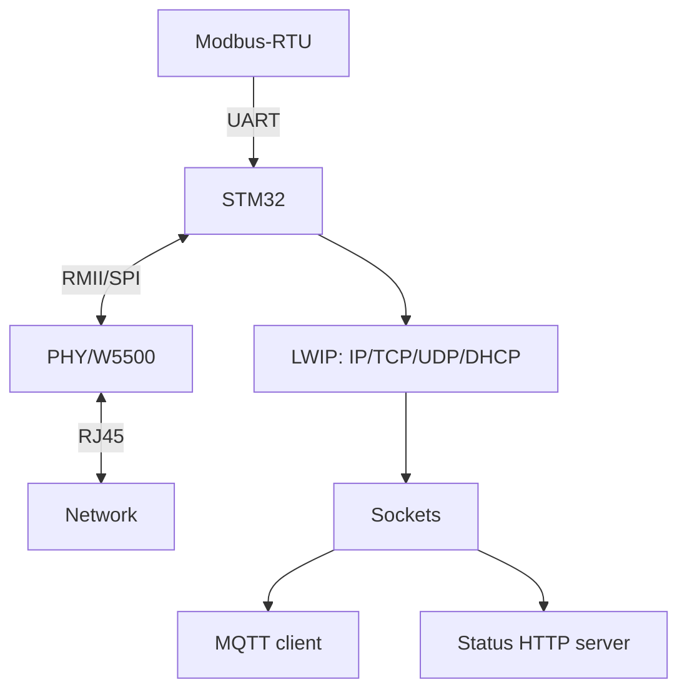

# STM32 Ethernet with LWIP - Sockets, MQTT and Gateway with no OS

![[assets/img/stm32-lwip-ethernet-scheme.png|600]]
*Fig. Wired node: MAC+PHY or W5500, LWIP with no OS, sockets up - MQTT and HTTP.*

> [!tip] What this note is
> Wire instead of radio: shop floor and server room stability. LWIP on bare metal (raw API) or with FreeRTOS (socket API). Base: [[EN/12-Comm-Modules/04-W5500.en|W5500 module]], [[EN/12-Comm-Modules/02-RS485-CAN-Ethernet.en|RS485/CAN/Ethernet]].

## 1. Goal

Give STM32 a full IP stack:

- two paths: built-in MAC+PHY (F4/F7/H7) or W5500 over SPI;
- LWIP raw API (callbacks) vs socket API (with RTOS);
- MQTT client over sockets;
- DHCP + static + reconnect;
- Modbus-RTU → MQTT gateway.

| Path | Pros | Cons |
| --- | --- | --- |
| Built-in MAC + PHY | speed, RMII | needs PHY and routing |
| W5500 over SPI | ready module, 8 sockets in hardware | SPI speed limit |

## 2. Architecture



With no OS use raw API with callbacks (RAM saving). With FreeRTOS use familiar sockets in three lines.

## 3. Node pinout

| Signal | STM32 pin | Note |
| --- | --- | --- |
| RMII REF_CLK | PA1 (50 MHz input) | from PHY! |
| RMII TXD, TX_EN | PB12/PB13, PB11 | data to PHY |
| RMII RXD, CRS_DV | PC4/PC5, PA7 | data from PHY |
| W5500 SPI | PA5/6/7 + CS | RMII alternative |
| W5500 INT/RST | PB0/PB1 | interrupt and reset |
| LINK/ACT LED | indication | link seen at once |

RMII pins are fixed by the multiplexer - check the chip AF table. The 50 MHz signal stays short and straight.

## 4. LWIP: raw versus socket

- raw: `tcp_recv/tcp_sent` callbacks, zero copies, complex logic;
- socket (with RTOS): `lwip_socket/connect/send` - like Linux;
- tune memp pools to the task (PBUF_POOL_SIZE!);
- DHCP with static fallback on timeout;
- DNS - or static broker IPs (more reliable).

## 5. Working code (C, socket API)

```c
#include "lwip/sockets.h"
#include "mqtt_client.h"

#define BROKER_IP "192.168.1.10"

int net_mqtt_pub(const char *topic, const char *payload) {
  int s = lwip_socket(AF_INET, SOCK_STREAM, 0);
  struct sockaddr_in a = {0};
  a.sin_family = AF_INET;
  a.sin_port = htons(1883);
  a.sin_addr.s_addr = inet_addr(BROKER_IP);
  if (lwip_connect(s, (struct sockaddr*)&a, sizeof(a)) != 0) {
    lwip_close(s);
    return -1;
  }
  mqtt_send_connect(s, "stm32-node");
  mqtt_send_pub(s, topic, payload);
  lwip_close(s);
  return 0;
}

void gateway_tick(void) {
  static uint32_t t0 = 0;
  if (HAL_GetTick() - t0 > 5000) {
    t0 = HAL_GetTick();
    char buf[64];
    snprintf(buf, sizeof(buf), "%lu,%d", t0, read_sensors());
    net_mqtt_pub("stm32/data", buf);
  }
}
```

A simple client (connect-publish-close) is enough for telemetry every 5 s. A permanent link is the next level.

## 6. Working code (MicroPython)

```python
# MicroPython: мережевий міст через W5500-SPI (навчальний)
import time
import network
from machine import Pin, SPI

spi = SPI(1, baudrate=40000000, sck=Pin(10), mosi=Pin(11), miso=Pin(12))
nic = network.WIZNET5K(spi, Pin(13), Pin(14))
nic.active(True)
nic.ifconfig(('192.168.1.50', '255.255.255.0', '192.168.1.1', '8.8.8.8'))
print(nic.ifconfig())

import usocket
while True:
    try:
        s = usocket.socket()
        s.connect(('192.168.1.10', 1883))
        s.send(b'stm32/hello\n')
        s.close()
    except OSError as e:
        print('net error', e)
    time.sleep(5)
```

Honest: no LWIP stack is written on MicroPython - the WIZNET5K driver gives sockets, logic stays the same.

## 7. Modbus to MQTT gateway

- UART polling of slaves on schedule;
- register cache in RAM;
- publish on change (deadband), not all in a row;
- commands from MQTT go as register writes;
- channel watchdog: silence over a minute means socket restart.

## 8. Common issues

| Symptom | Cause | Fix |
| --- | --- | --- |
| No link | PHY with no clock/power | 25 MHz quartz, RMII pins |
| DHCP 0.0.0.0 | no server/cable | static for test, other cable |
| Sockets leak | no close() on issues | close in all branches |
| Breaks under load | small memp pools | raise PBUF_POOL_SIZE |
| W5500 silent | SPI mode/speed | mode 0, start at 10 MHz |
| Slow after WiFi bridge | double NAT | wire straight to LAN |

## 9. Ethernet quick cheat sheet

- RMII pins from chip AF table;
- static is more reliable than DHCP;
- always close sockets;
- memp pools sized to task;
- wire is the base, radio the backup.

## 10. Neighbour notes

- [[EN/12-Comm-Modules/04-W5500.en|W5500 module]] - module hardware.
- [[EN/12-Comm-Modules/02-RS485-CAN-Ethernet.en|RS485/CAN/Ethernet]] - network physics.
- [[EN/15-Protocols/01-Modbus.en|Modbus protocol]] - gatewaying.
- [[EN/15-Protocols/04-MQTT.en|MQTT protocol]] - upper protocol.
- [[Home.en|main map]] - full navigation.

## Official sources

- [lwIP (GitHub)](https://github.com/lwip-tcpip/lwip) - stack, raw/socket API, memp.
- [CANopen (CAN in Automation)](https://www.can-cia.org/can-knowledge/canopen/) - neighbour industrial stack.
- [STM32CubeF7 (STMicroelectronics, GitHub)](https://github.com/STMicroelectronics/STM32CubeF7) - Ethernet examples.
- [W5500 (WIZnet Docs)](https://docs.wiznet.io/Product/Chip/Ethernet/W5500) - SPI registers, sockets, driver.
