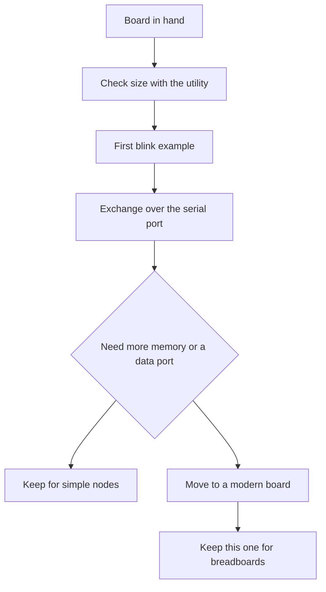

# Blue Pill - board map and limits

![[assets/img/stm32-bluepill-board-scheme.png|600]]
*Fig. Blue Pill map: controller, LED, mode jumpers, and weak regulator.*

> [!tip] Note purpose
> Give a map of the cheapest board: where the LED and buttons are, how to flash without data through the power connector, and when the board is already too little.

## 1. Purpose

The board gives the minimum to start: controller, crystal, reset and mode buttons, wire headers. A price of a few dollars makes it expendable for breadboards. Tons of examples for this controller shorten the search.

The board teaches the basics: clocking from the crystal, LED blinking, exchange over the serial port, firmware flashing with the debugger. Its limits teach you to read the documentation: power connector without data, small memory size, weak regulator.

For serious tasks, take modern boards with a memory reserve and a built-in debugger. This one stays for learning and simple nodes.

## 2. What is on the board

| Component | Where | Note |
| --- | --- | --- |
| Controller | Medium density, 64 KB per marking | Often 128 KB in fact, check with the utility |
| LED | PC13 line, active low | Lights at zero on the pin |
| Reset button | Near the edge | Short reset pulse |
| Mode jumper | BOOT0 between zero and one | One leads to the factory bootloader |
| Power connector | Power only | No data, a beginner trap |
| Regulator | Weak, about 100 mA | Power radio and motors separately |
| Crystal | 8 MHz | Accurate frequency for exchange |
| Headers | Two rows of 20 | Standard breadboard step |

```text
Карта плати вид зверху:
  +----------------------------------+
  |  [USB живлення]   [Кнопка RESET] |
  |                                  |
  |  BOOT0 [=]  BOOT1 (запаяно в 0)  |
  |                                  |
  |  Контролер LQFP48 по центру      |
  |  Кварц 8 МГц поруч               |
  |                                  |
  |  PC13 -- LED (активний нуль)      |
  |  PA9  -- TX1  PA10 -- RX1        |
  |  PA13 -- SWDIO PA14 -- SWCLK     |
  |  3V3 -- стабілізатор -- 5V вхід  |
  +----------------------------------+
  Лівий ряд:  GND 3V3 5V ... PB...   |
  Правий ряд: GND 3V3 ... PA...      |
```

## 3. Controller details

| Parameter | Value | Explanation |
| --- | --- | --- |
| Core | 32-bit, 72 MHz | No hardware FPU |
| Program memory | 64 KB per datasheet | Check often shows 128 KB |
| RAM | 20 KB | Enough for learning |
| Voltage | 2.0-3.6 V | Pins partly 5 V tolerant |
| Timers | Three general plus advanced | PWM and capture out of the box |
| Interfaces | 3×USART, 2×I2C, 2×SPI (+ CAN in Connectivity Line) | CAN bus in larger packages |
| ADC | Twelve bits, ten channels | One module with multiplexing |
| Unique ID | 96 bits | For firmware binding |

## 4. Clones and check

| Clone sign | How to see | What to do |
| --- | --- | --- |
| Different laser marking | Faint print or errors | Do not trust the label |
| Smaller size | Firmware does not fit | Tool will show real size |
| Crooked regulator | Heats and drops | Power from external source |
| No 32 kHz crystal | Empty pads for clock | Real-time clock drifts |
| LED on different line | Example does not blink | Seek specific vendor schematic |

```text
Перевірка утилітою перед роботою:
  1. Підключи налагоджувач: SWDIO, SWCLK, GND, 3V3.
  2. Запусти st-info --probe
  3. Дивись рядки flash і sram
  4. Якщо flash 131072 -- пощастило, вдвічі більше
  5. Запиши номер на стікері плати
```

## 5. Power and regulator limits

The board draws power from the power connector or from the 5 V pin. The built-in regulator is weak and heats up even with a bright LED and two sensors. Radio modules with consumption peaks sag the rail.

| Source | Voltage | Current | When to use |
| --- | --- | --- | --- |
| Power connector | 5 V | Up to 500 mA from port | Learning without peripherals |
| 5 V pin | 5 V | Depends on PSU | Separate PSU for breadboards |
| 3.3 V pin input | 3.3 V | Regulator bypass | Accurate lab source |
| Debugger | 3.3 V | About 100 mA | Flashing only, no load |

## 6. Boot modes

| BOOT0 | State | Mode | How to flash |
| --- | --- | --- | --- |
| 0 | Run | Start from program memory | Debugger over wires |
| 1 | Bootloader | Factory port | Serial port over converter |

Sequence for the factory bootloader: jumper to one, press reset, flash the file with the utility, jumper back to zero, press reset. A jumper forgotten at one is the classic cause of questions about why the board does not start.

## 7. Flashing by three ways

| Path | What is needed | Speed |
| --- | --- | --- |
| Debugger | Four wires and programmer | Fast and with debugging |
| Serial port | Level converter and utility | Slow but without programmer |
| Built-in debugger of another board | Jumpers from the board with debugger | Handy when there is no programmer |

```c
#include "stm32f1xx_hal.h"

int main(void)
{
  HAL_Init();
  __HAL_RCC_GPIOC_CLK_ENABLE();
  GPIO_InitTypeDef g = {0};
  g.Pin = GPIO_PIN_13;
  g.Mode = GPIO_MODE_OUTPUT_PP;
  g.Pull = GPIO_NOPULL;
  g.Speed = GPIO_SPEED_FREQ_LOW;
  HAL_GPIO_Init(GPIOC, &g);
  while (1)
  {
    HAL_GPIO_TogglePin(GPIOC, GPIO_PIN_13);
    HAL_Delay(500);
  }
}
```

The code above is the first example: the debugger flashes, the LED blinks twice a second. Active low means writing zero lights it, one turns it off.

```c
#include "stm32f1xx_hal.h"

extern UART_HandleTypeDef huart1;

void bluepill_hello(void)
{
  const char *msg = "Blue Pill живий\r\n";
  HAL_UART_Transmit(&huart1, (uint8_t *)msg, 17, 500);
}

void bluepill_button_poll(void)
{
  if (HAL_GPIO_ReadPin(GPIOA, GPIO_PIN_0) == GPIO_PIN_RESET)
  {
    HAL_GPIO_TogglePin(GPIOC, GPIO_PIN_13);
    HAL_Delay(200);
  }
}
```

## 8. Crystal and clocking

| Source | Frequency | Accuracy |
| --- | --- | --- |
| Internal 8 MHz | 8 MHz | Drifts with temperature |
| External crystal | 8 MHz | Accurate for exchange |
| Frequency multiplier | Up to 72 MHz | Core maximum |
| 32 kHz clock | Option | Often not soldered |

Setup with the graphic configurator: external crystal, multiplier to maximum, bus dividers per datasheet. Blinking checked with a stopwatch shows a clocking error.

## 9. Mermaid: what to do with the board



## 10. When the board is too little

| Task | Why it is not enough | Where to move |
| --- | --- | --- |
| Data port over connector | Power only there | Board with data over connector |
| Audio processing | Little memory and no FPU | Performance family with reserve |
| Wireless link | Weak power supply | Board with strong regulator |
| Accurate clock | No 32 kHz crystal | Board with clock crystal |
| Debugging out of the box | External programmer needed | Board with built-in debugger |

## Common issues

| Symptom | Cause | Fix |
| --- | --- | --- |
| Flashing via the power connector fails | No data lines on that connector | Use a debugger or the serial port |
| Board always enters the bootloader | Jumper left at one | Return it to zero and reset |
| Powering a radio from the board | Sagging and restarts | Separate supply with common ground |
| Trusting the memory marking | Clone with different size | Check with the utility before the project |
| 5 V on a non-tolerant input | Pin breakdown | Tolerance table in the datasheet |
| LED searched with a one | It is active low | Zero lights it, one turns it off |

## Official sources

- [Medium-density controller (ST)](https://www.st.com/en/microcontrollers-microprocessors/stm32f103c8.html) - datasheet, memory and pins.
- [Factory bootloader for each chip (ST)](https://www.st.com/resource/en/application_note/an2606-stm32-microcontroller-system-memory-boot-mode-stmicroelectronics.pdf) - modes and flashing ports.
- [Open-source programmer utilities (GitHub)](https://github.com/stlink-org/stlink) - size check and flashing.

## See also

- [[Home.en]]
- [[01-Hardware/01-F0-F1-Classic.en | F0/F1 classic]]
- [[EN/09-Firmware/03-ST-Link-Flashing.en| ST-Link flashing]]
- [[14-Devboards/02-Black-Pill.en | Black Pill board]]
- [[00-Start/04-Dev-Boards.en | Dev board overview]]
