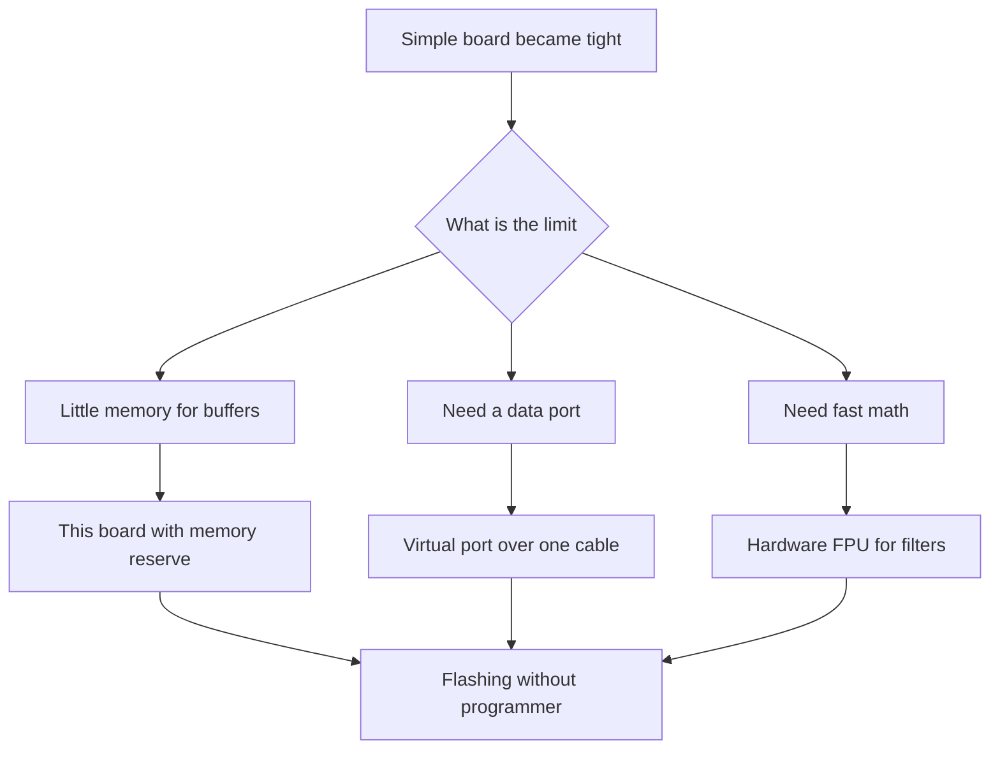

# Black Pill - board with built-in debugger and USB

![[assets/img/stm32-blackpill-board-scheme.png|600]]
*Fig. Black Pill map: performance core, data connector, control buttons and power reserve.*

> [!tip] Note purpose
> Show the next step after a simple board: the same size, but a faster core, hardware FPU and a real data port without external converters.

## 1. Purpose

The board stays small for breadboards, but the controller is already from the performance family. Hardware FPU speeds up filters and regulators. Higher frequency gives reserve for displays and exchange.

A modern connector carries data, so console and firmware go over one cable. Reset, mode and user buttons simplify work without jumpers. A regulator with reserve holds sensors and memory cards.

The board fits learning focused on sound, graphics and fast exchange. The price is slightly higher, but it saves on converters and the programmer.

## 2. Controller variants

| Board | Controller | Memory | Feature |
| --- | --- | --- | --- |
| Base | F401CC | 256 KB and 64 KB | Hardware FPU and 84 MHz speed |
| Senior | F411CE | 512 KB and 128 KB | 100 MHz and more interfaces |
| Both | Small package | Ports routed to pin headers | Partly pin compatible |

```text
Карта плати вид зверху:
  +----------------------------------+
  |  [USB-C дані]    [Кнопка NRST]   |
  |  [Кнопка BOOT0]  [Кнопка USER]   |
  |                                  |
  |  Контролер QFN48 по центру       |
  |  Кварц 25 МГц поруч              |
  |  Стабілізатор із запасом         |
  |                                  |
  |  PC13 -- LED (активний нуль)     |
  |  PA11 -- DM  PA12 -- DP          |
  |  PA13 -- SWDIO PA14 -- SWCLK     |
  |  5V вхід -- 3V3 вихід            |
  +----------------------------------+
```

## 3. Buttons and control

| Button | Marking | How to press |
| --- | --- | --- |
| Reset | NRST | Short press restarts |
| Mode | BOOT0 | Hold at power-on for the bootloader |
| User | USER on PA0 | Read by program as an input |

The mode button replaces the jumper from the old board. No tweezers and lost caps needed. The user button gives an input for menus without breadboard wires.

## 4. Data port over the connector

| Mode | What it gives | When to take |
| --- | --- | --- |
| Virtual port | Console over cable | Debug messages |
| Bootloader | Flashing without programmer | Field without tools |
| Own device | Keyboard or flash drive | Finished products |

Data lines are routed straight to the connector over matching resistors. The old board had nothing like that and demanded a converter. Here one cable covers power, console and flashing.

## 5. Power with reserve

| Source | Voltage | Capability |
| --- | --- | --- |
| Connector | 5 V | Power and data together |
| 5 V pin | 5 V | External PSU |
| 3.3 V pin | 3.3 V | Input from a lab source |
| Regulator | 3.3 V up to 500 mA | Sensors and memory card |

The current reserve holds a display and sensors at the same time. Still, it is better to power radio with peaks separately. Capacitors near the controller are already sufficient.

## 6. 25 MHz crystal and clocking

| Parameter | Value | Explanation |
| --- | --- | --- |
| Crystal | 25 MHz | Base accurate frequency |
| Core maximum | 84 or 100 MHz | Depends on the controller |
| Data port | 48 MHz from the multiplier | Accuracy is critical for link |
| Internal | 16 MHz | For start without crystal |

The graphic configurator calculates the multipliers for 48 MHz for the port by itself. A setup error gives a dead port with a live core. The check is the virtual port appearing in the system.

## 7. Flashing without a programmer

```text
Заливка через заводський завантажувач:
  1. Затисни BOOT0 і натисни NRST.
  2. Відпусти NRST, потім відпусти BOOT0.
  3. Підключи кабель до роз'єму плати.
  4. Система бачить пристрій завантажувача.
  5. Залий файл утилітою dfu-util.
  6. Натисни NRST для старту з пам'яті.
```

| Utility | Example command |
| --- | --- |
| Check | dfu-util -l shows the device |
| Flashing | dfu-util -a 0 -D firmware.bin -s 0x08000000 |
| Reset | Press NRST by hand |

## 8. Comparison with the old board

| Parameter | Simple board | This board |
| --- | --- | --- |
| Core | 72 MHz without FPU | 84-100 MHz with FPU |
| Program memory | 64 KB | 256-512 KB |
| RAM | 20 KB | 64-128 KB |
| Connector | Power only | Power plus data |
| Buttons | Reset and jumper | Three buttons without jumpers |
| Crystal | 8 MHz | 25 MHz |
| Regulator | Weak | With reserve |
| Flashing | Programmer or port only | Plus mode over connector |

## 9. Code: first virtual port

```c
#include "usbd_cdc_if.h"

void cdc_hello(void)
{
  const char *msg = "Black Pill живий\r\n";
  CDC_Transmit_FS((uint8_t *)msg, 19);
}

void cdc_echo(uint8_t *buf, uint32_t len)
{
  CDC_Transmit_FS(buf, len);
}

int main_loop_cdc(void)
{
  cdc_hello();
  HAL_Delay(500);
  return 0;
}
```

Reception is implemented by a callback in the device stack: bytes from the host arrive into a buffer, the program echoes them back. Transmission is a send call with copying into the endpoint. Queues are made for a stable stream.

```c
#include "stm32f4xx_hal.h"

void blackpill_led_init(void)
{
  __HAL_RCC_GPIOC_CLK_ENABLE();
  GPIO_InitTypeDef g = {0};
  g.Pin = GPIO_PIN_13;
  g.Mode = GPIO_MODE_OUTPUT_PP;
  g.Pull = GPIO_NOPULL;
  g.Speed = GPIO_SPEED_FREQ_LOW;
  HAL_GPIO_Init(GPIOC, &g);
}

void blackpill_user_button_init(void)
{
  __HAL_RCC_GPIOA_CLK_ENABLE();
  GPIO_InitTypeDef g = {0};
  g.Pin = GPIO_PIN_0;
  g.Mode = GPIO_MODE_INPUT;
  g.Pull = GPIO_PULLDOWN;
  HAL_GPIO_Init(GPIOA, &g);
}

void blackpill_poll(void)
{
  if (HAL_GPIO_ReadPin(GPIOA, GPIO_PIN_0) == GPIO_PIN_SET)
  {
    HAL_GPIO_WritePin(GPIOC, GPIO_PIN_13, GPIO_PIN_RESET);
  }
  else
  {
    HAL_GPIO_WritePin(GPIOC, GPIO_PIN_13, GPIO_PIN_SET);
  }
}
```

## 10. Mermaid: move to the new board



## 11. Port debugging

| Symptom | Cause | Fix |
| --- | --- | --- |
| Port does not appear | Multiplier does not give 48 MHz | Check the clock tree |
| Unknown device | No pull-up resistor | See the schematic of your board |
| Breaks at speed | Long cable | Short quality cable |
| Reset during transfer | Weak power | Power from a PSU, not from a hub |

## Common issues

| Symptom | Cause | Fix |
| --- | --- | --- |
| Waiting for a manual driver | Modern systems see the port themselves | Check the device manager after flashing |
| Blocking send in the interrupt | Device stack hang | Send only from the main loop |
| Long cable for power and data | Sagging and breaks | Short cable and separate supply for the load |
| Confusing the controller variants | Different memory size | Read the marking and the configurator |
| Ignoring the 48 MHz clock | Core alive, port silent | Clock tree first, then the stack |
| Mode button without reset | Bootloader does not start | Hold the button and press reset |

## Official sources

- [F401CC controller with FPU (ST)](https://www.st.com/en/microcontrollers-microprocessors/stm32f401cc.html) - frequencies, memory and port.
- [F411CE controller with reserve (ST)](https://www.st.com/en/microcontrollers-microprocessors/stm32f411ce.html) - differences of the senior variant.
- [Full-speed device port note (ST)](https://www.st.com/resource/en/application_note/an4879-usb-hardware-and-pcb-guidelines-using-stm32-mcus-stmicroelectronics.pdf) - board and line matching.

## See also

- [[Home.en]]
- [[EN/14-Devboards/01-Blue-Pill.en|Blue Pill board]]
- [[EN/09-Firmware/03-ST-Link-Flashing.en|flashing via ST-Link]]
- [[EN/04-Interfaces/01-UART.en|UART serial port]]
- [[EN/00-Start/04-Dev-Boards.en|board overview]]
