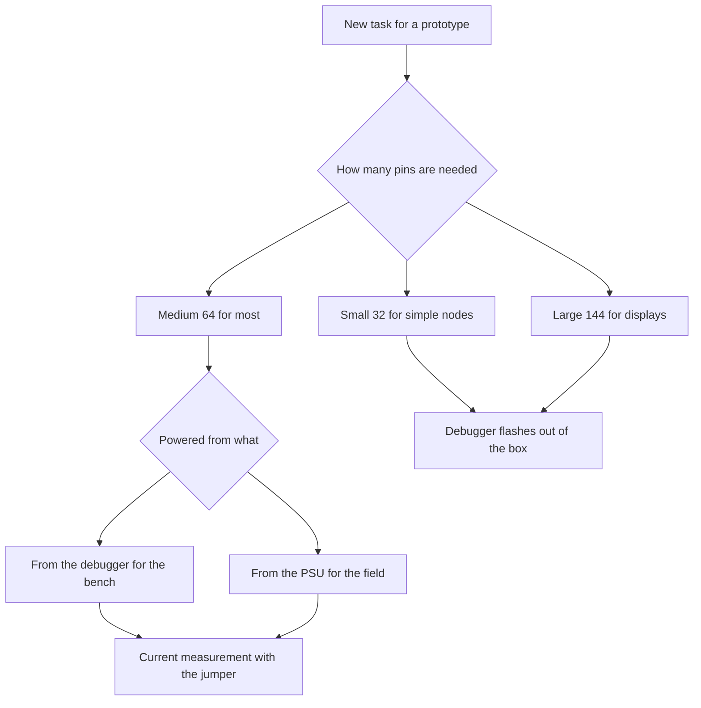

# Nucleo - development board with integrated ST-Link and Arduino headers

![[assets/img/stm32-nucleo-board-scheme.png|600]]
*Fig. Nucleo board: built-in debugger, expansion headers and power jumpers.*

> [!tip] Note purpose
> Explain why this line is the main one to start with: the debugger is already on the board, the virtual port works out of the box and extension modules are compatible.

## 1. Purpose

The line covers learning and prototypes without buying a programmer. The built-in debugger flashes its own controller and external boards over wires. The virtual port gives a console over the same cable.

Three sizes give a choice: small for compact nodes, medium for most tasks, large for processors with many pins. Compatibility with extension modules opens access to ready shields.

Current measurement over a jumper teaches you to estimate consumption. Pin headers with controller signals give access to all interfaces.

## 2. Line of three sizes

| Format | Example controller | Pins | When to take |
| --- | --- | --- | --- |
| Small 32 | F031, F042, G431 | 32 | Compact nodes and basic learning |
| Medium 64 | F103, F401, G474, L476 | 64 | General for most projects |
| Large 144 | F429, F746, H743 | 144 | Displays, network and interface reserve |

```text
Компонування середньої плати:
  +------------------------------------------+
  | [USB дебагер]  [Кнопка RESET чорна]      |
  | [Кнопка USER синя] [LED зелений LD2]     |
  |                                          |
  |  Контролер по центру                     |
  |  Кварц і кнопка користувача поруч        |
  |                                          |
  |  Морфо-гребінки ліва і права             |
  |  Гребінки під щити зверху і знизу        |
  |  Перемичка виміру струму IDD             |
  +------------------------------------------+
```

## 3. Built-in debugger

| Feature | How it works | Purpose |
| --- | --- | --- |
| Flashing own | Over cable out of the box | Start without purchases |
| Flashing external | Output signals on the header | Flashes simple boards nearby |
| Virtual port | Bridge to the serial port | Console without converter |
| Update | Separate flashing utility | Fixes old versions |
| Power | From the debugger connector | Powers weak breadboards |

The debugger also flashes external boards: remove the jumpers, connect three signal wires and ground. This saves you when a simple board without a debugger lies nearby.

## 4. Power jumpers

| Marking | Purpose | Position |
| --- | --- | --- |
| JP5 | Current measurement | Removed for the ammeter |
| U5V | Power from the debugger | Closed by default |
| E5V | External 5 V | Closed with a power PSU |
| VIN | 7-12 V input | Over the board regulator |

A typical error is power from two sources at the same time. The rule is one source for one board. Current measurement means removing the jumper and switching the ammeter into the break.

```text
Варіанти живлення однієї плати:
  Від дебагера ........ U5V замкнута, E5V розімкнута
  Від блока 5V ........ E5V замкнута, кабель дебагера тільки дані
  Від VIN 7-12V ....... VIN вхід, перемички за схемою плати
  Вимір струму ........ JP5 знята, амперметр у розрив
```

## 5. Expansion headers

| Header | What is routed | Compatibility |
| --- | --- | --- |
| Morpho left | Power and analog | All controller signals |
| Morpho right | Digital and interfaces | Direct access without shields |
| Shields top | 5 V and 3.3 V power | Extension modules |
| Shields bottom | Serial and two-wire | Sensors as ready packages |

Shield compatibility gives display, network and motors without soldering. Morpho headers give clean signals for the oscilloscope and the logic analyzer.

## 6. Choosing a board for the task

| Task | Which to take | Why |
| --- | --- | --- |
| Basic learning | Small 32 with a simple chip | Cheap and enough |
| General | Medium 64 with reserve | Most examples target it |
| Display and graphics | Large 144 with display controller | Bus and memory for frames |
| Low consumption | Variant with letter L | Sleep modes and current measurement |
| Sound and motors | Variant with F4 or G4 | Speed and accurate timers |
| Wired network | Large with network interface | Physical layer on the board |

## 7. First project step by step

```text
Старт за десять хвилин:
  1. Постав перемичку живлення U5V.
  2. З'єднай кабелем роз'єм дебагера і комп'ютер.
  3. Відкрий графічний конфігуратор і вибери свою плату.
  4. Увімкни тактування від кварца і зелений світлодіод.
  5. Згенеруй код і натисни збірку.
  6. Натисни прошивку і дивись миготіння.
  7. Відкрий термінал віртуального порту для повідомлень.
```

```c
#include "stm32f4xx_hal.h"

extern UART_HandleTypeDef huart2;

void nucleo_hello(void)
{
  const char *msg = "Nucleo жива\r\n";
  HAL_UART_Transmit(&huart2, (uint8_t *)msg, 14, 500);
}

int main(void)
{
  HAL_Init();
  SystemClock_Config();
  MX_GPIO_Init();
  MX_USART2_UART_Init();
  nucleo_hello();
  while (1)
  {
    HAL_GPIO_TogglePin(GPIOA, GPIO_PIN_5);
    HAL_Delay(500);
  }
}
```

The green LED on most boards hangs on the PA5 line. The user button on PC13 gives an input for pauses and menus.

```c
#include "stm32f4xx_hal.h"

int nucleo_button_pressed(void)
{
  return HAL_GPIO_ReadPin(GPIOC, GPIO_PIN_13) == GPIO_PIN_RESET;
}

void nucleo_wait_button(void)
{
  while (!nucleo_button_pressed())
  {
    HAL_Delay(20);
  }
  HAL_Delay(50);
}
```

## 8. Measuring current via the jumper

| Step | Action | Expectation |
| --- | --- | --- |
| 1 | Remove the measurement jumper | Power rail break |
| 2 | Ammeter into the break | Milliamp range |
| 3 | Firmware with sleep cycles | Current drops in pauses |
| 4 | Record three values | Run, sleep, idle |

Measurement teaches you to see the price of megahertz: halving the frequency cuts consumption visibly. Sleep modes give microamps between measurements.

## 9. Mermaid: choosing the board



## 10. External flashing via the debugger

```text
Шиємо просту плату дебагером цієї:
  Дебагер Nucleo       Проста плата
  ----------------     ----------------
  SWCLK -------------- SWCLK
  SWDIO -------------- SWDIO
  GND ---------------- GND
  3V3 ---------------- 3V3 (якщо слабка)
  Крок: зняти перемички дебагера на цій платі!
```

## Common issues

| Symptom | Cause | Fix |
| --- | --- | --- |
| Two power sources together | Opposing regulators heat up | One source and correct jumpers |
| Old debugger firmware | Breaks and unknown device | Update with the utility before work |
| Shield with 5 V logic | Input overload | Dividers or level shifters |
| Current measurement without a break | Ammeter in parallel gives a short | Only in the break of the removed jumper |
| Confusing the header numbers | Mirrored signal names | Check the schematic of your own revision |
| Console does not see the port | Forgotten debugger bridge | Check the port after cable connection |

## Official sources

- [Mid-format board manual (ST)](https://www.st.com/resource/en/user_manual/um1724-stm32-nucleo64-boards-mb1136-stmicroelectronics.pdf) - jumpers, power and debugger.
- [Small board manual (ST)](https://www.st.com/resource/en/user_manual/um1956-stm32-nucleo32-boards-based-on-32pin-stm32-mcus-stmicroelectronics.pdf) - compact format and limits.
- [Debugger firmware update (ST)](https://www.st.com/en/development-tools/stsw-link007.html) - update utility and drivers.

## See also

- [[Home.en]]
- [[EN/00-Start/04-Dev-Boards.en|board overview]]
- [[EN/09-Firmware/01-CubeIDE-CubeMX.en|CubeMX setup]]
- [[EN/09-Firmware/03-ST-Link-Flashing.en|flashing via ST-Link]]
- [[EN/14-Devboards/01-Blue-Pill.en|Blue Pill board]]
