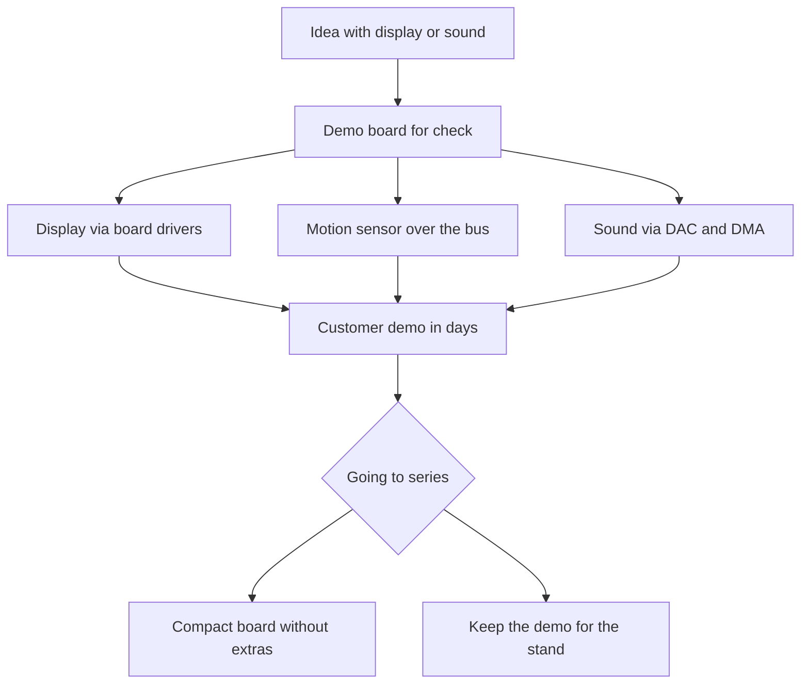

# Discovery - evaluation board with LCD, audio and USB

![[assets/img/stm32-discovery-board-scheme.png|600]]
*Fig. Discovery board: display, motion sensors, audio path and input buttons.*

> [!tip] Note purpose
> Show when to take a demo board instead of a general one: you need a display, sound or sensors out of the box for a quick idea check.

## 1. Purpose

A demo board is a showcase of controller features: display, motion sensors, microphones, audio path and buttons are already soldered. The idea is checked without breadboard wires and module hunting.

Factory firmware shows graphics, sound and sensors in action right away. The board driver package gives simple calls for the display and sound. Manufacturer examples open each node separately.

For series the board is too large and expensive, but for a prototype it saves weeks. After the idea check the project moves to a compact board.

## 2. What is on the board

| Block | Example | Purpose |
| --- | --- | --- |
| Display | Color with touch | Graphics and menus without modules |
| Motion sensor | Accelerometer and gyroscope | Gestures and tilt |
| Microphones | Digital with interface | Voice and noise level |
| Audio path | DAC and amplifier | Melodies and signals |
| Buttons | Reset and user | Input without wires |
| Debugger | Built-in with virtual port | Flashing out of the box |
| Memory | External flash for frames | Pictures and fonts |

```text
Компонування демо-плати:
  +------------------------------------------+
  | [USB дебагер]  [USB користувача]        |
  |                                          |
  |  +------------------------------------+  |
  |  |   Дисплей кольоровий з сенсором  |  |
  |  +------------------------------------+  |
  |                                          |
  |  Контролер + зовнішня флеш поруч         |
  |  Датчик руху + мікрофони з краю          |
  |  ЦАП звук + кнопки знизу                 |
  |  Гребінки розширення по боках            |
  +------------------------------------------+
```

## 3. Popular variants

| Board | Controller | Display | Trick |
| --- | --- | --- | --- |
| F4 classic | F407 or F429 | Color | Cheap and tons of examples |
| F7 fast | F746 or F769 | Large with touch | Fast graphics and cache |
| H7 flagship | H743 or H747 | High resolution | Reserve for complex interfaces |
| L4 thrifty | L476 | Small | Low consumption with display |

Choice depends on the task: even the classic pulls sound, smooth graphics asks for the fast one, complex logic with network asks for the flagship.

## 4. Factory firmware

| Step | Action | Result |
| --- | --- | --- |
| 1 | Power from cable | Display lights with menu |
| 2 | Touch scrolling | Demo pages |
| 3 | Board tilt | Ball or arrow moves |
| 4 | User button | Mode change |
| 5 | Headphone connection | Audio examples |

It is worth saving the demo as a separate file before your own firmware. A dumped image lets you bring the showcase back for display. The utility reads the image over the debugger.

## 5. Board driver package

| Call | What it does | When handy |
| --- | --- | --- |
| Display init | Sets up the bus and backlight | Graphics start in one line |
| Display clear | Fill with color | New menu frame |
| Text output | Font at coordinates | Labels and values |
| Circle drawing | Primitive for indicators | Arrows and scales |
| Sound start | Sets up DAC and DMA | Melodies without crackle |
| Sensor read | Polls motion over the bus | Gestures every 20 ms |

Board drivers lie separately from the controller abstraction layer. They know the chip addresses and the routing of this exact board. Moving to your own board demands your own addresses and pins.

```text
Шари коду для демо-плати:
  Твій код (меню, гра, виміри)
  -----------------------------
  Драйвери плати (екран, звук, датчики)
  -----------------------------
  Рівень абстракції (шина, таймер, DMA)
  -----------------------------
  Залізо контролера
```

## 6. When to take it instead of a general board

| Task | Why demo is better | Limit |
| --- | --- | --- |
| Menu check in a day | Display and touch already there | Then build compact |
| Motion sensor in control | Calibrated node on the board | Household accuracy |
| Audio signals | Path with amplifier | Volume for the desk |
| Graphics learning | Examples with frames | Memory for large pictures |
| Customer demo | Beautiful showcase | Price too high for series |

A general board is cheaper and more flexible for series. The demo wins on start speed: unpacked, powered, you see the result.

## 7. Code: display via drivers

```c
#include "stm32f429i_discovery_lcd.h"

void demo_lcd_start(void)
{
  BSP_LCD_Init();
  BSP_LCD_LayerDefaultInit(1, LCD_FRAME_BUFFER);
  BSP_LCD_SelectLayer(1);
  BSP_LCD_Clear(LCD_COLOR_DARKBLUE);
  BSP_LCD_SetFont(&LCD_DEFAULT_FONT);
  BSP_LCD_SetTextColor(LCD_COLOR_WHITE);
  BSP_LCD_DisplayStringAtLine(2, (uint8_t *)"Discovery жива");
}

void demo_lcd_value(int line, int value)
{
  char buf[24];
  sprintf(buf, "Значення: %d", value);
  BSP_LCD_DisplayStringAtLine(line, (uint8_t *)buf);
}

void demo_lcd_circle(uint16_t x, uint16_t y, uint16_t r)
{
  BSP_LCD_SetTextColor(LCD_COLOR_YELLOW);
  BSP_LCD_DrawCircle(x, y, r);
}
```

The frame buffer lives in external memory for large resolutions. A layer lets you draw the menu separately from the background. Fonts hold Cyrillic partly, check with the symbol table.

```c
#include "stm32f429i_discovery_gyroscope.h"
#include "stm32f429i_discovery_audio.h"

void demo_motion_start(void)
{
  BSP_GYRO_Init();
}

void demo_motion_poll(float *gx, float *gy, float *gz)
{
  BSP_GYRO_GetXYZ(gx, gy, gz);
}

void demo_beep(void)
{
  BSP_AUDIO_OUT_Init(OUTPUT_DEVICE_HEADPHONE, 70, 44100);
  BSP_AUDIO_OUT_Play((uint16_t *)tone_buf, TONE_LEN);
  HAL_Delay(200);
  BSP_AUDIO_OUT_Stop(CODEC_PDWN_SW);
}
```

Polling the sensor every 20 ms gives smooth gestures. Sound over direct access does not load the core. Volume 70 is loud for headphones, start with a smaller one.

## 8. Mermaid: from idea to series



## 9. Power and consumption

| Mode | Consumption | Explanation |
| --- | --- | --- |
| Demo with backlight | Hundreds of milliamps | Display eats the most |
| Sound to speaker | Peaks above average | Amplifier asks for current |
| Sleep with display off | Milliamps | Sensors can be put to sleep |
| Power | From the connector | PSU for a stable picture |

For a battery node the display is blanked between shows. The backlight is driven with pulse-width modulation for economy.

## Common issues

| Symptom | Cause | Fix |
| --- | --- | --- |
| Drivers from another revision | Different addresses and white screen | Take the package for your own board |
| Frame in internal memory | Does not fit and crashes | Buffer in external memory |
| Polling the sensor in a loop without pauses | Bus clogged, graphics slow | Timer every 20 ms |
| Volume at maximum at once | Distortion and fright | Start low and add up |
| Moving code to your board unchanged | Addresses and pins differ | Rewrite the board layer for your schematic |
| Erased factory firmware | Nothing to show quickly | Dump the image before your own flashing |

## Official sources

- [Demo board with F429 controller (ST)](https://www.st.com/en/evaluation-tools/32f429idiscovery.html) - schematic, display and examples.
- [Driver package for demo boards (ST)](https://www.st.com/en/embedded-software/stm32cubef4.html) - display, audio and sensor drivers.
- [Demo quick-start manual (ST)](https://www.st.com/resource/en/user_manual/um1670-discovery-kit-with-stm32f429zi-mcu-stmicroelectronics.pdf) - first power-on and modes.

## See also

- [[Home.en]]
- [[EN/14-Devboards/03-Nucleo.en|Nucleo boards]]
- [[EN/01-Hardware/02-F3-F4.en|performance F3 and F4]]
- [[EN/04-Interfaces/02-SPI.en|SPI bus]]
- [[EN/00-Start/04-Dev-Boards.en|board overview]]
