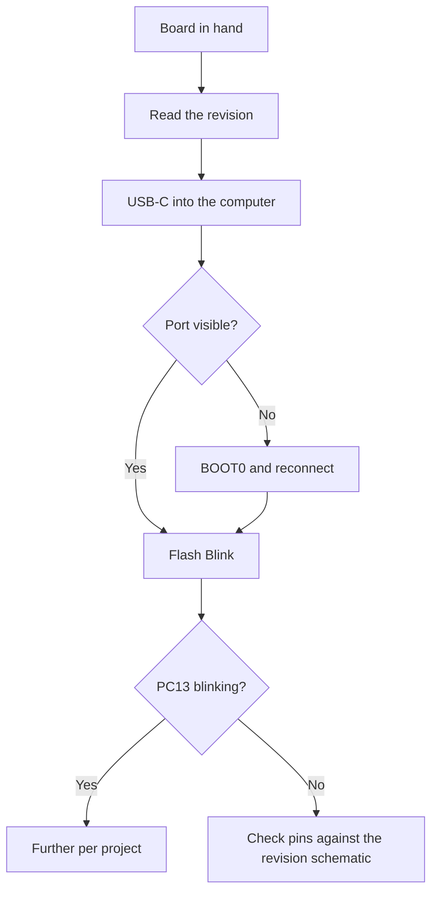

# WeAct - minimal STM32 board with USB-C

![[assets/img/stm32-weact-board-scheme.png|600]]
*Fig. Minimum size, maximum convenience: USB-C, buttons, documentation.*

> [!tip] Note purpose
> Teach how to choose and flash WeAct boards: models, revisions, USB modes and examples.

## 1. Purpose

WeAct Studio makes neat mini boards: Black Pill, MiniF4, separate Mini Debugger. USB-C with data, NRST and BOOT0 buttons on the board, schematics openly available. For prototypes this is a step up from no-name clones: known routing and live examples.

## 2. Model range: what to take

| Board | Chip | Feature | For what |
| --- | --- | --- | --- |
| Black Pill F401 | F401CC | USB-C, FPU | General prototype |
| Black Pill F411 | F411CE | More memory | USB devices, sound |
| MiniF4 F401 | F401CC | Compact | Embedded nodes |
| Mini Debugger | - | ST-Link clone | Flashing bare boards |

## 3. Revisions: check before buying

| Topic | Practice |
| --- | --- |
| Revision number | On the board silkscreen! |
| Changes between revisions | Crystal, LDO, USB routing |
| Examples for the revision | Code from the old one may not match the pins |
| Reviews | Check fresh batches first |

## 4. USB-C: data, not just power

| Mode | How to enable |
| --- | --- |
| CDC VCP | Firmware with USB stack |
| DFU flashing | BOOT0 at connection! |
| Power | USB-C gives more current |

```text
Перша DFU-прошивка без ST-Link:
  затиснути BOOT0, підключити USB;
  залити через DfuSe або dfu-util;
  відпустити, натиснути NRST.
```

## Mermaid: start with WeAct



## 5. WeAct examples: where to get

| Source | What is inside |
| --- | --- |
| GitHub WeAct | Examples for each board |
| Board schematics | PDF with routing |
| Factory demos | USB, display, SD |

## 6. WeAct vs no-name clones

| Criterion | WeAct | Clone |
| --- | --- | --- |
| Schematic | Open | Guess yourself |
| USB-C | With data | Often power only |
| Crystal | Decent | Sometimes remarked |
| Price | Slightly more expensive | Cheaper |

## Common issues

| Symptom | Cause | Fix |
| --- | --- | --- |
| Revision not checked | Pins do not match | Read the silkscreen! |
| Old example | Different routing | Example for your own revision |
| DFU without BOOT0 | No port | Button at connection time |
| Powering motors from the board | LDO dies | Separate PSU! |
| Cheap USB-C cable | Power only | Cable with data lines |
| NRST not wired in code | No reset | Button on the board exists |
| Clone instead of WeAct | Surprises with the crystal | Check with st-info |

## Storage and ESD: small things with a price

| Rule | Explanation |
| --- | --- |
| Antistatic bag | A bare board without it dies in winter |
| Do not put on metal | Short from below |
| Protect the USB-C socket | Mechanically the weakest spot |

## Official sources

- [WeAct GitHub (WeAct Studio)](https://github.com/WeActStudio) - examples, schematics, firmware.
- [MiniF4 product page (WeAct)](https://github.com/WeActStudio/MiniF4-STM32F4x1) - routing and demo.

## Mini Debugger: flashing bare boards

| Topic | Practice |
| --- | --- |
| Connection | SWDIO, SWCLK, GND, NRST to your board |
| Target power | Better separate, not from the debugger! |
| CubeProgrammer | Seen as a regular ST-Link |
| Firmware update | The debugger flashes itself over USB |

## Powering peripherals from the board: limits

| Consumer | Allowed? |
| --- | --- |
| Milliamp sensors | Yes, from the board 3.3 V |
| Small display | Yes, with reserve |
| Relays and motors | No! Separate PSU |
| ESP module nearby | No, WiFi peaks kill the LDO |

```text
Правило струму:
  сума споживачів менше половини LDO;
  гріється палець — вже забагато;
  реле і мотори завжди окремо.
```

## WeAct vs Nucleo: which when

| Task | Choice |
| --- | --- |
| Learning with debug | Nucleo, all out of the box |
| Compact node | WeAct mini |
| Own board later | WeAct as routing reference |
| Current measurement | Only Nucleo with IDD! |

## See also

- [[Home.en]]
- [[EN/14-Devboards/02-Black-Pill.en|Black Pill board]]
- [[EN/14-Devboards/01-Blue-Pill.en|Blue Pill board]]
- [[EN/14-Devboards/03-Nucleo.en|Nucleo boards]]
- [[EN/04-Interfaces/05-USB.en|USB port]]
- [[EN/09-Firmware/03-ST-Link-Flashing.en|flashing via ST-Link]]
