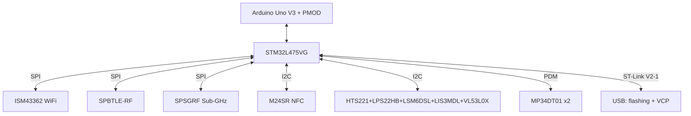
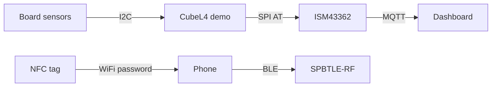

# IoT Discovery - board with BLE, Sub-GHz, NFC and sensors

![[assets/img/stm32-iot-discovery-scheme.png|600]]
*Fig. B-L475E-IOT01A: L475 + WiFi/BLE/Sub-GHz/NFC and a full sensor set - a ready IoT node out of the box.*

> [!tip] What this note is
> One board instead of a breadboard with a dozen modules: WiFi, BLE, Sub-GHz, NFC and six sensors already soldered here. The ideal answer to the question of where to start with STM32+cloud. Base: [[EN/14-Devboards/04-Discovery.en|Discovery line]], [[EN/01-Hardware/05-L0-L4-U5.en|L0/L4/U5 families]].

## 1. Goal

Show the board as a ready IoT node without soldering:

- what is already on board and what each chip is responsible for;
- how to flash the WiFi/BLE demo in 15 minutes;
- where to connect your own sensors (Arduino header, PMOD);
- how long it lives on battery in different modes.

| Block | Chip on board | Purpose |
| --- | --- | --- |
| MCU | STM32L475VG, M4 80 MHz, 1 MB flash | node core |
| WiFi | Inventek ISM43362-M3G-L44 | cloud over SPI |
| BLE | SPBTLE-RF (BlueNRG) | phone, beacons |
| Sub-GHz | SPSGRF-868/915 | long-range radio channel |
| NFC | M24SR, printed antenna | touch pairing |
| Sensors | HTS221, LPS22HB, LSM6DSL, LIS3MDL, VL53L0X, MP34DT01 ×2 | climate, motion, ranging, sound |

## 2. Board architecture



ST-Link V2-1 on the board - flashing over USB without an external programmer, plus a virtual COM port for logs.

## 3. First start

- ST-Link drivers, STM32CubeProgrammer or directly from CubeIDE;
- the `B-L475E-IOT01A/Demonstration` example from STM32CubeL4 - WiFi + sensors + cloud;
- WiFi credentials - via the VCP terminal with demo commands;
- BLE demo - beacon + services, visible in nRF Connect;
- NFC - writing the WiFi password into the tag, the phone reads it by touch.

## 4. On-board sensors in detail

| Sensor | What it measures | Bus |
| --- | --- | --- |
| HTS221 | humidity + temperature | I2C |
| LPS22HB | pressure 260-1260 hPa | I2C |
| LSM6DSL | accelerometer + gyroscope | I2C/SPI, motion interrupt |
| LIS3MDL | 3-axis magnetometer | I2C |
| VL53L0X | ToF ranging | I2C 0x29 |
| MP34DT01 ×2 | sound, PDM | DFSDM/SAI |

This is a ready set for a weather station with a compass and a motion detector - see [[EN/16-Projects/01-Weather-Station.en|weather station]] and [[EN/10-Sensors/14-Mag-Gesture-RTC.en|magnetometers]].

## 5. Working HAL code

Reading the HTS221 (a typical I2C sensor of the board):

```c
float hts_read_temp(void) {
  uint8_t reg = 0x2A | 0x80;
  uint8_t b[2];
  HAL_I2C_Master_Transmit(&hi2c2, 0xBE, &reg, 1, 50);
  HAL_I2C_Master_Receive(&hi2c2, 0xBE, b, 2, 50);
  int16_t raw = (b[1] << 8) | b[0];
  return 42.5f + raw / 480.0f;
}

void iot_sensors_poll(float *t, float *h, float *p) {
  *t = hts_read_temp();
  *h = hts_read_humi();
  *p = lps_read_press() / 100.0f;
}
```

The HTS221 address is 0x5F (shifted 0xBE/0xBF), auto-increment is bit 0x80 in the register address. Calibration coefficients live in the OTP of the HTS221 itself - read once at startup.

## 6. Power and energy consumption

| Mode | Current | Time on 2×AA (2000 mAh) |
| --- | --- | --- |
| Run 80 MHz + WiFi TX | ~120 mA | hours (demo) |
| Run + BLE advertising | ~15 mA | ~5 days |
| Stop 2 + RTC | ~2 uA + sensors | months |
| LSM6DSL motion wake-up | interrupt | years waiting |

For a battery node: Stop 2 between measurements, WiFi - once an hour in a burst, BLE advertising - rarely. Details: [[EN/07-Timers/03-Sleep-Stop-Standby.en|sleep modes]].

## 6.1 Cloud in 15 minutes: data path



Order: flash the demo, edit SSID/password in `wifi_config.h`, watch telemetry in the VCP terminal, only then change it for yourself. The BLE beacon is visible right after start - check with one glance in nRF Connect.

## 7. Expansion

- Arduino Uno V3 - shields for relays, displays, motors;
- PMOD - Digilent modules (BT, display, sensors);
- own sensors - free I2C/SPI/UART on pin headers;
- Sub-GHz antenna - U.FL connector, do not forget the antenna (see [[EN/05-Radio/03-Antenna-50ohm.en|antenna matching]]).

## 8. Common issues

| Symptom | Cause | Fix |
| --- | --- | --- |
| ST-Link does not see the board | ST-Link power jumpers | JP: U5V, reinstall the ST-Link driver |
| WiFi does not connect | 5 GHz network (module is 2.4 only) | 2.4 GHz access point, WPA2, no special chars in password |
| I2C sensors silent | Bus busy with NFC or speed | 100 kHz for start, address scanner |
| BLE does not advertise | Demo without BlueNRG init | BLE_Beacon example from CubeL4 |
| Drains the battery | WiFi never sleeps | Stop 2 + ISM43362 off between sessions |
| NFC does not read | Antenna covered by metal case | Plastic case, tag facing up |

## 9. Related notes

- [[EN/14-Devboards/04-Discovery.en|Discovery line]] - overview of all boards.
- [[EN/14-Devboards/03-Nucleo.en|Nucleo line]] - alternative without radio.
- [[EN/01-Hardware/05-L0-L4-U5.en|L0/L4/U5 families]] - low-power line.
- [[EN/10-Sensors/14-Mag-Gesture-RTC.en|magnetometers and RTC]] - board sensors in detail.
- [[EN/16-Projects/01-Weather-Station.en|weather station]] - first project on the board.

## Official sources

- [B-L475E-IOT01A (STMicroelectronics)](https://www.st.com/en/evaluation-tools/b-l475e-iot01a.html) - features, schematics, Gerber.
- [Disco L475 IoT1 (Zephyr)](https://docs.zephyrproject.org/latest/boards/st/disco_l475_iot1/doc/index.html) - Zephyr support, pin map.
- [STM32CubeL4 (STMicroelectronics, GitHub)](https://github.com/STMicroelectronics/STM32CubeL4) - HAL, B-L475E-IOT01A demos.
