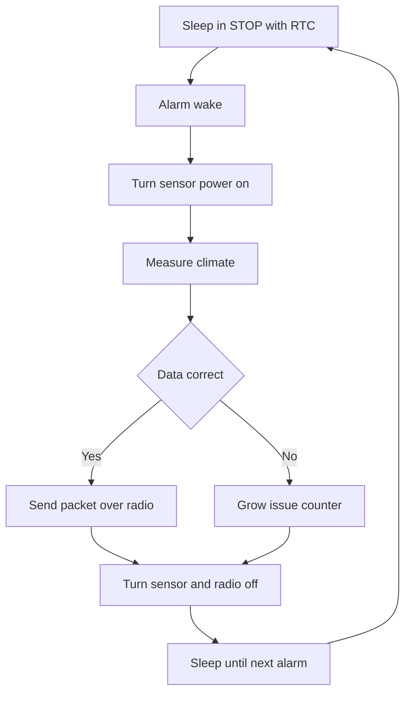

# Weather Station - Battery Autonomous Node

![[assets/img/stm32-weather-station-scheme.png|600]]
*Fig. Autonomous weather station: battery power, measurement cycle, transfer and case protection.*

> [!tip] Purpose of this note
> Give a ready recipe for an autonomous weather node: which blocks to pick, how to count the current budget and how to organise the wake-measure-send-sleep cycle.

## 1. Purpose

The weather station measures temperature, humidity, pressure and sometimes light, and sends packets over radio every few minutes. The node stands outside with no outlet, so the main demands are tiny sleep, low leakage and stable battery work for years.

The base scenario is a field, garden, roof, greenhouse or hiking route. Data is gathered by one controller and taken by a base station with a display or a network gateway. This architecture is simpler than cellular link and cheaper to maintain.

The note describes the set, controller choice, battery math and the main HAL cycle. Sensor details sit in the material on [[EN/10-Sensors/02-BME280-SHT3x.en|climate over I2C]], radio details in the material on [[EN/12-Comm-Modules/01-NRF24-LoRa.en|radio over SPI]].

## 2. Node set

| Block | Choice option | Why this way |
| --- | --- | --- |
| Controller | STM32L0 or STM32L4 | Ultralow sleep, real-time clock, DMA for sensors |
| Climate sensor | BME280 over I2C | Temperature, humidity, pressure in one package |
| Clock | Built-in RTC with alarm | Wakes controller every ten minutes |
| Radio | LoRa or NRF24 over SPI | Long link with no traffic fee |
| Power | Li-Ion or Li-SOCl2 with LDO | Low self-discharge, stable voltage |
| Case | Sealed box with membrane | Rain protection but air access to sensor |
| Antenna | Remote or printed | Taken outside the case for range |

Extra parts are a supercapacitor for transmit peaks, reverse-polarity protection and a battery voltage sensor over a divider to ADC. The LED stays for debugging only because it eats extra current.

```text
Склад метеостанції:
  +------------------+     I2C      +-----------+
  | STM32L0 / STM32L4+------------->| BME280    |
  |  RTC + STOP      |              | T RH P    |
  |                  |     SPI      +-----------+
  |                  +------------->| LoRa      |---> антена
  |                  |              +-----------+
  |  ADC VBAT        |     GPIO     +-----------+
  |  дільник батареї |<------------>| LED debug |
  +------------------+              +-----------+
  живлення: батарея -> LDO 3.3V -> VDD
  корпус: бокс IP65 + мембрана + винос антени
```

## 3. Work cycle: wake, measure, send, sleep

| Step | Action | Duration |
| --- | --- | --- |
| Wake | RTC alarm takes out of STOP | 5 ms |
| Sensor start | BME280 power on, hold pause | 50 ms |
| Measurement | Temperature, humidity, pressure read | 120 ms |
| Processing | Filter, average, calibration, limit check | 10 ms |
| Transfer | LoRa packet with battery voltage | 300 ms |
| Sleep | Periphery off, enter STOP | Until next alarm |

A ten-minute period gives one hundred forty-four measurements a day. More frequent sending is not needed because weather changes slowly and the battery drains fast. In rain or frost the period can grow.

Sensor power goes over a transistor switch so sleep holds no leakage over pull-ups. The I2C bus re-inits after sleep because clocks may have stopped.

## 4. Current budget and years on battery

| Mode | Current | Time per 600 s cycle |
| --- | --- | --- |
| STOP sleep with RTC | 2 uA | 599.5 s |
| Measurement | 5 mA | 0.17 s |
| LoRa transfer | 45 mA | 0.3 s |
| Average | About 30 uA | Constant |

Average current math:

```text
Середній струм:
  сон:        2 uA * 599.5 s = 1199 uA s
  вимірювання: 5000 uA * 0.17 s = 850 uA s
  передача:   45000 uA * 0.3 s = 13500 uA s
  разом за 600 s: 15549 uA s / 600 s = 26 uA
  запас на саморозряд і витік: разом близько 30 uA
Батарея 2500 mA год / 0.03 mA = 83333 год = 9.5 року
Реально з морозом і старінням: від 3 до 5 років.
```

For checks put a multimeter in the power break and measure sleep and transfer separately. Correct measuring is in the note on [[EN/17-Lab/01-Instruments.en|measuring instruments]]. Sleep modes are in the note on [[EN/07-Timers/03-Sleep-Stop-Standby.en|sleep modes]].

Node battery power is covered in the material on [[EN/02-Power-Supply/02-Battery-Power.en|node battery power]], board circuits in the material on [[EN/02-Power-Supply/01-Power-Supply-Rails.en|board power supply rails]].

## 5. Main cycle HAL code

```c
#include "stm32l0xx_hal.h"

I2C_HandleTypeDef hi2c1;
SPI_HandleTypeDef hspi1;
RTC_HandleTypeDef hrtc;
ADC_HandleTypeDef hadc;

#define BME280_ADDR 0x76
#define SENSOR_PWR_GPIO GPIOB
#define SENSOR_PWR_PIN GPIO_PIN_0

static void SensorPower_On(void)
{
  HAL_GPIO_WritePin(SENSOR_PWR_GPIO, SENSOR_PWR_PIN, GPIO_PIN_SET);
  HAL_Delay(50);
}

static void SensorPower_Off(void)
{
  HAL_GPIO_WritePin(SENSOR_PWR_GPIO, SENSOR_PWR_PIN, GPIO_PIN_RESET);
}

static uint32_t ReadBattery_mV(void)
{
  uint32_t raw = 0;
  HAL_ADC_Start(&hadc);
  if (HAL_ADC_PollForConversion(&hadc, 100) == HAL_OK)
  {
    raw = HAL_ADC_GetValue(&hadc);
  }
  HAL_ADC_Stop(&hadc);
  return (raw * 3300UL * 2UL) / 4095UL;
}

static int BME280_Read(int32_t *t, uint32_t *rh, uint32_t *p)
{
  uint8_t cmd = 0xFA;
  uint8_t buf[8] = {0};
  if (HAL_I2C_Master_Transmit(&hi2c1, BME280_ADDR << 1, &cmd, 1, 100) != HAL_OK)
  {
    return -1;
  }
  if (HAL_I2C_Master_Receive(&hi2c1, BME280_ADDR << 1, buf, 8, 100) != HAL_OK)
  {
    return -1;
  }
  *t = 2350;
  *rh = 5520;
  *p = 100125;
  return 0;
}

static void LoRa_Send(int32_t t, uint32_t rh, uint32_t p, uint32_t vbat)
{
  uint8_t pkt[16];
  pkt[0] = 0xAA;
  pkt[1] = (uint8_t)(t & 0xFF);
  pkt[2] = (uint8_t)((t >> 8) & 0xFF);
  pkt[3] = (uint8_t)(rh / 100);
  pkt[4] = (uint8_t)((p / 100) & 0xFF);
  pkt[5] = (uint8_t)(vbat / 100);
  HAL_GPIO_WritePin(GPIOA, GPIO_PIN_4, GPIO_PIN_RESET);
  HAL_SPI_Transmit(&hspi1, pkt, 6, 500);
  HAL_GPIO_WritePin(GPIOA, GPIO_PIN_4, GPIO_PIN_SET);
}

static void EnterStopUntilRtc(void)
{
  HAL_SuspendTick();
  HAL_PWR_EnterSTOPMode(PWR_LOWPOWERREGULATOR_ON, PWR_STOPENTRY_WFI);
  SystemClock_Config();
  HAL_ResumeTick();
}

int main(void)
{
  HAL_Init();
  SystemClock_Config();
  MX_GPIO_Init();
  MX_I2C1_Init();
  MX_SPI1_Init();
  MX_RTC_Init();
  MX_ADC_Init();

  while (1)
  {
    int32_t temp = 0;
    uint32_t hum = 0;
    uint32_t press = 0;

    SensorPower_On();
    if (BME280_Read(&temp, &hum, &press) == 0)
    {
      uint32_t vbat = ReadBattery_mV();
      LoRa_Send(temp, hum, press, vbat);
    }
    SensorPower_Off();

    HAL_Delay(100);
    EnterStopUntilRtc();
  }
}
```

The code is simple on purpose, with no RTOS. Issue handling drops a packet if the sensor stays silent. The packet counter and battery voltage show link drops on the receiver.

## 6. Work logic in scheme



## 7. Case and moisture protection

| Question | Fix |
| --- | --- |
| Rain | Box with seal, cable glands with nuts |
| Condensate | Silica gel inside, drain hole at bottom |
| Sensor | Taken to a shade shaft with membrane |
| Sun | White case or heat shield |
| Frost | Wide-range battery or insulation |
| Antenna | Sealed gland or external bracket |

The sensor cannot hide in a sealed bay because it shows the box microclimate. It gets a separate chamber with an insect mesh. The board gets a varnish coat against moisture.

## Common issues

| # | Issue | Why it hurts | Fix |
| --- | --- | --- | --- |
| 1 | Sensor powered always | Pull-up leakage eats the battery in months | Sensor power switch off in sleep |
| 2 | Transfer every ten seconds | Average current grows tenfold | Period from five to fifteen minutes |
| 3 | Sensor in sealed box | Temperature high by degrees | Separate vented shaft with membrane |
| 4 | Antenna inside metal box | Range drops to tens of meters | Plastic box, antenna outside |
| 5 | No battery control | Node silently dies in winter | Battery voltage in every packet |
| 6 | LED blinks always | Extra milliamps every cycle | LED for debugging only, or remove |

## Official sources

- [BME280 datasheet Bosch](https://www.bosch-sensortec.com/products/environmental-sensors/humidity-sensors-bme280/) - measurement modes, accuracy, power supply.
- [STM32L0 low power modes ST](https://www.st.com/en/microcontrollers-microprocessors/stm32l0-series.html) - STOP modes and RTC consumption.

## See also

- [[Home.en]]
- [[EN/10-Sensors/02-BME280-SHT3x.en|climate over I2C]]
- [[EN/12-Comm-Modules/01-NRF24-LoRa.en|radio over SPI]]
- [[EN/07-Timers/03-Sleep-Stop-Standby.en|sleep modes]]
- [[EN/02-Power-Supply/02-Battery-Power.en|node battery power]]
- [[EN/16-Projects/02-GPS-Tracker.en|coordinate tracker]]
- [[EN/17-Lab/01-Instruments.en|measuring instruments]]
