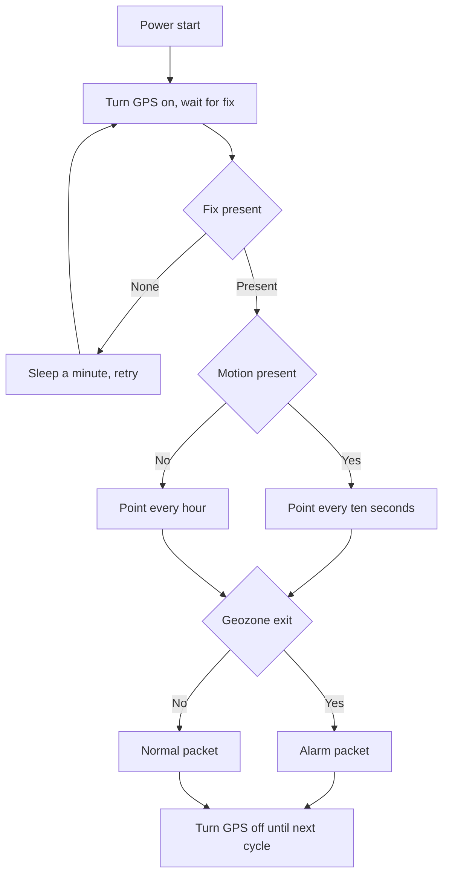

# GPS Tracker - Coordinates and Transfer

![[assets/img/stm32-gps-tracker-scheme.png|600]]
*Fig. Coordinate tracker: satellite receiver, controller, data transfer and power supply with current peaks.*

> [!tip] Purpose of this note
> Show the full tracker cycle: how to take coordinates, how to parse exchange lines, how to save battery and how to send points to the server.

## 1. Purpose

The tracker writes the route of a moving object: bicycle, car, animal, I2C adapter or cargo. It finds coordinates by satellites and sends them over radio or to a cellular network. At rest it sleeps, in motion it writes points often.

The main complexity is power supply. The satellite receiver eats tens of milliamps, and the transmitter takes up to two amps at peak. So battery, capacitors and power limits decide whether the tracker lives a day or a month.

Receiver and modem basics sit in the note on [[EN/12-Comm-Modules/03-GPS-GSM.en|satellites and cellular link]], network-free radio basics in the note on [[EN/12-Comm-Modules/01-NRF24-LoRa.en|radio over SPI]].

## 2. Tracker set

| Block | Choice | Explanation |
| --- | --- | --- |
| Controller | STM32L4 or STM32F4 | UART with DMA is enough for the line stream |
| GPS receiver | Module with UART 9600 or 115200 | Gives exchange lines every second |
| Transfer | GSM modem or LoRa module | City takes cellular, field takes LoRa |
| Battery | Li-Ion 2000 mA hour | Holds transmitter peaks |
| Capacitor | 1000 uF near modem | Smooths peaks to two amps |
| Accelerometer | Optional over I2C | Wakes tracker at motion start |
| Case | Plastic with no metal over antenna | Metal closes the sky and kills signal |

The receiver antenna must look at the sky. In a car the tracker goes under glass, not under a metal roof. An external antenna goes to the roof over a short cable.

```text
Склад трекера:
  +--------+   UART 9600   +-----------+
  | GPS    +-------------->| STM32     |
  | антена |   NMEA потік  | UART + DMA|
  +--------+               +-----+-----+
                                 | UART / SPI
                           +-----+-----+
                           | GSM / LoRa|
                           | антена    |
                           +-----------+
  живлення: Li-Ion -> 4.0V -> модем безпосередньо
                 \-> LDO 3.3V -> STM32 + GPS
  конденсатор 1000 uF біля живлення модема
```

## 3. Exchange lines and coordinate parsing

The receiver sends text lines every second. The best known types are position and speed. Stream example:

```text
Потік приймача:
  $GPRMC,123519,A,4807.038,N,01131.000,E,022.4,084.4,230394,003.1,W*6A
  $GPGGA,123519,4807.038,N,01131.000,E,1,08,0.9,545.4,M,46.9,M,,*47
  $GPGSV,2,1,08,01,40,083,46,02,17,308,41,12,07,344,39,14,11,292,42*70
Розбір:
  RMC дає час статус широту довготу швидкість дату
  GGA дає висоту кількість супутників точність
  GSV дає список супутників і рівень сигналу
```

| Field | From | How to read |
| --- | --- | --- |
| Latitude | RMC or GGA | Degrees and minutes recalculated to decimal |
| Longitude | RMC or GGA | Same with hemisphere |
| Speed | RMC knots | Multiply by factor for km per hour |
| Time | RMC UTC | Add zone and summer time on server |
| Validity | Status field A or V | V means no fix, ignore the point |
| Checksum | After star | Recalculate XOR and compare |

Parsing runs char by char in the DMA interrupt with a ring buffer. Whole lines are found by line start and end chars. Long lines with a mismatched checksum are dropped.

## 4. Modes: tracking, sleep, geozones

| Mode | When | What it does |
| --- | --- | --- |
| Tracking | Motion present | GPS on, point every ten seconds |
| Eco tracking | Slow motion | Point every minute, no GSM between points |
| Sleep | Stands long | All asleep, accelerometer or timer wakes |
| Geozone | Around base | Circle exit check and alarm |
| Alarm | SOS button | Instant coordinate send out of turn |

A geozone is a circle with centre and radius. The controller counts distance with a sphere formula and compares to radius. Leaving the circle builds a separate alarm packet.

For sleep GPS power goes off over a switch because even standby takes milliamps. An RTC alarm every hour gives a control point that the object stays put.

## 5. Power supply and two-amp peaks

| Node | Current | Demand |
| --- | --- | --- |
| STM32 sleep | 2 uA | STOP with RTC |
| STM32 work | 20 mA | Line processing |
| GPS search | 35 mA | Until fix |
| GPS tracking | 25 mA | When fix present |
| GSM registration | 300 mA average | Peaks to 2000 mA |
| LoRa transfer | 45 mA | Short packet |

A lab power supply with a current limit shows the dip if the capacitor is small. Correct power is in the note on [[EN/02-Power-Supply/01-Power-Supply-Rails.en|board power supply rails]], batteries in the note on [[EN/02-Power-Supply/02-Battery-Power.en|node battery power]].

```text
Живлення трекера:
  Li-Ion 3.7V --+--> DC-DC 4.0V --> GSM VCC + 1000 uF
                |
                +--> LDO 3.3V --> STM32 VDD
                              -> GPS VCC через ключ
                              -> акселерометр
  земля: широка доріжка або полігон без розривів
  вимірювання: шунт або кліщі для піків передачі
```

Flashing over the debugger is in the material on [[EN/09-Firmware/03-ST-Link-Flashing.en|flashing over ST-Link]], current measuring in the material on [[EN/17-Lab/01-Instruments.en|measuring instruments]].

## 6. Tracker HAL code

```c
#include "stm32f4xx_hal.h"
#include <string.h>
#include <stdlib.h>

UART_HandleTypeDef huart1;
UART_HandleTypeDef huart2;
RTC_HandleTypeDef hrtc;

#define GPS_BUF_LEN 256
uint8_t gps_dma_buf[GPS_BUF_LEN];
char line_buf[128];
uint8_t line_len = 0;

typedef struct
{
  double lat;
  double lon;
  float speed_kmh;
  uint8_t valid;
} GpsFix_t;

static uint8_t NmeaCrc(const char *s)
{
  uint8_t crc = 0;
  while (*s && *s != '*')
  {
    crc ^= (uint8_t)(*s);
    s++;
  }
  return crc;
}

static double NmeaToDeg(const char *f, char hemi)
{
  double v = atof(f);
  int deg = (int)(v / 100.0);
  double min = v - deg * 100.0;
  double res = deg + min / 60.0;
  if (hemi == 'S' || hemi == 'W')
  {
    res = -res;
  }
  return res;
}

static int ParseRMC(char *line, GpsFix_t *fix)
{
  char *tok = NULL;
  char *save = NULL;
  if (strncmp(line, "$GPRMC", 6) != 0 && strncmp(line, "$GNRMC", 6) != 0)
  {
    return -1;
  }
  char *star = strchr(line, '*');
  if (star == NULL)
  {
    return -1;
  }
  uint8_t calc = 0;
  for (char *p = line + 1; p < star; p++)
  {
    calc ^= (uint8_t)(*p);
  }
  uint8_t recv = (uint8_t)strtoul(star + 1, NULL, 16);
  if (calc != recv)
  {
    return -1;
  }
  tok = strtok_r(line, ",", &save);
  int idx = 0;
  char *lat_s = NULL;
  char *lat_h = NULL;
  char *lon_s = NULL;
  char *lon_h = NULL;
  char *stat = NULL;
  char *spd = NULL;
  while (tok != NULL)
  {
    if (idx == 2) stat = tok;
    if (idx == 3) lat_s = tok;
    if (idx == 4) lat_h = tok;
    if (idx == 5) lon_s = tok;
    if (idx == 6) lon_h = tok;
    if (idx == 7) spd = tok;
    tok = strtok_r(NULL, ",", &save);
    idx++;
  }
  if (stat == NULL || stat[0] != 'A')
  {
    fix->valid = 0;
    return -1;
  }
  fix->lat = NmeaToDeg(lat_s, lat_h[0]);
  fix->lon = NmeaToDeg(lon_s, lon_h[0]);
  fix->speed_kmh = (float)(atof(spd) * 1.852);
  fix->valid = 1;
  return 0;
}

void GpsByte_Handler(uint8_t b)
{
  if (b == '\n')
  {
    line_buf[line_len] = 0;
    GpsFix_t fix = {0};
    if (ParseRMC(line_buf, &fix) == 0)
    {
      Tracker_OnFix(&fix);
    }
    line_len = 0;
  }
  else if (b != '\r')
  {
    if (line_len < (sizeof(line_buf) - 1))
    {
      line_buf[line_len++] = (char)b;
    }
    else
    {
      line_len = 0;
    }
  }
}

void Tracker_OnFix(GpsFix_t *fix)
{
  static double base_lat = 48.45;
  static double base_lon = 35.05;
  double dlat = fix->lat - base_lat;
  double dlon = fix->lon - base_lon;
  double dist_m = 111320.0 * sqrt(dlat * dlat + dlon * dlon);
  if (dist_m > 500.0)
  {
    Modem_SendAlarm(fix);
  }
  else
  {
    Modem_SendPoint(fix);
  }
}
```

Reception over DMA with line idle gives whole lines with no losses. Parsing uses no dynamic memory, so it fits long work with no reboots.

## 7. Work logic in scheme



## 8. Field debugging

| Step | Action |
| --- | --- |
| Sky check | Go to open space, wait for fix up to five minutes |
| Line control | Print stream to terminal, look at status and sums |
| Peak check | Oscilloscope on modem power, hunt the dip |
| Geozone test | Walk around the base with tracker in pocket |
| Sleep test | Measure rest current, must be microamps |

The first start runs from a lab unit with a limit to see real peaks. Experiment boards are handy from the [[EN/14-Devboards/03-Nucleo.en|Nucleo boards]] family.

## Common issues

| # | Issue | Why it hurts | Fix |
| --- | --- | --- | --- |
| 1 | Antenna under metal | No satellites in view, no fix for hours | Antenna to sky, plastic case |
| 2 | Status field ignored | False zero points recorded | Check status and satellite count |
| 3 | No capacitor near modem | Dip and reboot at transfer | 1000 uF and wide power traces |
| 4 | GPS powered in sleep | Tens of milliamps eat the battery in a day | Power switch cuts GPS fully |
| 5 | Parsing with no checksum | Broken lines jump the route | Check sum after star |
| 6 | Point every second over GSM | Tariff and battery melt before eyes | Adaptive period by motion |

## Official sources

- [NMEA 0183 interface standard NMEA](https://www.nmea.org/content/STANDARDS/NMEA_0183_Standard) - line format, checksums, sentence types.
- [STM32 UART DMA reception ST](https://www.st.com/en/microcontrollers-microprocessors/stm32f4-series.html) - DMA reception with line idle.

## See also

- [[Home.en]]
- [[EN/12-Comm-Modules/03-GPS-GSM.en|satellites and cellular link]]
- [[EN/12-Comm-Modules/01-NRF24-LoRa.en|radio over SPI]]
- [[EN/02-Power-Supply/02-Battery-Power.en|node battery power]]
- [[EN/07-Timers/03-Sleep-Stop-Standby.en|sleep modes]]
- [[EN/16-Projects/01-Weather-Station.en|weather node]]
- [[EN/17-Lab/02-PCB-Board.en|board design]]
