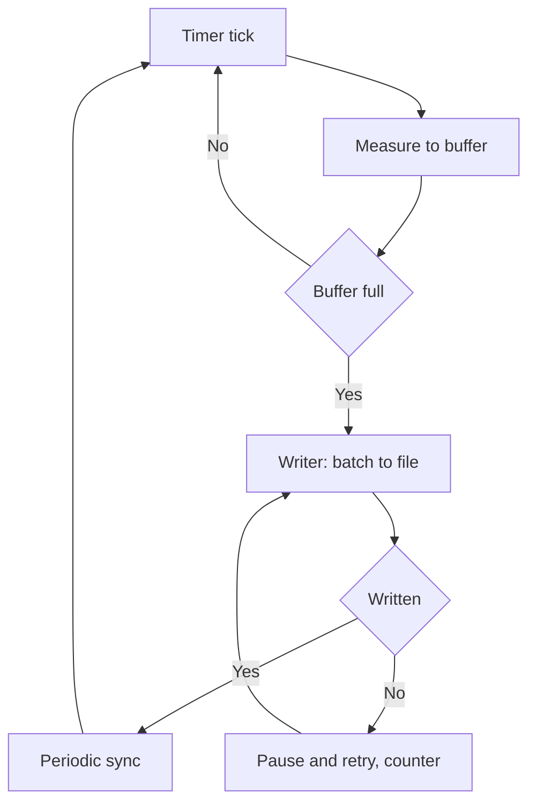

# USB Logger - Timestamped Data Recording

![[assets/img/stm32-usb-logger-scheme.png|600]]
*Fig. Flow: measure, buffer, file, view.*

> [!tip] Purpose of this note
> Teach writing a logger that never loses data: the buffer outlives the flash, time exact, files readable.

## 1. Purpose

The logger sits on the object for weeks and writes measurements with exact time. Then the stick is taken and parsed. Main enemies: slow flash, power fault mid-write and a lying clock. Correct architecture survives all three.

## Logger architecture

| Layer | Role |
| --- | --- |
| Timer measurement | Even intervals, jitter minimum |
| Ring buffer | Survives flash pauses |
| Flash writer | Dumps in batches, never by byte! |
| Battery RTC | Time mark even with no power |
| CDC port | Live view with no stick removal |

```text
Потік:
  таймер будить -> вимір у буфер -> писар пачкою у файл;
  буфер глибше за найдовшу паузу флешки.
```

## Ring buffer: the heart

| Parameter | Rule |
| --- | --- |
| Size | Minimum for a minute of recording! |
| Overflow | Loss counter, not silence |
| Atomicity | Indexes over critical sections |
| Check | Overflow test in development |

```c
// Запис у кільце з ISR таймера:
buf[head] = sample;
head = (head + 1) % BUF_SZ;
if (head == tail) { lost++; tail = (tail + 1) % BUF_SZ; }
```

## Mermaid: write cycle



## Files: format and rotation

| Topic | Practice |
| --- | --- |
| Format | CSV: time and values, readable everywhere |
| File name | Start date, new file daily |
| Rotation | Old ones deleted when full |
| Header | HAT board with version and settings |

## Power supply and faults

| Guard | How |
| --- | --- |
| Dip capacitor | Finish the buffer on drop (PVD!) |
| Sync before sleep | File closed correctly |
| Check at start | Last file whole or torn |
| Two sticks | Critical log duplicated |

## RTC: time with no lies

| Topic | Practice |
| --- | --- |
| VBAT cell | Clock lives with no main power |
| Sync | GPS PPS or by hand at service |
| Drift check | Compare every month |
| Every record marked | A log with no time is trash |

## Common issues

| # | Issue | Why it hurts | Fix |
| --- | --- | --- | --- |
| 1 | Byte writes | Flash dies fast | Batches over buffer! |
| 2 | Small buffer | Losses at pauses | Minimum a minute of recording |
| 3 | No sync | Torn file on fault | Periodic sync |
| 4 | Time with no cell | After reset comes 1970 | VBAT cell! |
| 5 | One file for all | Grows with no bound | Daily rotation |
| 6 | Losses silent | Data holes unseen | Loss counter to log |
| 7 | Stick with no spare | Overwrite kills | Spare and wear-leveling |

## Media: what to pick

| Media | Pros | Cons |
| --- | --- | --- |
| SD card | Removable, large | Connector wears |
| USB stick | Handy to take | Outdoor socket |
| QSPI chip | Reliable, no connectors | Drain over cable needed |

## Official sources

- [FatFs module (ChaN)](http://elm-chan.org/fsw/ff/00index_e.html) - filesystem for microcontrollers.
- [AN4039 RTC calibration (ST)](https://www.st.com/resource/en/application_note/an4039.pdf) - exact clock.

## Live view over CDC

| Command | Answer |
| --- | --- |
| STATUS | State, free space, losses |
| TAIL | Last log lines |
| TIME | Current RTC time |
| SYNC | Forced file sync |

```text
Протокол текстовий:
  команда рядком, відповідь рядками;
  ніяких бінарних чудес — читається терміналом;
  доступ без виймання флешки.
```

## File dump: order

| Step | Action |
| --- | --- |
| 1 | SYNC command - all written |
| 2 | Stop recording for copy time |
| 3 | Copy files over mass storage or CDC |
| 4 | Check copy integrity |
| 5 | Resume recording |

## See also

- [[Home.en]]
- [[EN/16-Projects/03-Energy-Monitor.en|energy metering]]
- [[EN/04-Interfaces/05-USB.en|USB port]]
- [[EN/04-Interfaces/06-SDMMC-QUADSPI.en|memory cards]]
- [[EN/07-Timers/02-LPTIM-RTC-WDT.en|time and watchdog]]
