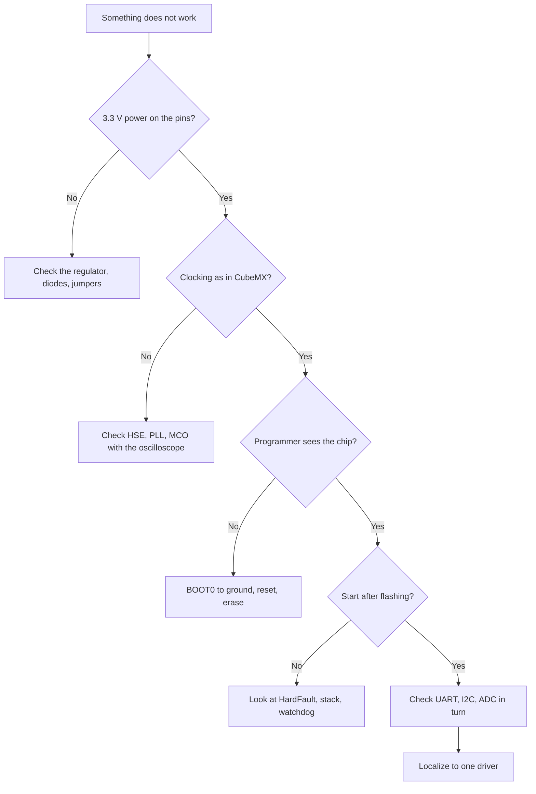
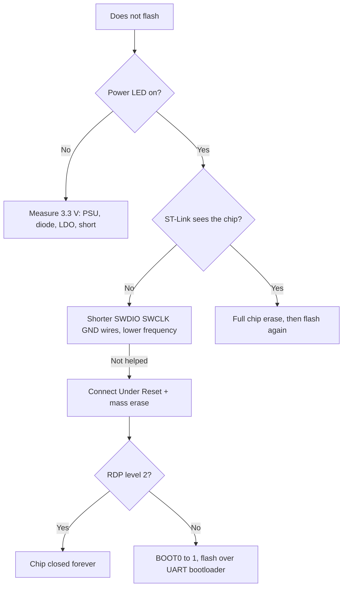
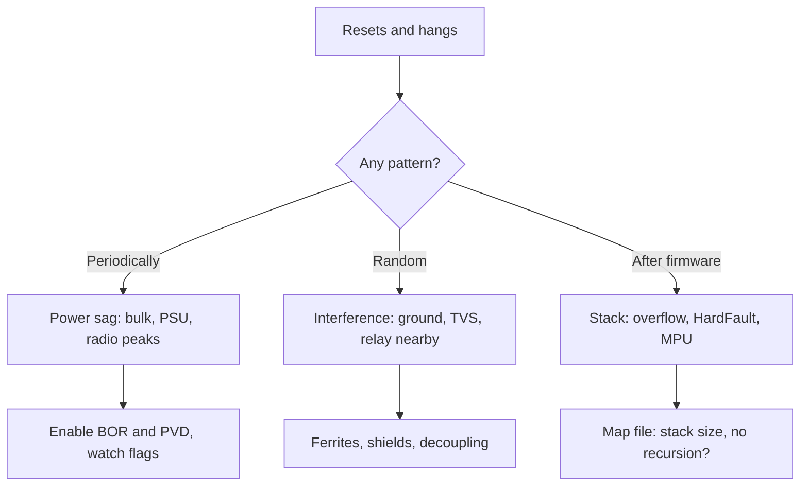
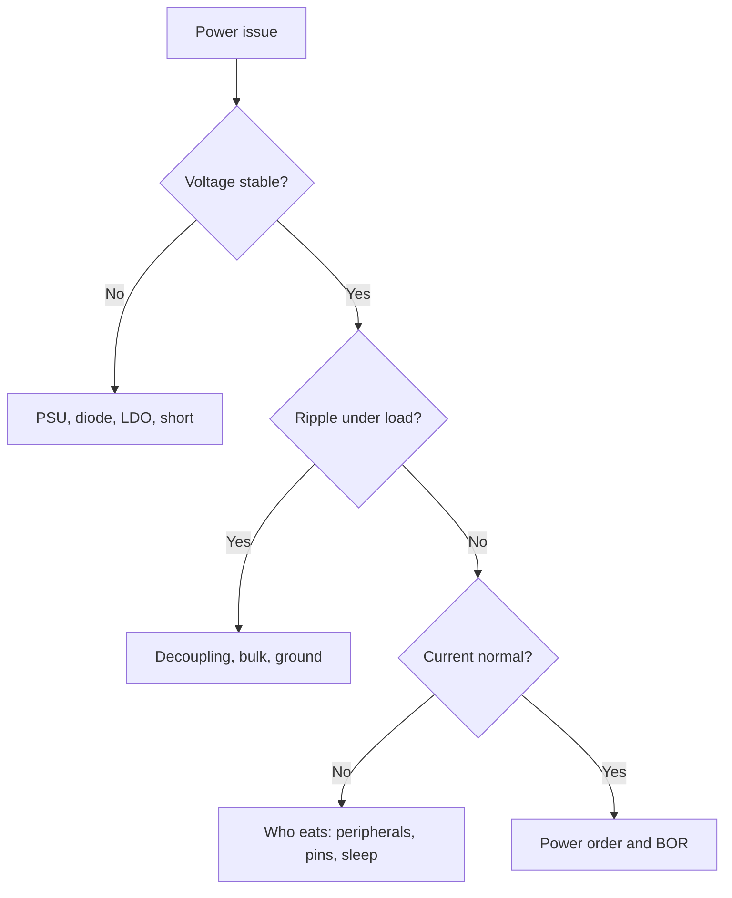

# Troubleshooting - frequently asked questions and answers
![[assets/img/stm32-faq-faq-scheme.png|600]]
*Fig. Fault finding logic: power, clocking, firmware, peripherals, sleep.*

> [!tip] Note purpose
> Collect nine out of ten beginner requests in one table: what we see, what is most often at fault and which reference note to open next.

## 1. The rule is measure, don't guess

The main beginner mistake is changing code at random. The correct order is always the same: power, clocking, reset, firmware, peripherals, program.

| Step | What we measure | With what | Norm |
| --- | --- | --- | --- |
| 1 | Supply voltage on the microcontroller pin | Multimeter | 3.3 V plus minus 0.1 V |
| 2 | Ripple and sag under load | Oscilloscope | Tens of millivolts, no dips |
| 3 | Level on NRST in operation | Multimeter | High level, short reset pulses |
| 4 | Crystal frequency and PLL output | Oscilloscope, MCO output | Matches the setting in CubeMX |
| 5 | Consumption current in run and in sleep | Multimeter, shunt | Milliamps in run, microamps in sleep |
| 6 | Logic levels on the buses | Logic analyzer | Clean edges without steps |

No guess counts without a number on the instrument screen. Write measurements into the debug notebook right away.

For power details, see the note about board power circuits, and for pin modes, see the note about GPIO modes.

## 2. Symptom, cause, where to look

| Symptom | Most frequent cause | Where to look |
| --- | --- | --- |
| Board is not flashed, programmer does not see the chip | No power, SWDIO and SWCLK mixed up, chip in deep sleep | ST-Link note, power section |
| Board flashes but does not start | BOOT0 at high level, forgotten SystemClock, hang in HardFault | CubeMX note, Blue Pill map |
| UART silent, garbage in the terminal | Wrong clock frequency, RX and TX mixed up, different speed | UART note, GPIO modes |
| ADC noisy, codes jump | Dirty analog ground, VDDA without filter, long sensor wires | ADC note, board power |
| Not sleeping, current is milliamps instead of microamps | Floating pins, peripherals not off, debugger holds the core | Sleep modes note |
| Slow, loop runs slowly | Waits in interrupts, float on a core without FPU, high polling rate | Chip comparison, F0 and F1 classic |
| HardFault crashes after code change | Null pointer access, stack overflow, unaligned access | CubeMX note, reference guide |
| I2C device not found by scanner | Missing pull-ups, wrong address, bus stuck after reset | I2C bus note |
| Time drifts, clock runs fast or slow | Internal RC instead of crystal, wrong prescaler, timer overflow | Sleep modes note, timers |
| Regulator or chip heats up | Short circuit, 5 V on a non-tolerant input, output overload | Board power rails |

Row decoding: firmware is described in the note [[09-Firmware/03-ST-Link-Flashing.en | firmware via ST-Link]], project start in [[09-Firmware/01-CubeIDE-CubeMX.en | CubeMX settings]], serial port in [[EN/04-Interfaces/01-UART.en|UART serial port]], sensor bus in [[EN/04-Interfaces/03-I2C.en|I2C bus]], measurement in [[06-Analog/01-ADC.en | measurement via ADC]], sleep in [[07-Timers/03-Sleep-Stop-Standby.en | sleep modes]].

## 3. Does not flash and does not start

| Check | How to do | Success sign |
| --- | --- | --- |
| Power reached the pins | Measure between VDD and VSS right on the package | 3.3 V, stable |
| Programmer connection | SWDIO, SWCLK, GND, NRST, 3.3 V if needed | Short wires up to 20 cm |
| Boot mode | BOOT0 to ground for running from flash | After flashing the board starts by itself |
| Read protection | Try connection under reset, then erase | Memory clears without errors |
| Driver and software | ST-Link Upgrade, latest CubeProgrammer | Programmer visible in the system |
| Board clone | Check crystal marking and soldering | Even soldering without cold joints |

If the chip fell asleep in Stop with SWD off, hold reset while pressing Connect, then do a mass erase right away. See the clone map in [[EN/14-Devboards/01-Blue-Pill.en|Blue Pill board]], power in [[02-Power-Supply/01-Power-Supply-Rails.en | board power rails]], and classic chips in [[EN/01-Hardware/01-F0-F1-Classic.en|classic F0 and F1]].

## 4. UART is silent and I2C is not visible

| Symptom | Cause | Action |
| --- | --- | --- |
| Hieroglyphs in the terminal | Baud calculated from another HCLK frequency | Check clocking, output frequency to MCO |
| Silence in reply | TX and RX mixed up, no common ground | Swap them, connect GND |
| Works only at low speed | Long wires, line capacitance, weak pull-ups | Shorten the cable, lower the speed |
| I2C scanner finds nothing | No 4.7 kOhm pull-ups to 3.3 V | Add resistors, check sensor power |
| Bus hangs after an error | Follower holds SDA at zero | Nine pulses on SCL, then bus reset |
| Wrong address | Shift by the read-write bit | Run the scanner from 0x08 to 0x77 |

Detailed pin modes are described in [[03-GPIO/01-GPIO-Modes.en | GPIO modes]], and start navigation in [[EN/00-Start/01-How-to-Use-Guide.en|reference guide]].

## 5. ADC is noisy and time drifts

| Issue | What to check | Norm |
| --- | --- | --- |
| ADC low bits jump | VDDA filter, capacitors near pins | 100 nF plus 1 uF right at the package |
| Systematic offset | Calibration, reference, divider | Calibrate after each gain change |
| Digital noise pickup | Analog ground routing, polling in the pause | Measure in a silent moment, average 16 samples |
| Timer runs fast | HSI source instead of HSE | 8 MHz crystal for accurate intervals |
| Periodic freezing | 16-bit counter overflow | Move to 32 bits or count overflows |
| Real-time clock drift | 32 kHz crystal load | Capacitors per datasheet |

The basic measurement theory is covered by [[06-Analog/01-ADC.en | measurement via ADC]], and sensor power by [[02-Power-Supply/01-Power-Supply-Rails.en | board power rails]].

## 6. A minimal example to reproduce the bug

Do not send the whole project. Cut ten lines where the bug is visible without your hardware.

```text
Мінімальний повтор:
1. Новий проєкт CubeMX, тільки HSE 8 МГц, UART1 115200.
2. У main лише Blink світлодіодом 1 Гц.
3. Додаєш ОДИН підозрілий рядок: виклик драйвера, переривання, DMA.
4. Якщо зламалось: це і є повтор. Якщо ні: додаєш наступний рядок.
5. Фіксуєш: частота HCLK, версія HAL, що на осцилографі, що в логах.
```

| Report field | Example of filling |
| --- | --- |
| Board and chip | Home-made on F103C8, 3.3 V power |
| Clocking | HSE 8 MHz, PLL to 72 MHz, MCO checked |
| What did you expect? | UART answers every second |
| What did you get? | Silence, constant one on TX |
| What was already measured? | TX with oscilloscope, ground, speed 115200 |
| Minimal code | Archive with three files or paste below |

Such a report is analyzed in ten minutes instead of three days of correspondence. See [[EN/00-Start/03-Chip-Comparison.en|chip comparison]] for chip comparison to choose speed.

## 7. Mermaid: fault finding algorithm



Go from top to bottom and do not skip. Ninety percent of bugs close on the first three diamonds.

## 8. Typical mistakes of beginners

| Number | Issue | Result | Correct way |
| --- | --- | --- | --- |
| 1 | Long SWD wires over a breadboard | Random link breaks | Short cable, ground nearby |
| 2 | 5 V on a non-tolerant pin | Input breakdown, heating | See the FT column in the datasheet |
| 3 | Delays in interrupts | Skipped packets, slowdowns | Flag only in the interrupt |
| 4 | Floating pins before sleep | Milliamps instead of microamps | All free pins to analog mode |
| 5 | Trust in clone marking | Less memory, different crystal | Check with the programmer |
| 6 | Capacitor fix at random | Masks the sag | First measure current and ripple |

For the first start of a factory board open [[EN/14-Devboards/03-Nucleo.en|Nucleo boards]] and [[EN/14-Devboards/01-Blue-Pill.en|Blue Pill board]], and for classic chips [[EN/01-Hardware/01-F0-F1-Classic.en|classic F0 and F1]].

## 9. Diagnostic levels: L1, L2, L3

| Level | What we do | Tool | Time |
| --- | --- | --- | --- |
| L1 Quick fix | Power, wires, BOOT0, jumpers | Eyes and multimeter | 5 minutes |
| L2 Software and config | Clocking, NVIC, DMA channels, init bugs | Debugger and log | Hour |
| L3 Depth | Crystals, routing, interference, defects | Oscilloscope and analyzer | Day |

```text
Правило ескалації:
  L1 не дав результату двічі — іди на L2, не крути дроти годину;
  L2 не дав результату — роби мінімальний приклад і міряй залізо (L3).
```

## 10. Decision tree: not flashing



## 11. Decision tree: works unstable



See the full symptom map in [[EN/99-Additions/04-Diagnostic-Map.en | diagnostic map]].

## 12. Power FAQ: sags and ripple

| Symptom | Cause | What to do |
| --- | --- | --- |
| Reset at radio start | Current peak sags the rail | Bulk 10 uF+ near the radio, PSU with reserve |
| ADC ripple in sync with PWM | Shared decoupling | Ferrite and separate capacitors on VDDA |
| Does not start on battery, works from USB | Internal resistance of the cell | Fresh cell, short thick wires |
| LDO heats up | Large drop and current | Calculate dissipation, or buck |
| Dip in the first millisecond | Charge of output capacitors | Soft-start, more bulk at the input |
| Works only with the debugger | Power comes from ST-Link | Check your own power without the debugger |



## 13. Radio FAQ: join failures and bad RSSI

| Symptom | Cause | What to do |
| --- | --- | --- |
| BLE does not advertise | Stack not flashed or FUS old | FUS and stack from one package! |
| Does not connect | UUID missing in advertising | Add services to the package |
| LoRa does not join | Keys or frequency | OTAA keys, region range |
| Packets lost | Weak signal | Antenna, higher SF, gateway higher |
| Server ban | Duty-cycle exceeded | Less frequent packets, lower SF |
| Works on the bench, not in the field | Case and hand | Test in real conditions |

## 14. FAQ on boards: Blue Pill, Black Pill, Nucleo

| Board | Symptom | Cause and fix |
| --- | --- | --- |
| Blue Pill | Does not flash over USB | Power only there! ST-Link or UART |
| Blue Pill | BOOT0 forgotten back | Board hangs in the bootloader - switch it |
| Blue Pill | LDO heats up | Load too large - separate power |
| Blue Pill | Less flash than written | Clone: check st-info |
| Black Pill | DFU not visible | BOOT0 button at USB connection! |
| Black Pill | CDC silent | Descriptors and VCP drivers |
| Nucleo | Does not see the external board | Remove the ST-Link jumpers! |
| Nucleo | Power JP5 wrong | U5V, E5V, VIN - choose yours |
| Nucleo | Current measurement zero | Is the IDD jumper in place? |
| Discovery | White display | BSP init sequence, backlight power |
| Discovery | No sound | I2S and amplifier in shutdown |

## 15. HardFault decoder: we read the cause of the crash

| Register | Bit | Value |
| --- | --- | --- |
| HFSR | FORCED | Another fault escalated - see below |
| HFSR | VECTTBL | Vector table read error |
| CFSR.BFSR | PRECISERR | Precise bus error - address in BFAR! |
| CFSR.BFSR | IMPRECISERR | Imprecise - find the culprit by code |
| CFSR.UFSR | UNDEFINSTR | Unknown instruction - broken code or jump |
| CFSR.UFSR | INVSTATE | ARM mode attempt on Cortex-M |
| CFSR.UFSR | DIVBYZERO | Division by zero (if trap is on) |
| CFSR.MMSR | IACCVIOL | Execution from a forbidden area (MPU!) |
| CFSR.MMSR | DACCVIOL | Access to a forbidden area |

```c
// Мінімальний зловлювач з дампом у консоль:
void HardFault_Handler(void)
{
  print_hex("HFSR", SCB->HFSR);
  print_hex("CFSR", SCB->CFSR);
  print_hex("BFAR", SCB->BFAR);
  print_hex("MMFAR", SCB->MMFAR);
  while (1) { blink_sos(); }
}
```

```text
Розшифровка адреси падіння:
  1. Взяти адресу з BFAR або зі стека (PC на момент fault);
  2. arm-none-eabi-addr2line -e firmware.elf <адреса>;
  3. Отримати файл і рядок винуватця.
Типові винуватці: NULL-вказівник, переповнення стека, читання з вимкненої периферії.
```

## 16. Symptom index: fast entry

| Symptom | Where to look |
| --- | --- |
| ADC noisy | Section 5 of this note, VDDA filter |
| Battery drains fast | Sleep modes, sleep current with ammeter |
| Chip heats up | Short, reversed LDO, firmware with pin conflict |
| Random hangs | Stack, interference, power sag |
| I2C device not visible | Address, pull-ups, stuck bus |
| Does not start after flashing | Clocking, WDG, vector table |
| Not flashing | Tree 10 of this note |
| Works unstable | Tree 11 of this note |
| RTC time drifts | LSE crystal, VBAT, capacitors |
| Radio silent | FUS and stack, antenna, PA power |
| Resets under load | Bulk, BOR, current peaks |
| Garbage in UART | Baud rate, ground, inversion |
| SPI bit shift | CPOL and CPHA on both sides |

## See also

- [[Home.en | Home]]
- [[EN/00-Start/01-How-to-Use-Guide.en|reference guide]]
- [[02-Power-Supply/01-Power-Supply-Rails.en | board power rails]]
- [[EN/04-Interfaces/01-UART.en|UART serial port]]
- [[EN/04-Interfaces/03-I2C.en|I2C bus]]
- [[06-Analog/01-ADC.en | measurement via ADC]]
- [[07-Timers/03-Sleep-Stop-Standby.en | sleep modes]]
- [[09-Firmware/03-ST-Link-Flashing.en | firmware via ST-Link]]
- [[EN/99-Additions/02-Cheklisti.en|checklists]]
- [[EN/99-Additions/03-Datasheet-Links.en|where to get datasheets]]


## Common issues

Common issues are documented in the tables above. Verify power supply, clock, and firmware before changing code.


## Official sources

- STMicroelectronics reference manuals and datasheets
- Official ST-Link documentation
- Arduino / Raspberry Pi official guides
