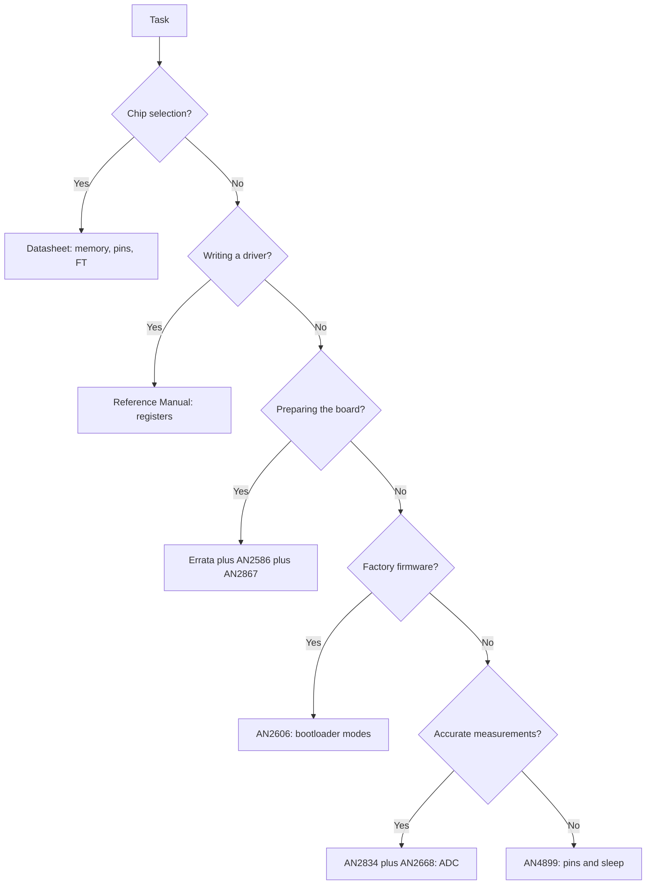

# Datasheets - what to read and where to get them
![[assets/img/stm32-datasheet-links-scheme.png|600]]
*Fig. Pyramid of documents: datasheet, reference manual, programming manual, errata, app notes.*

> [!tip] Note purpose
> Explain which document is responsible for what, where the original source lies and which app notes really exist, so as not to Google garbage.

## 1. Hierarchy of ST documents

| Document | What is inside | When to open |
| --- | --- | --- |
| Data sheet | Pins, packages, memory, 5 V tolerance, currents, temperatures | Chip choice and pin check |
| Reference Manual | Registers, clocking, DMA, interrupts, sleep modes | Driver writing and debugging |
| Programming Manual | Cortex core, interrupt system, instructions, MPU | HardFault, priorities, assembler |
| Errata Sheet | Silicon errors of a specific revision and workarounds | Before the board order and before release |
| Application Note AN | Ready recipes: bootloader, crystals, ADC, USB | When you build a node for the first time |
| Board User Manual | Nucleo schematic, jumpers, on-board ST-Link | First start of a factory board |

One rule: the original source on st.com decides any doubt, not a forum or a retelling.

## 2. Where to download without catching the old

| Source | What to take | Why |
| --- | --- | --- |
| st.com, chip page | Datasheet, Reference Manual, Errata of latest revisions | Always fresh, with date and revision |
| st.com, AN search | App notes in PDF with number and date | No rewritten copies |
| STM32CubeMX | HAL headers and SVD register description | Matches your HAL version |
| STM32CubeProgrammer | Latest flashing algorithms | Old software does not see new chips |
| Project archive | Saved PDFs with download date | In a year you will prove what you routed for |

Never route a board from a datasheet on an unknown mirror. Check the revision number in the footer.

## 3. Key app notes: only real numbers

| Number | Topic | What to take |
| --- | --- | --- |
| AN2606 | System memory boot mode, factory bootloader | Bootloader interface table for each chip |
| AN2586 | Getting started with hardware development | Minimum wiring: power, reset, crystals |
| AN2867 | Oscillator design guide | Crystal choice, load, routing |
| AN2834 | How to get the best ADC accuracy | VDDA, reference, ground, averaging |
| AN2668 | Improving ADC resolution by oversampling | Oversampling and filtering for bits |
| AN4899 | GPIO hardware settings and low-power | Pin settings for sleep and current |
| AN3155 | USART protocol used in bootloader | Flashing protocol over UART |
| AN4879 | USB hardware and PCB guidelines | USB routing, protection, power |
| AN2824 | I2C optimized examples | Polling, interrupt and DMA examples for I2C |
| AN1709 | EMC design guide | Protection against interference and static discharge |

All numbers above exist on st.com. If you see another number in a blog, check it with a search on the manufacturer site.

Reference: bootloader in [[EN/15-Protocols/02-DFU-Bootloader.en|firmware update]], port in [[EN/04-Interfaces/01-UART.en|UART serial port]], bus in [[EN/04-Interfaces/03-I2C.en|I2C bus]], measurement in [[06-Analog/01-ADC.en | measurement via ADC]].

## 4. How to read a datasheet in twenty minutes

| Minute | Section | What we write out |
| --- | --- | --- |
| 0-3 | Ordering information | Exact part number, memory size, package |
| 3-7 | Pinout | Power, NRST, BOOT0, SWD, FT pins |
| 7-12 | Electrical characteristics | Supply range, pin current, temperatures |
| 12-16 | Clock and timing | HSE, LSE, capacitor requirements |
| 16-20 | Package drawings | Footprint and thermal requirements |

Start with the classics [[EN/01-Hardware/01-F0-F1-Classic.en|classic F0 and F1]] and check against [[EN/00-Start/03-Chip-Comparison.en|chip comparison]].

## 5. How to read errata before ordering a board

| Step | Action | Example |
| --- | --- | --- |
| 1 | Find your chip revision | Letters on the package and marking |
| 2 | Open errata for this revision | Date fresher than your datasheet |
| 3 | Walk your peripherals | UART, I2C, ADC, sleep, USB |
| 4 | Write workarounds into code | Flag, reset, delay |
| 5 | Check the effect on the board | Other crystal, filter, pull-up |
| 6 | Save the PDF to the repo | docs folder with the date |

The most expensive mistake is learning about an I2C bug after the production run. An hour with errata is cheaper than rework.

## 6. Mermaid: which document when

Move from top to bottom. Do not open the reference manual until you have closed the package and power question.

## 7. Cheat sheet of reference links

| Reference topic | ST document |
| --- | --- |
| Board power and VDDA | Datasheet plus AN2834 |
| Pin modes and sleep | AN4899 plus Reference Manual GPIO |
| UART bootloader | AN2606 plus AN3155 |
| Sensor bus | AN2824 plus Reference Manual I2C |
| ADC and noise | AN2834 plus AN2668 |
| First board start | Board User Manual plus Nucleo note |
| Flashing with a programmer | ST-Link note plus CubeProg manual |

Also keep [[03-GPIO/01-GPIO-Modes.en | GPIO modes]] and [[09-Firmware/03-ST-Link-Flashing.en | firmware via ST-Link]] nearby for a quick check.

See the first board start in [[EN/14-Devboards/03-Nucleo.en|Nucleo boards]], the clone map in [[EN/14-Devboards/01-Blue-Pill.en|Blue Pill board]], project start in [[09-Firmware/01-CubeIDE-CubeMX.en | CubeMX settings]].

## 8. Typical reading errors

| Number | Issue | Consequence | Correct way |
| --- | --- | --- | --- |
| 1 | Reading an old revision PDF | Pins do not match | Check the date and revision on st.com |
| 2 | Confusing maximum with typical | Overheating and sag | Design by maximum, battery by typical |
| 3 | Ignoring the FT footnote | 5 V burns the input | Check the FT column for each pin |
| 4 | Not opening errata | Silicon bug catches you in series | Read errata before routing |
| 5 | Trusting forum copies | Outdated bootloader tables | Only AN2606 from the manufacturer site |
| 6 | Not saving the PDF | A year later the decision cannot be proved | Dated docs folder in the repo |

To start from zero open [[EN/00-Start/01-How-to-Use-Guide.en|reference guide]] and updates [[EN/15-Protocols/02-DFU-Bootloader.en|firmware update]].

## See also

- [[Home.en | Home]]
- [[EN/00-Start/01-How-to-Use-Guide.en|reference guide]]
- [[EN/01-Hardware/01-F0-F1-Classic.en|classic F0 and F1]]
- [[EN/04-Interfaces/03-I2C.en|I2C bus]]
- [[06-Analog/01-ADC.en | measurement via ADC]]
- [[09-Firmware/03-ST-Link-Flashing.en | firmware via ST-Link]]
- [[EN/14-Devboards/01-Blue-Pill.en|Blue Pill board]]
- [[EN/99-Additions/01-Troubleshooting-FAQ.en|answers to frequently asked questions]]
- [[EN/99-Additions/02-Cheklisti.en|checklists]]

## Common issues

Common issues are documented in the tables above. Verify power supply, clock, and firmware before changing code.

## Official sources

- STMicroelectronics reference manuals and datasheets
- Official ST-Link documentation
- Arduino / Raspberry Pi official guides
